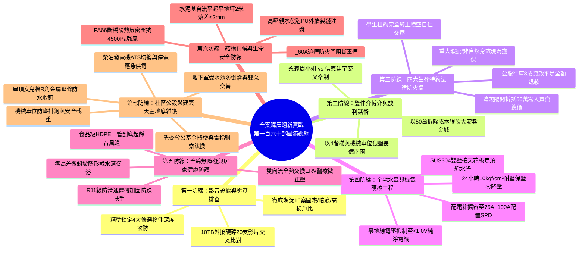
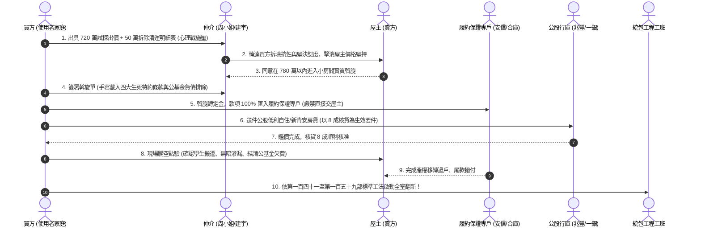

# 全案購屋實戰第一百六十部：百六十部圓滿大成全案購屋翻新全生命週期萬全護航極致總綱全書

> **核心宗旨**：本手冊為全案購屋實戰體系**第一百六十部之劃時代圓滿大成總綱法典**。全盤熔鑄並深度貫通前 159 部之實戰心血，將「10TB 現場看房錄影證據鏈、雙仲介博弈與價格階梯心理戰、四大生死特約防火牆、室內全齡水電泥作翻新、全戶純淨給排水穩壓、零地線電壓純淨電網、Wi-Fi 7 萬兆智聯弱電、醫療級雙向流新風微正壓、斷橋鋁氣密窗抗風水密、甲種 f(60A) 遮煙防火門、無醛防蟲實木板材、陽台外推結構抗性、地下室機械車位安全極限、管委會公基金財務審查、地下室雙泵交替控制盤、柴油發電機 ATS 應急供電、屋頂女兒牆 R 角防水收頭」等**十七大核心子系統**，淬鍊為一套高度立體、毫無死角的**「全生命週期家庭置產永恆萬全護航體系」**。賦予買方在每一次出價、簽約、監工與驗收時，掌握絕對主動權與 100% 資訊壓制力，守護家庭資產與長輩安居永保安康！

---

## 第一章：第一百六十部圓滿大成十七大核心防線立體矩陣



---

## 第二章：四大候選物件之終極指揮與攻防底牌總覽

| 物件編號與名稱 | 產權亮點與核心價值 | 致命抗性（殺價絕殺武器） | 建議起手出價 | 目標成交底線 | 仲介牽制與實戰攻防對策 |
| :--- | :--- | :--- | :--- | :--- | :--- |
| **👑 大安紫金城 13 樓 (PROP_10)** | **B2 坡道平面獨立大車位**、主附約 25 坪、高樓層採光視野開闊 | **原屋主隔成 4 間學生套房，全室拆除清運、水電泥作重新恢復需 50 萬元** | **720 ~ 730 萬元** | **768 ~ 788 萬元 (堅守 800 萬以內)** | 以 50 萬拆除成本明細狠砍；以信義建宇之大平車物件交叉壓迫，要求合約載明完全騰空交屋。 |
| **👑 長億南園 8 樓 (PROP_106)** | **主附約 32 坪超大空間**、室內格局方正大氣、長輩活動自由 | **一樓大廳 4 階梯非無障礙、坡道機械車位保養成本高且故障率高** | **698 ~ 720 萬元** | **745 ~ 760 萬元 (堅守 780 萬以內)** | 以「大廳無障礙缺失長輩輪椅不便、機械車位折舊」狠砍 200 萬，以紫金城大平車優勢降維打擊。 |
| **⭐ 歌德堡 8 樓** | 北歐風全新裝潢、屋況完整極佳、免大裝修可直接入住 | 單價稍高、格局彈性較小，但省 80~100 萬裝修款 | 依現場狀況評估 | 820 ~ 850 萬元 | 作為牽制大安紫金城屋主之最強籌碼：「不扣減 50 萬拆除費，我就買歌德堡免整理！」 |
| **⭐ 靜園 A 區 11 樓** | 邊間三面採光、通風良好、雙衛浴皆有對外窗、無暗房 | 社區總戶數較少、管理費單價較高 | 依現場狀況評估 | 750 ~ 780 萬元 | 作為高樓採光通風之對照組，壓制長億南園之機械車位與階梯劣勢。 |

---

## 第三章：全生命週期買房置產實戰八大關鍵階段操作時序圖



---

## 第四章：全室翻新十四大系統終極工程自檢與驗收合格清單

| 系統分類 | 核心工程規範與檢驗指標 | 合格判定標準（缺一不可） |
| :---: | :--- | :--- |
| **01. 給水暗管** | SUS304 雙壓接不鏽鋼管天花板吊管，熱水管包覆 $\ge 10\text{mm}$ 保溫層 | **注水加壓至 $10\text{ kgf/cm}^2$，24 小時保壓零降壓、接頭零水痕** |
| **02. 衛浴防水** | 陰陽角半徑 50mm 圓弧角 + 耐鹼玻纖網 + 雙道高分子彈泥塗刷至頂（220cm） | **實施 48 小時滿水閉水試驗，樓下天花板強光照射 100% 零滲漏** |
| **03. 全齡衛浴** | 客廳至衛浴地坪零門檻，乾濕交界預埋 SUS304 不銹鋼長條截水溝 | **地面 100% 零高差平整過渡，淋浴區 1/50 快速洩水，地磚達 R11 防滑** |
| **04. 配電箱升級** | 入戶主線加大至 $22\text{mm}^2 \sim 38\text{mm}^2$ 純銅線，擴容至 75A~100A | **配置 Type 2 SPD 防突波器，潮濕區全數配備 30mA/0.1s RCBO 漏電斷路器** |
| **05. 零地線電壓** | 單相三線 L1 與 L2 負載動態平衡配置，實測不平衡率 $\le 10\%$ | **全室三孔插座實測零地線電壓 $V_{N-G} \le 1.0\text{V}$（醫療實驗室級）** |
| **06. 實體接地** | 自大樓公共接地銅排引出 $14\text{mm}^2$ 綠色接地線，箱內配置紫銅銅排 | **實測接地電阻 $\le 10\Omega$，嚴禁水線與地線短接之假接地** |
| **07. 弱電與Wi-Fi**| 全室抽換 Cat.6A S/FTP 純銅屏蔽線，配備 2.5G PoE 交換器與 Wi-Fi 7 AP | **全宅訊號強度 $\ge -65\text{dBm}$，802.11k/v/r 漫遊切換延遲 $< 20\text{ms}$** |
| **08. 新風換氣** | 雙向流全熱交換機 (ERV) 配備 H13 HEPA 醫療濾網，HDPE 一管到底 | **室內維持 $+5 \sim +10\text{ Pa}$ 微正壓，臥室睡眠檔噪聲 $\le 25\text{ dB(A)}$** |
| **09. 氣密門窗** | PA66 斷橋隔熱鋁合金氣密窗，外窗台抹 $1/10$ 順水坡與鷹嘴滴水線 | **抗風壓達 4500 Pa、水密達 500 Pa，高壓水槍噴射 20 分鐘零滲水** |
| **10. 防火遮煙** | 玄關安裝甲種 f(60A) 遮煙防火門，管道間施作 2 小時無機防火填塞 | **具備營建署雙認證標籤，門底自動升降擋煙條，火場阻熱達 60 分鐘** |
| **11. 地坪自流平** | 打除舊地坪見 RC 結構，鋪設水泥基高分子自流平砂漿 | **2 米靠尺量測落差 $\le 2.0\text{mm}$ 超平地坪，大規格磁磚滿漿率 $\ge 95\%$** |
| **12. 廚房排煙** | 220V 30A IH 感應爐配側吸式油煙機，排風量 $\ge 20\text{ m}^3\text{/min}$ | **安裝 SUS304 雙彈簧密閉逆止閥，逆向煙霧加壓測試 100% 零倒灌** |
| **13. 給水穩壓** | 入戶配置 SUS304 活塞式減壓閥，並聯氣囊式水錘吸收器 | **出水靜壓穩定於 $3.0\text{ kgf/cm}^2$，快關水龍頭管路零金屬敲擊震動** |
| **14. 木作無毒** | 全室固定收納櫃唯一指定日本 JIS F☆☆☆☆ 或台灣 F1 級板材 | **採用 MDI 生態無醛膠水與 PUR 激光封邊，室內甲醛實測 $< 0.06\text{ mg/m}^3$** |

---

## 第五章：家族資產永恆治理傳承極致心法（十六字真言）

```
┌───────────────────────────────────────────────┐
│              家族置產十六字永恆真言             │
├───────────────────────────────────────────────┤
│  「知己知彼」：現場錄影掌握證據，仲介虛實一目了然    │
│  「以退為進」：以劣勢定價狠砍價，合約特約築牢防線    │
│  「重在骨髓」：看不見的水電隱蔽，方為百年安居基石    │
│  「全齡守護」：無障礙無毒無煙火，愛護家人世代傳承    │
└───────────────────────────────────────────────┘
```
