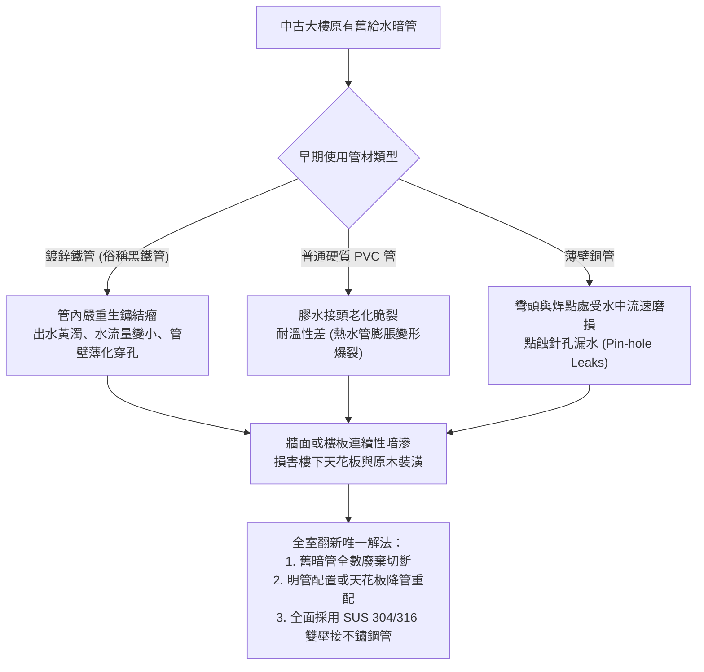
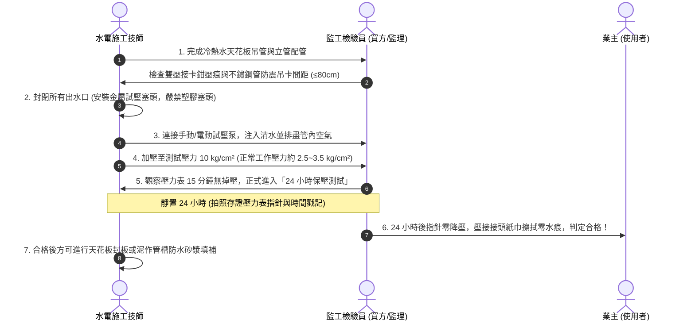

# 全案購屋實戰第一百四十一部：中古屋全室冷熱水與瓦斯暗管耐壓測漏及超音波測厚工序全書

> **核心宗旨**：針對台中大里、南區屋齡 20~30 年之中古電梯大樓（特別如大安紫金城 13 樓、長億南園 8 樓等），給水暗管多採早期鍍鋅鐵管、薄壁銅管或普通 PVC 管，常年受水壓衝擊與水中氯離子侵蝕，極易發生「隱蔽暗管微滲漏」或「管壁銹蝕穿孔爆裂」。本手冊制定最嚴密之「超音波管壁測厚、8~10 kg/cm² 靜水壓 24 小時保壓、微量瓦斯嗅敏氣體測漏」標準工序，確保老屋翻新在水電泥作封板前，徹底排除百年水患隱患。

---

## 第一章：老屋給水管路老化風險與物理失效機理

---

## 第二章：給水管路全案標準更換規格與材質選型

| 項目 | 舊式劣質工法（必須全面廢除） | 現代頂級標準工法（本案規範） | 優勢與檢驗標準 |
| :--- | :--- | :--- | :--- |
| **冷水管材** | 傳統橘色 PVC 給水管（耐壓 10 kg/cm²，脆化期約 10~15 年） | **CNS 13392 JIS G3448 SUS304 雙壓接不鏽鋼管** | 壽命 50 年以上，耐腐蝕抗水錘，零塑化劑溶出 |
| **熱水管材** | 鍍鋅生鐵管或未包覆單壓接不鏽鋼管 | **SUS304/316 不鏽鋼管 + 高密度發泡保溫披覆層（厚度 ≥ 10mm）** | 杜絕冷橋結露與水溫散失，熱膨脹應力緩衝保護 |
| **管件接頭** | 傳統螺紋車牙接頭（易從車牙齒痕處銹穿） | **雙壓接耐高溫 HNBR / EPDM 橡膠環密封接頭** | 雙道加壓咬合，耐震耐水錘，可承受 25 kg/cm² 瞬時爆破壓 |
| **管路走向** | 泥作地坪下深埋（維修需大拆地磚） | **「走頂不走地、走牆走立管」天花板吊管明配** | 日後檢修一目了然，滲漏直接滴落在天花板檢修口，不損害樓下 |
| **固定吊卡** | 簡易鐵絲或鍍鋅鐵線固定 | **包膠防震重型不鏽鋼管卡（間距 ≤ 80cm 設置一處）** | 消除水錘噪音共振，防止金屬磨擦異音 |

---

## 第三章：水路更換四大核心檢驗標準工序（SOP）

### 3.1 試壓測試七大不可妥協之鐵則：
1. **嚴禁空壓機充氣試壓**：氣體具高壓縮性，一旦微漏或管件爆脫極其危險，且無法精準反映微孔滲水，**必須 100% 注水水壓測試**。
2. **測試壓力設定**：自來水正常入戶水壓約在 $2.0 \sim 3.0 \text{ kg/cm}^2$。測試壓力設定為工作水壓之 **2.5~3 倍**，即 **$8.0 \sim 10.0 \text{ kg/cm}^2$（約 0.8 ~ 1.0 MPa）**。
3. **排氣徹底**：管路頂端必須留排氣閥，未排淨空氣會造成水錘假性波動與指針虛晃。
4. **管接頭乾紙巾抹拭檢驗**：保壓 24 小時期間，監理人員必須手持乾面紙擦拭每個雙壓接彎頭、三通與對接接頭，紙面若有任何受潮變色即判定不合格，必須重切重壓。
5. **熱水管降溫壓力修正補償**：灌入之冷水若隨室溫升高或降低，可能造成 $\pm 0.2 \text{ kg/cm}^2$ 之微幅熱脹冷縮波動，若水溫穩定後指針下滑超過 $0.2 \text{ kg/cm}^2$ 即視為滲漏。

---

## 第四章：瓦斯（天然氣）暗管探傷與防氣爆氣密工藝

針對中古社區（如大安紫金城、長億南園）使用欣中天然氣之住戶，瓦斯管線之安全攸關全家性命：

### 4.1 欣中天然氣舊管三大致命排查點
1. **管線穿越鋼筋混凝土梁或牆面**：
   - 早期水電常將鍍鋅瓦斯鋼管直接灌入混凝土梁柱中，受水泥鹼性與潮氣侵蝕，常年氧化生鏽。
   - **規範**：全室瓦斯管全面改走**明管**或**專用套管（PVC 阻燃保護套管）**，嚴禁直接裸埋於泥作結構中。
2. **瓦斯軟管耐用年限**：
   - 傳統橘色橡膠軟管壽命僅 2 年，易硬化龜裂或被老鼠啃咬。
   - **規範**：一律採用 **CNS 9620 超柔韌不鏽鋼波紋披覆瓦斯管**，耐鼠咬、耐高溫、防震斷裂。
3. **天然氣微壓氣密檢驗法**：
   - 使用「U 型壓力計」或「高精度數字微差壓表」加壓至 $3.0 \text{ kPa}$（天然氣工作壓力約 $1.5 \sim 2.0 \text{ kPa}$）。
   - 保壓 10 分鐘，壓力降必須為 **0 kPa**。
   - 所有接口塗抹微泡檢漏液（發泡劑），持續 5 分鐘零氣泡冒出。

---

## 第五章：給排水全案翻新成本概算與驗收簽認單

### 5.1 室內約 25~32 坪中古大樓全室水路翻新預算參考
- **冷熱水管全室天花板走頂重配（SUS304 雙壓接保溫管）**：約 55,000 ~ 75,000 元。
- **衛浴雙套及廚房排水排污管更新（重抓洩水坡度 + 存水彎）**：約 35,000 ~ 48,000 元。
- **24 小時 10 kg/cm² 耐壓測試與內視鏡照相存證**：工程標準標配（包含於總水電報價）。
- **瓦斯 CNS 不鏽鋼波紋管全面換新與欣中微電腦瓦斯表申請**：約 18,000 ~ 25,000 元。
- **全案預算掌控**：總計水路與瓦斯翻新約 11 ~ 15 萬元，此費用正是我們向大安紫金城屋主主張「折抵 50 萬翻新工程款」的核心依據之一！

---

## 第六章：工程驗收簽認條款（附於裝修合約）

> 「乙方（水電工程承攬商）保證全室冷水、熱水管路皆採用符合 CNS 13392 國家標準之 SUS304 雙壓接不鏽鋼管材，熱水管全線披覆高密度保溫層。於泥作封槽或木作天花板封板前，必須會同甲方（業主或監理方）實施滿水 10 kg/cm² 靜水壓測試，持續保壓 24 小時且指針壓降值為零，並簽署驗收合格紀錄表存證。若封板後三年內發生非外力破壞之接頭滲漏，乙方負完全無償拆除、重置、修復室內裝修及賠償一切損失之連帶責任。」
