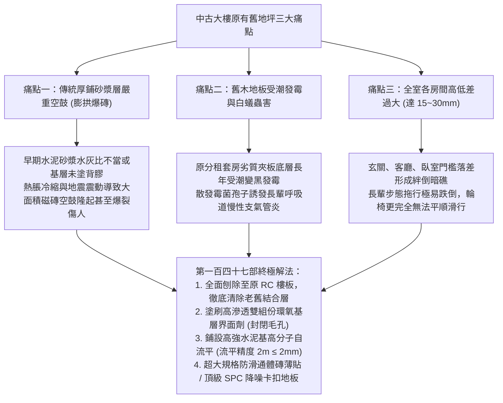
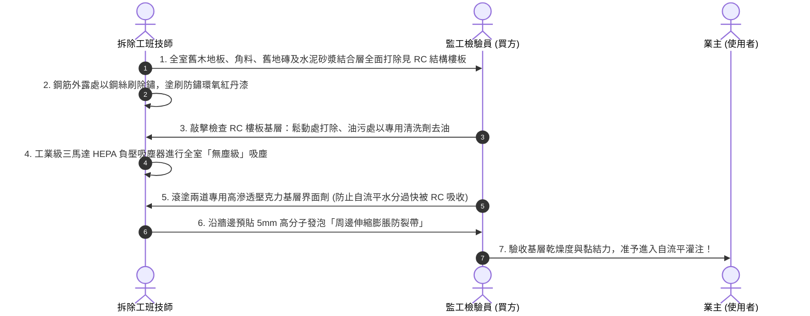
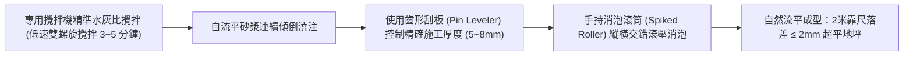
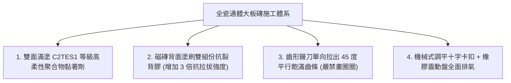

# 全案購屋實戰第一百四十七部：老屋地坪木地板與磁磚拆除RC基層整平及高分子自流平防空鼓工序全書

> **核心宗旨**：在地坪翻新過程中，高齡長輩居家環境最忌諱「地坪不平引發輪椅阻卡」、「傳統水泥砂漿厚鋪空鼓龜裂致地磚爆裂」、「舊有木地板受潮發霉白蟻蛀蝕」等致命隱患。針對屋齡 20~30 年中古電梯大樓（大安紫金城 13 樓、長億南園 8 樓等），本手冊專攻「舊地磚/木地板全面剃除見 RC 結構樓板、高壓無塵吸塵素地整理、水泥基高分子自流平（Self-leveling）超平施工（2 米靠尺落差 ≤ 2mm）、抗空鼓雙組份背膠與薄貼工法」，構建 50 年絕不空鼓、極致平整之全齡通用安全地坪。

---

## 第一章：老屋地坪三大致命痛點與結構物理分析

---

## 第二章：地坪全面拆除見底與 RC 素地處理標準 SOP

針對大安紫金城 13 樓原屋主隔成 4 間學生套房之複雜地坪（包含局部高架木地板、局部舊磁磚），必須徹底根除：

### 2.1 素地整理三大不可妥協之鐵則：
1. **嚴禁「磚上貼磚（磁磚直接覆貼）」**：
   - 早期翻新為省錢常直接在舊地磚上塗黏著劑再貼新磚。此舉不僅增加樓板荷重（每坪增加約 40~50kg 恆載），且舊磁磚一旦底層脫膠，新舊磁磚將整片崩塌翹起，**本案 100% 嚴禁覆貼**！
2. **基層含水率控制**：
   - RC 樓板含水率必須 **$\le 8\%$**，方可塗刷界面劑；未乾燥即施工會導致底層水氣頂破自流平產生起泡。
3. **牆邊彈性膨脹緩衝帶（Perimeter Strip）**：
   - 在所有牆腳、柱腳與落地門框四周，必須預先黏貼厚度 $5\text{mm}$、高度 $50\text{mm}$ 的閉孔發泡聚乙烯緩衝帶。
   - 緩衝自流平砂漿與後續地坪材料因熱脹冷縮產生的側向推力，徹底消除牆邊起拱與擠壓裂紋。

---

## 第三章：水泥基高分子自流平（Self-leveling）超平工藝

傳統泥作以鏝刀手工「抹地心」，人為誤差極大，地面往往呈波浪狀。本案採用歐洲現代化工業標準之**泵送式自流平砂漿**：

### 3.1 自流平施工技術參數標準：
- **抗壓強度（28天）**：$\ge 30 \text{ MPa}$（高於一般混凝土的 20~25 MPa，耐椅輪重壓不碎裂）。
- **抗折強度**：$\ge 7.0 \text{ MPa}$。
- **平整度指標**：
  - 使用 $2.0 \text{ 公尺}$ 鋁合金平整度檢驗靠尺與塞尺檢測，**全室任意方向量測之最大間隙落差 $\le 2.0 \text{ mm}$**（傳統泥作誤差常達 5~10mm）。
  - 超平地坪為長輩輪椅滑行、機器人清掃機無障礙通行提供極致完美的平順基底。

---

## 第四章：大規格磁磚薄貼抗空鼓工法（針對客餐廳與廚衛）

### 4.1 磁磚空鼓防範四大核心工序：
1. **雙面滿漿工藝（Butter-Floating Method）**：
   - 基層自流平地面用齒形鏝刀刮抹黏著劑，磁磚背面亦刮塗一層 $1 \sim 2\text{mm}$ 黏著劑。
   - 磁磚貼合後，滿漿率必須達到 **$95\%$ 以上**（廚衛及玄關重水區必須達 **$98\%$ 以上**），底層絕無任何空心氣囊。
2. **手持電動吸盤震動機排氣**：
   - 磁磚鋪上後，嚴禁用鐵鎚或木棒盲目敲擊；一律使用高頻微幅「電動橡膠吸盤震動機」均勻走壓，將底層殘留空氣自邊緣完全擠出。
3. **專用調平器卡扣（Tile Leveling System）**：
   - 每塊磚邊緣配置至少 4~6 個調平基座與楔形插片，精確鎖死相鄰磁磚之平整度，相鄰磚高低差（錯台）控制在 **$\le 0.5 \text{ mm}$**，赤腳行走完全無踢腳感。
4. **環氧樹脂彩砂填縫**：
   - 留設 $1.5 \sim 2.0\text{ mm}$ 標準膨脹接縫，採用耐酸鹼、不吸水、防霉抗菌之「雙組份環氧彩砂」，永不發黑脫落。

---

## 第五章：長輩房靜音防滑地坪選型（頂級 SPC 石塑卡扣地板）

在長輩臥室，為兼顧「腳感溫潤、防滑安全、隔音減震、防尿液滲漏腐蝕」，推薦採用旗艦級 **SPC 石塑卡扣靜音地板**：

| 評估維度 | 傳統超耐磨木地板（MDF 底材） | 劣質 PVC 塑膠地板 | 本案頂級 SPC 降噪卡扣地板 |
| :--- | :--- | :--- | :--- |
| **防水防潮性** | 差，水杯傾倒或長輩尿失禁易膨脹變形發黑 | 普通，底膠受潮易脫膠翹邊 | **100% 絕對防水，浸水 30 天零膨脹零變形** |
| **甲醛釋放量** | 含有黏合膠水，多為 E1 或 E2 級 | 劣質塑化劑異味重 | **零甲醛、零塑化劑，達嬰幼兒級綠建材標準** |
| **抗衝擊與耐磨** | 轉數 4000~6000 轉 | 耐磨層僅 0.1~0.2mm | **耐磨層 0.55mm，高耐磨 $\ge 20000$ 轉，輪椅推進無刮痕** |
| **靜音減震性能** | 腳步聲空洞噪聲大 | 腳感生硬無彈性 | **底層一體化熱壓 1.5mm 高密度 IXPE 靜音墊，降噪 $\Delta L_w \ge 20\text{dB}$** |
| **防滑係數** | 遇水變滑，乾濕摩擦係數低 | 遇水極滑，極度危險 | **表面微浮雕 UV 塗層，遇水產生吸盤效應，濕態防滑達 R10 級** |

---

## 第六章：工程驗收標準簽認單（附於泥作地坪合約）

> 「乙方（地坪工程承攬商）保證全宅地坪拆除見 RC 底層，並施作符合歐標之水泥基高分子自流平砂漿。完工後全室任意兩公尺範圍內落差不得大於 2.0mm，且房間與走道交接處達成 100% 零高差平整過渡。磁磚施工採用雙面刮膠與排氣工藝，全室驗收時經響鼓鎚敲擊檢測，單片磁磚空鼓率不得大於 5%，主要走道及長輩房空鼓率必須為 0%。乙方對地坪防空鼓與防起拱提供自交屋日起五（5）年之結構品質保固。」
