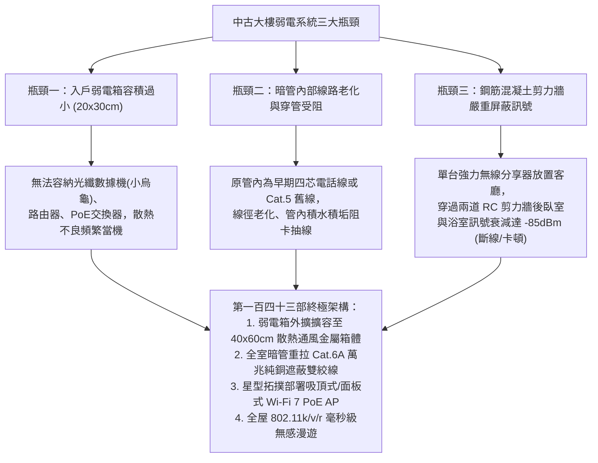
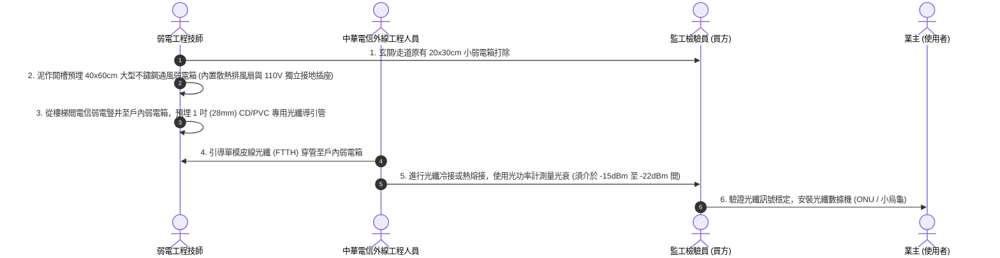
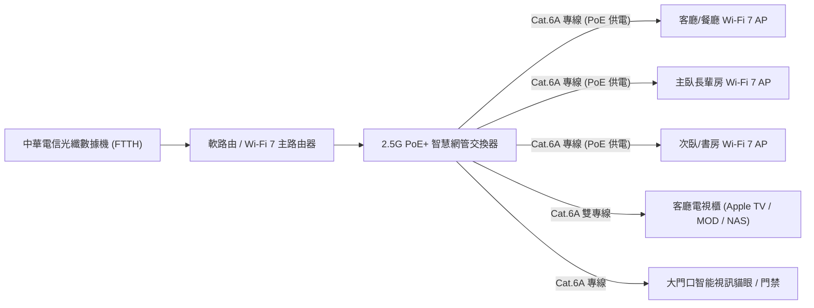
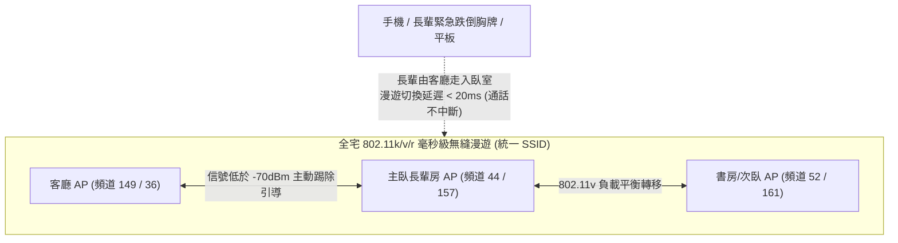

# 全案購屋實戰第一百四十三部：中古大樓弱電智聯光纖FTTH進戶與全宅Wi-Fi 7高速無縫漫遊架構全書

> **核心宗旨**：現代家庭生活與高齡居家照護極度依賴穩定且低延遲的網絡環境（如遠端即時視訊看護、智能跌倒偵測毫米波雷達、全天候雲端門禁監控、長輩高畫質串流娛樂）。針對台中 20~30 年中古大樓（大安紫金城 13 樓、長億南園 8 樓等）常見之「傳統電話線/劣質扁平線穿管、弱電箱容積狹小無法散熱、鋼筋混凝土厚牆嚴重阻斷無線訊號」等硬傷，本手冊制定最嚴密的「光纖到戶（FTTH）冷接/熔接引導、Cat.6A 遮蔽雙絞線暗管抽換、全宅 Wi-Fi 7 802.11be 無縫漫遊（802.11k/v/r）星型拓撲」標準工序，構建 30 年不落伍的高速數位神經網絡。

---

## 第一章：老屋弱電系統三大致命瓶頸與數位訊號物理阻斷

---

## 第二章：弱電箱擴容與中華電信光纖 FTTH 入戶引導工序

### 2.1 弱電箱硬體擴容五大不可妥協之鐵則：
1. **箱體容積標準**：最小規格不低於 **$40 \times 60 \times 12 \text{ cm}$**，必須能同時收納：光纖數據機、8 埠 Gigabit/2.5G PoE 交換器、微型不斷電系統（Mini UPS）及智能家居網關。
2. **獨立供電與接地**：弱電箱內必須引入一組 **獨立專用 110V 20A 插座**（附有良好設備保護接地），嚴禁與大功率廚房或冷氣回路混接，消除電源雜訊干擾。
3. **百葉強制散熱通風**：箱門必須設計上下對流散熱百葉孔，必要時頂部加裝 $12\text{V}$ 靜音磁懸浮排風扇（溫控啟動，高於 40°C 自動抽風），防止光纖數據機因過熱降速或當機。
4. **專用不斷電系統（Mini UPS）**：為弱電箱數據機與主路由器配置 $60\text{W}$ 鋰電池 UPS，停電時仍可維持室內網絡、緊急通報器與醫療監測設備持續運作 $4 \sim 6$ 小時。

---

## 第三章：全宅有線網絡 Cat.6A 萬兆純銅佈線規格

### 3.1 網絡線材與施工檢驗標準：
| 檢驗項目 | 劣質作法（嚴格禁止） | 頂級專業作法（本案標準） |
| :--- | :--- | :--- |
| **線材規格** | 廉價 Cat.5e 或劣質銅包鋁線（CCA） | **國際標準 UL 認證 Cat.6A S/FTP 或 U/FTP 23AWG 100% 純無氧銅線** |
| **傳輸帶寬** | 100MHz ~ 250MHz，僅支援 1Gbps | **500MHz 帶寬，支援 10Gbps（萬兆）高速傳輸，傳輸距離 100 米無衰減** |
| **屏蔽防干擾** | 無屏蔽（UTP），與 110V 強電穿同管 | **鋁箔獨立雙屏蔽層，強弱電管路嚴格保持 30cm 以上間距（交叉處包覆金屬箔）** |
| **資訊插座模組**| 廉價免打線模組（接觸不良易氧化） | **原廠抗氧化鍍金 50μ" Cat.6A 屏蔽型金屬資訊插孔（Keystone Jack）** |
| **驗收儀器** | 簡易幾十元之雙邊閃燈測線器 | **使用 Fluke（福祿克）DSX-5000/8000 網路線認證分析儀，全線取得 Channel/Permanent 測試通過報告** |

---

## 第四章：Wi-Fi 7（802.11be）全屋無縫漫遊架構配置

針對三房兩廳或大空間格局（如大安紫金城、長億南園等主附 25~32 坪住宅），單一無線分享器絕不可能消除厚牆死角。本案採用 **AC + PoE AP（控制器 + 無線存取點）星型拓撲** 架構：

### 4.1 Wi-Fi 7 核心技術優勢：
1. **320MHz 極致頻寬與 4096-QAM 調變**：提供比 Wi-Fi 6 快 2.4 倍的極限傳輸吞吐量。
2. **MLO 多重連接模式（Multi-Link Operation）**：
   - 設備可同時聚合連接 2.4GHz、5GHz 與 6GHz 三個頻段。
   - 即使其中一個頻段受到微波爐或鄰居訊號干擾，數據瞬時無縫切換至另一頻段，達到 **0 丟包率、超低延遲（< 5ms）**，對遠端高畫質醫療照護監控極為關鍵。
3. **802.11k / 802.11v / 802.11r 漫遊協議聯動**：
   - **802.11k（射頻資源測量）**：手機隨時獲取周圍最佳 AP 清單，預先做好切換準備。
   - **802.11v（BSS 轉換管理）**：控制器主動監控訊號強弱，當長輩走動且訊號降至 $-70 \text{ dBm}$ 時，主動引導手機切換至最近 AP。
   - **802.11r（快速 BSS 切換）**：跳過繁瑣的重新握手認證，在 **20 毫秒內** 完成加密切換，LINE 視訊或語音電話完全不卡頓。

---

## 第五章：高齡居家安全智能連網專用隔離虛擬網（VLAN）

為防止長輩居家智能監控與醫療警報系統受到一般電腦下載或惡意病毒攻擊而癱瘓，本案在主路由器劃分 **三大獨立虛擬子網（VLAN）**：

| VLAN 識別 | 網路名稱 (SSID) | 頻段分配 | 連接設備類型 | 安全策略與頻寬保證 |
| :---: | :--- | :--- | :--- | :--- |
| **VLAN 10** | `Family_HighSpeed` | 5GHz + 6GHz | 家人筆電、智慧手機、工作 NAS | 全速訪問、內網互通、最高安全加密 |
| **VLAN 20** | `Care_Safety_IoT` | 2.4GHz 專用 | 長輩跌倒偵測雷達、防跌拉繩、智能門鎖、網路攝影機 | **獨立頻寬保證、禁止存取一般電腦、抗干擾、全時在線優先轉發** |
| **VLAN 30** | `Guest_Free` | 2.4GHz + 5GHz | 親友訪客設備、非核心智慧家電 | 僅供上網、禁止存取家庭內網設備、隔離防護 |

---

## 第六章：工程驗收標準簽認單（附於弱電合約）

> 「乙方（弱電及通訊工程承攬商）保證全宅網絡佈線採用符合國際標準之 Cat.6A 純銅遮蔽線材，所有資訊座模組接點均經原廠標準工法打線。完工後乙方須提供專用網絡分析儀之各節點萬兆通過認證測試數據。全宅部署之 PoE AP 系統須達成全室信號覆蓋率 $\ge -65 \text{ dBm}$（包含衛浴及廚房死角），漫遊切換時間不大於 30 毫秒，並提供全系統自交屋驗收合格日起三（3）年之硬體維護保固服務。」
