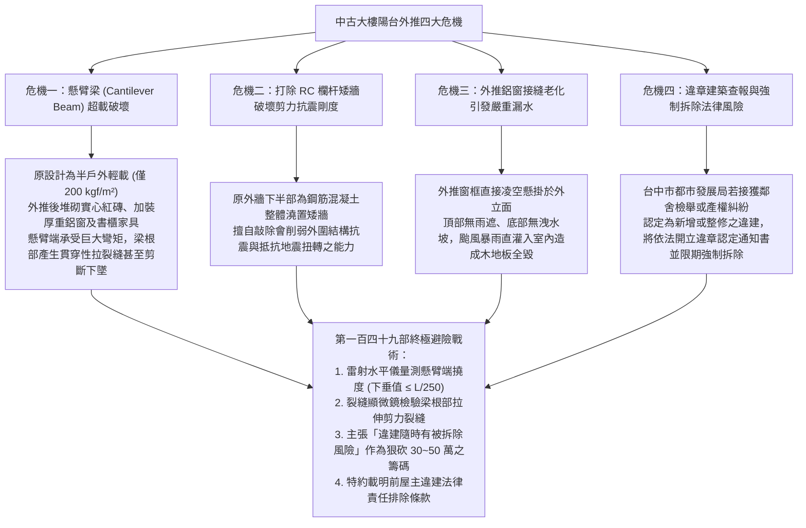
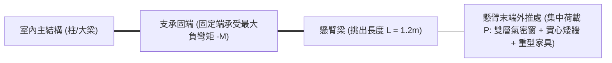
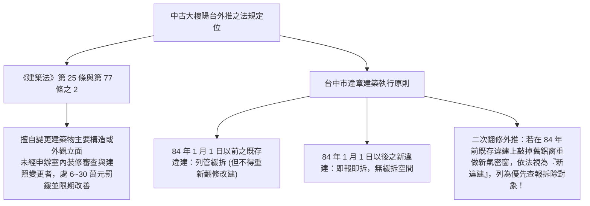
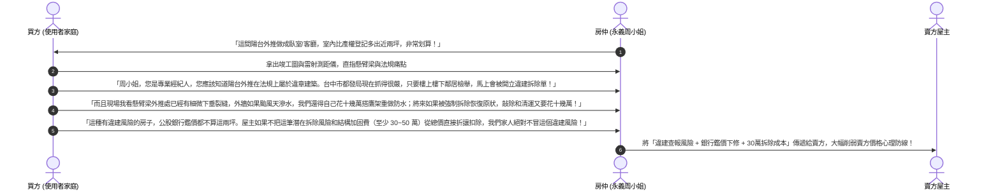

# 全案購屋實戰第一百四十九部：老屋陽台外推結構排查與承重安全評估及違章建築拆除風險法規全書

> **核心宗旨**：在台中地區 20~30 年中古電梯大樓（如大安紫金城 13 樓、長億南園 8 樓等早期規劃物件），前屋主為擴大室內使用坪數，常將「景觀陽台」或「工作陽台」之外牆打除外推，並將外推處改為室內客廳或臥室的一部分。然而，陽台外推在台灣現行法規中屬「實質違章建築」，且多涉及打除具抗震作用之 RC 矮牆（副梁或剪力牆構造），增加懸臂梁自重，造成「結構下垂開裂、外牆大面積滲漏、遭檢舉限期拆除恢復原狀、產權買賣貸款成數遭銀行下修」等重大危機。本手冊專攻「陽台外推結構受力計算、懸臂梁抗傾覆安全檢測、違建查報風險排查、合法室裝審查（簡審/二階審查）流程及買賣契約抗抗性殺價戰術」，確保買方不承擔前人的違章負債與結構傾覆風險。

---

## 第一章：陽台外推四大致命危機與力學物理破壞機理

---

## 第二章：陽台結構力學檢測與懸臂梁抗傾覆計算

陽台結構多為由室內主梁或柱向外懸挑出 $1.0 \sim 1.5 \text{ 公尺}$ 之「懸臂梁板結構」：

### 2.1 懸臂梁過載四大現場排查指標：
1. **懸臂端撓度（Deflection）超標量測**：
   - 於懸臂板最外緣與室內基準地坪架設高精度雷射水平儀。
   - 容許最大垂直下垂撓度：
     $$\delta_{\max} \le \frac{L}{250}$$
     例如：陽台懸挑長度 $L = 1200\text{ mm}$，則容許下垂值為 $\delta_{\max} \le \frac{1200}{250} = 4.8\text{ mm}$。
   - 若現場實測下垂量超過 $8 \sim 10\text{ mm}$，代表鋼筋早已屈服塑性變形，結構存在永久性損傷！
2. **梁根部上緣貫穿性橫向裂縫**：
   - 懸臂梁之最大受拉面在「梁板上部」（與一般簡支梁受拉在底部完全相反）。
   - 仔細檢查陽台與室內交界處的天花板與兩側梁根部，若發現 **寬度 $\ge 0.3\text{mm}$ 之橫向或斜向 45 度裂縫**，代表抗拉鋼筋已不堪負荷，隨時有脆性剪斷脫落之極度危險！
3. **加載材料減重原則**：
   - 若維持外推現況，外側封閉牆體絕對嚴禁使用重量達 $180\text{ kg/m}^2$ 之實心紅磚。
   - 必須採用「輕鋼架骨架 + 雙面厚水泥板 + 中填岩棉」之輕質乾式隔間（重量僅約 $35\text{ kg/m}^2$），大幅減輕懸臂梁負載達 $80\%$。

---

## 第三章：台灣現行建築法規與違章建築拆除風險排查

### 3.1 銀行鑑價與房貸下修風險：
- 公股銀行（如兆豐、一銀、台銀等）指派之特約鑑價師現場勘查時，會核對建物測量成果圖與竣工圖。
- 凡發現陽台外推，**外推部分之室內面積一律不計入產權坪數估價**。
- 若外推結構有明顯裂縫或涉重大違建，銀行內部會備註「結構與外觀有違章變更」，核貸成數可能直接由 8 成壓低至 7 成或 6.5 成。
- 此處再次印證第一百三十九部手冊中 **「貸款不足 8 成無條件解除契約全額退款」特約條款** 的極度重要性！

---

## 第四章：買方斡旋談判殺價話術與抗性反擊戰術

當現場勘查發現大安紫金城或長億南園有陽台外推時，買方絕不可將其視為「賺到室內空間」，而必須將其包裝為「巨大法律風險與結構定時炸彈」，全力壓低買賣總價款：

---

## 第五章：斡旋買賣合約必備之「違章免責與修復特約」

若最終決定購入帶有陽台外推之物件，必須在合約中手寫載入以下特約，完全排除買方之既往法律責任：

> **【陽台外推既存違建免責與產權瑕疵特約條款】**：
> 「雙方確認：本買賣標的物現況含有陽台外推之非原合法建照構造（以下簡稱外推違建）。賣方保證於交付標的物前，本建物未曾收受主管機關（台中市政府都市發展局）之違章建築查報單、限期拆除通知書或行政處分。若於交屋日前本標的物遭主管機關查報認定為應強制拆除之新違章建築，買方有權無條件解除本買賣契約，賣方應於三日內無息全額返還買方已付之全部價金及定金。若交屋後因交屋前之檢舉或訴訟致使主管機關要求拆除恢復原狀者，所生之拆除、罰鍰及結構恢復工程費用均由賣方負擔。」

---

## 第六章：驗收排查標準核對表（現場看屋即時判定）

| 檢驗項目 | 標準合格條件 | 現場異常判定（重大警訊） | 處置戰術 |
| :---: | :--- | :--- | :--- |
| **懸臂樑根部** | 混凝土表面平整，無任何裂痕 | 出現橫向寬度 $\ge 0.3\text{mm}$ 之拉伸裂縫 | ❌ 立即要求結構技師鑑定，否則放棄承購 |
| **外推窗台接縫** | 矽利康完整彈性，打底斜坡良好 | 窗角發霉、油漆膨拱剝落、有明顯壁癌水漬 | ⚠️ 估算 15 萬元外牆吊掛抓漏重置成本直接砍價 |
| **外立面外觀** | 與大樓上下樓層外立面色澤與建材協調 | 突出大樓外觀、違規搭建鐵皮或不同色鋁板 | ⚠️ 屬極高風險被鄰舍檢舉之優先拆除對象 |
| **竣工圖核對** | 現場空間與地政建物測量成果圖完全相符 | 測量圖標示「陽台」，現場卻為室內實體地板 | 👑 啟動違建抗性殺價戰術，狠扣 30~50 萬元！ |
