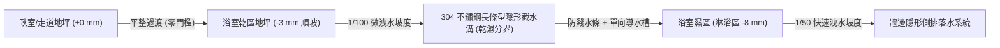
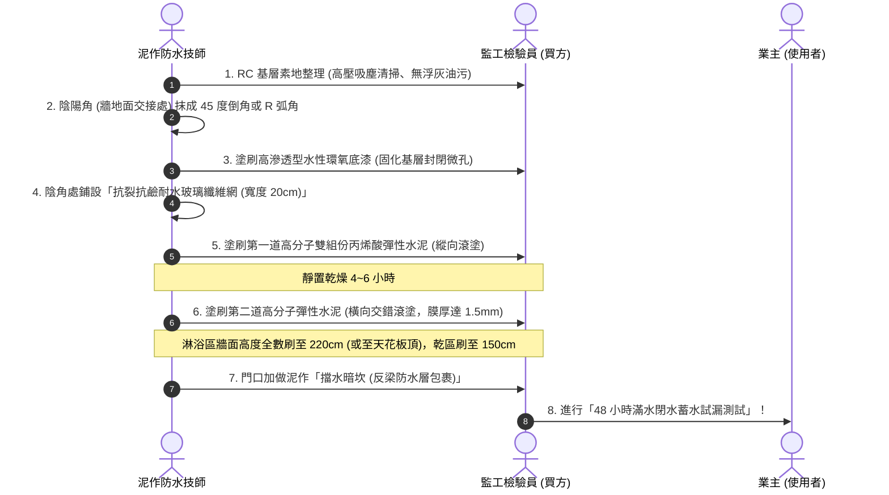
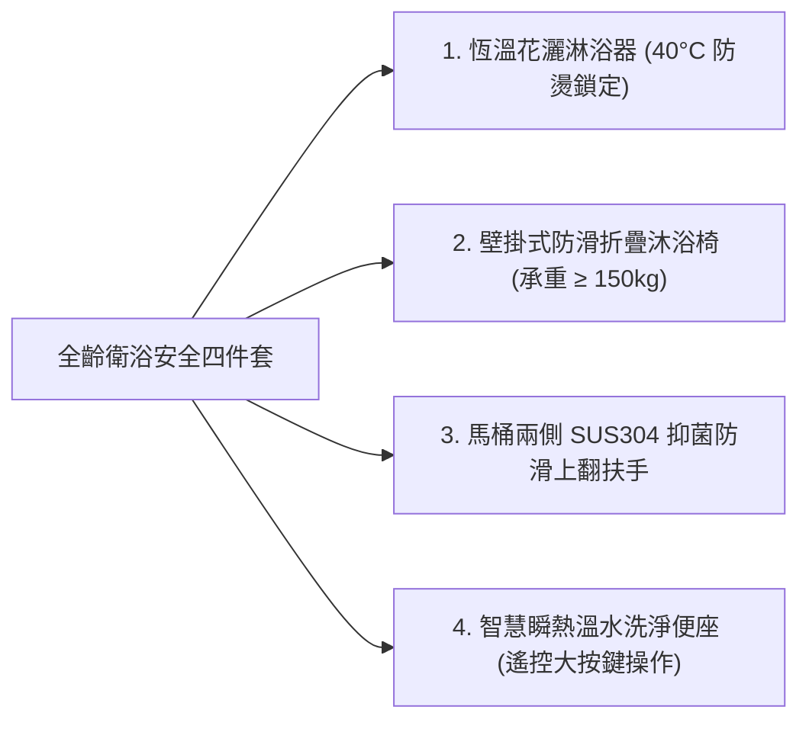

# 全案購屋實戰第一百四十二部：老屋浴室降板防漏與微斜坡截水溝零門檻通用衛浴改造全書

> **核心宗旨**：衛浴空間為長輩居家生活中跌倒與滑倒風險最高之場所（佔高齡室內意外逾 60%）。本手冊專攻台中中古大樓（大安紫金城 13 樓、長億南園 8 樓等）之老舊浴室重置工程。針對傳統浴室「門檻高起阻礙輪椅進出」、「傳統圓形落水頭排水緩慢回湧」、「防水層老化脆裂滲漏樓下」等致命通病，全面導入「全室地坪微斜坡無門檻截水溝工法、雙重彈性水泥與聚脲防水體系、抗滑度 R11 防滑磁磚選型、壁體重型不鏽鋼防跌扶手預埋結構」，打造兼具「百年不漏水」與「長輩輪椅自如進出」之極致全齡通用衛浴。

---

## 第一章：老屋浴室三大致命痛點與結構物理分析

```mermaid
graph TD
    A["中古大樓傳統衛浴痛點"] --> B["致命痛點一：高門檻阻礙 (3~8cm)"]
    A --> C["致命痛點二：局部防水層老化與冷橋微滲"]
    A --> D["致命痛點三：傳統單點落水頭排水不良"]

    B --> B1["長輩抬腳困難易絆倒<br/>輪椅及助行器完全無法推入"]
    C --> C1["原建商早期瀝青或單層彈泥脆裂<br/>水氣滲透RC樓板，致使樓下天花板壁癌滴水"]
    D --> D1["洗澡時地面大量積水、肥皂泡沫滯留<br/>形成極滑水膜，長輩滑倒骨折風險極高"]

    B1 --> E["第一百四十二部終極解法：<br/>1. 門檻全敲平，改隱形不鏽鋼截水溝過渡<br/>2. 七道工序雙層彈泥加抗裂玻璃纖維網<br/>3. R11 級防滑仿石紋通體磚 (乾濕摩擦係數 > 0.6)<br/>4. 預埋 C 型抗拉拔防跌扶手"]
    C1 --> E
    D1 --> E
```

---

## 第二章：浴室無門檻（零高差）微斜坡截水溝專利級工法

傳統工法必須留設 $3 \sim 5 \text{ cm}$ 的人造石門檻來擋水，造成長輩絆倒或輪椅進出障礙。現代全齡化衛浴採用「**乾濕分離無門檻微斜坡截水溝工法**」：

### 2.1 零門檻微斜坡核心施工要點：
1. **地坪高程精算**：
   - 泥作打底時，以客廳/走道完成面為基準高程（$\pm 0 \text{ mm}$）。
   - 浴室乾區（馬桶、面盆區）向淋浴區方向做 $1/100$ 微坡，交界處落差控制在 $-3 \sim -5 \text{ mm}$。
   - 淋浴區做 $1/50$ 快速洩水坡度，最低點落差在 $-8 \sim -10 \text{ mm}$ 之間，既符合輪椅上下微坡標準，又確保水流絕不倒灌至客廳。
2. **長條型隱形截水溝（Linear Drain）設置**：
   - 採用 **SUS304 不鏽鋼厚度 1.5mm 沖壓成型長條截水槽**（寬度 8cm，長度同淋浴門寬度 80~100cm）。
   - 上蓋採用「地磚內嵌式隱形蓋板」，視覺與周邊地磚一體化，表面平整無凸起。
   - 內置「磁吸式大排量防臭防蟲防逆流落水心」，排水速度達 $35 \text{ L/min}$ 以上，洗澡時泡沫水流瞬間被截斷排空。

---

## 第三章：百年不漏水之「七道抗裂高彈性防水工序」

浴室拆除見底磚（打除至 RC 結構層）後，嚴禁直接抹水泥貼磚，必須嚴格執行以下七道防水標準工序：

### 3.1 閉水試驗 48 小時合格判定標準：
- **蓄水高度**：地坪蓄水深度不低於 $3 \sim 5 \text{ cm}$（注水前以水泥砂漿在浴室門口築起臨時擋水坎）。
- **水位標記**：以油性奇異筆在牆角水線處畫線標記初始刻度。
- **48 小時排查項目**：
  1. 水位因自然蒸發下降量不超過 $2 \sim 3 \text{ mm}$。
  2. 浴室外牆四周踢腳板、背牆房間木地板無任何潮濕、發霉或變色。
  3. **至樓下鄰居天花板（由監工協同管委會進入）用強力手電筒照射**，管道間周邊、管根接縫處、樓板天花板 RC 表面無任何水滴、潮斑或滲水反潮痕跡。
  4. 經三方（業主、泥作工班、樓下住戶或管委會）會勘拍照簽名存證後，方准進行洩水與貼磚工程！

---

## 第四章：長輩全齡無障礙衛浴設備與五金防護配置

### 4.1 防滑地磚規格選配：
- **防滑等級**：嚴選 **德國 DIN 51130 標準 R11 級**、且符合 **CNS 3299 濕式防滑摩擦係數 C.S.R $\ge 0.55$（甚至高達 0.65 以上）** 的石紋通體石英磚。
- **規格建議**：採用 $30 \times 60 \text{ cm}$ 或 $60 \times 60 \text{ cm}$ 模面微凹凸紋理磚，填縫劑一律採用「雙組份防霉耐磨環氧彩砂填縫劑」，徹底解決傳統水泥填縫發霉變黑與吸水問題。

### 4.2 結構預埋防跌扶手（嚴禁使用吸盤式扶手）：
- **基層加固**：拆除輕隔間重砌磚牆或加厚水泥板時，在預計安裝扶手高度（地面起算 $70 \sim 75 \text{ cm}$）預埋厚度 $3.0\text{ mm}$ 不鏽鋼補強鋼板或防腐實木夾板。
- **拉拔力測試**：安裝後之不鏽鋼外包尼龍抗菌扶手，必須能承受 $\ge 150 \text{ kg}$ 的垂直重壓與水平瞬間拉拔力，提供長輩如廁起立時最穩固的支撐。

---

## 第五章：衛浴暖房換氣與應急呼叫系統整合

1. **頂級五合一多功能暖風乾燥機（如 Panasonic / 樂奇）**：
   - 功率 $2000 \text{ W}$，採用專用 20A 漏電保護回路。
   - **冬天預暖房**：長輩入浴前 5 分鐘開啟強暖房，將室溫由 18°C 提升至 26°C 以上，徹底阻絕「熱休克（因溫差過大導致血壓暴衝引發腦中風或心肌梗塞）」風險。
   - **雙向直流變頻排風**：沐浴後自動啟動 24 小時微量排風乾燥，全室 1 小時內徹底乾燥無水滴。
2. **緊急防跌求救拉繩與警報聯動**：
   - 在馬桶側邊與淋浴區離地 $20 \text{ cm}$ 處（長輩跌倒臥地伸手可及位置）設置防水型「紅色緊急拉繩開關」。
   - 一旦拉動，客廳蜂鳴警報器響起、門口防跌警示燈閃爍，並透過 Zigbee/Wi-Fi 網關第一時間推播警報訊息至子女智慧型手機！

---

## 第六章：衛浴翻新工程驗收簽認單（納入工程合約附冊）

> 「乙方（泥作與裝修工程承攬商）保證浴室地坪採用零高差微斜坡隱形截水溝設計，地坪平整無絆腳高差。防水工程施作雙道彈性水泥及抗裂網，並在甲方會同下實施 48 小時滿水閉水試驗，確認無任何微滲滴漏後方可貼磚。乙方對浴室防水工程提供自交屋日起五（5）年之結構防水保固。保固期內若因施工瑕疵導致自身或樓下住戶滲水，乙方須負擔一切抓漏、重置及損害賠償責任。」
