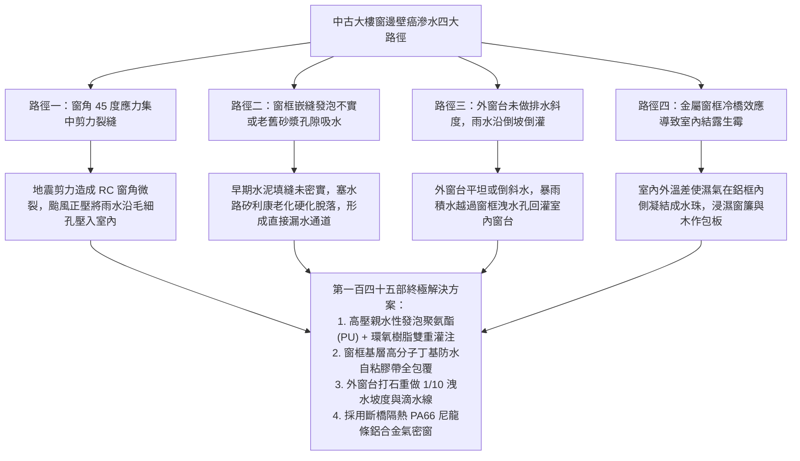
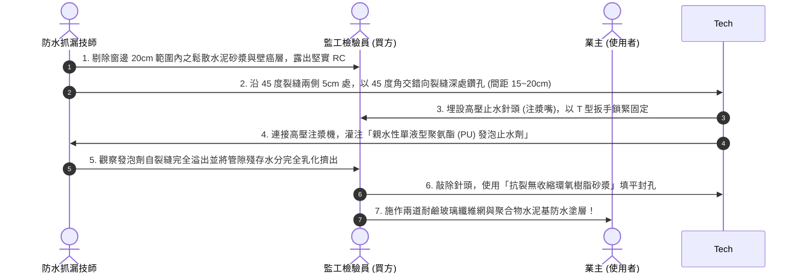
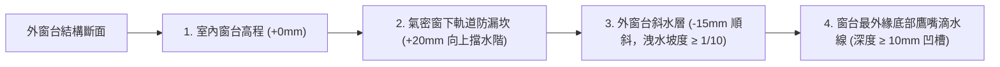

# 全案購屋實戰第一百四十五部：老屋窗框外推與冷橋斷熱微發泡注漿及外牆防水滲漏終極阻斷全書

> **核心宗旨**：台中地區夏季多暴雨颱風、冬季受東北季風夾帶濕氣侵襲。針對屋齡 20~30 年中古電梯大樓（特別如大安紫金城 13 樓之高樓層強風迎風面、長億南園 8 樓等），常見「早期鋁窗填縫不實、窗框四周外牆產生 45 度結構斜裂縫、冷熱交替引發窗邊反潮結露與壁癌剝落」等頑疾。本手冊專攻「舊窗框無破壞或乾式施工包框升級、外牆 RC 剪力裂縫微發泡高壓親水環氧樹脂灌注、窗下倒斜水八字角披水板安裝、斷橋鋁氣密水密抗風壓窗系整合」，打造抵禦百年暴雨侵襲的外維護結構永恆防水防線。

---

## 第一章：老屋窗邊滲漏水四大物理失效路徑

---

## 第二章：窗框更換工法比較（拆除泥作重砌 vs 乾式包框）

在中古大樓翻新中，更換氣密窗主要有兩種工法。針對大安紫金城或長億南園，需視外牆磁磚與管委會規約精確選型：

| 評估維度 | 工法一：濕式工法（打除舊窗框見 RC 結構） | 工法二：乾式工法（包框微發泡免打牆工法） |
| :--- | :--- | :--- |
| **施工方式** | 將舊鋁框全面切除打碎，剔除周圍磁磚，重做泥作與防水 | 保留原有舊內框骨架，使用特製包框型材將舊框完整包覆覆蓋 |
| **防水性能** | 防水層可與外牆結構完全搭接，防水壽命最長（$\ge 20$ 年） | 依靠包框接縫之丁基膠帶與高品質耐候矽利康，壽命約 $10 \sim 15$ 年 |
| **施工震動** | 震動大，需動用打石機，易破壞外牆磁磚造成外觀修補困難 | **無衝擊震動，零粉塵、不破壞外牆磁磚與公共立面** |
| **工期影響** | 需泥作抹縫、養護、多次防水塗刷，工期長達 5~7 天 | **單窗施工僅需半天，全室 1~2 天即可全數完工** |
| **透光面積** | 窗戶視野與玻璃透光面積不變 | 四周邊框因雙層包覆約向內縮窄 $2.5 \sim 3.5 \text{ cm}$ |
| **本案結論** | 👑 **室內全翻新且窗角已有嚴重壁癌者強烈推薦** | ⭐ **外牆磁磚無法修補或管委會嚴禁動外立面者首選** |

---

## 第三章：高壓灌注微發泡聚氨酯（PU）排查與補強工序

針對窗角 45 度裂縫與窗框四周滲漏，在安裝新窗前必須實施結構深層注漿：

---

## 第四章：窗框「外低內高」外窗台洩水坡與滴水線設計

### 4.1 窗台滴水防逆流三大不可妥協之細節：
1. **室內外高低差（內高外低）**：
   - 泥作打底時，窗框安裝位置之混凝土台基，室內側必須高於室外側 **$20 \sim 30 \text{ mm}$**，形成天然重力擋水階梯。
2. **洩水坡度 $\ge 1/10$**：
   - 外窗台絕不可水平鋪磚，必須抹出向外下斜之順水坡，確保暴雨落地後在 3 秒內自動順流排向外牆，不形成任何死角積水。
3. **鷹嘴（Drip Edge）滴水凹槽**：
   - 在窗台伸出外牆之凸緣下方，預留一條寬度 $10\text{mm}$、深度 $10\text{mm}$ 之半圓形或方形凹槽（俗稱「滴水線」）。
   - 雨水流至外緣時，因表面張力被凹槽中斷，直接垂直滴落，絕不沿外牆底部毛細孔倒吸回滲至窗框底層。

---

## 第五章：斷橋隔熱 PA66 尼龍條鋁合金氣密窗選型規格

針對大安紫金城 13 樓高樓層面對大里強烈東北季風與夏日烈陽，氣密窗選型直接決定室內舒適度與電費支出：

| 性能指標 | 國家 CNS 規範最低標準 | 本案全案採購頂級旗艦標準 | 實質效益 |
| :--- | :--- | :--- | :--- |
| **抗風壓性** | 280 kgf/m² (2800 Pa) | **450 kgf/m² (4500 Pa) 頂級耐強颱等級** | 抵禦 16 級強烈颱風強風推擠，窗框零變形跳動 |
| **氣密性** | 2 等級 (8 m³/hr·m²) | **1 等級 (2 m³/hr·m² 以下極致氣密)** | 阻絕沙塵暴與外側 PM2.5 滲透，冬天阻絕冷風倒灌 |
| **水密性** | 35 kgf/m² (350 Pa) | **50 kgf/m² (500 Pa) 以上狂暴雨水密** | 颱風暴雨直沖窗面，雨水絕不從軌道溢出 |
| **隔音性** | 30 dB | **40 dB 以上（搭配雙層 5mm+5mm 膠合 Low-E 玻璃）**| 車流聲與狂風呼嘯聲徹底消除，長輩睡眠不受干擾 |
| **斷橋斷熱** | 傳統一體式導熱鋁材 | **中置 $24\text{mm}$ 寬 PA66 玻璃纖維強化尼龍隔熱條** | 消除室內外金屬冷橋，徹底杜絕窗框結露流汗壁癌 |

---

## 第六章：外窗高壓噴水驗收標準簽認單（附於門窗合約）

> 「乙方（門窗工程承攬商）保證所安裝之斷橋氣密窗符合 CNS 11526 國家最高抗風壓、水密及氣密等級。於全室窗框安裝並完成外牆塞水路矽利康（採用道康寧 Dow Corning 791 / 991 高耐候中性結構矽利康）後，須會同甲方進行高壓噴水檢驗：使用出水壓力不低於 4 kg/cm² 之高壓水槍，以 45 度角朝窗框四邊接縫、拼接處及活動扇軌道持續噴射 20 分鐘。檢驗期間室內側窗框、窗角及四周牆面須達到 100% 零滲水、零水漬、零受潮。乙方對全室窗系提供五年結構防水與抗風保固。」
