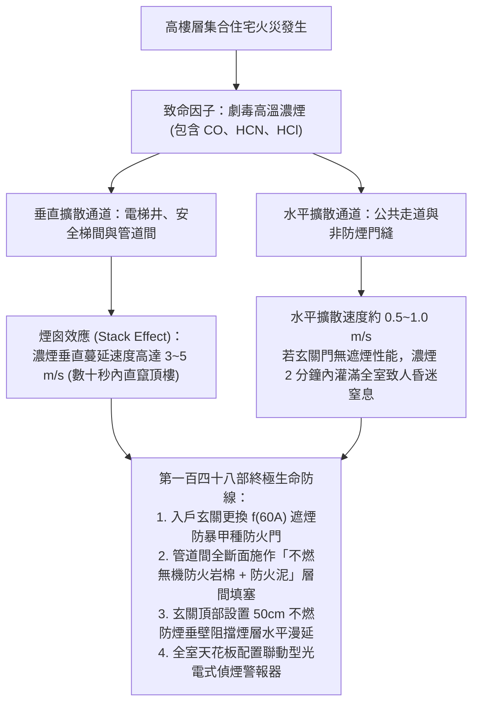
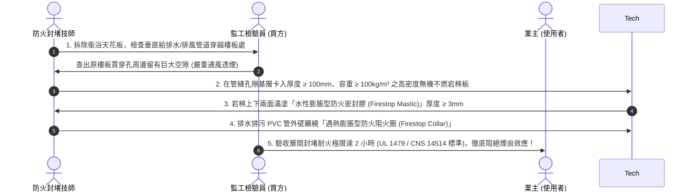
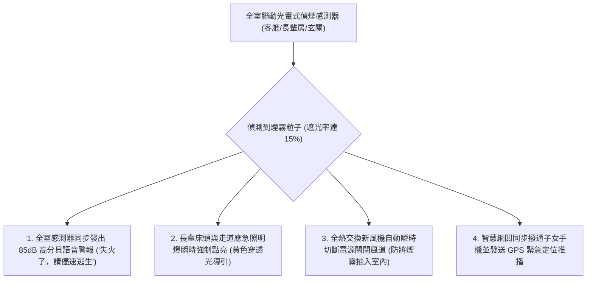

# 全案購屋實戰第一百四十八部：中古大樓防火區劃與防煙垂壁及遮煙防火門耐火時效規範全書

> **核心宗旨**：在高層電梯住宅集合住宅（如大安紫金城 13 樓、長億南園 8 樓等）中，火災時致死率最高者並非明火灼燒，而是劇毒濃煙與高溫熱氣之窒息與嗆傷（佔火災罹難者逾 80%）。特別是 20~30 年中古大樓常有「原分租套房破壞原有防火區劃、大門未具備遮煙性能、管道間未做層間防火填塞致使濃煙垂直煙囪效應倒灌」等致命隱患。本手冊專攻「甲種防火門（f(60A) 耐火 1 小時且具阻熱性）重置、全戶防煙氣密矽膠條升級、管道間無機耐火棉層間封堵、自動防煙垂壁與高靈敏光電式聯動偵煙感知器」，為長輩構築火場黃金逃生與就地避難之永恆生命防線。

---

## 第一章：高樓層火災濃煙擴散機理與致命「煙囪效應」

---

## 第二章：入戶玄關大門防火與遮煙等級嚴格選型

在中古屋翻新中，更換玄關大門絕不可僅看外觀氣派，必須 100% 符合最新內政部建築技術規則之「防火時效」與「遮煙性能」：

| 門扇等級 | 耐火性能 (Fire Resistance) | 阻熱性能 (Thermal Insulation) | 遮煙性能 (Smoke Control) | 適用場景與安全性評價 |
| :--- | :--- | :--- | :--- | :--- |
| **早期普通硫化銅門** | 無認證（約 10~15 分鐘即燒穿變形） | 無（門板背面溫度飆破數百度） | **無遮煙條，濃煙由門縫大量湧入** | ❌ **中古大樓常見，火災極度危險** |
| **普通乙種防火門** | 耐火 0.5 小時 (30 分鐘) | 無阻熱性能 | 無或簡易防塵條 | ❌ **高樓層集合住宅嚴格不合格** |
| **甲種防火門 f(60B)** | **耐火 1.0 小時 (60 分鐘)** | 無阻熱性能 (背面可引燃室內物) | 具備基本遮煙 | ⚠️ **阻熱不足，無法形成就地避難點** |
| **👑 頂級甲種遮煙防火門 f(60A)** | **耐火 1.0 小時 (60 分鐘以上)** | **阻熱性達 1.0 小時 (背面升溫 ≤ 140°C)** | **具備 CNS 15038 氣密遮煙認證（室溫及中溫漏煙量 ≤ 0.2 m³/min·m）** | 👑 **本案唯一指定旗艦玄關門** |

---

## 第三章：甲種遮煙防火門（f(60A)）四大核心構造與工法

### 3.1 防火遮煙大門施工四大不可妥協之鐵則：
1. **內政部營建署防火與遮煙雙認證標籤**：
   - 門扇上緣及門框側邊，必須鉚接「**f(60A) 防火時效 60 分鐘且阻熱 60 分鐘**」及「**CNS 15038 建築用門遮煙性能**」之雙認證銘牌與正品雷射防偽標籤。
2. **遇熱膨脹防火阻煙條（Intumescent Strip）**：
   - 門框三邊（左、右、上）預嵌高膨脹率石墨基防火密封條。當火場溫度升至 $150^\circ\text{C}$ 時，密封條瞬間膨脹 10~15 倍，將門扇與門框間之微小縫隙 100% 熔封閉合，毒氣濃煙徹底阻絕於門外。
3. **機械式隱形自動升降下擋煙條（Drop Down Seal）**：
   - 配合第一百四十二部之「室內零門檻平整地坪」，門扇底部不留凸出金屬門檻。
   - 門扇下底暗埋機械連動氣密條；門扇關閉與門框碰觸瞬間，內部活塞受壓驅動耐高溫矽膠氣密壓條垂直下壓，緊密貼合地面，漏煙量趨近於零；開門時自動彈起收回，不磨損地坪。
4. **門框泥作實心灌漿（Grouting）**：
   - 安裝門框時，門框內部空間必須使用 **1:2 高標號水泥砂漿 100% 飽滿灌漿**，嚴禁用發泡劑偷工減料，確保火場高溫下門框絕對不扭曲變形卡死，逃生開關順暢。

---

## 第四章：管道間層間防火封堵（Firestop）阻斷煙囪效應

針對中古大樓（大安紫金城、長億南園）浴室或廚房之貫穿垂直管道間，早期翻新常將管道間打開後未作密封，形成連通各樓層的致命垂直毒氣煙囪：

---

## 第五章：玄關防煙垂壁（Smoke Barrier）與全宅智慧光電感煙聯動

### 5.1 走道玄關防煙垂壁工程規範：
- **物理作用**：火災初期，煙氣會先貼著天花板呈蘑菇狀水平蔓延。在玄關天花板交界處，設置自天花板向下凸出 **$\ge 50 \text{ cm}$ 的不燃玻璃或耐火板防煙垂壁**。
- **控煙效益**：可將初期大量濃煙蓄積在天花板煙蓄池內長達 5~8 分鐘，延緩濃煙向長輩臥室沉降蔓延，為行動緩慢的長輩爭取極為寶貴的黃金逃生時間。

---

## 第六章：工程驗收標準簽認單（附於防火防護工程合約）

> 「乙方（防火門與防火工程承攬商）保證入戶大門符合 CNS 11227-1 及 CNS 15038 國家標準，具備內政部營建署認可之 f(60A) 遮煙與耐火 60 分鐘阻熱雙標籤證書。管道間穿越樓板孔洞均以耐火極限 2 小時以上之無機防火岩棉及膨脹防火泥實施層間封堵。大門關閉後四周及底部遮煙密封條緊密貼合，室溫及中溫漏煙檢驗符合規範。乙方對全室防火防煙工程提供自交屋日起五（5）年之結構品質保固。」
