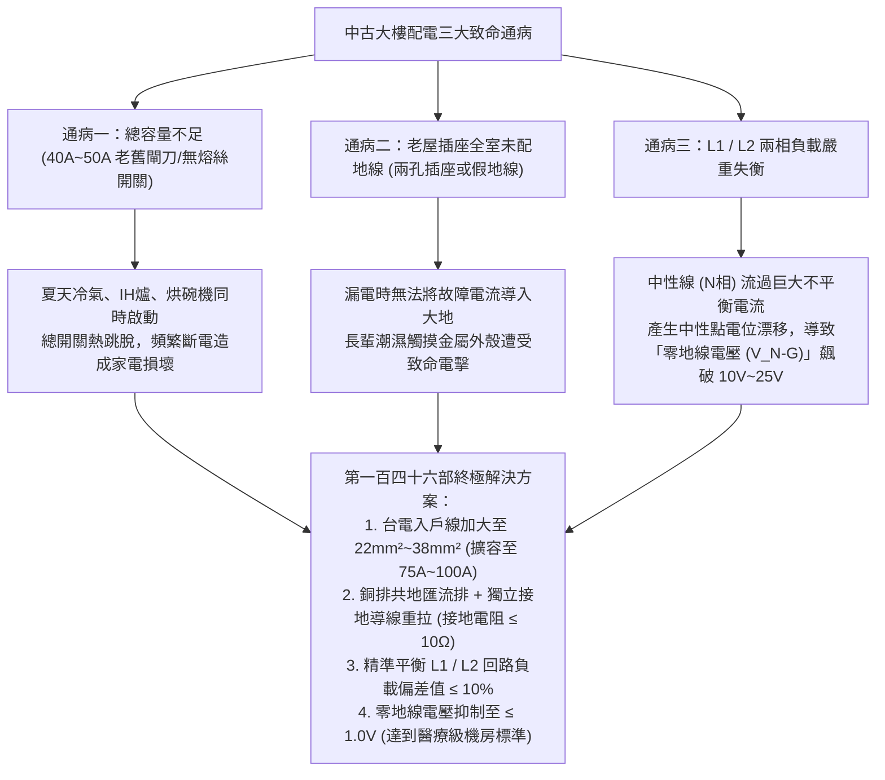
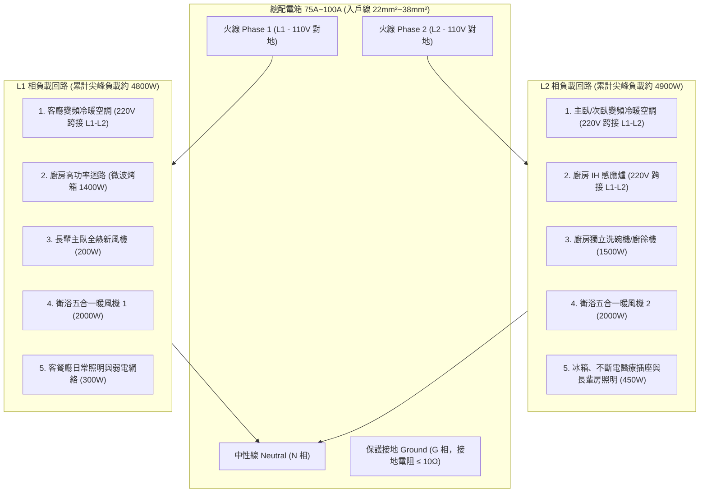
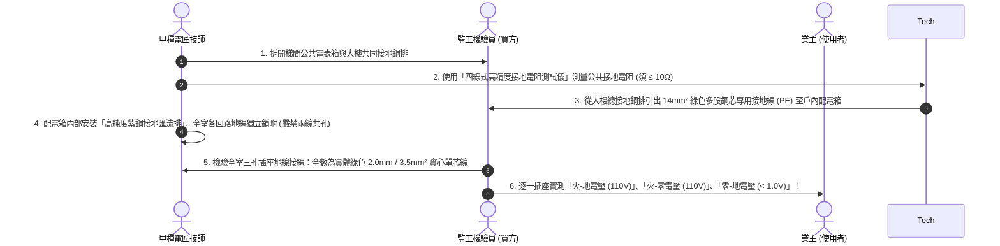

# 全案購屋實戰第一百四十六部：中古大樓配電箱三相四線分相平衡與全室零地線電壓抑制工序全書

> **核心宗旨**：20~30 年中古電梯大樓（特別如大安紫金城 13 樓、長億南園 8 樓等）常見「舊有配電箱僅單相三線 110V/220V 且總負載容量僅 40A~50A」、「地線（GND）虛接或甚至未拉地線」、「三相/兩相負載嚴重不平衡導致中性線（水線）常態性帶電、零地線電壓飆高至 10V 以上」等危險通病。高零地線電壓會造成微電腦家電當機、醫療監測設備數據失準、全熱交換器與智慧馬桶板子燒毀，甚至長輩觸摸金屬外殼有麻電觸電感。本手冊制定最嚴密的「進戶分相平衡精算、零地線電壓抑制至 < 1.0V、全室獨立接地極接地電阻測量（≤ 10Ω）、Schneider / ABB 模組化配電箱升級」標準工序，構建百年安穩純淨用電環境。

---

## 第一章：老屋配電三大致命通病與零地線電壓危害機理



---

## 第二章：零地線電壓（$V_{N-G}$）抑制工程與醫療級純淨電相標準

在精密家庭醫療設備（如長輩氧氣製造機、睡眠呼吸中止呼吸機、心率血壓即時監測儀）運作時，零地線電壓若過高，會引入高頻共模噪聲，導致感測器失準或甚至硬體電路擊穿：

| 零地線電壓範圍 ($V_{N-G}$) | 電源品質等級 | 對長輩家電與醫療設備之影響 | 本案判定標準 |
| :--- | :--- | :--- | :---: |
| **$> 5.0 \text{ V}$（老屋常見 10~25V）** | **極差 / 危險** | 金屬外殼明顯麻電感、晶片死機、精密設備數據亂跳、燒板子 | ❌ **嚴禁驗收，必須停工查線** |
| **$2.0 \text{ V} \sim 5.0 \text{ V}$** | 普通 / 合格線 | 滿足普通照明與一般家電，但長期使用可能加速微電腦電容老化 | ⚠️ **需進一步調相優化** |
| **$1.0 \text{ V} \sim 2.0 \text{ V}$** | 優良 / 商業級 | 各類家電與變頻空調穩定運行，無雜訊干擾 | 🟢 **合格達標** |
| **$< 1.0 \text{ V}$（本案標準）** | **頂級 / 醫療實驗室級** | **背景噪聲完全消除、零麻電感、醫療呼吸機與音響系統極致純淨** | 👑 **本案旗艦驗收門檻** |

---

## 第三章：單相三線（110V/220V）L1 與 L2 負載動態平衡配置表

為確保中性線（N 相）電流最小化，配電箱左右兩排（或上下匯流排）之大功率與常態性用電設備必須精確交錯分配：



### 3.1 負載平衡設計三大鐵則：
1. **跨相 220V 設備優先**：
   - 冷氣室外機、IH 感應爐等大功率負載採用 $220\text{V}$（跨接於 L1 與 L2 之間），此時電流直接在兩相之間流動，**流經中性線 N 的電流理論上為 0**，極具天然平衡效果。
2. **110V 大功率負載對稱分配**：
   - 廚房大電器（微波爐、烤箱、氣炸鍋、洗碗機）分屬不同回路，且分別接在 L1 與 L2。
   - 兩間衛浴的暖風機（各約 2000W）絕對禁止掛在同一相，必須分別接於 L1 與 L2。
3. **負載電流不平衡率計算與門檻**：
   $$\text{不平衡率 } \eta = \frac{|I_{L1} - I_{L2}|}{\frac{I_{L1} + I_{L2}}{2}} \times 100\% \le 10\%$$
   在全宅常用設備全開之模擬尖峰狀態下，L1 與 L2 之實測電流差距不得超過 $10\%$。

---

## 第四章：全室接地（Earth Grounding）改造與電阻抑制工藝



### 4.1 接地施工五大不可妥協之禁忌：
1. **嚴禁「水地共接（中性線與地線短接）」**：早期劣質水電為應付驗收，常在插座後方拿小銅線將 N 孔與 G 孔短路（俗稱假接地）。此舉一旦中性線接觸不良，所有電器金屬外殼立即帶上 110V 致命高壓，**本案一經查獲立即解約求償**！
2. **嚴禁接在自來水管或瓦斯鋼管上**：現代自來水暗管多包含塑膠接頭或生鏽鐵管，缺乏連續導電性；接在瓦斯管上更有引發火花氣爆之滅頂風險。
3. **電箱內接地銅排規格**：厚度 $\ge 3.0\text{mm}$、寬度 $\ge 20\text{mm}$ 鍍錫高導電率紫銅排，螺絲為不鏽鋼防鬆動彈簧墊圈。

---

## 第五章：配電箱模組化旗艦配置（以施耐德 / ABB 為例）

```
總箱尺寸：450mm(寬) x 650mm(高) x 120mm(深) 雙層粉體烤漆鋼板箱體
├── [總開關區]：Schneider 2P 75A / 100A 10kA 高遮斷容量無熔絲斷路器 (NFB)
├── [突波保護區]：Type 2 模組化防突波保護器 (SPD)，放電容量 I_max = 40kA (綠色指示燈)
├── [220V 重負載專用區]：
│   ├── 客廳冷氣：2P 20A 高感度漏電斷路器 (RCBO, 30mA 0.1s 跳脫)
│   ├── 主臥/次臥冷氣：2P 20A RCBO
│   └── 廚房 IH 感應爐：2P 30A RCBO (專用 5.5mm² 線路)
├── [110V 潮濕危險區域 (全面配備 RCBO 漏電保護)]：
│   ├── 主衛浴暖風機與免治馬桶：1P 20A RCBO
│   ├── 客衛浴暖風機與插座：1P 20A RCBO
│   ├── 廚房微波烤箱專用回路：1P 20A RCBO
│   ├── 廚房洗碗機與廚餘機回路：1P 20A RCBO
│   └── 陽台洗衣機與全戶軟水機：1P 20A RCBO
└── [110V 一般乾燥區域 (耐燃高規格配線)]：
    ├── 長輩主臥專用插座 (不斷電/醫療備用)：1P 20A NFB
    ├── 客廳/玄關插座回路：1P 20A NFB
    ├── 全室照明系統回路：1P 15A NFB
    └── 弱電箱光纖與 Wi-Fi 7 AP 專用回路：1P 15A NFB
```

---

## 第六章：工程驗收標準簽認單（附於電氣工程合約）

> 「乙方（甲種電氣工程承攬商）保證全宅配電箱配置符合最新《用戶用電設備裝置規則》國家標準。所有回路電線均採用台灣一線大廠（太平洋 / 華新麗華）一級耐熱純銅線材，箱內接地匯流排與大樓總接地端子緊密跨接。完工後乙方須逐一量測全宅所有三孔插座之極性與零地線電壓：在日常負載運行下，全室插座之零地線電壓 ($V_{N-G}$) 必須穩定低於 1.0V，且各回路漏電斷路器於 30mA / 0.1 秒內正常動作。乙方對全室電氣工程提供自交屋日起五（5）年之安全保固。」
