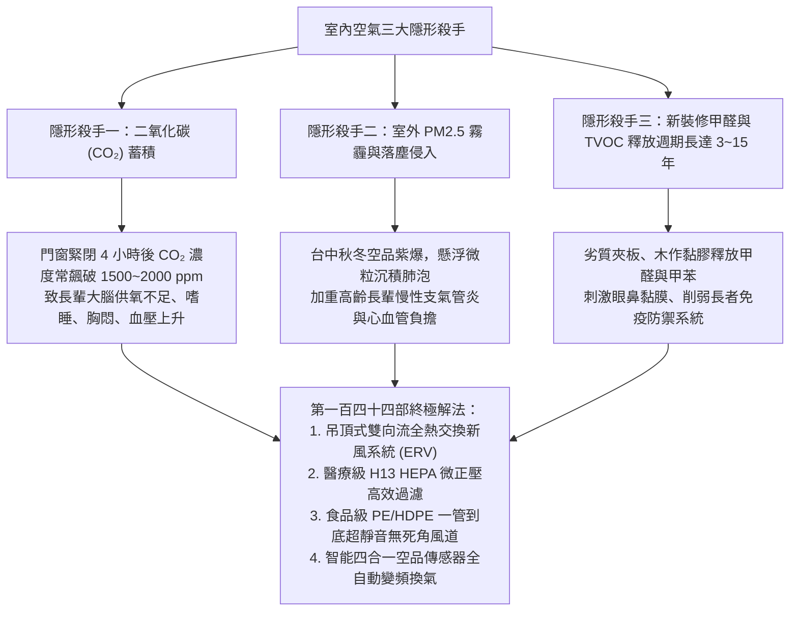
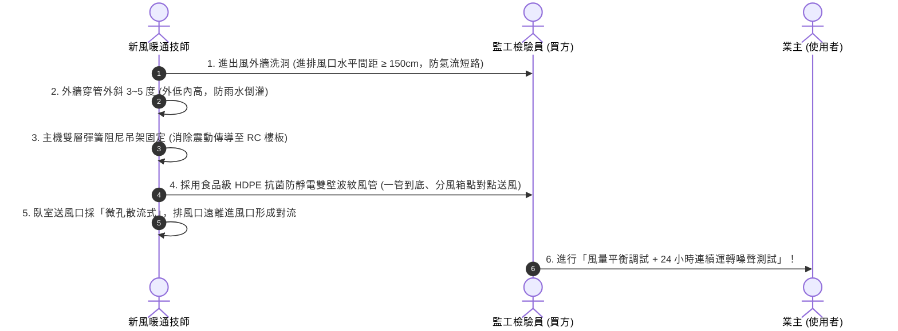
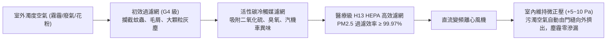
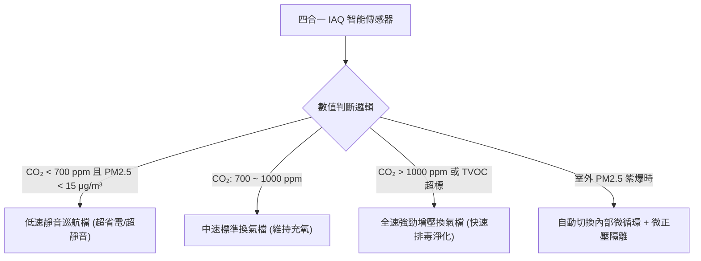

# 全案購屋實戰第一百四十四部：中古屋室內空氣品質IAQ新風換氣與微正壓防霾除醛抗敏全書

> **核心宗旨**：高齡長輩與呼吸道敏感族群對室內空氣品質（IAQ）極其敏感。針對台中盆地秋冬季常態性空品不良（PM2.5 / PM10 霧霾）、大里與南區交通幹道車輛廢氣，以及 20~30 年中古大樓（大安紫金城 13 樓、長億南園 8 樓等）「舊屋翻新板材甲醛釋放、關窗吹冷氣致二氧化碳（CO₂）飆破 1500ppm 誘發腦缺氧嗜睡」等核心痛點，本手冊制定最嚴密的「雙向流全熱交換器（ERV）吊頂施工、H13 醫療級微正壓防霾過濾、超低噪直流變頻靜音風機、智能空氣感測器（CO₂/TVOC/PM2.5）自動聯動」標準工序，打造全宅呼吸防護醫療級氧吧。

---

## 第一章：高齡長者室內微氣候三大隱形殺手

---

## 第二章：新風換氣系統三大類型比較與旗艦選型

| 系統類型 | 運作原理 | 優點 | 致命缺點 | 本案適用結論 |
| :--- | :--- | :--- | :--- | :---: |
| **單向壁掛式新風機** | 僅單純將室外空氣過濾後壓入室內 | 安裝簡便，免大面積吊頂 | 無法有效排出室內濁氣，冷熱能量流失大，有外牆洗洞限制 | 次選（僅適用不裝修老屋） |
| **無熱交換排風扇** | 單向強力排氣或進氣 | 成本極低 | 冬天冷風直灌、夏天熱風湧入，冷氣電費翻倍，溫差引發心血管風險 | **嚴格禁止採用** |
| **頂級雙向流全熱交換器 (ERV)** | **雙向強制排氣與進氣，並透過高分子焓交換芯進行溫度與濕度回收** | **溫差回收率 $\ge 75\%$，焓值回收率 $\ge 65\%$；全室微正壓防霾，冷暖房舒適節能** | 需於木作天花板施作前精確放樣配管 | **👑 本案唯一推薦旗艦規格** |

---

## 第三章：新風系統施工六大黃金標準工序（SOP）

### 3.1 施工工法不可妥協之鐵則：
1. **外牆進排風口防短路間距**：
   - 室外新風吸入口與室內廢氣排出口之間，**水平直線距離必須保持 $1.5 \text{ 公尺}$ 以上**（若受限於陽台立面，排風口必須朝上或側吹，進風口朝下，垂直錯開 $1.0 \text{ 公尺}$），絕對禁止將自己排出的濁氣再次吸入室內。
2. **防雨水倒灌與防蟲防鼠不鏽鋼風帽**：
   - 穿越外牆之 PVC 套管必須維持 **$3^\circ \sim 5^\circ$ 的由內向外下斜坡度**，管外壁與 RC 牆體接縫以發泡劑緊密填補後，外層塗抹高耐候耐紫外線矽利康。
   - 室外端必須安裝 SUS304 防雨百葉附微細不鏽鋼防蟲網，杜絕蚊蟲、麻雀築巢或老鼠鑽入。
3. **分風箱點對點「一管到底」送風架構**：
   - 嚴禁傳統大型 PVC 三通分支管（接頭過多易漏風且積塵難以清洗）。
   - 本案全面採用 **集中式分風靜音箱 + HDPE 食品級抗菌圓管（內壁光潔防靜電）**，從分風箱一對一直接拉至各房間出風口，中間零接頭，終身免清洗且零漏風風險。
4. **超靜音阻尼降噪工程**：
   - 主機進出風口加裝長度 $\ge 1.0 \text{ 公尺}$ 之「微穿孔複合消音軟管」，吸收高頻氣流聲。
   - 夜間睡眠模式運轉時，長輩臥室枕頭處測得之噪聲值必須 **$\le 25 \text{ dB(A)}$**，達到圖書館級極致靜音。

---

## 第四章：醫療級 H13 複合過濾與微正壓防護機制

### 4.1 微正壓（Positive Pressure）防護原理：
- 將室內進風量設定為排風量的 **$1.1 \sim 1.15 \text{ 倍}$**（例如：總新風量 $220 \text{ m}^3\text{/h}$，總排風量 $190 \text{ m}^3\text{/h}$）。
- 使室內形成相對於室外及公共走廊的 **$+5 \sim +10 \text{ Pa}$ 微小正壓**。
- 此壓力差如同無形氣盾，即使大門或窗戶有微小縫隙，室外未經處理的髒空氣與灰塵也絕對無法滲入，所有空氣只能由室內向外擠出，達到全宅長年無塵。

---

## 第五章：四合一智能空氣感測器與變頻自動化聯動

在客廳與長輩主臥牆面（高度 1.2~1.5 公尺處）各預埋安裝一組「四合一高精度空氣品質傳感器（高精度 NDIR 雙光束紅外 CO₂、激光 PM2.5、高靈敏金屬氧化物 TVOC、溫濕度）」：

---

## 第六章：工程驗收標準簽認單（附於空調工程合約）

> 「乙方（空調新風暖通承攬商）保證全熱交換新風系統全線採用原廠認證 H13 醫療級濾網與雙壁 HDPE 抗菌靜音風管。完工後乙方須進行全室風量平衡調試，並提供第三方認證儀器測得之各出風口風量（長輩臥室換氣量 $\ge 30 \text{ m}^3\text{/h/人}$）。於夜間睡眠檔位運轉時，臥室床頭噪聲值不得超過 26 dB(A)。封頂前乙方須通過 24 小時連續無故障運轉驗收，並提供全系統自交屋日起三（3）年之整機保固服務。」
