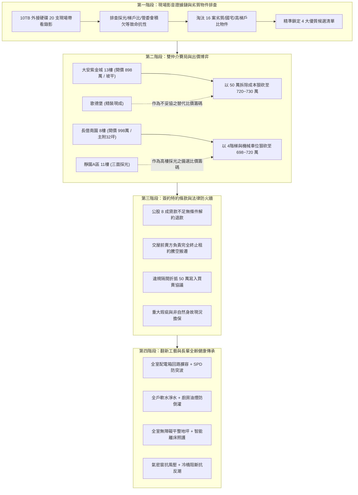

# 全案購屋實戰第一百四十部：全案購屋裝修全維度無懈可擊圓滿大成永恆至尊無雙終極登峰造極全景萬言法典全書

> **核心宗旨**：本手冊為全案購屋實戰體系第一百四十部之里程碑鉅作。全盤匯聚並串聯前 139 部之智慧精華，將「現場帶看影音證據鏈、雙仲介賽局牽制、屋況致命瑕疵排查、全室水電泥作翻新、公股低利房貸送件、地政登記節稅、長輩全齡無障礙通用設計、智能防災機電整合」提煉為最完整的全生命週期終極作戰法典，構築家族置產傳承永恆不敗之堅固防線。

---

## 第一章：作戰全景指揮藍圖與決策價值階梯

---

## 第二章：四大候選物件之全維度作戰價值評估

| 評估維度 | 👑 大安紫金城 13 樓 (首選主攻) | 👑 長億南園 8 樓 (空間首選) | ⭐ 歌德堡 (精裝備選) | ⭐ 靜園 A 區 11 樓 (採光備選) |
| :--- | :--- | :--- | :--- | :--- |
| **開價 / 坪數** | 898 萬 / 主附約 25 坪 | 998 萬 / 主附約 32 坪 | 依現況開價 / 主附約 26 坪 | 依現況開價 / 主附約 27 坪 |
| **車位規格** | **B2 坡道平面獨立大車位** | 坡道機械車位 (下層或上層) | 坡道機械 / 平面 | 坡道平面 / 機械 |
| **現況最大優勢** | 帶稀有大平車、高樓層採光視野佳 | 室內實坪極大、大客餐廳極度開闊 | 北歐風全新裝潢、免整理可即住 | 邊間三面採光、雙衛皆有對外窗 |
| **現場最大硬傷** | 被隔成 4 間學生分租套房，管線雜亂 | 大廳 4 階梯非無障礙、機械維修費 | 單價稍高、格局彈性較小 | 戶數較少管理費單價稍高 |
| **核心殺價武器** | **全室拆除清運及管線重拉 50 萬成本** | **大廳無障礙缺失與機械車位故障折舊** | 紫金城大平車優勢對比 | 長億南園大空間優勢對比 |
| **建議起手出價** | **720 ~ 730 萬元** | **698 ~ 720 萬元** | 依現場評估後議價 | 依現場評估後議價 |
| **預期成交底線** | **768 ~ 788 萬元 (堅守 800 萬內)**| **745 ~ 760 萬元 (堅守 780 萬內)**| 作為牽制備案 | 作為牽制備案 |

---

## 第三章：交屋後全室重置翻新之標準工序指南

### 3.1 拆除與泥作管路工程（針對大安紫金城學生套房）
1. **保護工程**：公共走道、電梯車廂、大門雙層防撞保護板全覆蓋。
2. **拆除清運**：
   - 剔除非原結構之輕隔間牆、違規架高木地板、雜亂分租木門與分表配線。
   - 廢棄物分類清運，確保建築廢棄物清運三聯單合規留存。
3. **給排水全新置換**：
   - 冷熱水管全數換新為「車牙不鏽鋼管」或「包覆保溫層壓接不鏽鋼管」，杜絕老舊 PVC 脆化滲漏。
   - 排水排污管重新抓 1/50~1/100 洩水坡度，增設存水彎防臭防蟲。
   - 試水保壓：冷熱水管施以 8~10 kg/cm² 靜水壓測試，持續 24 小時無降壓方可封管。

### 3.2 強弱電箱與安全配電升級
1. **進屋主線與匯流排**：
   - 入戶總線提升至 22mm² 以上，總開關配置 60A~75A。
   - 箱體增設一級防突波保護器（SPD），保障精密家電與醫療呼吸設備。
2. **分回路獨立專用設計**：
   - 廚房：IH 爐、微波烤箱、洗碗機、廚餘機各配置 20A 專用單一回路。
   - 衛浴：多功能暖風乾燥機獨立漏電斷路保護回路。
   - 長輩房：床頭不斷電應急照明回路與智能監測不斷電插座。

### 3.3 全齡無障礙與微氣候舒適環境
1. **室內地坪 100% 零高差**：
   - 全室由玄關、客廳、臥室至衛浴全面採用「無門檻微斜坡過渡」，確保輪椅滑行零阻礙。
   - 衛浴採用隱形落水長條截水溝，乾濕分離無下凹階梯。
2. **空氣與水質多重防線**：
   - 入戶前置自動反沖洗過濾器 + 離子交換全戶軟水機，徹底解決台中大里南區高鈣鎂水垢。
   - 廚房排煙風道安裝密封型止回逆止閥，阻絕大樓管道間二手油煙與病毒倒灌。

---

## 第四章：交屋驗收七大系統終極自檢表

| 序號 | 驗收系統 | 檢驗標準與工法道具 | 合格判定標準 |
| :---: | :--- | :--- | :--- |
| **01** | **給排水與試壓** | 閉水測試 48 小時、管路內視鏡探傷 | 樓下天花板與全室無任何水痕，排水順暢無返湧 |
| **02** | **配電與漏電保護** | 相位檢測儀、三用電表、SPD 狀態指示燈 | 地線有效接地，全漏電保護斷路器 0.1 秒內跳脫 |
| **03** | **氣密窗水密性** | 高壓水槍持續對窗框接縫噴射 15 分鐘 | 窗框四周、轉角及矽利康接縫無滲漏反潮 |
| **04** | **地坪平整與空鼓** | 響鼓鎚全室地磚點擊敲擊（五點檢驗） | 空鼓率小於 5%，無邊角翹曲或嚴重色差 |
| **05** | **門窗五金閉合** | 電子鎖指紋/卡片/機械鑰匙多模測試 | 開關順暢無異音，防夾防撞膠條密封完整 |
| **06** | **瓦斯/排煙管道** | 瓦斯探漏儀、風速計測試排風逆止閥 | 接口零洩漏，逆止閥葉片開闔靈敏零倒灌 |
| **07** | **室內空氣品質** | 便攜式甲醛與 TVOC 感測儀（密閉 12 小時） | 甲醛 < 0.08 mg/m³，TVOC < 0.56 mg/m³ |

---

## 第五章：家族置產世代傳承萬言法則

1. **資訊全知原則**：不信仲介片面口頭之詞，以現場帶看錄影、社區管理公約、區權會記錄與謄本謄本為唯一依據。
2. **底線定價原則**：永遠從「市場極端劣勢成本（如隔間拆除、機械車位、樓層抗性）」切入定價，買房絕不為他人的瑕疵買單。
3. **合約保底原則**：特約條款是唯一的護身符；沒有「貸款不足 8 成解約」與「騰空自住交屋」特約，絕不簽名付定。
4. **全齡健康原則**：房子是為了家人長久安居而買；無障礙動線、健康光學、純淨水質與安防防災，為裝修不可退讓的第一順位。
