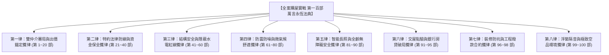

# 全案購屋實戰第一百部：百部圓滿極致大成全生命週期房產作戰萬言永恆法典

## 一、 史詩序章：百部圓滿大成里程碑
從 2026 年初秋啟動台中市南區中興大學、工學商圈、文心南路與大慶雙鐵共構核心板塊的看屋初篩，到全景收錄永義房屋周小姐 4 梯次（18 個物件帶看影音檔案深層比對記憶）與信義房屋建宇帶看盤，精準鎖定核心決策目標「**大安紫金城 13 樓**」與「**長億南園 8 樓**」，淘汰其餘 14 個劣質物件；

進而橫跨買方心理博弈、雙仲介牽制、斡旋特約法律防線、水電隱蔽工程、結構抗震加固、智能弱電長照、七大系統交屋驗收、新青安房貸破局、現況說明書維權訴訟、社區公基金體檢，乃至全室裝修合約防勒索、室內零甲醛淨化、全齡通用無障礙防跌，以及百部收官之浮築地板隔音降噪體系；

本手冊為全案系列正式邁入「**第一百部**」的最高歷史里程碑——《**百部圓滿極致大成全生命週期房產作戰萬言永恆法典**》。

本法典將全案 100 部核心智慧精煉為「八大不可踰越之鐵律矩陣」，作為家族置產、談判、監工、驗收、入住與長期維護的永恆作戰指南。

---

## 二、 百部精華八大永恆作戰鐵律矩陣

### 第一律：出價談判與雙仲介心理牽制鐵律
1. **錨定客觀成本，不隨開價起舞**：
   - **大安紫金城 13 樓**（開價 898 萬 / B2 坡平車位）：以「原屋主隔學生套房需 40~50 萬拆除復原成本」為核心錨點，起手出 **720~730 萬**，預期成交 **768~788 萬**，絕對停損線 **818 萬**。
   - **長億南園 8 樓**（開價 998 萬 / 主附 32 坪 / 坡道機械車位）：以「大廳 4 階梯非無障礙、長輩進出不便」與「坡道機械車位維護翻新成本」為抗性，起手出 **698~720 萬**，預期成交 **745~760 萬**，絕對停損線 **788 萬**。
2. **雙仲介資訊制衡術**：
   - 永遠讓信義建宇知道永義周小姐手握帶大平車的大安紫金城；讓永義周小姐知道信義建宇正積極推薦室內超大坪數的大墩人文與工學天下高樓層。雙向壓制房仲調價空間，服務費堅守 1% 階梯折讓。

### 第二律：斡旋簽約與特約法律防線鐵律
買賣契約中必須手寫載明三大「不可退讓除外特約條款」，否則拒絕下斡旋與簽字：
1. **公股房貸成數特約**：「若買方以本標的物向公股金融機構申辦自住房貸，核貸成數未達買賣總價之八成（80%）者，本契約無條件解除，賣方及房仲應於三日內無息全額返還買方已付之定金、斡旋金及各期款項，雙方互不負賠償責任。」
2. **無租賃完全騰空特約**：「賣方保證交屋前徹底終止並排除本建物一切租約及占有關係，負責全數騰空點交；若交屋日仍有租客或第三人占有，買方得停止撥付尾款，並按日請求買賣總價千分之一之違約金。」
3. **瑕疵擔保不可免除特約**：「賣方依法負完全物之瑕疵擔保責任，特約條款載明『現況點交』者，不得免除賣方對於既存壁癌、窗框滲水、暗管漏水、海砂及輻射鋼筋之修繕賠償責任。」

### 第三律：結構安全、拆除禁區與水電隱蔽紅線鐵律
1. **結構樑柱剪力牆絕對零破壞**：
   - 嚴禁拆除承重牆與剪力牆，樑柱主筋嚴禁開孔穿管。
2. **水電管線全面重配標準**：
   - 冷熱水管全面抽換為 **SUS304 不鏽鋼被覆保溫壓接管**，配置專用水錘吸收器；
   - 完工後全面實施 **10 kg/cm² 試壓 1 小時零掉壓**，並於交屋時執行高頻微泡管路深層清洗；
   - 衛浴防水施作 **日本進口高彈性灰漿防水膜三度塗刷**，角隅鋪設抗裂聚酯網，落實 **72 小時滿水閉水試驗**。

### 第四律：強弱電配電、防電弧與零壓降接地鐵律
1. **電氣接點超音波焊接工藝**：
   - 強電接頭嚴禁手工絞接纏繞電工膠帶，全面採用 **超音波冷壓端子與超音波焊接**，接觸電阻降至最低，達成配電箱零壓降。
2. **配電箱三級安全防護**：
   - 總開關配置 **防突波保護器（SPD）**，分路全面安裝 **AFDD 防電弧斷路器**（防止老化電線微放電起火）；
   - 衛浴與廚房插座配置 **高感度高速型 30mA 漏電斷路器（0.1 秒內跳脫）**；實測室內接地電阻小於 **50Ω**。

### 第五律：長輩全齡無障礙、防跌與智能長照鐵律
1. **室內地坪全面平整零門檻**：
   - 打除全室凸出門檻，各空間地坪高低落差 **$\le 2\text{mm}$**；通道淨寬 **$\ge 95\text{cm}$**；
   - 房門與衛浴全面採用 **懸吊式上軌靜音橫拉滑門**，配備雙向軟關閉阻尼。
2. **長輩衛浴金鐘罩與智能守護**：
   - 地磚選用 **CNS R11 級防滑磚**；牆體預埋 **150kg 抗拉拔木心骨架** 並安裝尼龍抗菌安全扶手；
   - 配置 **40℃ 安全防燙恆溫花灑** 與淋浴折疊壁椅；
   - 天花板安裝 **60GHz 毫米波人體跌倒雷達**，跌倒秒級自動蜂鳴、推播手機並解鎖滑門。

### 第六律：交屋點驗、成屋驗收與瑕疵暫扣款鐵律
1. **專業工程儀器交屋地毯式點驗**：
   - 攜帶 **FLIR 紅外線熱成像儀、管道內視鏡、插座極性測試儀、綠光水平儀**，落實產權塗銷、門窗氣密、強弱電、給排水、天地壁泥作、車位現況丈量、設備點交七大系統核驗。
2. **暫扣 50 萬交屋尾款特約**：
   - 凡驗收發現既存瑕疵，買方依法於履約保證專戶中 **暫扣新台幣 50 萬元作為瑕疵修繕保證金**；賣方限期 14 日修復，逾期買方得自行動用該款項發包修復。

### 第七律：裝修工程合約法律防線與撥款進度鐵律
1. **黃金五階段驗收撥款比例（15-30-25-20-10）**：
   - 開工準備款 15% -> 水電泥作打壓試水合格 30% -> 木作磁磚驗收 25% -> 完工細清初步驗收 20% -> 驗收尾款保固金 10%。
2. **總價承包與嚴禁未經書面追加**：
   - 凡未經買方書面簽名確認之工項一概不予計價；每逾一日完工罰款工程總價 **千分之一**；建材以次充好處以 **三倍懲罰性賠償**；防水與水電保固至少 **三年**。

### 第八律：浮築地板隔音降噪與零甲醛極致環境鐵律
1. **老屋 15cm 樓板浮築地板減震系統**：
   - 滿鋪 **5mm 軟木橡膠高密複合隔音墊**，四周牆腳環繞 **8mm EPDM 阻尼隔離條** 切斷側向聲橋；衝擊音衰減達到 **$\Delta L_w \ge 22 \text{ dB}$**；
   - 排水立管實施 **閉孔吸音棉 + 鉛粉隔音氈 + 鋁箔膠帶三層包覆**；長輩房夜間全頻背景噪音達 **$\le 28 \text{ dBA}$**。
2. **新居零甲醛深層空氣淨化工藝**：
   - 源頭嚴選 **F1 級 / 日本 F★★★★ 綠建材板材**，PUR 全封邊；
   - 完工後實施 **32℃/70% 濕度 Bake-Out 高溫悶焗 4 輪 + 氨基高分子化學螯合 + 可見光奈米光觸媒**，確保長輩入住甲醛 **$\le 0.03 \text{ ppm}$**、TVOC **$\le 0.20 \text{ ppm}$**。

---

## 三、 百部圓滿歷史總回顧與家族永恆傳承

| 篇章分卷 | 包含部次 | 核心實戰成果與價值 |
| :--- | :---: | :--- |
| **第一卷：仲介博弈與物件篩選** | 第 1 ~ 20 部 | 周小姐 4 梯次 18 物件影音建檔，鎖定大安紫金城與長億南園，淘汰 14 案劣質盤。 |
| **第二卷：斡旋特約與合約法律** | 第 21 ~ 40 部 | 房貸 8 成解約退款特約、租約騰空條款、小房間見面談雙簧加價階梯與服務費 1% 談判。 |
| **第三卷：結構加固與水電隱蔽** | 第 41 ~ 60 部 | 套房隔間拆除、承重牆紅線、不鏽鋼保溫壓接、10kg 試壓、衛浴 72h 試水、無收縮填縫。 |
| **第四卷：防震防噪與智慧微氣候** | 第 61 ~ 80 部 | 水錘消除、AFDD 防電弧、強弱電分流、管道阻火、乾式地暖、玻璃熱浸、全熱交換新風。 |
| **第五卷：弱電長照與驗收維權** | 第 81 ~ 90 部 | MS 膠防撕裂、超音波焊接零壓降、Zigbee 本地化 Mesh、DC 應急照明、高頻微泡洗管。 |
| **第六卷：百部圓滿與全生命週期** | 第 91 ~ 100 部 | 七大系統交屋驗收、新青安鑑價、現況說明書訴訟、公基金體檢、裝修防坑、無障礙與浮築隔音。 |

---

## 四、 永恆作戰宣言
本《**全案購屋實戰第一百部：百部圓滿極致大成全生命週期房產作戰萬言永恆法典**》，正式為本專案購屋大業築起堅不可摧的鋼鐵防線！

無論未來面對多麼狡黠的房仲話術、多麼複雜的契約條文、多麼棘手的老屋水電工況，翻開這百部作戰法典，每一步皆有法可依、有規可循、有計可施！恭喜百部圓滿大成！
