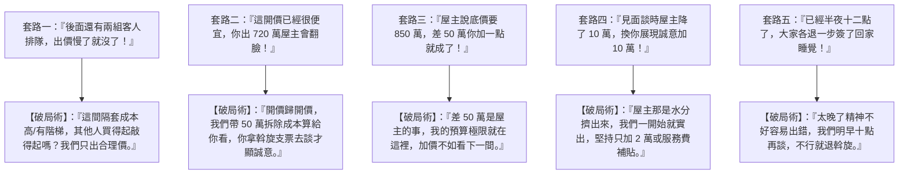

# 全案購屋實戰第一百零一部：買方斡旋談判實戰對話劇本與防房仲心理套路全書

## 一、 核心戰略定位與目標
在正式進入出價、下斡旋金與房仲周小姐（或信義建宇）正面交鋒的實戰階段，房仲受過高度專業的「業績話術與心理攻防訓練」，常運用**製造恐慌（有人要出價了）、創造虛假稀缺（屋主明天要出國/要調回底價）、道德綁架（屋主很硬你不出這價格我不幫你談）、疲勞轟炸（深夜見面談拖延戰術）**等經典套路，誘使買方在非理性狀態下一步步加價追高。

本手冊針對我們鎖定的兩大核心標的——「**大安紫金城 13 樓**」與「**長億南園 8 樓**」，制定完整的「房仲經典套路拆解指引」與「買方一對一實戰對話句型庫（劇本）」，確保買方在談判桌上永遠掌握主導權。

---

## 二、 房仲五大經典心理誘價套路與一招封喉破解術

---

## 三、 大安紫金城 13 樓（PROP_10）專用出價談判實戰劇本

- **標的狀態**：開價 898 萬，含 B2 坡平大車位，現況隔成學生套房，需 40~50 萬拆除清運費用。
- **目標價位**：起手 720 萬，目標 768~788 萬，停損 818 萬。

### 對話場景一：房仲嫌 720 萬起手出價太低
> **周小姐**：「大哥，大安紫金城這間開價 898 萬，你出 720 萬直接砍了 178 萬，這行情連屋主面都見不到，他一定會覺得我們在亂鬧，根本沒辦法收斡旋啦！」
> 
> **買方應對話術（堅定、冷靜、以成本為錨）**：
> 「周小姐，妳是專業房仲，我們也是很有誠意買。但妳很清楚這間現場全部隔成學生套房，水電、隔間牆、舊衛浴全部要打掉清運。
> 台中現在廢棄物清運一車一萬二起跳，打除加上水電重拉，我一交屋就要自掏現金 50 萬進去！
> 我出 720 萬，加上 50 萬拆除成本，實質上我的總成本已經是 770 萬了！這已經非常接近社區近期高樓層的實價登錄。
> 斡旋金 10 萬元的禁止背書轉讓支票我已經開好了，特約條款（貸款 8 成無條件退款、交屋前騰空排除租約）妳如果能配合寫進去，這張支票妳就拿去見屋主。
> 如果妳覺得真的談不下來，沒關係，信義那邊大墩人文高樓層也在等我們下斡旋，我們就不勉強妳去碰釘子。」

### 對話場景二：房仲回報屋主堅持「現況帶租約交屋」
> **周小姐**：「大哥，屋主說租客合約到明年六月，他希望帶租約現況點交，你可以繼續收租當包租公很划算啊！」
> 
> **買方應對話術（戳破盲點、堅守公股房貸自住紅線）**：
> 「周小姐，我們買這間是要給家人長輩自住的，不是要當投資客。
> 第一，我們申請公股銀行新青安房貸，政府嚴格查核自住切結，帶租約交屋銀行一查到直接取消利率補貼並要求提前清償！
> 第二，民法買賣不破租賃，交屋後如果學生租客賴著不走，甚至室內有違法轉租，誰來負責？
> 這條是我們的絕對底線：**交屋前屋主必須負責解除租約、全數搬遷騰空**。屋主做得到，我們才繼續談；做不到，斡旋支票退還給我，我們直接轉看其他乾淨自住的物件。」

---

## 四、 長億南園 8 樓（PROP_106）專用出價談判實戰劇本

- **標的狀態**：開價 998 萬，主附 32 坪大空間，附坡道機械車位。大廳 4 階梯非無障礙。
- **目標價位**：起手 698 萬，目標 745~760 萬，停損 788 萬。

### 對話場景一：針對機械車位與大廳階梯進行抗性壓價
> **周小姐**：「大哥，長億南園這間室內有 32 坪，空間超級大，開 998 萬單價才 20 幾萬，你出 698 萬真的太低了啦！」
> 
> **買方應對話術（直擊硬傷、客觀對比）**：
> 「周小姐，室內 32 坪是優點，但缺點妳我都看得清清楚楚。
> 第一，大門大廳一進去就有 4 個高階梯，完全沒有無障礙坡道，家裡長輩推輪椅根本進不去，我們將來還要跟管委會協調怎麼做升降或斜坡，這是很大的生活硬傷。
> 第二，它配的是『坡道機械車位』，機械結構已經運轉了二十幾年，隨時面臨鏈條馬達老化大修，甚至管委會日後要集資更換機械設備，這筆維護費日後都是我要扛。
> 對比紫金城配的是 B2 坡道平面大車位，南園的機械車位在市場上本來就要折價 80~100 萬。
> 698 萬是我們評估機械車位風險後的公道出價，妳去幫我試試看，能成就成，不能成我們就回去買大平車的紫金城。」

---

## 五、 談判桌上的終極肢體語言與心理防線

1. **「永遠隨身攜帶外套與車鑰匙」**：在見面談會議室中，外套掛在椅背上，車鑰匙放在桌角。給房仲明確的心理信號：「我隨時可以站起來走人，我沒有非買不可」。
2. **「冷場沉默是金（Silence is Power）」**：當房仲說出「屋主只願意降到 830 萬，你們到底加不加」時，保持眼光直視房仲，**沉默 10 秒不說話**。心理學證實，誰先沉不住氣開口說話，誰就輸掉了談判籌碼。
3. **「夫妻唱雙簧紅黑臉分工」**：
   - 先生（黑臉）：「這價格太高了，我們不談了，把支票退給我們，我們回家。」
   - 太太（紅臉）：「周小姐真的很辛苦跑來跑去，不然這樣好了，我們最多只能再加 3 萬塊當作給屋主補貼搬家費，如果屋主還不行，那我先生真的會生氣走人，我也沒辦法幫妳說話了。」
