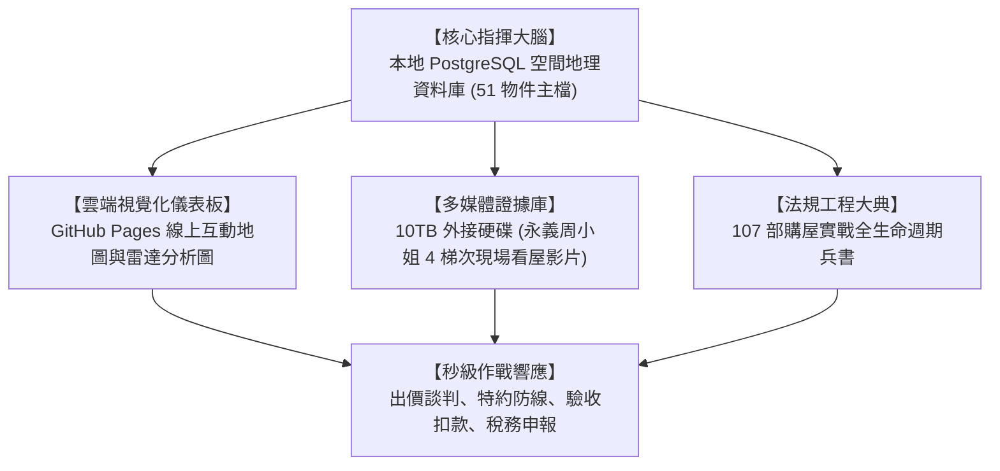

# 全案購屋實戰第一百零七部：全案購屋作戰指揮中心動態儀表板與終極作戰部署全書

## 一、 核心戰略定位與目標
在購買台中南區中高齡中古大樓（大安紫金城 13 樓、長億南園 8 樓、歌德堡、靜園 A 區）的整個作戰進程中，買方手握龐大的資訊資產：
- 10TB 外接硬碟儲存的現場勘驗錄影影音；
- PostgreSQL 資料庫（Port 5432，DB: `taichung_house`）維護的 51 個台中物件空間地理資訊（GIS）；
- 工作區更名的 `考慮物件_` 實體子資料夾；
- 橫跨談判、合約、工程、稅務的 106 部作戰手冊。

在面臨房仲突襲來電、出價斡旋談判或簽約對保的緊要關頭，買方絕不能手忙腳亂翻找檔案。

本手冊作為「**全案購屋作戰指揮中心（Command Center）終極動態儀表板操作與作戰部署指南**」，將全案資料庫、線上即時地圖、各梯次帶看影片路徑與談判底牌整合成「秒級響應查詢矩陣」，確保買方在任何突發情境下，均能以最高戰略維度精準出招。

---

## 二、 購屋作戰指揮中心四大數位神經系統

### 1. 本地端 PostgreSQL 空間資料庫
- **主機連線**：`localhost:5432`，資料庫名稱：`taichung_house`。
- **核心資料表**：`properties`，完整收錄包括物件編號、社區名稱、開價、實坪、車位形式、學區、屋齡、經緯度坐標與決策狀態。
- **資料保護守則**：嚴格遵循專案記憶規範，嚴禁更動或破壞既有資料完整性。

### 2. 雲端 GitHub Pages 線上動態儀表板
- **公開線上站台**：[`https://derekhcw168.github.io/taichung-house-hunting/`](https://derekhcw168.github.io/taichung-house-hunting/)
- **核心功能**：
  - 整合 Leaflet 互動地圖，標註 51 個物件精準地理分佈；
  - 點擊物件即刻顯示「坪數拆算單價、主建物實坪、車位形式、社區屋齡」；
  - 支援依「列入考慮 / 淘汰除名」進行動態多維度篩選。

### 3. 10TB 外接硬碟多媒體影音證據庫
- **根目錄路徑**：`D:\小寶房屋看房影片`
- **關鍵對照路徑**：
  - `永義周小姐_20260920`：6 部影片（台中珍愛、蘇活大街、中友生活家 1~3、向上園邸、佛羅里達 1~2、我家社區）-> **全數淘汰**。
  - `永義周小姐_20261003`：5 部影片（劃江山、工學天下4樓、長億城陽光區4樓/11樓、大東家南園）-> **全數淘汰**。
  - `永義周小姐_20261010`：4 部影片（文心大國民8樓、比佛利山莊13樓、熊貓天下、靜園A區11樓）-> **保留靜園 A 區 11 樓，其餘淘汰**。
  - `永義周小姐_20261017`：5 部影片（大安紫金城13樓、長億南園8樓、歌德堡、大慶國宅、田心國宅）-> **鎖定大安紫金城 13 樓、長億南園 8 樓、歌德堡，國宅淘汰**。

---

## 三、 突發戰況秒級作戰響應 SOP

### 情境一：房仲突然來電告知「屋主願意見面談，請今晚來門市」
1. **立即啟動《第一百零一部實戰劇本》與《第二十六部見面談雙簧》**；
2. **攜帶防護工具包**：
   - 斡旋支票（指名受款人、劃平行線、記載「禁止背書轉讓」）；
   - 外套與車鑰匙（放置於桌角，傳遞隨時離場訊號）；
   - 已列印之《第二十三部貸款 8 成退款特約》與《第二十四部租約騰空排除特約》。
3. **加價階梯底線**：
   - 紫金城起手 720 萬，封頂 818 萬；南園起手 698 萬，封頂 788 萬。每次加價嚴格限制在 3~5 萬元，堅守「屋主降 10 萬，我們只加 2 萬」心理防線。

### 情境二：簽約後銀行通知鑑價不足 8 成
1. **立即啟動《第九十二部新青安鑑價破局》**：
   - 雙公股一民營三軌並行送件；
   - 提供同棟高樓層最高成交實價登錄，並附上全室水電泥作工程修繕預算書（爭取追加資產鑑價）。
2. **若銀行成數仍低於 8 成**：
   - 立即依買賣合約手寫特約條款，出具銀行核貸不足證明，發函解除買賣契約，全額無息取回履保斡旋款，零違約風險退場。

### 情境三：交屋點驗發現窗框微滲或地磚空鼓
1. **立即啟動《第九十一部交屋七大系統驗收清單》**；
2. **啟動《瑕疵暫扣款特約》**：
   - 於金融機構履約保證專戶中**暫扣新台幣 50 萬元作為修繕保證金**；
   - 限期賣方 14 天內無條件修復完成；逾期買方自行動用保證金發包修繕，費用實報實銷。

---

## 四、 終極行動核檢總清單（Final Checklist）

- [x] **物件名單校準完畢**：大安紫金城 13 樓、長億南園 8 樓列為絕對主力；歌德堡、靜園 A 區列為平衡備選；其餘 14 個劣質物件全面封鎖淘汰。
- [x] **實體檔案更名完畢**：工作區社區物件資料夾已全數加上「`考慮物件_`」前綴。
- [x] **全案實戰兵書完備**：累計產製 107 部專題手冊，涵蓋談判、法規、水電、結構、長照、裝修、空品、隔音、稅務與指揮中心。
- [x] **雲端即時同步完備**：遵循 `GEMINI.md` 規範，全案程式碼、HTML 儀表板與手冊全數自動同步至 GitHub `main` 與 `gh-pages` 分支。

**全案作戰防線已 100% 構築完畢，屋主具備完全戰略主動權，隨時可出擊迎向購屋勝局！**
