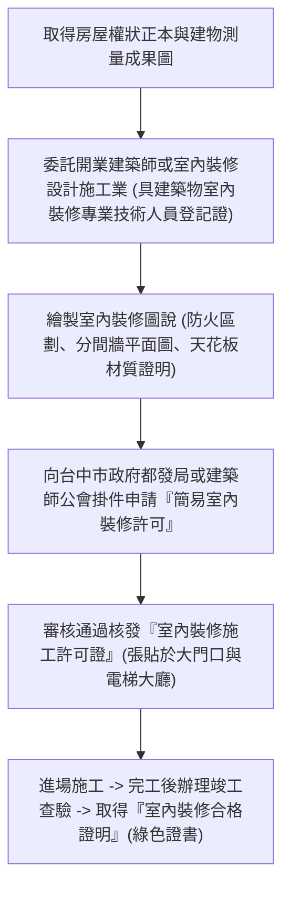
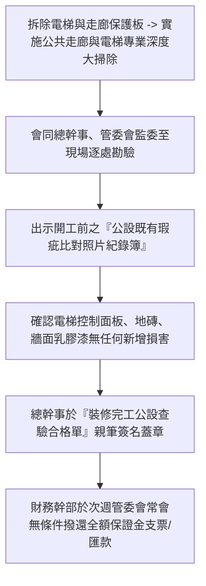

# 全案購屋實戰第一百零三部：舊屋翻新水電泥作施工申辦室內裝修審查與管委會押金退還全書

## 一、 核心戰略定位與目標
在購買台中南區中高齡中古大樓（如大安紫金城 13 樓、長億南園 8 樓）並進行全室裝修時，最常遭遇的外部法律與行政障礙為：
1. **未申請室內裝修審查許可（俗稱簡易裝修申報）遭到鄰居檢舉，被台中市政府都市發展局（都發局）勒令停工並開罰 6 萬至 30 萬元罰鍰**；
2. **大樓管委會巧立名目刁難，扣留數萬元至十萬元的「施工裝修保證金（押金）」遲遲不肯退還**；
3. **施工期間廢棄物清運粉塵、電梯公共梯間保護板磨損爭議，引發鄰里衝突**。

本手冊依據內政部《建築物室內裝修管理辦法》及台中市政府公寓大廈管理規範，制定「合法簡易室內裝修審查許可申辦 SOP」、施工前公共區域防護工程標準，以及「裝修完工管委會保證金 100% 全額無扣款退還攻略」。

---

## 二、 台中市合法室內裝修審查（裝修許可）申辦條件與 SOP

依台灣現行建築法規，只要集合住宅大樓涉及以下施工工項之一，依法**必須申辦建築物室內裝修審查**：
- 增設或敲除室內分間牆（如大安紫金城 13 樓拆除學生套房隔間）；
- 變更原有天花板或新設天花板；
- 變更兩間以上衛浴空間（涉及水電吊管與防水地坪）。

### 1. 簡易裝修審查（二階段免繁瑣跑照流程）
- **適用對象**：10 層以下樓層任一樓層，或 11 層以上樓層部分裝修且未破壞主要構造與防火區劃者。
- **核心要件**：
  - 天花板與室內分間牆裝修材料必須使用 **耐燃一級（如矽酸鈣板、石膏板）或耐燃二級綠建材**，出具出廠防焰合格證明。
  - 嚴禁更動主要結構樑、柱、剪力牆或樓板（大安紫金城敲除僅限非承重輕隔間）。

### 2. 未報備擅自施工之法律風險
- 鄰居若撥打 1999 市民專線檢舉，都發局建管科將無預警派員突擊聯合稽查。
- 若無施工許可證，當場開立「勒索性罰鍰 60,000 ~ 300,000 元」，並勒令連續停工至補件審驗完成為止（往往拖延 1~2 個月工期，損失慘重）。
- 因此，統包工程合約中必須載明「由廠商合法代辦室內裝修許可申請，規費實報實銷」。

---

## 三、 管委會裝修申報與公共空間高規格保護工程規範

在工班正式進場打石前 7 天，必須向社區物業管理中心（總幹事）辦妥施工報備：

### 1. 繳納施工保證金與清潔規費
- **保證金行情**：台中一般中古大樓裝修保證金約為 **NT$ 20,000 ~ 50,000 元**（完工無損公設全額無息退還）。
- **每日/每月清潔規費**：管委會常收取每日約 100~200 元之電梯用電與公共走廊清潔損耗補貼，要求物業開立正式收據入社區公基金專戶。

### 2. 電梯機廂與公共梯間三層保護防護工法
- **進場第一天必驗項目**：
  - 凡從社區大門、中庭推車走道、電梯機廂內外門框、電梯內部六面、施工樓層公共走廊地板至住戶大門口，必須施作**三層防護保護板**：
    1. **第一層（底層）**：防刮吸震之高發泡 PE 泡棉或瓦楞板；
    2. **第二層（中層）**：2分厚（6mm）強韌夾板（木木板），抵抗重型工具推車與打石廢棄物之撞擊；
    3. **第三層（面層）**：抗磨防滑之 PVC 塑料保護膜，接縫處以無痕布紋膠帶滿貼。
- **現況錄影拍照備查（防甩鍋關鍵）**：
  - 保護板鋪設前，會同總幹事或保全組長，將公共電梯鏡面、不鏽鋼壁板、走廊地磚既有之刮痕、破損處拍照並錄影建檔，雙方簽名確認，嚴防完工時管委會將十年前的舊傷硬栽在我們頭上！

---

## 四、 施工噪音與時段管理：鄰里關係和諧實戰技巧

1. **嚴格遵守法定施工時段**：
   - 台中市環保局噪音管制標準：週一至週五上午 8:30 ~ 12:00、下午 13:30 ~ 17:30。
   - 週六、週日及國定例假日**全天嚴禁施作打石、電鑽等重噪音震動工項**（僅可進行無噪音之靜態油漆、水電穿線或細部量測）。
2. **施工前「鄰里睦鄰禮盒與施工告知函」拜訪**：
   - 於開工前 3 天，由屋主親自（或偕同設計師）拜訪「正樓上、正樓下、同層左右兩側」共 4~6 戶鄰居。
   - 遞送一份精緻點心禮盒（如台中在地知名伴手禮）與印有設計師及屋主電話之「施工告知卡」，誠懇致歉並承諾將噪音最大之打除期壓縮在 3 天內結束。
   - 「先禮後兵」能消弭 90% 以上鄰里投訴與惡意檢舉。

---

## 五、 完工驗收管委會施工保證金 100% 全額退款 SOP

裝修完工、細清完成並拆除電梯公共保護板後，按以下步驟辦理保證金退款：

> **【法律自保防線】**
> 若管委會個別委員故意藉故刁難拖延退款超過一個月，出示本手冊存證條文：
> 「本案已完成內政部室內裝修合格查驗，公共設施經雙方現場點驗與施工前原始比對照片完全相符，並無任何毀損情事。
> 依公寓大廈管理條例及民法第 179 條不當得利規定，管委會無權擅自扣留施工保證金，請於五日內無息返還；逾期本人將向台中市政府住宅發展工程處公寓大廈爭議事件審調委員會提出申訴並循民事程序追償利息損失。」
> 通常管委會見屋主具備完整影像證據與法規底氣，皆會於數日內全額退款結案！
