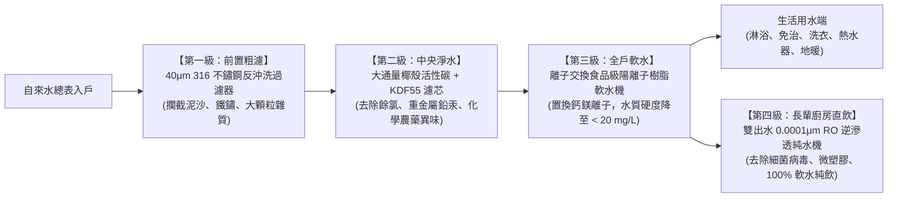
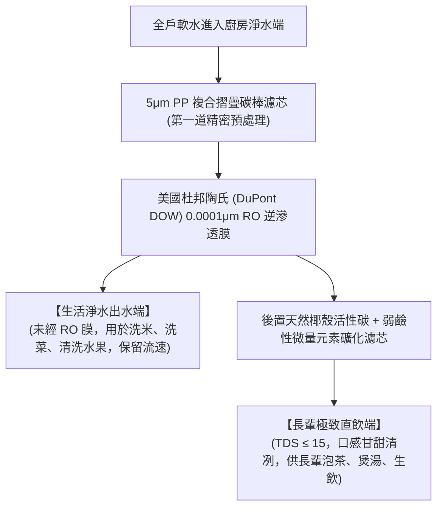

# 全案購屋實戰第一百零九部：台中水質硬度與全戶軟水活水淨水系統規劃全書

## 一、 核心戰略定位與目標
在購買台中南區中高齡中古大樓（如大安紫金城 13 樓、長億南園 8 樓、歌德堡、靜園 A 區）時，除了注重空間動線與結構安全，另一個長年困擾台中居民且嚴重影響健康的日常隱形殺手為**自來水高硬度與老舊供水管網二次污染**。

台中地區水源主要取自大安溪與大甲溪流域，地質富含碳酸鈣與碳酸鎂岩層，總水質硬度（Total Hardness as $\text{CaCO}_3$）長年維持在 **$150 \sim 220 \text{ mg/L}$（依 WHO 標準屬於「硬水至極硬水」）**。

高硬度自來水進入中古大樓後，會引發四大破壞性後果：
1. **水垢沉積導致暗管水壓驟降**：加熱後鈣鎂離子迅速結晶析出水垢，堵塞熱水管彎頭、熱水器熱交換器與全戶出水龍頭陶瓷閥芯；
2. **長輩與全家皮膚毛孔乾燥受損**：硬水中的鈣鎂皂垢殘留皮膚表面，洗澡後皮膚乾癢緊繃，加劇長輩冬季搔癢症與濕疹；
3. **高級衛浴設備石灰白垢腐蝕**：淋浴玻璃門、黑色花灑龍頭與免治馬桶在數月內布滿難以清除的頑固白斑；
4. **管網鐵鏽與重金屬鉛鎘微粒**：中古大樓頂樓水塔清洗若不落實，水塔底部淤泥、鐵鏽與餘氯大幅增加洗腎及致癌風險。

本手冊制定「全戶給水四級淨水軟水過濾架構」、「離子交換食品級樹脂軟水機計算工序」、「長輩直飲級 RO 雙出水逆滲透系統」與「台中自來水定期水質化驗標準」。

---

## 二、 全戶四級階梯式淨水軟水物理化學防護模型

在全室水電翻新配管時，必須於冷水進戶總管處（後陽台或工作陽台進水端）規劃一體化「四級防護」：

---

## 三、 第三級全戶離子交換軟水機選型與鹽箱計算工序

### 1. 鈉離子交換樹脂原理
- 軟水機內部填裝 **食品級高交換容量強酸性陽離子交換樹脂（Gel-type Strong Acid Cation Resin）**。
- 當硬水流經樹脂層時，樹脂上的鈉離子（$\text{Na}^+$）與水中的鈣離子（$\text{Ca}^{2+}$）、鎂離子（$\text{Mg}^{2+}$）進行定量置換：
$$2\text{R-Na} + \text{Ca}^{2+} \longrightarrow \text{R}_2\text{Ca} + 2\text{Na}^+}$$
- 出水總硬度可由台中的 $180 \text{ mg/L}$ 極限降至 **$0 \sim 17 \text{ mg/L}$（極軟水境界）**。

### 2. 樹脂填裝量與通量計算公式
- 依據 3~4 口自住家庭（含長輩），每日總生活用水量約 $600 \sim 800 \text{ L}$。
- 台中水質平均硬度以 $10 \text{ gpg} \; (171 \text{ mg/L})$ 計算，一週再生一次之所需交換容量：
$$\text{週期交換容量} = 800 \text{ L/天} \times 7 \text{ 天} \times 171 \text{ mg/L} = 957,600 \text{ mg} \approx 958 \text{ g 碳酸鈣}$$
- **樹脂選型標竿**：填裝量至少 **$20 \sim 25 \text{ 公升（L）}$**，工作流量達 **$1.5 \sim 2.0 \text{ 噸/小時（m}^3\text{/hr）}$**，保證全家兩間浴室同時淋浴時水壓零衰減。

### 3. 微電腦智能流量型逆流再生控制閥
- 嚴禁選用依舊式「時間型」定時再生的控制閥（易造成未飽和即洗鹽或過載未洗出硬水）。
- 必須指定 **智能動態流量型控制閥（Flow-meter Controlled Valve）**，精準計量實際通過水量，並在凌晨 2:30 長輩睡眠時段自動執行「逆流加鹽再生與正沖洗」。
- **專用軟水鹽**：必須使用純度高達 **$99.5\%$ 以上之食品級天然無碘真空結晶球型鹽球**，嚴禁使用未精製之工業鹽或海鹽（防止雜質使樹脂中毒板結）。

---

## 四、 長輩專用廚房第四級 RO 逆滲透雙出水系統

對於高齡長輩的飲食與茶道用水，軟水機出水雖已無水垢，但水中鈉離子略微增加，不宜作為心血管長輩的長期直接飲用水。因此廚房流理台下方必須串接直飲 RO 系統：

### 1. 無儲水桶大通量即濾即飲（Tankless 800G~1000G）
- 傳統 RO 帶壓力橡膠儲水桶使用 2 年後，橡膠隔膜老化易滋生大量細菌與亞硝酸鹽。
- 本工法一律採用 **800G ~ 1000G 無桶大通量直出水 RO 機**，出水速度達 **$2.1 \sim 2.6 \text{ L/min}$（5 秒盛滿一杯 200ml 純淨水）**，新鮮現濾零二次污染。

### 2. 純廢水比 2:1 一級水效
- 選配智能雙旋脈衝自清洗專利技術，純廢水比高達 **$2:1 \sim 3:1$**，大幅節省水費。
- 專用智能水龍頭配備雙出水切換（淨水洗菜 / 純水生飲），並於龍頭底座顯示濾芯壽命與即時出水 TDS 數值，長輩一眼即知水質健康狀態。

---

## 五、 水電工程預留管線與空間配置核驗清單（Checklist）

在進行大安紫金城或長億南園水電圖面審查時，陽台與廚房必須落實以下隱蔽預留：

- [ ] **後陽台軟水機專用空間**：預留長 60cm $\times$ 寬 40cm $\times$ 高 110cm 之避雨遮陽專屬設備區。
- [ ] **進出水管路走線**：自來水總表進入後陽台後，設置「三閥旁通管路（Bypass Valve）」，日後軟水機保養換料時，切換旁通閥即可維持全戶正常供水不中斷。
- [ ] **專用排水地漏**：軟水機旁預留一處離地高度 10~15cm 之防臭排水立管或地漏，供再生反沖洗強排水使用。
- [ ] **防水防潮專用電源**：配置一組 110V/15A 帶 IP55 防水防濺盒之獨立接地插座。
- [ ] **廚房水槽下方電源與排水**：流理台下方預留兩組 110V 獨立接地插座（供 RO 機與廚餘機使用），排水管配置防逆流雙接口密封轉接環。

---

## 六、 驗收測試與水質硬度滴定檢驗標準

完工通水 72 小時後，實施全項水質物理化學驗收測試：

| 檢驗點位 | 檢驗項目 | 檢驗工具 / 試劑 | 合格標準 | 判定意義 |
| :--- | :--- | :--- | :---: | :--- |
| **陽台進水端** | 自來水原水硬度 | EDTA 絡合滴定液 | $150 \sim 200 \text{ mg/L}$ | 掌握台中自來水初始水質 |
| **浴室冷熱水端** | 軟化後水質硬度 | 總硬度試劑（鈣鎂呈色劑） | $\mathbf{< 17 \text{ mg/L} \; (0 \sim 1 \text{ gpg})}$ | 滴定液呈深純藍色，水垢 100% 消除 |
| **全戶水龍頭出水** | 餘氯殘留濃度 | DPD 餘氯比色粉劑 | $\mathbf{0.00 \text{ mg/L}}$ | 活性碳濾除氯氣，保護長輩呼吸皮膚 |
| **廚房直飲出水口** | 溶解性固體總量 | 數位校準 TDS 筆 | $\mathbf{\le 15 \text{ ppm}}$ | 達到瓶裝頂級礦泉水純度 |
| **全系統承壓性** | 設備與管路氣密 | 手動打壓錶保壓 | **$6 \text{ kgf/cm}^2$ 保壓 1 小時零滲水** | 接頭法蘭安全防爆管 |
