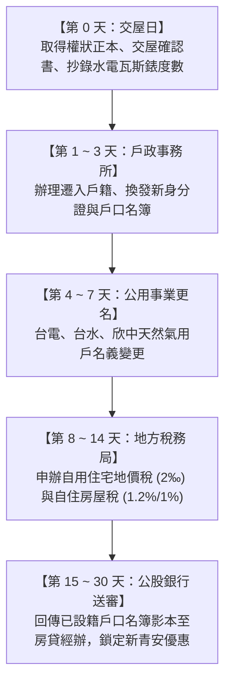

# 全案購屋實戰第一百零二部：交屋後戶籍遷移水電更名與自用住宅稅率優惠申請全書

## 一、 核心戰略定位與目標
在圓滿完成簽約、銀行撥款與實體交屋驗收後，買方必須在法定時限內迅速完成「行政戶籍遷移、公用事業過戶更名、地價稅與房屋稅自用住宅優惠稅率申請」。

若未在法定期限前完成戶籍遷入與自用稅率申請，將導致：
1. **地價稅適用一般稅率（10‰ ~ 55‰ 累進稅率），比自用住宅優惠稅率（2‰）暴增整整 5 倍以上稅額**；
2. **房屋稅無法適用自住優惠稅率（1.2% ~ 1.0% 全國單一自住），直接以非自住住家稅率（2.0% ~ 4.8% 囤房稅率）重稅課徵**；
3. **若適用新青安貸款，公股行庫會於交屋後 6 個月內主動勾稽財政部全國戶籍與租賃所得資料，若未設籍將面臨追回利息補貼與縮減年限懲罰**。

本手冊制定完整的「黃金 30 天行政手續辦理時程表」、水電瓦斯更名步驟，以及「自用住宅稅率節稅極大化申請指南」。

---

## 二、 交屋後黃金 30 天必辦行政作業時程表

---

## 三、 戶政事務所遷入戶籍實戰 SOP

- **承辦機關**：台中市南區戶政事務所（或其他就近連線戶政事務所）。
- **應備文件證件清單**：
  1. 新取得之「建築物所有權狀正本」及「土地所有權狀正本」；
  2. 原戶口名簿正本；
  3. 遷入者國民身分證正本、印章（或現場親筆簽名）；
  4. 最近 2 年內拍攝之符合身分證規格彩色照片 1 張（若要換發新身分證照片，亦可沿用系統內舊照）。
- **長輩與家庭設籍策略**：
  - 若名下有多處房產，由本人、配偶或直系親屬（父母長輩、成年子女）擇一辦理設籍，即可合法享受一處自用住宅地價稅優惠（自用住宅地價稅本人、配偶及未成年子女以一處為限，但直系尊親屬父母設籍不受一處限制！）。

---

## 四、 台電、自來水與天然瓦斯更名過戶 SOP

交屋當日雙方地政士已將水電瓦斯抄表度數切算完畢並結清舊款，買方應立即完成名義變更，保障用電用水權利：

### 1. 台灣電力公司（台電）用戶名稱變更
- **線上快速申辦**：使用「台電 App」或「台電官網網路櫃檯」，點選「過戶申辦」。
- **現場辦理應備**：身分證正本、所有權狀影本、前次電費收據或電號（配電箱電表上有 11 碼電號）。
- **注意事項**：選擇「廢止前用戶契約用電，並以新用戶名義重新簽約」，避免承擔前屋主未知之違章用電追償責任。

### 2. 台灣自來水公司（台水第四區管理處）更名
- **辦理方式**：攜帶權狀影本、水費收據（水號）、身分證至台中服務所辦理，或透過台水官網線上申請過戶。

### 3. 欣中天然氣（瓦斯過戶與安全檢驗）
- **過戶手續**：欣中天然氣要求買方攜帶身分證、權狀影本至欣中營業處辦理過戶。
- **預約到府安檢**：全室裝修完成後，正式開通瓦斯前，預約欣中技師到府實施「微電腦瓦斯表氣密檢驗與管線壓力測試」，確保室內無漏氣隱患。

---

## 五、 自用住宅稅率節稅申辦極限攻略（省下數萬元稅金）

### 1. 地價稅自用住宅優惠稅率（2‰ vs. 一般 10‰~55‰）
- **法定黃金截止日**：**每年 9 月 22 日前** 提出申請，當年即可適用 2‰ 優惠稅率；逾期申請者，自次年度起適用！
- **必備四要件**：
  1. 土地所有權人或其配偶、直系親屬在該地**辦竣戶籍登記**；
  2. 無出租或供營業使用（完全純住家自用）；
  3. 地上房屋為土地所有權人或其配偶、直系親屬所有；
  4. 都市土地面積不超過 300 平方公尺（約 90.75 坪）。
- **申辦方式**：至台中市政府地方稅務局民權分局臨櫃，或使用「財政部稅務入口網」線上自然人憑證/健保卡申請。

### 2. 房屋稅自住住家用稅率（1.2% / 全國單一自住 1.0%）
- **法定要件**：
  - 個人所有之住家用房屋，符合「無出租、供本人、配偶或直系親屬實際居住使用，且本人、配偶及未成年子女全國合計 3 戶以內」，房屋稅率為 **1.2%**。
  - **全國單一自住房屋減稅優惠**：若本人、配偶及未成年子女在全國僅持有此 **唯一一戶房屋**，且房屋現值在一定金額以下，房屋稅率再降為 **1.0%**！
- **申辦期限**：於事實發生之日起 **30 日內** 向地方稅務局提出申報。

---

## 六、 公股銀行新青安貸款查核對照回報

完成戶籍遷入後，務必於 14 天內完成最後一步關鍵動作：
1. 將載有新地址與全體設籍人員之「新戶口名簿影本（或詳細記事戶籍謄本）」拍照或掃描。
2. Email 或 LINE 提供給承辦新青安房貸之公股行庫（如土銀、台銀）授信經辦專員存查。
3. 經辦將於銀行授信系統中註記「已查核自住設籍無誤」，正式鎖定享有完整 40 年年限、5 年寬限期與政府利息補貼，免除後續被總行抽查補稅或降成數之風險！
