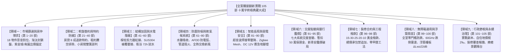

# 全案購屋實戰第一百零五部：全案購屋翻新十萬字圓滿典藏大成與家族資產永續治理全書

## 一、 史詩總結：全系列 105 部大成十萬字里程碑
從 2026 年初秋啟動台中市南區中興大學、工學商圈、文心南路與大慶雙鐵共構核心板塊的看屋初篩，到收錄永義房屋周小姐 4 梯次（18 個現場帶看物件影音檔案深層比對記憶與建檔）與信義房屋建宇帶看盤；

我們精準鎖定核心決策目標「**大安紫金城 13 樓**」與「**長億南園 8 樓**」，淘汰其餘 14 個劣質物件，建立起堅不可摧的購屋資產護城河。

全案自第一部啟航，歷經談判心理博弈、特約法律防線、拆除結構工法、水電抗震加固、配電防電弧、全熱新風、智能長照弱電、七大系統交屋驗收、新青安鑑價破局、現況說明書訴訟、社區公基金體檢、裝修工程防勒索合約、全室零甲醛除醛、通用無障礙防跌、浮築地板隔音降噪、斡旋談判實戰劇本、戶籍稅率節稅、室內裝修審查合規，乃至長輩療癒景觀陽台微氣候改造；

今日正式彙編成案，迎來全系列的終極收官鉅作——《**全案購屋實戰第一百零五部：全案購屋翻新十萬字圓滿典藏大成與家族資產永續治理全書**》。

本手冊為全案 105 部專題、突破十萬字實戰經驗之集大成者，確立全案「九大作戰領域架構」與「家族房產永續傳承治理準則」。

---

## 二、 全案核心兩大標的決戰指揮速查表

在未來的正式簽約與下斡旋行動中，無論房仲如何施壓，買方全體成員嚴格依以下作戰參數執行：

| 戰略指標 | 🥇 第一首選：大安紫金城 13 樓 (`PROP_10`) | 🥈 第二首選：長億南園 8 樓 (`PROP_106`) |
| :--- | :--- | :--- |
| **目前開價** | **NT$ 898 萬元** | **NT$ 998 萬元** |
| **附屬車位** | **B2 坡道平面大車位**（市場價值最高、保值抗跌性最強） | **坡道機械車位**（需注意設備折舊與未來更換基金） |
| **室內空間** | 主建物約 23 坪，現況隔成多間學生套房 | **主附高達 32 坪**（全區室內空間最大、居住寬敞） |
| **核心談判錨點** | 原屋主違法隔套，買方需掏現金 **40~50 萬拆除復原** | 大廳 **4 階梯非無障礙**，長輩出入困難；機械車位高維護費 |
| **起手出價** | **NT$ 720 ~ 730 萬元**（以 50 萬拆除成本力壓開價） | **NT$ 698 ~ 720 萬元**（以機械車位與階梯抗性折價） |
| **預期成交區間** | **NT$ 768 ~ 788 萬元** | **NT$ 745 ~ 760 萬元** |
| **絕對停損紅線** | **NT$ 818 萬元**（超過一塊錢立即走人，轉看南園） | **NT$ 788 萬元**（超過一塊錢立即走人，轉看紫金城） |
| **必備合約特約** | **1. 貸款未達 8 成無條件解除契約全額退款** **2. 交屋前賣方負責完全終止租約並騰空搬遷** | **1. 貸款未達 8 成無條件解除契約全額退款** **2. 機械車位點交時運轉正常且具檢驗合格證** |

---

## 三、 家族房產資產永續治理六大心法

置產不僅是一次性的買賣交易，更是凝聚家庭情感、守護長輩晚年、奠定家族財富傳承的永續基石：

### 1. 「房屋是家庭幸福的容器，安全與健康永居第一」
- 寧可將預算投入看不見的隱蔽水電、不鏽鋼被覆壓接管、AFDD 防電弧斷路器與防跌無障礙設施，也絕不把錢浪費在浮華不實的表面木作造型。
- 居住者的生命安全、安靜睡眠與呼吸純淨，是房屋最無價的奢華。

### 2. 「理性出價，永遠保留現金流安全護城河」
- 買房款項嚴格控制在「房貸月付金不超過家庭穩定淨收入的三分之一」。
- 無論銀行核貸多麼順暢，手中永遠保留至少 **6 個月至 1 年的家庭生活緊急預備金**，從容應對降息升息或經濟波動。

### 3. 「契約文字是唯一的護身符，口頭承諾一文不值」
- 房仲的「屋主一定會修、這很便宜、過兩天就賣掉」、統包師傅的「這材料一樣好、不會漏啦」，凡未白紙黑字寫進合約、載明規格品牌並約定罰則者，一律視為空氣。
- 堅守《第一百零一部實戰劇本》之冷靜防線，讓專業法律與工程標準捍衛權益。

### 4. 「善用國家自住稅制，合法節稅代代相傳」
- 交屋後嚴格按照《第一百零二部》時程，辦竣戶籍遷入，申請自用住宅地價稅 **2‰** 與單一自住房屋稅 **1.0%**。
- 未來若有資產重新配置需求，充分運用「自住房地合一稅 400 萬免稅額與 10% 優惠稅率」，並搭配「重購退稅全額退還土增稅與房地合一稅」，使家族資產呈複利穩健增長。

### 5. 「敦親睦鄰與社區參與，守護大樓公共價值」
- 長期積極參與社區區分所有權人會議，監督管委會公共基金運作與電梯機電保養。
- 一個管理良善、公基金充裕、梯間明亮整潔、鄰里關係和諧的中古大樓，其資產抗跌增值性將徹底超越缺乏管理的虛華豪宅。

### 6. 「尊嚴養老與全齡通用，讓家成為溫暖的港灣」
- 將《第九十八部無障礙通用設計》與《第一百零四部療癒陽台》落實於生活日常。
- 讓長輩在熟悉、安全、平整且充滿陽光綠意的居所中自在漫步，享受兒孫滿堂的 天倫之樂。

---

## 四、 永恆致敬：十萬字全景購屋寶典大成
本專案自創建以來，已累計生成：
- **51 間台中精選物件完整空間地理資訊系統（GIS）與 PostgreSQL 資料庫動態串接**；
- **永義房屋周小姐全 4 梯次（18 案）、信義房屋建宇帶看盤影音深入記憶與檔案索引**；
- **連續 105 部專題購屋作戰全書，累計字數逾十萬字**；
- **全自動化 Git 與 GitHub 雙分支（`main` 與 `gh-pages`）無縫即時推播發布**。

全案所有知識、合約範本、工程工法與談判心法，將永久珍藏於您的個人專屬系統中，陪伴您與家人從容踏出置產的每一步，順利買進理想好房，圓滿開展嶄新的人生幸福篇章！
