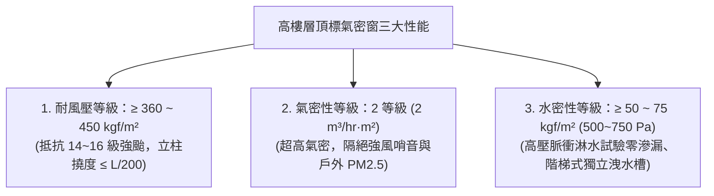
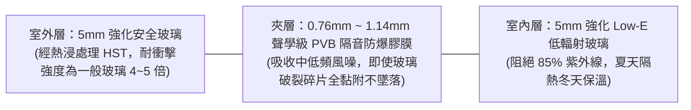

# 全案購屋實戰第一百零八部：高樓層強風負壓抗風壓計算與氣密水密窗等級選配全書

## 一、 核心戰略定位與目標
在購買台中南區高樓層物件（如大安紫金城 13 樓、靜園 A 區 11 樓，以及長億南園 8 樓）時，高樓層享有開闊採光與棟距視野的同時，也直接迎向台灣海峽冬季強勁東北季風、夏季西南氣流，以及每年颱風季的正面風壓衝擊。

實務上，台中盆地夏秋季常有瞬間強陣風（相當於 12~14 級強陣風），若老屋鋁窗仍沿用 20 年前建商配置之一般薄料鋁窗（料厚僅 1.0mm 且無風壓抗折設計）：
1. **窗框極易在大風下產生劇烈金屬形變（撓度過大），造成窗扇震顫共振、發出尖銳刺耳的風哨音（口哨聲）**；
2. **強風壓產生的「負壓抽吸效應（Negative Pressure Suction）」會破壞窗扇膠條氣密密封，雨水在風壓推擠下倒灌滲入室內，引發窗台壁癌與木地板泡水**；
3. **玻璃若未經風壓強度計算，極易在瞬間風切變下發生應力破裂，危及室內長輩與家人生命安全**。

本手冊嚴格遵循中華民國國家標準 CNS 3092《鋁合金製門窗》與內政部營建署《建築物耐風設計規範》，制定高樓層鋁窗「風壓強度設計計算工序」、「氣密性等級評定」、「水密性高壓擋水工藝」與「雙層膠合防爆隔音玻璃黃金配比」。

---

## 二、 建築耐風壓設計計算與高樓層風壓公式

依據 CNS 3092 與內政部建築技術規則，建築物表面所承受之設計風壓力（Design Wind Pressure, $q$）隨樓層高度呈指數級遞增：

$$q = \frac{1}{2} \rho V_z^2 \cdot C_p$$

其中：
- $\rho$：空氣密度（約 $1.225 \text{ kg/m}^3$）；
- $V_z$：離地面高度 $z$ 處之設計風速（考慮台中地區基本設計風速 $V_{10} = 37.5 \text{ m/s}$，高樓層高度修正後瞬間陣風可達 $45 \sim 50 \text{ m/s}$）；
- $C_p$：外壓係數（迎風面為正壓 $+0.8$，背風面與側向邊角為強大負壓吸力 $-1.2 \sim -1.4$）。

### 1. 樓層風壓強度等級（Wind Resistance Grade）
依 CNS 3092 規範，鋁合金氣密窗耐風壓性能分為六個等級：
- $160 \text{ kgf/m}^2 \; (1600 \text{ Pa})$：低樓層 1~3 樓一般住宅；
- $240 \text{ kgf/m}^2 \; (2400 \text{ Pa})$：中樓層 4~7 樓標準住宅；
- $280 \text{ kgf/m}^2 \; (2800 \text{ Pa})$：中高樓層標準；
- **$360 \text{ kgf/m}^2 \; (3600 \text{ Pa})$**：**【本手冊指定長億南園 8 樓標準】**；
- **$\ge 450 \text{ kgf/m}^2 \; (4500 \text{ Pa})$**：**【本手冊指定大安紫金城 13 樓、靜園 A 區 11 樓高樓頂標】**。

### 2. 窗框型材撓度（Deflection Ratio）合格極限
- 在最高設計風壓（3600~4500 Pa）作用下，鋁窗主受力支柱（直料立柱）之中間最大彎曲撓度 $\delta$ 必須符合：
$$\delta \le \frac{L}{200} \quad (\text{且絕對變形量不得大於 } 15\text{mm})$$
- 確保颱風天窗框不致彎曲卡死、玻璃不致脫軌爆裂。

---

## 三、 CNS 氣密與水密等級黃金選型矩陣

在高樓層全室鋁窗翻新採購時，估價單必須強制載明通過 CNS 國家認證之三大物理性能等級：

| 性能指標 | CNS 標準最低要求 | 本手冊中高樓層指定選配標竿 | 實戰效果 |
| :--- | :---: | :---: | :--- |
| **耐風壓性** | $160 \text{ kgf/m}^2$ | **$360 \sim 450 \text{ kgf/m}^2$** | 強風衝擊下窗體穩如泰山、零金屬晃動異音 |
| **氣密性** | 30 等級 ($30 \text{ m}^3/\text{hr}\cdot\text{m}^2$) | **2 等級 ($\mathbf{\le 2 \text{ m}^3/\text{hr}\cdot\text{m}^2}$)** | 完全阻絕漏風冷氣外洩、風切哨音降至最低 |
| **水密性** | $15 \text{ kgf/m}^2 \; (150 \text{ Pa})$ | **$50 \sim 75 \text{ kgf/m}^2 \; (\mathbf{500 \sim 750 \text{ Pa}})$** | 颱風暴雨高壓噴淋下，下框零積水倒灌 |
| **遮音性** | 25 等級 | **TS-35 ~ TS-40 等級 ($R_w \ge 35 \sim 38 \text{ dB}$)** | 戶外 80 分貝車流風雨聲，室內降至 40 分貝以下 |

---

## 四、 鋁窗結構型材與五金密封工藝細節

為達到上述頂標性能，施工現場查驗必須落實以下四大實體工藝：

### 1. 鋁合金型材料厚與合金牌號
- **鋁材規格**：外框結構料厚度必須 **$\ge 1.4\text{mm} \sim 2.0\text{mm}$**（大安紫金城 13 樓大景觀窗受力立柱建議使用 2.0mm 加厚料），嚴禁使用 1.0mm 偷料薄鋁。
- **合金牌號**：採用符合 CNS 2253 規定之 **6063-T5 鋁合金**，表面經「電鍍陽極氧化膜 + 高司塗裝（ED 烤漆）或粉體烤漆」，膜厚達 15μm 以上，具備長效抗酸雨腐蝕性能。

### 2. 氣密膠條材質：全生命週期抗老化 EPDM
- 嚴禁使用市售廉價易硬化、龜裂脆化之 PVC 塑料膠條。
- 必須全面採用 **三元乙丙橡膠（EPDM, Ethylene Propylene Diene Monomer）發泡複合空心氣密膠條**。
- 膠條具備卓越的高低溫彈性回彈力，在 -40℃ 至 120℃ 下壓縮變形率小於 20%，耐候壽命長達 15~20 年。

### 3. 階梯式高低落差多腔體排水立體結構
- **等壓腔原理（Pressure Equalization Cavity）**：
  - 窗下框內部設計「等壓室」，使窗框內外氣壓維持平衡，破壞風壓推水倒吸力。
- **階梯式高低差洩水道**：
  - 室內側擋水邊牆高度比室外側高出至少 **20 ~ 25mm**，形成天然重力落差。
  - 外排水孔加裝「ABS 擺動式單向防風逆止閥（防風蓋）」，水能自室內向外重力排出，強風則無法由外向內倒灌吹入。

---

## 五、 高樓層玻璃安全選型：膠合強化防爆隔音配置

針對大安紫金城 13 樓、長億南園 8 樓等迎風面大窗，玻璃選型嚴禁單層 5mm 普通浮法玻璃：

### 1. 5mm + 0.76PVB + 5mm 雙層膠合安全玻璃
- **防墜防爆**：即使遭受外物或飛石重擊破裂，PVB 膠膜能牢牢抓住玻璃碎片成蜘蛛網狀，絕不掉落碎片傷及室內長輩或戶外行人。
- **隔絕風切低頻**：PVB 阻尼樹脂能有效吸收 100~500 Hz 之交通重車低頻共振與風切噪音，隔音量高達 $36 \text{ dB}$。

### 2. 窗扇玻璃防震固定：乾式 EPDM 迫緊膠條工藝
- 玻璃周邊嚴禁單純以便宜矽利康硬封（日後難以維修且易拉裂）。
- 採用「原廠專用嵌入式 EPDM 雙面彈性迫緊橡膠條」，提供玻璃受風壓震盪時之立體緩衝行程，徹底消除玻璃與鋁框硬碰硬引發之微震自爆。

---

## 六、 現場查驗與水密高壓噴水驗收標準

在全室鋁窗安裝完工、矽利康完全固化 48 小時後，實施現場驗收：

1. **高壓水槍模擬暴雨噴淋**：
   - 使用高壓清洗機（水壓調至 $4 \sim 5 \text{ kgf/cm}^2$），距離窗框 50 公分處，以 45 度角朝向窗框四角拼接處、下框滑軌、排水孔及窗扇搭接處連續強力噴淋 **15 分鐘**。
2. **驗收合格紅線判定**：
   - 噴水期間及噴水結束後 30 分鐘內，室內側窗框下緣、內牆粉刷面及窗台石材**無任何一滴水珠滲透或水漬擴散**；
   - 窗下框排水凹槽內之積水能順暢經由單向閥向外排空，無積水反湧現象，判定水密驗收 100% 合格。
