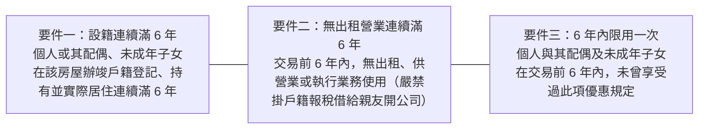
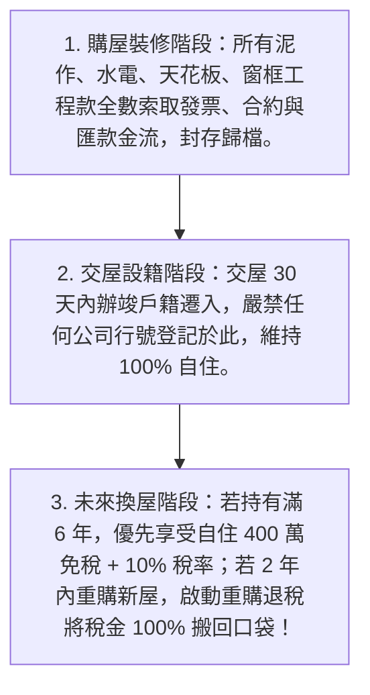

# 全案購屋實戰第一百零六部：房地合一2.0與重購退稅跨期節稅策略全書

## 一、 核心戰略定位與目標
在購買台中南區中古大樓（如大安紫金城 13 樓、長億南園 8 樓）時，除了關注當下的買入價格與翻修成本，更必須從「長線資產佈局」的制高點，精準規劃**持有期成本控制**與**未來換屋出售時的資本利得稅（房地合一稅 2.0）最小化**。

許多屋主在買房裝修時，因「未向工班索取合法發票/收據」、「未妥善留存修繕工程合約」，或「誤踩設籍與出租限制紅線」，導致日後換屋時面臨：
1. **數十萬甚至上百萬的裝修修繕支出無法列為扣除成本，被國稅局依標準核定扣除（僅得扣除成交總價之 3% 或上限 30 萬元），多繳幾十萬冤枉稅**；
2. **錯失「自住房地合一稅 400 萬元免稅額及 10% 超低稅率」**；
3. **因設籍中斷或曾有微型出租/營業行為，導致數十萬至上百萬元的「自用住宅重購退稅（土地增值稅與房地合一稅）」遭國稅局全數追繳加計利息**。

本手冊深入剖析房地合一 2.0 稅制架構、裝修發票憑證合法列成本攻防戰術、自住 400 萬免稅黃金要件，以及「先買後賣 / 先賣後買」重購退稅全額退稅之極致節稅模型。

---

## 二、 房地合一 2.0 稅率級距與應納稅額計算公式

依《所得稅法》房地合一稅 2.0 規範，個人交易 105 年 1 月 1 日以後取得之房屋及土地，課稅級距如下：

| 持有年限 | 一般交易適用稅率 | 核心戰略評估 |
| :--- | :---: | :--- |
| **持有 2 年以內** | **45%** | 短線重稅禁區，除非法定非自願性離職調職，否則嚴禁賣出。 |
| **超過 2 年，未逾 5 年** | **35%** | 次高稅率，資本利得三分之一以上歸公，非必要不宜處分。 |
| **超過 5 年，未逾 10 年** | **20%** | 中期平穩稅率，一般置產客可考慮之退場窗口。 |
| **超過 10 年以上** | **15%** | 長期持有低稅率。 |
| **自用住宅滿 6 年特惠** | **400 萬內免稅，超過部分 10%** | **【最高等級神級節稅待遇】**，符合自住要件即享極限節稅！ |

### 房地合一應納稅額核心公式：
$$\text{應納稅額} = \Big[ \text{成交價額} - \text{原始取得成本} - \text{合法必要費用（裝修/仲介費）} - \text{土地漲價總數額} \Big] \times \text{適用稅率}$$

---

## 三、 翻修裝修支出合法列報成本之發票憑證秘笈

國稅局對於「裝修工程支出是否能列為取得成本」審查極其嚴苛，依《房地合一課徵所得稅申報作業要點》，唯有**「能增加房屋價值或效能，且非 2 年內所能耗竭之重大修繕支出（資本化支出）」**始得認列扣除：

### 1. 國稅局核可認列之「資本化必要修繕」清單
- ✅ **水電暗管全面更換工程**（SUS304 不鏽鋼管抽換、電線全面重拉）；
- ✅ **衛浴與廚房泥作防水工程**（打除見磚、防水膜重做、地壁磚重鋪）；
- ✅ **全室鋁門窗/氣密隔音窗更換工程**；
- ✅ **室內輕鋼架/矽酸鈣板隔間牆變更工程**（拆除非承重牆、新設分間牆）；
- ✅ **全室矽酸鈣板防震防火天花板吊頂工程**；
- ✅ **地磚/木地板鋪設工程**（浮築地板減震墊 + SPC/磁磚地坪）。

### 2. 國稅局【絕對剔除不予認列】之消耗性支出清單
- ❌ **純油漆粉刷、壁紙黏貼**；
- ❌ **活動式傢俱（沙發、餐桌、活動衣櫃、床組）**；
- ❌ **活動式家電（冰箱、電視、分離式冷氣、洗衣機、熱水器）**；
- ❌ **裝飾性窗簾、燈具燈泡**；
- ❌ **系統櫃（若非與結構天花壁面一體成型不可分離，常被認定為可拆遷活動家具而剔除）**。

### 3. 保全憑證之四大鐵證清冊（簽裝修約時必須要求工班配合）
1. **合法統一發票（含 5% 營業稅之三聯式/二聯式發票）**，載明品名為「室內裝修修繕工程款」；若為免用統一發票之小規模工班，必須具備工班行號蓋章之「免用統一發票收據」及載明工班統編與負責人身分證號。
2. **詳細工程估價單/驗收請款明細表**（逐項載明水電、泥作、防水、天花板工項與單價數量，嚴禁僅寫「裝修工程一批」）。
3. **施工前、施工中、施工後對比彩色照片集**（證明確實有將管線埋入牆體與泥作翻新）。
4. **銀行端真實金流軌跡**（匯款至工程合約承攬人名下公司帳戶之匯款單或存摺內頁影本，嚴禁現場現金交付無憑無據）。

---

## 四、 自用住宅滿 6 年「400 萬免稅 + 10% 稅率」黃金三大門檻

若未來居住滿 6 年換屋，要享受「利得 400 萬全額免稅、超過部分僅課 10%」之終極優惠，必須 100% 滿足以下三大法定要件（缺一不可）：

---

## 五、 自住重購退稅（土地增值稅 + 房地合一稅）全額退稅操作指南

當家庭成長、換屋升級時，政府提供「自住房地合一稅」與「土地增值稅」之雙重重購退稅機制，能將繳納的稅金**全額（或比例）退還買方**！

### 1. 房地合一稅重購退稅 vs. 土地增值稅重購退稅

| 比較項目 | 房地合一稅重購退稅 | 土地增值稅重購退稅 |
| :--- | :--- | :--- |
| **法定期限** | 出售舊屋與重購新屋之所有權登記日，**差距在 2 年以內**（先買後賣或先賣後買均可）。 | 買賣產權登記日**差距在 2 年以內**（先買後賣需注意買新屋時舊屋仍須符合自用）。 |
| **退稅比例原則** | **「以房屋總價金額比」退稅**： • **大換小（新屋總價 < 舊屋總價）**：按比例退稅； • **小換大（新屋總價 $\ge$ 舊屋總價）**：**全額 100% 退稅！** | **「以土地公告現值差額」退稅**： 新買土地公告現值總額，必須大於賣出土地公告現值扣除土增稅後之餘額。 |
| **設籍要件** | 本人、配偶或**未成年子女**在該地設籍。 | 本人、配偶或**直系親屬（包含直系尊親屬父母）**設籍。 |
| **管制閉鎖期** | **重購新屋後 5 年內嚴禁移轉或改作其他用途**（5 年內嚴禁出租、營業、遷出戶籍，否則國稅局立即追繳全額退稅款！）。 | **重購新屋後 5 年內列管**，嚴禁轉移或出租營業。 |

---

## 六、 總結：資產守護與節稅標準作戰 SOP

