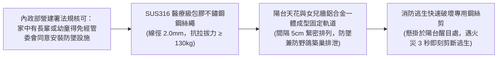

# 全案購屋實戰第一百零四部：長者身心健康療癒景觀陽台改造與微氣候通風全書

## 一、 核心戰略定位與目標
在購買台中南區中高齡中古大樓（如大安紫金城 13 樓、長億南園 8 樓、歌德堡、靜園 A 區）時，陽台往往是被嚴重忽視或淪為單純堆放雜物、懸掛雜亂衣物的次要角落。

實務上，對於退休在家、行動偶有不便的長輩而言，**陽台是全屋中唯一能無障礙接觸自然陽光、微風吹拂、遠眺台中盆地天際線與享受綠意生機的「心理療癒核心核心空間」**。

醫學研究證實，每日於陽台接受 30 分鐘自然晨光照射，能有效促進長輩體內維生素 D 合成、調節褪黑激素分泌以改善失眠，並大幅降低憂鬱與認知退化風險。

本手冊針對高樓層陽台，制定「隱形安全防墜防鳥網工序」、「抗風防雨微氣候自動百葉窗系統」、「長輩園藝高架植栽花台工藝」、「防腐木防滑地坪排水系統」與「微型景觀水景綠化維護全指南」。

---

## 二、 高樓層隱形安全防墜防鳥網工序

高樓層陽台（大安紫金城 13 樓、靜園 A 區 11 樓）風壓較大，必須在「不違反公寓大廈管理條例、不破壞外觀與消防逃生」前提下，落實長輩防墜與防鴿鳥侵入防護：

### 1. 法規底氣與免管委會同意條款
- 依《公寓大廈管理條例》第 8 條第 2 項規定：
  > 「公寓大廈有十二歲以下之住戶或六十五歲以上之老人時，外牆開口部或陽臺得設置不妨礙逃生且不突出外牆面之防墜設施。」
- 管委會規約即使記載禁止安裝鐵窗，亦不得抵觸母法；買方只需選用合格之「隱形鐵窗（細鋼絲繩）」，外觀遠眺近乎隱形，兼顧大樓美觀與生命安全。

### 2. 施工工藝與抗拉防鳥標準
- 鋼絲間距嚴格設定為 **5 公分（5cm）**，不僅能百分之百防止長輩失足墜落，更能徹底阻絕台中市常見的野鴿進入陽台築巢排泄（避免鴿糞隱球菌引發長輩嚴重腦膜炎肺部感染）。
- 固定軌道採用鋁合金陽極氧化烤漆厚料，膨脹螺栓一律採用 SUS304 不鏽鋼螺栓，固定間距不超過 15 公分。

---

## 三、 長輩通用園藝工藝：人體工學高架花台與自動滴灌系統

長輩常有腰椎骨刺或膝關節退化問題，傳統蹲在地面彎腰澆花整理盆栽極易造成腰部扭傷或重心不穩跌倒：

### 1. 人體工學 85cm 高架種植箱（Raised Garden Bed）
- **黃金操作高度**：花台種植箱檯面高度精確設定在 **離地 80 ~ 85 公分**，寬度不超過 60 公分。
- **無障礙操作**：長輩無論是站立或坐在輪椅上，皆能雙手自然平放修剪枝葉、播種鬆土，完全無需彎腰曲膝。
- **材質選型**：採用食品級耐候 PP 樹脂或高密度鋁合金防腐支架，重量輕盈（每平方米濕重小於 60kg），嚴格低於陽台結構載重安全限額（建築技術規則陽台活載重規範為 300 kg/m²）。

### 2. 微型太陽能/定時智能精準滴灌系統
- **零水管拖拉絆倒風險**：
  - 由陽台給水水龍頭引出一組 4分 PE 軟管，串聯「電池式/太陽能定時微電腦水閥」。
  - 鋪設微細滴箭至各盆栽根部，每日清晨 6:00 自動啟動微量滴灌 5 分鐘，免除長輩手提沉重水桶或拖拉長水管造成失足滑倒之風險。
- **配置專用防逆流逆止閥**：防止園藝肥料水因管網負壓倒吸回室內飲用水管。

---

## 四、 陽台地坪微氣候：無障礙平整防腐木與快速排水系統

### 1. 戶外快拆式高耐候卡扣石塑/防腐木地坪
- **地坪零落差銜接**：
  - 客廳通往景觀陽台處，以第 98 部無障礙標準抓平，採用「高抗紫外線戶外木塑複合地板（WPC）」或「深層高溫炭化防腐松木板」。
  - 底層自帶疏水網格腳墊，厚度 2.0~2.5 公分，與室內地面無縫齊平，雨水能於木板縫隙間秒級下滲，腳踏表面保持乾燥防滑。

### 2. 陽台排水孔雙重防堵防蟲地漏
- **下沉式集水槽與落葉過濾罩**：
  - 於陽台原排水孔處安裝「不鏽鋼長條型集水槽」並加裝可拆卸之不鏽鋼細孔落葉攔截網。
  - 地漏芯選用具備「重力翻板磁吸防臭防蟲芯」，無水時自動密封，徹底封死地下室或低樓層蟑螂、蚊蟲順著雨水立管爬入陽台之管道。

---

## 五、 長輩身心療癒之光環境與自然生機規劃

| 配置項目 | 建議選型規格 | 身心醫學與療癒價值 |
| :--- | :--- | :--- |
| **景觀休閒座椅** | 人體工學高背戶外休閒椅（附防水高密泡棉軟墊、扶手高度 65cm 易於借力起立） | 提供長輩晨間品茗、閱讀、曬太陽之舒適支撐。 |
| **療癒植栽配置** | 迷迭香、薄荷、薰衣草、茉莉花、金盞花、矮種桂花 | 天然植物揮發精油（芬多精），具備舒緩神經焦慮、活化嗅覺感知之芳香療法效果。 |
| **柔和景觀燈光** | 太陽能戶外防水暖光地插燈（2700K 暖黃光，照度 30 Lux） | 夜間營造寧靜溫馨氛圍，且柔和不眩光，長輩夜間步入陽台安全無虞。 |
| **超靜音微型流水** | 太陽能低壓無刷直流循環流水盆（水流聲控制在 35~40 dBA 潺潺水音） | 白噪音掩蓋戶外車流吵雜聲，流水潺潺能顯著降低交感神經張力與收縮壓。 |
