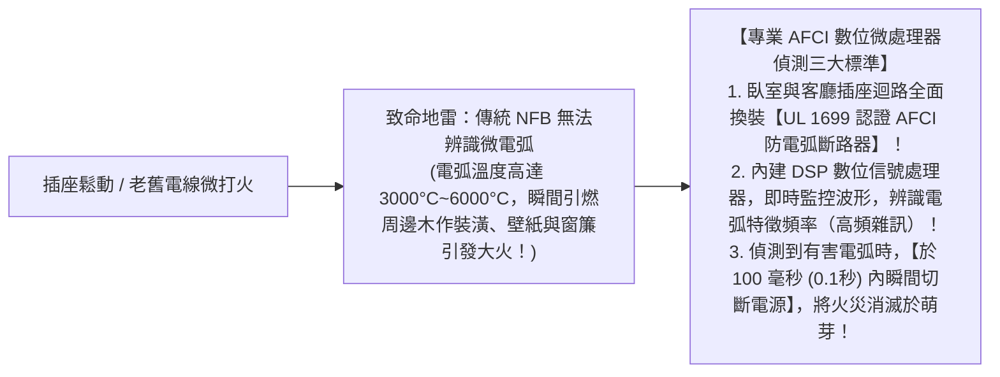
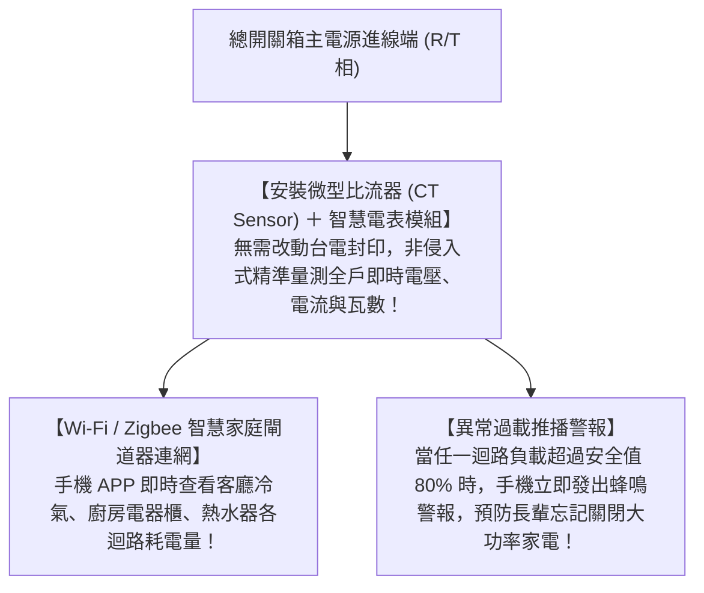

# 全案購屋實戰第七十一部：老屋配電箱防電弧斷路器與智慧電表EMS工序全書

## 核心主旨
本篇為購屋實戰指引第七十一部，聚焦於台中南區 28~29 年中古大樓在總配電箱水電翻新之「防電弧故障斷路器 (Arc Fault Circuit Interrupter, AFCI)」與「智慧家庭電能監控系統 (EMS)」施工標準，徹底預防中古屋老舊插座微打火引發電氣火災，並建立全屋用電負載即時可視化。

---

### 一、中古大樓配電盤「防電弧故障斷路器 (AFCI)」安全升級規範

傳統無熔線斷路器（NFB）只能防範「過載」與「短路」，但中古屋高達 70% 的電氣火災是由電線絕緣老化破損、插座接觸不良所產生的「串聯電弧（微小火花打火）」所引發，此時電流並未超過額定值，傳統 NFB 完全不會跳脫！

---

### 二、全屋智慧用電監控「智慧電表 (Smart Meter) 與 EMS 模組」工序

學生套房拆除重新規劃三房後，在總電箱內加裝微型導軌式智慧電表模組：

---

### 三、買方隨身談判金句：電氣火災防護升級之價格抗辯

當房仲試圖強調房子電線以前換過不用再花錢時，買方攻防切入：

> 「周小姐，大安紫金城原本分租給多個學生，每個房間都塞滿冷氣跟電熱水器，電箱內部長期處於滿載甚至超載的高溫烘烤狀態，電線絕緣早已嚴重劣化。我們自住不可能拿全家人的生命安全開玩笑，買下來必須全部重新配置合規的 AFCI 防電弧安全斷路器與智慧電盤，這筆水電重造費少說又是十幾萬現金。我們出 730 萬（目標 768 萬）就是要把全家人的安全防護一次做到位。請周小姐跟屋主回報，我們是有誠意、懂工程的實客，價格合理我們隨時簽斡旋！」
