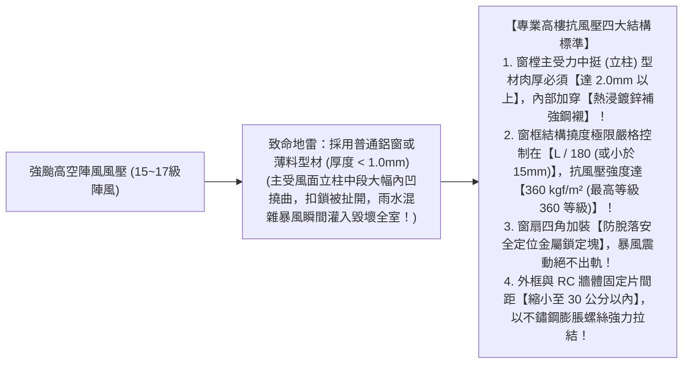
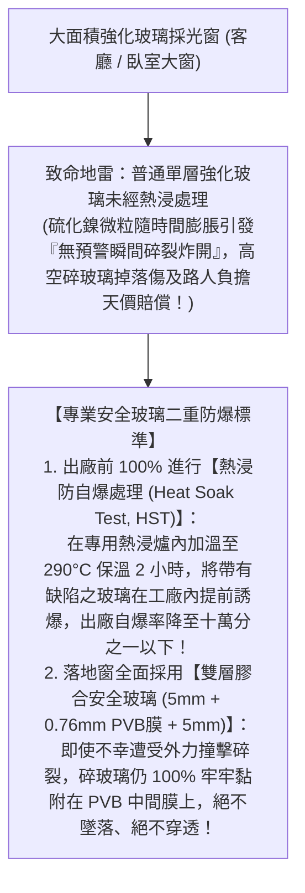

# 全案購屋實戰第七十七部：全室鋁窗高抗風壓撓度計算工序與高樓層玻璃自爆熱浸全書

## 核心主旨
本篇為購屋實戰指引第七十七部，聚焦於台中南區 28~29 年中古大樓在窗戶工程之「高樓層風壓撓度計算（Wind Load Deflection Calculation）」與「大片落地窗玻璃熱浸防自爆處理 (Heat Soak Test, HST)」，全面提升 13 樓高空迎風面之結構剛性，防止強烈颱風導致窗框扭曲變形與玻璃爆裂傷人事故。

---

### 一、高樓層迎風面「窗框風壓撓度與抗風壓等級」高標工序

大安紫金城 13 樓處於高空無遮擋迎風面，颱風來襲時，瞬間陣風風壓常高達 250~360 kgf/m²。若窗框型材厚度不足或未經撓度精算，窗框會被強風吹至嚴重內凹變形，甚至整扇窗被吹落：

---

### 二、大面採光落地窗「防自爆熱浸處理 (Heat Soak Test, HST)」標準

現代客廳多追求大面採光景觀落地窗，但強化玻璃內部含有微量硫化鎳 (NiS) 結晶雜質，在高樓層日曬溫差衝擊下，隨時有莫名自爆的機率：

---

### 三、買方隨身談判金句：高樓層結構防颱抗爆之價格攻防

當房仲強調 13 樓無遮蔽大景觀、大採光窗非常難得時，買方攻防切入：

> 「周小姐，13 樓視野開闊是事實，但 13 樓也是最危險的迎風面，29 年前安裝的老窗戶抗風壓規格根本無法抵禦現在越來越極端的強烈颱風。我們自住買下來，為了長輩與家人的生命安全，全室大面景觀窗必須全部打掉，換成通過抗風壓 360 等級的加厚型鋼襯斷橋窗，大面玻璃全部要升級為防自爆的雙層膠合熱浸玻璃，這筆攸關高空安全的高階窗戶工程款隨便估都要 15~20 萬元現金。我們堅持出價 730 萬（目標 768 萬）就是為了把這筆自住必備的結構安全預算留下來。請周小姐跟屋主回報，我們是有誠意、重視安全的好買方，價格有共識隨時可簽約！」
