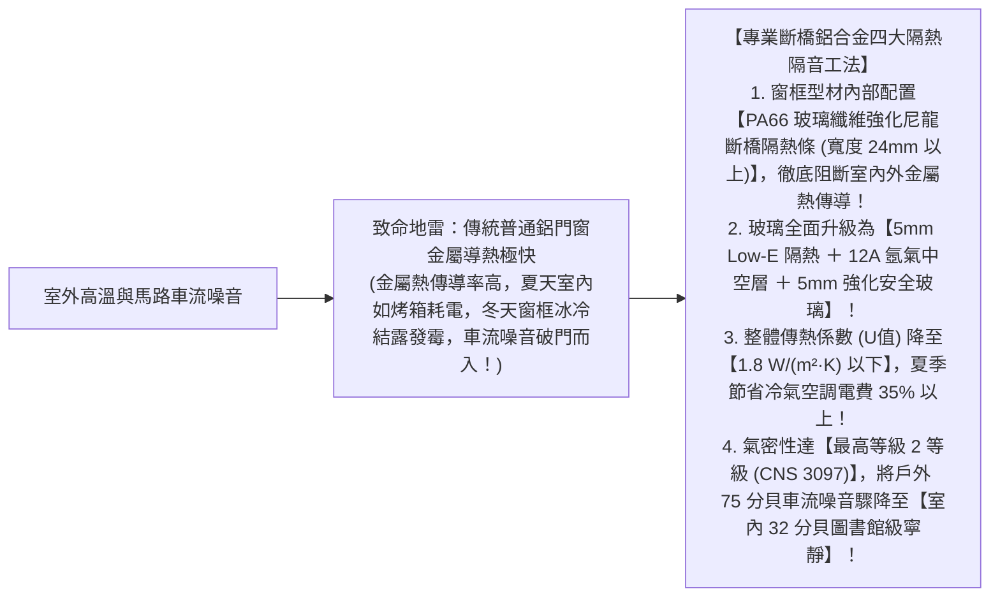
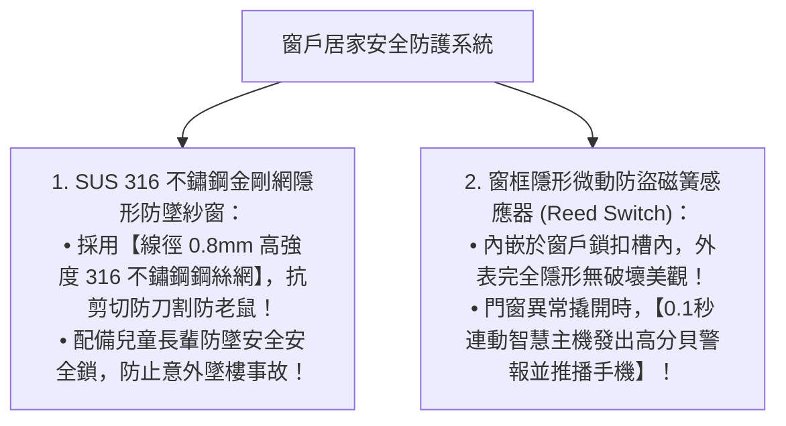

# 全案購屋實戰第七十三部：全室氣密防音窗雙重斷橋工序與防盜安全連動全書

## 核心主旨
本篇為購屋實戰指引第七十三部，聚焦於台中南區 28~29 年中古大樓在窗戶工程之「雙重斷橋鋁合金隔熱型材 (Thermal Break Aluminium)」與「複層中空 Low-E 膠合玻璃防音水密工法」，阻斷熱島效應高溫傳導與美村南路車流高頻噪音，打造冬暖夏涼的最高自住舒適圈。

---

### 一、高樓層「雙重斷橋鋁合金隔音氣密窗」工序

大安紫金城 13 樓屬於高樓層戶，傳統單層鋁門窗是全屋熱能與噪音流失的最大破口：

---

### 二、智慧居家安全防護「窗戶隱形防墜紗窗與微動防盜磁簧連動」標準

長輩起居安全與防墜防盜是現代自住不可或缺的配置：

---

### 三、買方隨身談判金句：老屋高溫耗能與隔音工程之價格抗辯

當房仲試圖強調高樓層通風採光極佳時，買方攻防切入：

> 「周小姐，13 樓採光好是優點，但 29 年前蓋的大樓完全沒有現代建築的節能斷熱標準，單層老鋁窗在夏天就像一個大烤箱，而且美村南路車流聲音在 13 樓高處有向上匯聚的喇叭效應，非常吵鬧。我們買下來給長輩自住，全室窗戶必須全部換成高等級的斷橋隔熱氣密窗與 Low-E 複層玻璃，這筆節能防噪的窗戶工程款隨便算都要十幾二十萬現金。我們出 730 萬（目標 768 萬）就是為了把這筆自住必備的整修預算先保留下來。請周小姐跟屋主好好談，我們是實實在在的自住買方，價格有共識隨時可簽約！」
