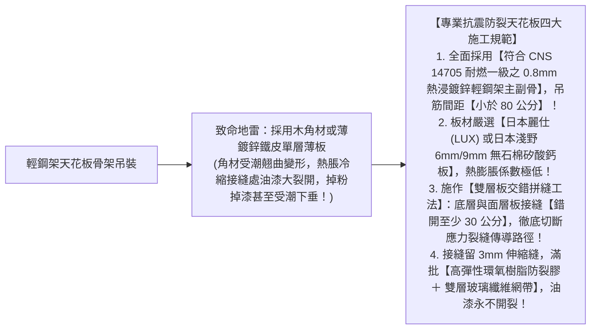
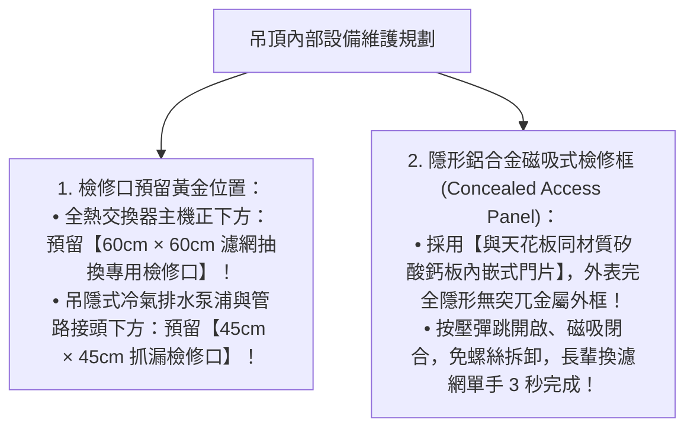

# 全案購屋實戰第七十九部：室內天花板抗裂雙層矽酸鈣板工序與吊頂暗藏檢修口全書

## 核心主旨
本篇為購屋實戰指引第七十九部，聚焦於台中南區 28~29 年中古大樓在天花板吊頂裝修之「輕鋼架防鏽防震雙層矽酸鈣板工序 (Dual Calcium Silicate Board)」，以及吊頂內部隱藏設備之「磁吸式/隱形鋁框檢修孔 (Access Panel) 配置標準」，徹底防止老屋因熱脹冷縮與地震震盪引發天花板拼縫開裂，並確保全熱交換器濾網、冷氣排水器與吊管閥門日後維護零破壞。

---

### 一、天花板吊頂「抗震防裂雙層交錯矽酸鈣板」高標工序

中古大樓高樓層受地震搖晃幅度較大，若天花板骨料間距過大或單層封板，完工後半年內拼縫必出現放射狀裂紋：

---

### 二、吊頂內部隱藏設備「隱形美觀磁吸檢修口」標準

學生套房拆除重新規劃為現代標準自住三房後，全熱交換器、隱藏式吊隱冷氣、消防管閥門全部隱藏在天花板內：

---

### 三、買方隨身談判金句：老屋天花板全拆重造之價格抗辯

當房仲試圖強調「現況天花板好好的不用動」時，買方攻防切入：

> 「周小姐，大安紫金城原本分租給學生，天花板上面藏著各個套房私拉的雜亂老舊電線、廢棄的冷氣排水管跟以前漏水的水痕暗病。我們買下來給全家人長久自住，為了居住安全與空氣品質，全室舊天花板必須全部拆光見底，重新施作耐燃一級的鍍鋅輕鋼架、雙層抗裂日本麗仕矽酸鈣板，並配置全套專業隱形檢修口。這筆全室天花板拆除重造款隨便估都要 8~12 萬元現金支出。我們出價 730 萬（目標 768 萬）就是為了把這筆必備的結構翻新預算先扣下來。請周小姐向屋主轉達我們實在、重視安全的買方心態，價格有共識隨時可簽約！」
