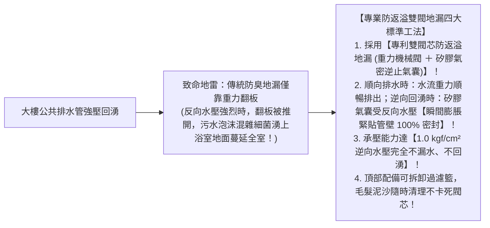
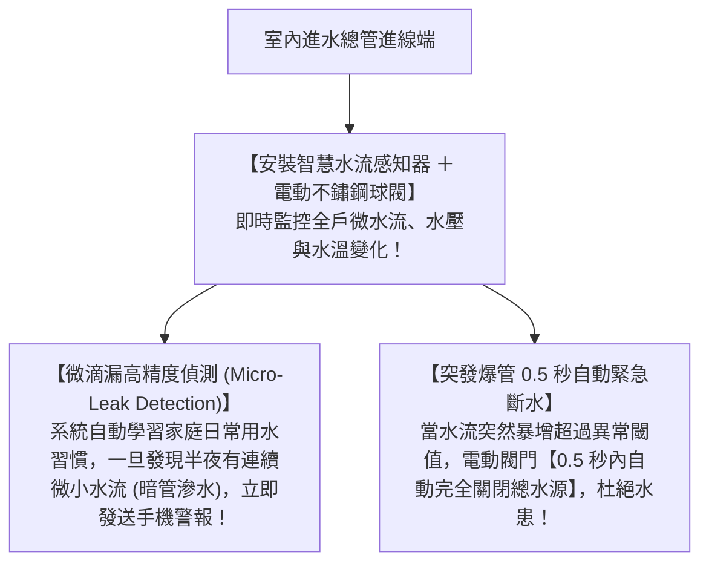

# 全案購屋實戰第七十二部：浴室地排防返溢地漏閥與全室給水智能控水系統全書

## 核心主旨
本篇為購屋實戰指引第七十二部，聚焦於台中南區 28~29 年中古大樓在衛浴與廚房給排水之「防返溢雙閥地漏工序」，以及總進水端加裝「智慧漏水自動切斷電磁閥閥組 (Smart Water Shut-off Valve)」，杜絕老屋暗管滲漏水泡爛鄰居天花板之重大法律賠償風險。

---

### 一、中古大樓衛浴「防返溢雙閥氣密封閉地漏」工序

大樓公共排水立管在大雨或高樓層同時排水時，管內水壓遽增，傳統地漏極易發生「污水混雜泡沫噴濺湧出」：

---

### 二、總進水端「智慧漏水偵測與自動切斷閥 (Smart Shut-off)」標準

老屋最怕出遠門或上班時，暗管水管突然爆裂，水流漫延整棟大樓引發數十萬賠償：

---

### 三、買方隨身談判金句：老屋水患防護與智慧安全之價格攻防

當房仲強調屋況良好可以直接住時，買方攻防切入：

> 「周小姐，大安紫金城畢竟是快 30 年的老大樓了，以前又改裝成分租套房，給排水管線被切割分接無數次，暗管老化爆管的風險是客觀存在的。我們自住買下來，為了保障自己也保障樓下鄰居，全室必須重做防返溢雙閥地漏與總水閥的智慧自動斷水系統，這些高科技安全工序又是好幾萬元的現金支出。我們出 730 萬（目標 768 萬）就是為了把這間老房子改造為百分之百安心傳家的好住宅。請周小姐向屋主轉達我們實在、穩健的購屋誠意，價格談妥我們隨時簽約！」
