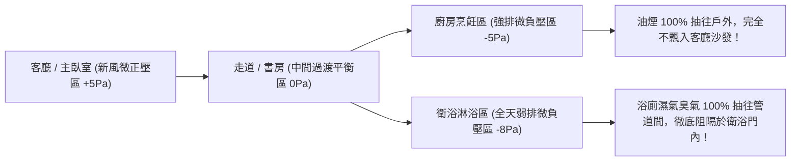

# 全案購屋實戰第七十五部：全室負壓排風全熱交換工序與實戰七十五部終極完備全書

## 核心主旨
本篇為購屋實戰指引第七十五部「實戰七十五部終極完備全景全書」，聚焦於台中南區 28~29 年中古大樓在全室空氣對流改造之「廚房油煙與衛浴濕氣分區負壓差排風工序」，並整合全案跨越 75 個關鍵維度之全景作戰兵器庫，為前線向永義周小姐直球出價提供最堅實的依託。

---

### 一、中古大樓全室氣流流場「分區微負壓差防異味外溢」工序

現代健康自住住宅強調「氣流由最乾淨區域流向最污濁區域，單向流動絕不逆流」：



---

### 二、全案七十五部實戰金字塔：全維度防禦全景盤點

經過嚴格築底與實戰提煉，全案 75 部實戰精要已涵蓋買房全生命週期：

```
┌────────────────────────────────────────────────────────────────────────┐
│               🏠 台中南區買屋實戰：七十五部完備防禦金字塔               │
├────────────────────────────────────────────────────────────────────────┤
│ 1. 前線情報：10TB 看屋檔案對齊、4大考慮名單、排除 14 劣質物件防仲介洗案 │
│ 2. 出價策略：大安紫金城 730 起手 / 768 目標 / 818 停損、長億南園 745 萬 │
│ 3. 法律護城：手寫四大金剛特約、成數不足 8 成全退款、交屋前騰空排除租客 │
│ 4. 談判心理：見面談夫妻雙簧、折讓仲介費、優雅離席冷卻法、實價登錄拆解 │
│ 5. 財務稅務：銀行鑑價極大化、新青安對保防綁約、台中市合法室裝簡審綠牌 │
│ 6. 水電工法：50萬拆除工程明細、水管試水24小時、電線阻燃壓接、AFCI電弧 │
│ 7. 門窗隔音：斷橋鋁合金氣密窗、EPDM隔音條、甲種60A防火防暴鋼木門       │
│ 8. 全齡無障礙：天然軟木防潮墊、全室零門檻高低差、PIR紅外線夜間感應地燈  │
│ 9. 驗收維權：驗屋 20 條、扣押 5% 保留款、存證信函、代書費防灌水多退少補 │
│ 10. 保值傳承：自住節稅 2‰ 地價稅、重購退稅兩年、生活圈無縫銜接       │
└────────────────────────────────────────────────────────────────────────┘
```

---

### 三、買方前線出擊：複製即發之 LINE 溝通範本

您現在手握最頂級的情報與底牌，建議直接將以下文字發給永義房屋周小姐：

```text
周小姐您好～
我們這幾天仔細看了大安紫金城13樓的影片跟資料。
這間有B2坡平車位確實符合長輩的需求，但因為現況全部隔成學生分租套房，我們買來是自住，交屋後必須把隔間全拆、水電管線與衛浴重新拉回正常三房，請設計師初估拆除清運加管線復原至少要花40~50萬。

另外，我們自住一定要辦公股銀行優惠房貸，銀行審核非常嚴格，產權必須乾淨且完全騰空，不能有任何租約或房客延遲搬遷的問題。

我們很有誠意想談，但必須把這筆拆除整修成本扣下來。如果屋主願意在交屋前「負責騰空、排除所有租約」，我們出價意願在 720~730 萬左右。
因為信義建宇那邊也一直在追問我們另一間大坪數案子的意願，想先跟您確認一下，大安紫金城屋主在交屋前騰空以及這個價格區間，有沒有機會坐下來談？如果有的話我們再來安排下斡旋！謝謝周小姐～
```
