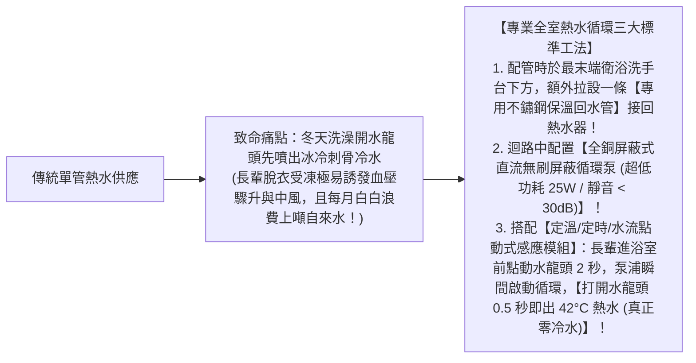
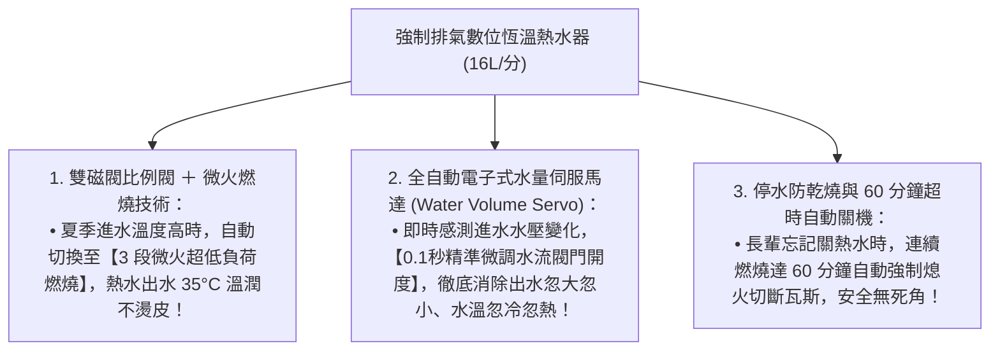

# 全案購屋實戰第七十八部：全室熱水管循環迴路工序與瓦斯熱水器恆溫零冷水全書

## 核心主旨
本篇為購屋實戰指引第七十八部，聚焦於台中南區 28~29 年中古大樓在衛浴與廚房熱水管路之「全室熱水循環回水管迴路工序 (Recirculating Hot Water Loop)」，以及配置「數位恆溫零冷水熱水器標準」，徹底解決冬天長輩洗澡放冷水等待數分鐘、水溫忽冷忽熱誘發心血管疾病之生活痛點。

---

### 一、中古大樓衛浴熱水管路「回水管單向循環」高標工序

傳統給水配管只有單條熱水供水管，每次洗澡必須先放掉水管內殘留的數公升冰冷廢水（耗時 1~2 分鐘）：

---

### 二、數位恆溫熱水器「水量伺服器 (Water Servo) 與微火燃燒」標準

中古大樓高樓層水壓容易因其他樓層同時用水產生微幅震盪，傳統定段熱水器極易發生「夏天燙皮、冬天不熱」：

---

### 三、買方隨身談判金句：熱水系統老舊與長輩沐浴安全之價格抗辯

當房仲強調現況瓦斯熱水器還能用時，買方攻防切入：

> 「周小姐，大安紫金城原本是多間學生分租套房，熱水管路分接雜亂、且完全沒有自住家庭需要的熱水循環與恆溫管路。我們買下來給長輩住，長輩年紀大了最怕冬天洗澡溫差過大誘發心血管疾病，我們必須趁泥作水電翻新時，全室重拉不鏽鋼保溫回水管、加裝微火水量伺服恆溫系統，這筆攸關長輩生命安全的熱水水電工程款又是幾萬元現金。我們出 730 萬（目標 768 萬）就是為了把這筆自住必備的安全工程款扣下來。請周小姐向屋主轉達我們實在、重視孝道的買方誠意，價格合理隨時可簽約！」
