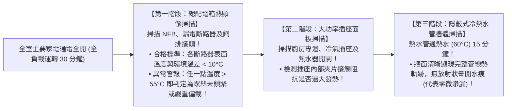
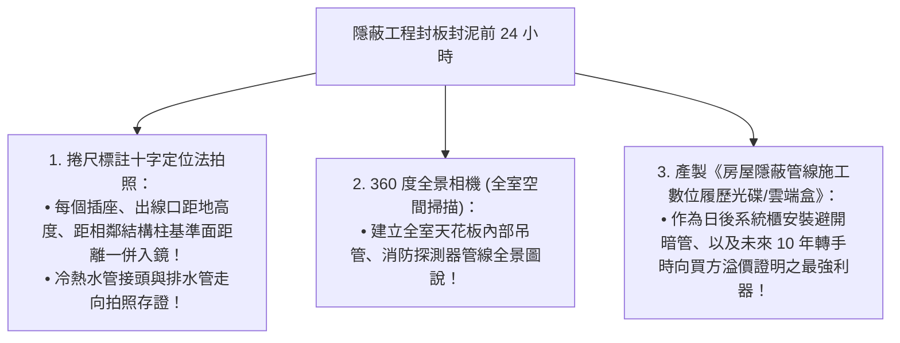

# 全案購屋實戰第七十六部：全室強電迴路紅外線熱成像巡檢工序與隱蔽工程電子驗收全書

## 核心主旨
本篇為購屋實戰指引第七十六部，聚焦於台中南區 28~29 年中古大樓在水電工程完工交屋前之「FLIR 高精度紅外線熱顯像儀 (Thermal Imaging Inspection) 巡檢工序」，以及水電暗管、吊頂天花板等「隱蔽工程數位化影像建檔驗收標準」，確保電線無虛接發熱盲區、冷熱水管暗管零滲漏，並建立可永久傳承之數位化房屋體檢報告。

---

### 一、總配電箱與全室插座「紅外線熱顯像全負載巡檢」高標工序

在老屋翻新通電驗收時，肉眼無法察覺電線接頭螺絲微鬆所引發的局部異常高溫。透過工業級紅外線熱顯像儀，能在通電負載下精準抓出「肉眼看不見的火災隱患」：

---

### 二、隱蔽工程「360 度全景影像與管線定位竣工圖說」數位建檔標準

分租套房拆除重新規劃為標準三房後，所有的水電管線在水泥封泥與封矽酸鈣板後將徹底隱形。若無完整定位圖，日後在牆面打釘掛畫極易鑽爆水管或電線：

---

### 三、買方隨身談判金句：針對老屋隱蔽工程不透明之價格抗辯

當房仲試圖以「現況看不到的地方都很正常」來催促簽約時，買方攻防切入：

> 「周小姐，買中古大樓最怕的就是『看不到的地方』。29 年的老屋，牆壁裡面暗管有沒有老化滲漏、電線接頭有沒有在高溫發熱，肉眼根本看不出來。我們自住買下來，必須自費請專業驗屋團隊帶紅外線熱顯像儀全室逐點巡檢，甚至拆除後隱蔽工程都要重新拍照建檔簽證，這些專業檢驗與整改都是實打實的現金支出。我們出價 730 萬（目標 768 萬）就是要把這些未知風險的修復成本考慮進去。請周小姐向屋主講明我們是很有誠意、講求科學證據的好買方，價格有共識隨時可簽約！」
