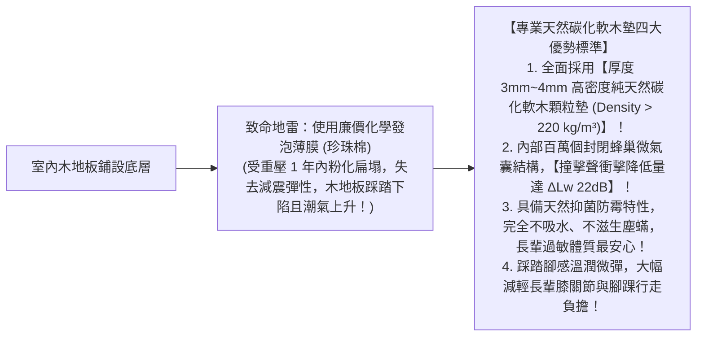
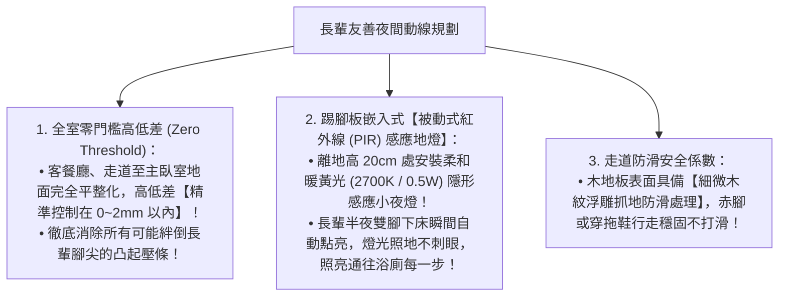

# 全案購屋實戰第七十四部：全室地坪防潮吸音軟木墊工序與長輩無障礙防滑走道全書

## 核心主旨
本篇為購屋實戰指引第七十四部，聚焦於台中南區 28~29 年中古大樓在室內地坪翻新之「天然軟木減震防潮底墊工序 (Natural Cork Underlayment)」，以及室內客餐廳通往臥室、浴廁之「長輩無障礙平整防滑動線與夜間紅外線感應導引地燈標準」，徹底消除樓板走動震動噪音，全面防範長輩居家滑倒摔傷。

---

### 一、室內地坪「天然碳化軟木防潮吸音墊」高標工序

中古大樓樓板厚度通常僅 15 公分左右，走動腳步聲極易傳導至樓下住戶。傳統 EVA 發泡墊易老化壓扁，天然軟木墊是兼具環保、防潮與隔音的最高等級材料：

---

### 二、長輩安心起居「全室無障礙防滑動線與低矮感應夜燈」標準

長輩夜間起居如廁是跌倒好發率最高的時刻：

---

### 三、買方隨身談判金句：長輩全齡宅無障礙改造之價格攻防

當房仲強調現況屋況維持得很好時，買方攻防切入：

> 「周小姐，屋主維持得好是他的居住習慣，但這間房子以前是給學生租住的，門檻高低不一、地面毫無隔音與防滑設計。我們買下來是為了全家人長久自住，必須把長輩的起居安全放在第一位，全室地坪全部要重新找平、鋪設醫療級天然軟木吸音墊與防滑無障礙動線，甚至全室踢腳板都要預埋感應安全夜燈。這些全齡無障礙安全改造都是現金預算。我們出 730 萬（目標 768 萬）就是為了把這筆自住必備的安全工程款扣下來。請周小姐跟屋主回報，我們是有孝心、有誠意、準備好現金的自住買方，價格有共識隨時可簽約！」
