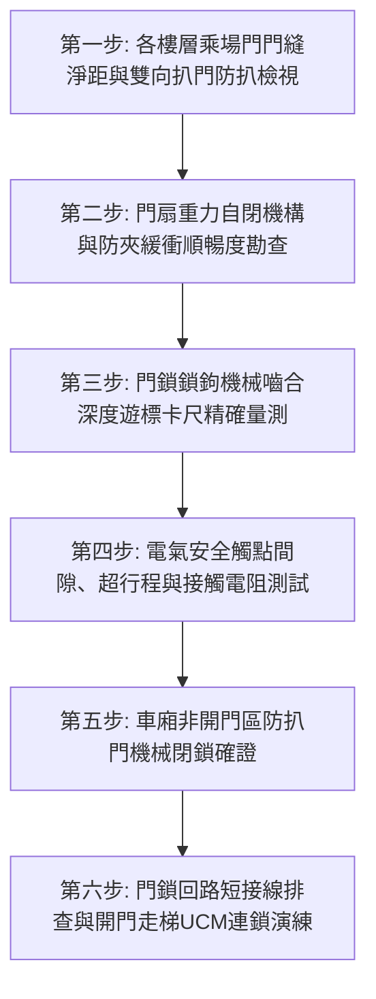

# 全案購屋實戰第七百三十七部_中古大樓社區電梯乘場門門鎖裝置機械咬合嚙合深度不足電氣安全觸點氧化積碳與剪切夾人事故體檢工序全書

---

## 壹、核心體檢綱領與歷史案例借鏡

在中古大樓（屋齡 20 至 30 年以上）的垂直昇降電梯安全事故統計中，高達 **70% 以上的電梯重大傷亡意外（如人員墜落井道、電梯開門走梯引發人體剪切擠壓）**，其根本肇因均源自於位於各樓層外門的「電梯乘場門門鎖裝置（Landing Door Interlock / Door Lock Device）」。

依據電梯安全工程基本原理，電梯乘場門門鎖裝置承擔著「機械鎖閉」與「電氣連鎖」雙重防護任務：
1. **機械鎖閉**：當電梯車廂不在該樓層開門區（Door Zone）時，乘場外門必須由重力錘、彈簧與機械鎖鉤（Locking Hook）牢牢扣死，門外之人即使以雙手全力扒門（施加高達 $1000\,\text{N}$ 橫向推力），門扇縫隙亦不得被拉開。
2. **電氣連鎖**：只有當機械鎖鉤完全旋轉卡入鎖座，且其嚙合深度（Engagement Depth）達到法規法定之 **$7\,\text{mm}$ 以上**時，串聯於電梯全區安全回路（Safety Circuit）中的「電氣安全觸點（Door Lock Safety Contacts）」方允許接通導電。只要全大樓任一樓層之乘場門有一只門鎖未鎖好，電梯驅動主機必須被 100% 強制斷電，絕對禁止啟動或行駛。

然而，中古大樓常年處於缺乏深度校驗與更換的盲區中，門鎖裝置普遍面臨四大致命破壞：
1. **門鎖鉤爪機械嚙合深度不足（Under-engagement）**：門扇懸掛滾輪磨損下垂、導軌變形或鎖座鬆動移位，機械咬合深度由標準的 $8 \sim 10\,\text{mm}$ 衰減至僅剩 $1 \sim 2\,\text{mm}$。住戶或孩童在外門輕輕推擠靠壓，鎖鉤便受震動滑脫跳開，乘客誤以為車廂已到，踏入後直接從十幾樓墜落底坑粉身碎骨。
2. **電氣安全觸點氧化、積碳電蝕與彈簧微弱**：觸點長年暴露於走道灰塵與潮濕空氣中，在頻繁接通微電流時產生微火花，形成高電阻之黑色碳化層（Contact Resistance $> 5\,\Omega$）。安全觸點彈簧疲勞無力，導致接觸不良，電梯頻繁發生「無故急停（急煞困人）」或「按鈕無反應」。
3. **安全接點被惡意「短接（Jumping / Bypassing）」**：由於門鎖接點老化頻繁引發電梯故障跳脫，部分不肖或低價電梯保養維修工為求省事，竟然在控制盤內使用跳接線將全棟門鎖安全回路「全額短路」。此時電梯徹底喪失開門閉鎖保護，引發最恐怖之「開門行梯（Unintended Car Movement, UCM）」慘劇，將正在進出車廂的乘客腰斬剪切！
4. **門扇自閉裝置（Self-closing Mechanism）重錘鋼索斷裂或彈簧疲勞**：各層乘場門依規定必須具備獨立之重力下垂重錘（Weight Block）或彈簧捲簧自閉裝置。中古大樓常見重錘鋼索鏽斷脫落，當車廂離去後外門殘留 $5 \sim 10\,\text{cm}$ 縫隙無法自行緊閉，埋下墜井隱患。

本工序全書旨在建立極致嚴謹的電梯乘場門門鎖裝置機械與電氣安全體檢規範，守護全體住戶出入電梯時的生命安全。

---

## 貳、乘場門鎖裝置機械咬合力學與電弧接觸物理機制

### 一、門鎖機械嚙合受力幾何學
鎖鉤在重力矩與鎖緊彈簧作用下扣入鎖盒：
$$M_{\text{lock}} = F_{\text{spring}} \cdot L_{\text{arm}} + m_{\text{hook}} \cdot g \cdot d_{\text{CG}} > F_{\text{push}} \cdot \mu_{\text{friction}} \cdot r$$
- 嚙合重疊深度 $H_{\text{engage}}$ 依 CNS 10594 / EN 81-20 法規規定，在電氣觸點接通瞬間必須滿足：
$$H_{\text{engage}} \ge 7.0\,\text{mm}$$
**病理失效演變**：
當鎖鉤轉軸潤滑油乾涸積垢、鎖鉤尖端磨損鈍化，有效嚙合深度降至 $3\,\text{mm}$ 以下。此時鎖座側向反作用力將產生向上之分力，外力推門時產生「槓桿撬開滑脫效應」，門扇瞬間失鎖。

### 二、電氣觸點電弧燒蝕與接點接觸阻抗
門鎖開關通常承載 AC 110V/220V 控制回路電流。開閉瞬間產生的火花放電造成金屬轉移：
$$R_{\text{contact}} = \frac{\rho_{\text{silver}}}{2a} + \frac{\sigma_{\text{film}}}{\pi a^2}$$
- $a$：真實接觸微斑點半徑。
- $\sigma_{\text{film}}$：表面氧化層（$\text{Ag}_2\text{O}, \text{Ag}_2\text{S}$）隧道電阻係數。
當彈簧接觸壓力由 $2.0\,\text{N}$ 衰退至 $0.5\,\text{N}$ 時，真實接觸面積 $a$ 急劇縮小，接觸電阻激增百倍，造成壓降過大，控制盤安全繼電器異常釋放，導致電梯行駛中頻繁急停頓挫。

---

## 參、實地體檢六大極致檢驗工序

### 工序一：乘場門扇間隙與外力扒門機械抗拒力測試
1. **門縫幾何間隙檢測**：使用塞尺（Feeler Gauge）測量兩門扇中縫、門扇與門套（側柱/頂梁）、門扇與地坎（Threshold）間隙。
   - 法規標準：中縫及四周間隙必須維持在 **$4.0 \sim 6.0\,\text{mm}$** 規範內；運轉磨損後最大嚴禁超過 **$10.0\,\text{mm}$**。
2. **手動扒門抗脫測試**：在車廂不在該樓層之狀態下，兩手用力拉扯門扇邊緣向兩側扒開（施加約 $300\,\text{N}$ 人體極限推拉力）。
   - 合格標準：門扇必須穩固閉鎖，兩門扇最大張開縫隙嚴禁超過 **$20\,\text{mm}$**，且放手後能靠自身重力自閉完全復位。

### 工序二：門扇重力重錘自閉機構與滑輪滑動阻力檢驗
1. **重錘自閉試驗**：在該樓層將乘場門手動推開至最大開度，隨後鬆手釋放。
2. **自閉性能判定**：
   - 門扇必須在重錘或捲簧驅動下，**平穩、勻速滑向閉合位置**，並在最後完全卡入鎖座上鎖，無阻滯、無中途停頓。
   - 檢查懸吊重錘之細鋼索，表面嚴禁有斷絲、起刺或嚴重紅鏽；滑輪轉動無偏擺卡死。

### 工序三：鎖鉤機械嚙合深度（Engagement Depth）遊標卡尺精確實測
1. 由專業檢驗人員於車頂或梯廳開啟檢修狀態，以游標卡尺或深度規測量鎖鉤與鎖座金屬咬合尺寸。
2. **嚙合深度判定基準**：
   - **法規合格標準：$H_{\text{engage}} \ge 7.0\,\text{mm}$**（優良狀態應達到 $8.5 \sim 10.0\,\text{mm}$）。
   - 絕對禁止：若嚙合深度 $< 5.0\,\text{mm}$，必須立即調整偏心輪軸或門掛輪高度，未改善前嚴禁投入載客運行。

### 工序四：電氣安全觸點接觸電阻與超行程（Overtravel）檢校
1. **觸點導通電阻測量**：在門鎖閉合到位狀態下，使用微歐姆表量測安全觸點兩端接觸電阻。
   - 接觸電阻必須 **$< 0.5\,\Omega$**；若讀數 $> 2.0\,\Omega$，觸點表面必須使用麂皮或專用接點清潔劑清除積碳氧化物，若鍍銀層已燒穿露出紅銅底材，必須整組更換。
2. **接觸超行程檢驗**：動觸頭在接觸到靜觸頭後，壓縮彈簧必須具備至少 **$1.5 \sim 2.5\,\text{mm}$** 之超行程壓縮量，確保彈性壓力充足（接觸壓力 $\ge 1.5\,\text{N}$）。

### 工序五：車廂開門刀（Door Cam）與門鎖滾輪間隙檢驗
1. 檢驗車廂行經各樓層時，車廂門刀與乘場門鎖滾輪之間的動態避讓間隙。
2. **間隙標準**：
   - 當車廂正常高速運行通過時，開門刀兩側與乘場門鎖滾輪的間隙必須維持在 **$5.0 \sim 10.0\,\text{mm}$** 之間，嚴禁發生任何微摩擦擦碰發出「咔噠」異音。
   - 到站開門時，車廂門刀完全張開，必須將乘場門鎖滾輪推開至完全解鎖位置（解鎖超行程 $> 3\,\text{mm}$）。

### 工序六：門鎖安全回路短接線排查與開門行梯（UCM）保護測試
1. **機房安全盤短接線徹查**：打開電梯控制盤，徹底清查安全回路端子排（Door Lock Circuit Terminals），嚴格確認無任何違規跨接跳線（Jumper Wires）。
2. **開門行梯保護演練**：模擬乘場門開啟狀態，手動給予運行指令，驅動主機抱閘必須牢固抱死，馬達絕對無電壓輸出；電梯若具備 UCMP（非預期移動保護系統），必須能在車廂移動不超過 **$150\,\text{mm}$** 範圍內緊急機械煞停。

---

## 肆、社區管委會維護與置產勘查避坑清單

| 檢查項目 | 良好合規狀態（安心置產） | 嚴重劣化徵兆（潛在巨額分攤） | 買方議價與防禦對策 |
| :--- | :--- | :--- | :--- |
| **梯廳外門手推晃動度** | 梯廳外門關閉時緊密貼合，手推門扇無明顯晃動框啷聲，門鎖咬合厚實 | 外門輕推即晃動達 2~3 公分，伴隨巨大金屬撞擊聲，甚至能看見井道內部暗光 | 門鎖鉤爪磨損即將脫扣，存在墜井致命危險，必須列為最嚴重安全瑕疵 |
| **各樓層關門到站平層** | 電梯在各樓層停靠時，車廂地坎與梯廳地坎完全水平齊平（高差 $\le \pm 5\,\text{mm}$） | 平層落差高達 2~4 公分，經常絆倒長輩孩童，出入時門扇劇烈震顫搖晃 | 平層感應器老化且門刀導向偏斜，需重新校正導軌與門機，整改費用數萬元 |
| **門鎖電氣開關原廠配件** | 門鎖開關採用原廠或國際知名大廠（三菱/日立/通力等）專用微動開關，外殼透明乾淨 | 採用雜牌通用改裝微動開關，線路裸露纏繞電工黑膠布，積滿油垢灰塵 | 嚴重非正規拼裝維修，電氣觸點隨時氧化短路，需全面更換全棟門鎖總成 |
| **乘場門防夾感應機制** | 配備全高度多光束紅外線光幕感應器（Door Sensor），遮擋任一點門立即彈開 | 僅有老舊機械安全觸板且回彈遲鈍，甚至光幕失效直接夾人夾物不退讓 | 門機防夾系統失靈，曾發生夾傷孩童事故，要求更換全新密集型紅外線光幕 |

---

## 伍、本手冊落地執行結論

電梯乘場門門鎖裝置，是全體住戶每日踏入電梯垂直深井前，唯一一道守護生死的「安全閥門」。那一聲清脆厚實的閉鎖聲，代表著數百公噸精密機械對生命的崇高敬畏；而那一枚老化發黑的接觸片、一段被磨損削薄的鎖鉤，隨時能化為吞噬無辜生命的幽冥深淵。

購屋者在勘驗中古大樓標的時，切勿僅看梯廳磁磚裝潢。在等候電梯時用手輕推門扇、親眼審視門縫間隙與關閉咬合度，是檢驗管委會是否具備人命關天底線意識、守護家人免於垂直墜落災難的至高實戰智慧。
