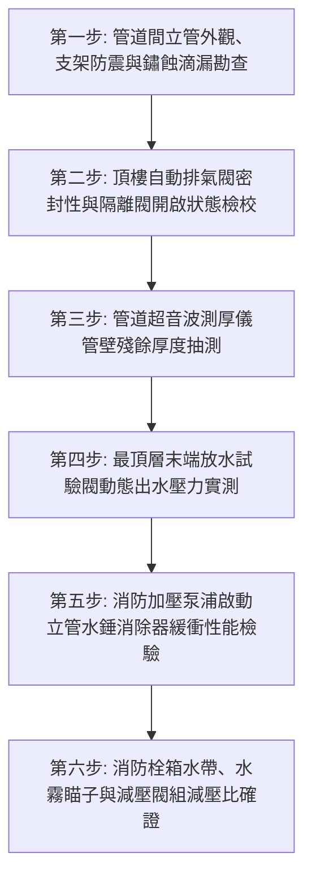

# 全案購屋實戰第七百三十九部_中古大樓社區消防送水幹管排氣閥橡膠塞老化洩漏立管水錘震盪末端放水試驗壓力不足與管壁穿孔體檢工序全書

---

## 壹、核心體檢綱領與歷史案例借鏡

在中古大樓（屋齡 20 至 30 年以上）的消防救災與生命防衛架構中，垂直貫穿整棟大樓管道間之「消防垂直送水立管（Fire Protection Standpipe System）」與各樓層之「室內消防栓箱（Fire Hose Cabinet, FHC）」、「自動灑水立管（Fire Sprinkler Standpipe）」，是火災發生時第一時間壓制初期火勢、供應消防隊員高壓撲救水源的「生命高壓水動脈」。

為了確保消防立管隨時處於「滿水、恆壓（充水濕式系統）」狀態，位於消防立管最頂端（通常安裝於屋頂突出一層或高處屋凸）之**自動排氣閥（Air Release Valve / Air Vent Valve）**，承擔著至關重要的水力動態調節使命：在日常管路補水時自動排出管內積存空氣，在水流平穩後靠浮球橡膠塞密封保壓；在水錘震盪或洩水時吸入空氣防止管路產生局部真空負壓。

然而，中古大樓常年處於缺乏專業消防水力檢驗的盲區中，消防送水管網普遍面臨四大致命破壞：
1. **頂樓自動排氣閥橡膠密封塞（Rubber Seat / Seal Plug）老化硬化洩漏**：排氣閥長年承受屋頂烈日曝曬與內部高壓靜水浸泡，橡膠密封塞碳化脆裂、表面產生凹坑溝槽。排氣閥無法閉鎖，高壓消防水由閥頂排氣孔常態噴濺滲漏，頂樓管道間壁癌斑駁；更嚴重者，管委會為防漏水竟將排氣閥前端隔離球閥「直接手動鎖死關閉」，導致管內大量氣體被死死鎖在立管頂部，形成危險的「巨型壓縮空氣氣囊」。
2. **立管劇烈水錘（Water Hammer）震盪與管件撕裂**：當立管內部含有未排出的空氣囊時，一旦消防栓開啟或地下室消防加壓雙泵（柴油消防泵或電動消防泵）啟動，不可壓縮的高速水流猛烈撞擊可壓縮的空氣囊，引發極度強烈的「水錘脈衝壓力波（Water Hammer Pressure Spike）」。瞬間衝擊峰值水壓可飆升至正常工作水壓的 3 至 5 倍（突破 $20 \sim 30\,\text{kg/cm}^2$），將轉彎處之鑄鐵彎頭或機械溝槽管件（Victaulic Couplings）硬生生震裂拉脫，整棟大樓管道間瞬間爆管下大雨。
3. **管壁電化學點蝕（Pitting Corrosion）與生鏽穿孔爆管**：早期消防管多採用鍍鋅鋼管（Galvanized Steel Pipe）。20 年以上之管路內部鍍鋅層早已消耗殆盡，在停滯死水中生成大量「厭氧菌腐蝕（MIC）」與鐵鏽結石。管壁厚度由原始的 $4.5\,\text{mm}$ 嚴重削弱至不足 $1.0\,\text{mm}$，管頂與凹槽處形成無數針孔級微穿孔，外表看似完整的消防管內部早已千瘡百孔。
4. **末端放水試驗（Inspector's Test Connection）放水壓力嚴重不足**：法規強制要求室內消防栓末端出水壓力必須維持在 **$1.7 \sim 7.0\,\text{kg/cm}^2$（$0.17 \sim 0.7\,\text{MPa}$）**，且出水量 $\ge 130\,\text{L/min}$。然而中古大樓因管內生鏽結瘤卡阻、泵浦葉輪磨損或洩壓閥失調，頂樓末端消防栓放水時僅呈現「尿尿般微弱水流（水壓 $< 0.8\,\text{kg/cm}^2$）」，射程不足 3 公尺，一旦真火來襲住戶根本無法自救滅火，眼睜睜看著火勢蔓延。

本工序全書旨在建立極致嚴謹的消防立管送水系統、排氣閥與末端放水壓力體檢標準，守護家庭免於火災吞噬。

---

## 貳、消防水力管網氣囊震盪與管壁腐蝕物理病理機制

### 一、立管氣水混合水錘壓力波（Joukowsky's Pressure Surge）力學方程式
當高速水流 $v_0$ 遭遇管內受阻或快速閉閥時，產生之理論水錘壓力增量 $\Delta P$：
$$\Delta P = \rho \cdot a \cdot \Delta v$$
- $\rho$：流體密度（約 $1000\,\text{kg/m}^3$）。
- $\Delta v$：水流流速變化量。
- $a$：壓力波在管路中的傳播速度（音速）：
$$a = \sqrt{\frac{K/\rho}{1 + (K/E) \cdot (D/e) \cdot c_1}}$$
- $K$：流體體積彈性模數。
- $E$：鋼管楊氏彈性模數。
- $D, e$：管徑與管壁厚度。

**氣囊爆炸性震盪病理分析**：
當立管頂部殘留空氣時，空氣之體積彈性模數極低，氣體被瞬間壓縮至極小體積後產生劇烈「彈簧回彈效應（Rebound Surge）」。高壓波在立管內以數百米每秒速度上下來回振盪，在管道支架與薄弱管壁處產生極限彎曲疲勞應力，直接震裂老舊焊縫。

### 二、微生物腐蝕（MIC）與沉積物下腐蝕（Under-deposit Corrosion）
停滯 20 年之消防死水中，鐵氧化菌（IOB）與硫酸鹽還原菌（SRB）在管底沉積物下方繁殖：
$$\text{Fe} + \text{H}_2\text{S} \rightarrow \text{FeS} + \text{H}_2 \uparrow$$
生成的硫化鐵（FeS）與鋼管基體形成原電池，局部腐蝕速率高達 $0.5 \sim 1.0\,\text{mm/年}$，在管道底部產生深層錐形蝕坑，導致管壁在無外力作用下突然自行穿孔爆裂。

---

## 參、實地體檢六大極致檢驗工序

### 工序一：垂直消防立管外觀、耐震管卡支架與銹蝕微滲勘查
1. **耐震管架檢視**：檢查管道間消防立管每層樓之承重托架與抗震管卡（Seismic Riser Clamp），金屬支架螺栓無鬆脫變形，防震橡膠墊墊片無碳化遺失。
2. **管體表面腐蝕等級判定**：依據 ISO 8501-1 銹蝕標準評估。若管身外表出現連續「起泡凸起紅鏽瘤（Rust Tubercles）」，刮開表面露出深黑色蝕坑，代表管壁已發生深層貫穿性點蝕。

### 工序二：頂樓自動排氣閥（Air Release Valve）排氣與氣密性能測試
1. **隔離閥（Ball Valve）開啟確證**：檢視排氣閥底座前之控制球閥，必須處於「常開（Normally Open）」鎖定狀態，嚴禁私自關閉。
2. **手動頂針洩氣與復位檢測**：使用專用工具輕輕頂下排氣閥頂部洩氣針芯，應有微弱氣流伴隨清脆金屬聲，放開後內部浮球必須在 **$0.5$ 秒內**迅速向上頂緊橡膠密封塞，閥口滴水不漏。若閥口持續向外冒水或冒水珠，代表密封橡膠已老化穿孔，必須立即更換排氣閥芯。

### 工序三：非破壞性超音波測厚儀（Ultrasonic Thickness Gauge）管壁厚度實測
1. 在立管底層高壓區、彎頭後方紊流區及頂樓氣水交界區，以砂紙打磨出 $30 \times 30\,\text{mm}$ 金屬裸露面，塗抹超音波耦合劑。
2. **殘餘壁厚判定標準**：
   - 4 吋（DN100）SCH40 鋼管原始厚度為 $6.02\,\text{mm}$。
   - **安全淘汰極限**：實測殘餘壁厚不得小於原始厚度之 **$65\%$（即不得小於 $3.9\,\text{mm}$）**。若實測厚度 $< 3.0\,\text{mm}$，管壁隨時面臨破裂爆管，必須強制更換管段。

### 工序四：最遠頂樓末端放水試驗閥（Inspector's Test Valve）動態水壓實測
1. 依據消防法規，至頂樓末端查驗閥（裝有 $15\,\text{mm}$ 銅質孔口與甘油指針壓力錶處）全開進行放水。
2. **水力動態參數考核**：
   - **靜水壓力（Static Pressure）**：放水前靜態表壓必須維持在 **$3.0 \sim 5.0\,\text{kg/cm}^2$** 以上。
   - **動態放水壓力（Flowing Pressure）**：持續放水 3 分鐘，在地下室消防加壓泵自動聯動啟動後，末端指針壓力錶讀數必須維持在 **$1.7 \sim 3.5\,\text{kg/cm}^2$** 規範合格區間內。
   - 若動態水壓 $< 1.5\,\text{kg/cm}^2$，且水流呈現黑褐色鐵鏽水泥漿狀，代表管內嚴重結石淤塞且泵浦出力嚴重衰減。

### 工序五：消防泵浦啟停與水錘吸收器（Water Hammer Arrestor）性能驗證
1. 檢驗立管底部或加壓泵出水總管旁安裝之不鏽鋼活塞式或氣囊式水錘吸收器。
2. **衝擊阻尼考核**：在消防泵浦啟動與停止瞬間，觀察立管管身震動幅度。
   - 正常狀態：立管管身橫向晃動位移必須 **$\le 2.0\,\text{mm}$**，無金屬敲擊劇烈巨響。
   - 異常判定：若泵浦停機瞬間伴隨「轟！咚！」之巨響且整根立管跳動位移 $> 10\,\text{mm}$，代表水錘消除器氣囊已破裂漏氣，喪失阻尼功能，必須更換。

### 工序六：室內消防栓箱（FHC）水帶、水霧瞄子與低樓層減壓閥組校驗
1. **水帶耐壓與脆化檢視**：展開箱內 20 公尺消防橡膠皮管或雙層帆布水帶，內襯橡膠層無沾黏裂解，快速接頭（Machino Coupling）純銅扣爪彈性完好無氧化變形。
2. **低樓層比例式減壓閥（Pressure Reducing Valve）減壓比確證**：地下室或 1~3 樓高水壓區（靜壓可能高達 $8 \sim 10\,\text{kg/cm}^2$），檢查消防栓減壓閥是否將出水壓力精確限制在 **$\le 7.0\,\text{kg/cm}^2$**，防止水柱後座力過大擊傷住戶或震脫水帶。

---

## 肆、社區管委會維護與置產勘查避坑清單

| 檢查項目 | 良好合規狀態（安心置產） | 嚴重劣化徵兆（潛在巨額分攤） | 買方議價與防禦對策 |
| :--- | :--- | :--- | :--- |
| **每年消防安全設備申報** | 連續五年消防申報合格，附有合格消防設備師放水壓力簽證與照片憑證 | 申報紀錄長期列管「消防栓水壓不足」或「立管滲水漏水」，管委會未曾撥款整修 | 公共消防安全體系全面停擺，面臨消防局開罰並有火災保險拒賠風險，列入重大議價折扣 |
| **頂樓排氣閥與管道間環境** | 排氣閥外表乾燥無水漬，控制閥常開，管道間乾燥無壁癌青苔 | 排氣閥被關死且用塑膠袋包裹，管道間牆面大面積剝落長毛壁癌，地面積水 | 管路內部蓄積巨大壓縮氣囊，隨時面臨水錘爆管淹水，更換閥門與防水抓漏需數萬元 |
| **消防栓箱內部配件齊整度** | 箱門開閉順暢，水帶整齊捲收無發霉，多功能水霧瞄子完好，壓力錶指針正常 | 水帶發霉爛穿、水槍頭被偷走消失，箱內堆滿住戶私人雜物鞋盒垃圾 | 社區住戶公德心低落且物業管理形同虛設，緊急時刻完全無法救火 |
| **消防加壓主泵與備援泵** | 電動主泵與柴油備援泵每週定時試車，機油水箱飽滿，電瓶電壓維持 24V | 消防泵浦開關切在「OFF（停止）」檔，詢問維護人員答稱「怕誤啟動爆管」 | 荒謬絕倫之掩耳盜鈴！立管強度已極度脆弱無法承受正常水壓，整換管網費用數百萬元 |

---

## 伍、本手冊落地執行結論

消防送水幹管與頂樓排氣閥，是深藏於大樓牆體內部沉睡的「救命動脈」。它平日在幽暗中承載著數十噸高壓清水的巨大張力，默默守候著整棟大樓千百名住民的生命安全；而一處老化的排氣閥密封塞、一段被鐵鏽蝕穿的薄弱管壁，在火魔降臨的極限時刻，就能讓整座生命滅火網絡瞬間潰堤。

購屋者在勘驗大樓公共公設時，走入樓梯間打開消防栓箱檢視壓力錶指針、登上頂樓查驗排氣閥是否常開滴水不漏，是檢視社區是否具備抗災韌性、守護家人免於祝融災厄的至高實戰智慧。
