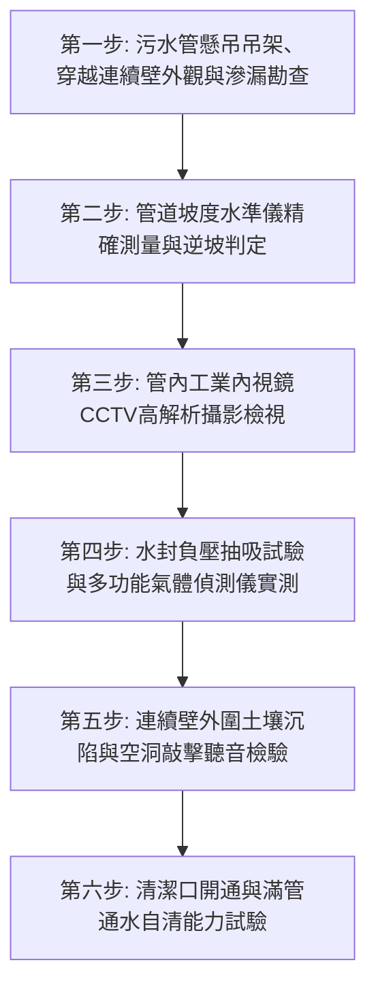

# 全案購屋實戰第七百三十二部_中古大樓社區地下室生活污水下水道用戶接管重力流破管滲漏地盤掏空沉砂淤塞逆坡回沖與惡臭毒氣逆灌室內體檢工序全書

---

## 壹、核心體檢綱領與歷史案例借鏡

在中古大樓（屋齡 20 至 30 年以上）的公共衛生環境與地基安全架構中，「生活污水下水道系統與用戶接管（Sewerage Connection & Gravity Drainage System）」是整棟社區排除家庭洗滌廢水與糞便污水的「地下隱形下水道動脈」。現代化都市（如台中市南區與南屯區）在推進污水下水道接管工程時，社區通常會將原有的老舊地下化糞池廢除或改建為污水轉向流槽，由大樓污水垂直立管匯集後，利用**重力流（Gravity Flow）**自然坡降貫穿地下室外壁，接入市府公共污水下水道幹管。

然而，歷經 20 餘年的地層微沉陷、水流沖刷與化學腐蝕，中古大樓的污水重力流系統普遍存在四大隱蔽性致命危機：
1. **地盤不均勻沉陷引發穿越連續壁管段剪裂與地盤掏空**：大樓主體沉陷量與周邊道路地盤沉陷量存在差異。污水管在穿透地下連續壁或外牆處，承受巨大的垂直剪切應力（Shear Stress），管節破裂脫筍。污水常年向地盤深處淘洗滲漏，將基底細砂礫石帶走，造成地下室周邊地基大面積「地盤掏空（Cavity Formation）」，甚至引發鄰近車道地磚崩塌與連續壁外側湧水。
2. **坡度不足與逆坡（Reverse Slope / Back-pitch）沉砂淤塞**：污水重力流管線必須維持至少 $1/100$ 至 $1/50$（約 $1\% \sim 2\%$）的法定水力坡降。早期施工不良或後天地層沉降，導致管段形成「U型下垂微積水」甚至「逆坡回沖」，油脂（FOG）、濕紙巾與泥沙迅速在逆坡低窪處凝固板結，管徑有效流通面積縮減 70% 以上，頻繁引發低樓層（1樓或2樓）馬桶與排水孔嚴重糞水倒灌。
3. **排水自清流速（Self-cleansing Velocity）不足與管壁硫化氫（H₂S）酸化破壞**：當重力流速低於 $0.6\,\text{m/s}$ 時，污水中的固體有機物沉降發酵，在厭氧環境下釋放高濃度硫化氫劇毒氣體。硫化氫與管頂凝結水結合轉化為強腐蝕性硫酸（$H_2SO_4$），將鑄鐵污水管頂部蝕穿，形成肉眼難辨的管頂「縱向長溝破裂」。
4. **存水彎水封（Water Trap Seal）破壞與致命毒氣直灌臥室客廳**：由於排污主通氣管（Main Vent Pipe）未與用戶接管有效連通，重力流在管道內引發強烈負壓抽吸（Siphonage）或正壓回衝，破壞低樓層衛浴存水彎之水封。含有沼氣（甲烷）、硫化氫與氨氣的致命惡臭毒氣直接灌入室內，危及住戶呼吸道與神經健康。

本工序全書旨在建立極致嚴謹的生活污水下水道與重力流管網體檢工序，捍衛地基安全與居家空氣品質。

---

## 貳、污水重力流與結構破壞物理病理機制

### 一、污水重力流水力學計算方程式
重力流排水流速與流量依據曼寧公式（Manning's Formula）：
$$V = \frac{1}{n} \cdot R_h^{2/3} \cdot S^{1/2}$$
$$Q = A \cdot V$$
- $V$：斷面平均流速（$\text{m/s}$）。
- $n$：管壁粗糙係數（PVC 管 $n \approx 0.009 \sim 0.010$，鑄鐵管鏽蝕後 $n \approx 0.015 \sim 0.018$）。
- $R_h$：水力半徑（Hydraulic Radius, $R_h = A / P_w$，$A$ 為過水斷面積，$P_w$ 為潤周）。
- $S$：水力坡降（坡度，$\Delta h / L$）。

**水力失衡病理演變**：
當水力坡降 $S$ 因地基沉降由 $1/100$ 變為負值（逆坡）時，水流停滯甚至反向迴流；水力半徑驟降，沉積油脂與毛髮將粗糙係數 $n$ 放大兩倍以上，排污自清流速徹底喪失，形成堅硬如水泥之油垢柱（Fatberg），最終引發全管段死鎖爆管。

### 二、連續壁穿越段雙重剪切破壞力學
當大樓本體採用筏式基礎樁支承於堅硬卵石層，而外部道路下水道管溝位於回填夯實層時：
$$\tau_{\text{shear}} = \frac{F_{\text{settlement}}}{A_{\text{pipe\_wall}}} > [\tau_{\text{allowable}}]$$
高抗剪應力集中於穿牆套管處，若未安裝具備 $\pm 100\,\text{mm}$ 軸向伸縮與 $\pm 15^\circ$ 撓曲補償能力之「抗震軟性接頭（Flexible Expansion Coupling）」，管身必被硬生生剪斷折裂。

---

## 參、實地體檢六大極致檢驗工序

### 工序一：懸吊污水管外觀、固定支架與穿牆接頭盤查
1. **防震吊架間距**：檢視地下室頂板懸吊之排污橫幹管，每隔 $1.5 \sim 2.0\,\text{m}$ 必須設置一處固定吊架，轉彎處與穿牆前必須設置防震抗晃支架；檢查吊桿螺絲有無嚴重鏽蝕變形。
2. **連續壁穿牆套管（Wall Penetration Sleeve）檢視**：持強光手電筒照射穿牆處，套管周圍混凝土是否有深色潮濕水痕、流砂白華或黑褐色油污滲出。

### 工序二：管道水準儀（Level Tool）坡度與逆坡精密實測
1. **數位電子水平尺量測**：在懸吊橫幹管上，每隔 $2\,\text{m}$ 放置數位角度水平儀，精確讀取坡度值。
   - 合格標準：坡度必須維持在 **$1.0\% \sim 2.0\%$（$1/100 \sim 1/50$）**之向下傾角。
   - 逆坡確診：若儀表顯示 $0\%$（水平）或負角度（向上傾斜），即為嚴重逆坡沉砂段，必須全面重新調整吊架螺桿高度。

### 工序三：工業級 CCTV 管道內視鏡（Pipe Inspection Camera）內部探測
1. 由地下室最前端清潔口（Cleanout, CO）伸入高解析防水內視鏡鏡頭，全行程推送至市府接管陰井。
2. **鏡頭影像考核標準**：
   - **管底積水沉砂**：無盲區殘留死水，管底無大塊油垢白化結晶與泥沙淤積（沉積物厚度嚴禁 $> 5\,\text{mm}$）。
   - **管身結構完整性**：管內無環狀裂紋、無變形壓扁、接頭承插口無脫膠錯位。

### 工序四：多功能氣體偵測儀與存水彎水封性能測試
1. **室內排水孔氣體實測**：使用已校驗之四合一氣體偵測儀（偵測 $H_2S, CH_4, CO, O_2$）緊貼 1 樓及 2 樓排水孔與衛浴地面。
   - **標準讀數**：硫化氫 $H_2S$ 必須為 **$0.0\,\text{ppm}$**，可燃性甲烷 $CH_4$ 必須為 **$0\%\,\text{LEL}$**。
   - 若讀數 $> 1.0\,\text{ppm}$，代表存水彎水封破壞，沼氣逆灌室內。
2. **水封深度量測**：衛浴存水彎之有效水封深度（Water Seal Depth）必須維持在 **$50\,\text{mm} \sim 100\,\text{mm}$** 規範標準。

### 工序五：連續壁外側地盤沉陷與空洞敲擊聽音
1. 在大樓外圍污水接管處地面，使用音響敲擊桿（Sounding Rod）敲擊地磚或柏油路面，辨識是否有空洞回音。
2. 檢查大樓結構外牆與人行道交界處，若有裂縫開裂 $> 10\,\text{mm}$ 或地坪局部下陷，代表地下污水破管已造成嚴重地基土石淘空。

### 工序六：全載滿管自清能力通水試驗
1. 同時開啟低樓層 3 處以上大流量排水閥，持續放水 5 分鐘。
2. 於地下室觀察清潔口視窗，水流應順暢奔流無壅水（Backwater）迴盪現象，管壁無劇烈震動與水流敲擊異音。

---

## 肆、社區管委會維護與置產勘查避坑清單

| 檢查項目 | 良好合規狀態（安心置產） | 嚴重劣化徵兆（潛在巨額分攤） | 買方議價與防禦對策 |
| :--- | :--- | :--- | :--- |
| **市府污水接管狀態** | 已完成市府污水下水道用戶接管，化糞池已填砂廢除，地下室乾淨無惡臭 | 尚未接管或接管失敗被市府退件，仍在使用 30 年老舊化糞池，地下室沼氣瀰漫 | 需自費施作污水管路改管工程，每戶評估分攤 3~6 萬元，並列入健康環境折讓 |
| **懸吊排污橫幹管現況** | 管身乾淨標示明確，每隔數米設有清潔口（CO），吊架緊實平直向下傾斜 | 管身多處用膠帶塑膠布捆綁止漏，吊桿拉斷下垂形成嚴重逆坡，管底結厚重油垢 | 管道已嚴重淤塞面臨全面爆管倒灌，整換橫幹管與吊架需花費 15~30 萬元 |
| **低樓層住戶反映紀錄** | 社區歷年會議紀錄無馬桶冒泡倒灌投訴，排水順暢無沼氣異味 | 2樓或1樓住戶經常反映馬桶發出「啵啵」冒氣聲、下大雨時糞水溢出淹水 | 社區重力流系統存在重大水力設計缺陷或管底堵塞，低樓層標的嚴禁購買 |
| **清潔口密封狀態** | 清潔口全數採用銅製或厚不鏽鋼螺紋旋塞，墊片密封完好無漏水 | 清潔口蓋脫落缺失，直接用塑膠袋或抹布胡亂塞住，發酵臭氣直接逸散地下室 | 管委會機電管理混亂，存在嚴重衛生安全與蟑螂老鼠孳生隱患 |

---

## 伍、本手冊落地執行結論

生活污水下水道重力流管網，是大樓深處最不為人所見、卻最攸關居住尊嚴與地盤穩固的底層生命線。一處破裂漏水的污水接管、一段積存油垢的逆坡管段，不僅能讓全家長年吸入致命有毒沼氣，更能悄悄淘空地基土壤、威脅整棟大樓的結構基盤。

購屋者在勘驗大樓公共環境時，切勿僅看地面景觀。務必親自走入地下室管線夾層，以水平儀親量管段坡度、用雙眼檢視穿牆套管滲漏痕跡。唯有排水順暢、地盤穩固的清朗社區，才能守護全家人的健康與資產永續承傳！
