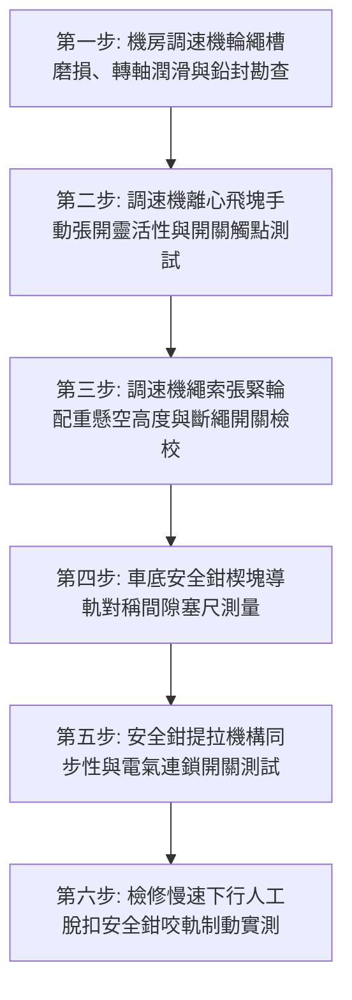

# 全案購屋實戰第七百三十八部_中古大樓社區電梯調速機夾繩鉗磨損飛塊離心彈簧疲勞失準與超速溜梯下墜安全鉗制動體檢工序全書

---

## 壹、核心體檢綱領與歷史案例借鏡

在中古大樓（屋齡 20 至 30 年以上）的電梯安全防護體系中，位於電梯頂樓機房之「機械調速機（Speed Governor / Overspeed Governor, OSG）」與安裝於車廂底部之「漸進式安全鉗（Progressive Safety Gear）」，共同構成了電梯在遭遇曳引鋼索全斷、制動煞車失靈或控制系統失控時，防止車廂發生「超速自由落體墜落（Free Fall）」與「衝頂溜梯」的**最後終極機械剎車生命線**。

調速機與安全鉗之聯動運作原理，係透過一條獨立的調速機閉合鋼索（Governor Rope）隨車廂等速上下同步運行。當車廂下行速度超過額定速度的 **$115\%$** 時，調速機內部的電氣超速開關首先動作，切斷主機電源並讓主制動器抱閘；若速度因重力加速度持續飆升至額定速度的 **$125\%$**（或法定安全動作極限速度 $V_{\text{trip}}$）時，調速機內部的機械夾繩鉗（Rope Gripper）瞬間咬死調速機鋼索。靜止的鋼索透過拉桿連動機構拉動車廂底部之安全鉗楔形滑塊，楔塊在幾分之一秒內順著導軌強力擠入，將數噸重的車廂「強行機械咬死於鋼軌上」，徹底煞停電梯！

然而，中古大樓常年處於缺乏深度動態試驗與專業校驗的盲區中，該系統普遍存在四大致命隱患：
1. **夾繩鉗夾口（Rope Gripping Jaws）金屬磨損打滑與油污附著**：機房空氣中漂浮的油霧與鋼索潤滑油沉積於調速機夾繩鉗的鋸齒狀夾口表面，齒紋磨平鈍化。當超速發生時，夾繩鉗無法提供足夠的法定夾持力（法定夾緊力至少需大於安全鉗拉起力的 2 倍且 $\ge 300\,\text{N}$），鋼索在夾口中劇烈滑移拉絲，無法將車廂底部的安全鉗拉桿提起，安全鉗完全不動作。
2. **調速機離心飛塊（Centrifugal Flyweights）旋轉軸銷卡死與彈簧疲勞**：調速機長達數十年未清洗上油，旋轉轉軸之潤滑油脂硬化凝固、黏滿灰塵，離心甩塊轉動受阻；或者調校額定動作速度之離心拉伸彈簧產生金屬塑性疲勞，彈性係數衰退，導致超速動作速度點嚴重飄移（要麼在正常速度下頻繁誤跳扣死，要麼在超速 150% 時依然紋絲不動）。
3. **漸進式安全鉗楔塊（Safety Wedge Blocks）導軌間隙偏差與偏心卡阻**：安全鉗安裝於車廂底樑兩側，楔塊與電梯導軌兩側之標準間隙應均勻對稱維持在 $2 \sim 3\,\text{mm}$。中古大樓常見車廂導靴磨損導軌傾斜，安全鉗單側間隙被磨平甚至常態刮碰導軌，另一側間隙過大；動作時單側先咬死引發車廂劇烈傾斜偏載，扭斷車架甚至卡死出軌。
4. **安全鉗電氣連鎖開關（Safety Gear Switch）接點失靈**：當安全鉗被提起時，其電氣開關必須在機械楔塊接觸導軌前先行切斷安全回路。若開關接點卡死或被違規短接，主機在安全鉗咬死導軌後仍持續以滿功率拉扯旋轉，導致曳引鋼索劇烈摩擦燒紅斷裂。

本工序全書旨在建立極致嚴謹的電梯調速機與安全鉗超速煞停體檢工序，捍衛大樓垂直交通之終極生存防線。

---

## 貳、調速機離心力學與安全鉗制動摩擦破壞病理分析

### 一、調速機飛塊離心力平衡力學方程式
調速機飛塊繞軸旋轉時，離心力 $F_{\text{centrifugal}}$ 與調速彈簧預緊力 $F_{\text{spring}}$ 之力矩平衡：
$$F_{\text{centrifugal}} = m_{\text{weight}} \cdot \omega^2 \cdot r_{\text{CG}} = m_{\text{weight}} \cdot \left(\frac{v_{\text{car}}}{R_{\text{sheave}}}\right)^2 \cdot r_{\text{CG}}$$
$$M_{\text{centrifugal}} = F_{\text{centrifugal}} \cdot L_1 \ge F_{\text{spring}} \cdot L_2 = (k \cdot \Delta x + F_0) \cdot L_2$$
- $v_{\text{car}}$：車廂下行線速度。
- $R_{\text{sheave}}$：調速機繩輪節圓半徑。
- $k$：調速彈簧剛度係數。
- $F_0$：彈簧初始預緊力。

**病理破壞分析**：
當彈簧剛度 $k$ 因疲勞衰減 15% 時，飛塊將在正常額定運行速度下提前甩出，引發電梯高速行駛中「無預警機械咬死急停」，造成乘客頸椎甩鞭效應挫傷；反之，若轉軸阻尼摩擦力 $f_{\text{friction}}$ 過大，需要超速達 $140\%$ 以上才能克服摩擦甩開，此時車廂下墜動能已增加近一倍（$E_k \propto v^2$），超出安全鉗能量吸收極限。

### 二、漸進式安全鉗摩擦煞車制動力矩
漸進式安全鉗依靠碟形彈簧（Belleville Springs）提供恆定法向正壓力 $N$：
$$F_{\text{brake}} = 2 \cdot \mu_{\text{friction}} \cdot N$$
車廂制動減速度 $a_{\text{stop}}$ 必須符合法規人體生理極限：
$$a_{\text{stop}} = \frac{F_{\text{brake}} - (M_{\text{car}} + Q_{\text{load}}) \cdot g}{M_{\text{car}} + Q_{\text{load}}} \in [0.2\,g, 1.0\,g]$$
若導軌表面塗抹了過量未經核可之厚重牛油，摩擦係數 $\mu_{\text{friction}}$ 由 $0.15$ 驟降至 $0.05$ 以下，制動力 $F_{\text{brake}}$ 將遠小於重力，安全鉗在導軌上打滑狂衝，徹底喪失制動煞停能力。

---

## 參、實地體檢六大極致檢驗工序

### 工序一：調速機輪槽磨損、鋼索張力與原廠校驗鉛封檢驗
1. **原廠調校鉛封（Lead Seal）確證**：檢視調速機彈簧調節螺栓處之鉛封是否完好無損。若鉛封被剪斷或有非原廠調整痕跡，代表動作速度可能被隨意篡改，必須重新拆卸至實驗室校驗台標定。
2. **繩槽與鋼索磨損**：使用鋼索直徑卡尺測量調速機專用鋼索（直徑通常為 $6.0 \sim 8.0\,\text{mm}$）。鋼索磨損量嚴禁超過原始直徑之 **$10\%$**，表面無斷絲、無嚴重紅鏽；檢查繩槽有無偏磨拉溝。

### 工序二：離心甩塊機械轉動靈活性與電氣超速開關動作檢測
1. **手動擺動甩塊**：在切斷電源狀態下，用手輕推調速機離心甩塊。甩塊應能順暢向外張開，無金屬摩擦刮擦阻力，放開後能在復位彈簧作用下瞬間清脆復位。
2. **電氣超速開關（Overspeed Switch）間隙**：測量飛塊張開至接觸電氣開關時之觸動行程。開關必須在機械夾繩機構動作前**先行斷開**，且接點斷開行程 $\ge 4\,\text{mm}$，接觸電阻 $< 0.5\,\Omega$。

### 工序三：底坑調速機張緊輪（Tensioning Sheave）懸空高度與斷繩開關
1. 檢視安裝於井道底坑之調速機鋼索張緊輪裝置。
2. **配重懸空高度與導軌滑動**：張緊輪重錘塊必須保持自由懸空狀態，重錘底面離底坑地坪距離應維持在 **$150 \sim 350\,\text{mm}$** 規範間隙內，導向槽無卡死。
3. **斷繩安全開關（Broken Rope Switch）驗證**：手動抬起或下壓張緊輪重錘，模擬鋼索斷裂或過度伸長鬆弛，安全開關必須在行程移動 **$20\,\text{mm}$ 內**切斷電梯安全回路。

### 工序四：安全鉗楔塊與導軌側面間隙精密實測
1. 由檢驗人員於車頂或地坑，使用厚薄規（塞尺）測量車廂兩側安全鉗楔形滑塊與電梯 T 型導軌（T-Rail）兩側工作面的間隙。
2. **間隙標準**：
   - 安全鉗左右兩側單邊間隙必須均勻維持在 **$2.0 \sim 3.0\,\text{mm}$** 規範標準。
   - 兩側間隙不平衡差值嚴禁超過 **$0.5\,\text{mm}$**；楔塊表面齒槽必須清潔無油垢雜物，嚴禁塗抹潤滑脂。

### 工序五：安全鉗提拉連桿機構同步性與電氣開關驗證
1. 手動向上提起安全鉗連動提拉桿，觀察車廂左右兩側之楔塊動作狀態。
2. **雙側同步提升（Simultaneous Lifting）**：兩側楔塊必須完全同步向上滑動夾向導軌，不得有一先一後之偏扭現象。
3. **安全鉗電氣開關（Safety Gear Switch）**：在提拉桿向上抬起 **$3 \sim 5\,\text{mm}$**、楔塊尚未夾緊導軌之瞬間，電氣連鎖開關必須精準動作斷開，切斷控制回路。

### 工序六：檢修慢速下行人工脫扣安全鉗咬軌制動實測
1. 配合電梯專業維護人員實施低速安全鉗實體咬軌試驗（慢速檢修速度 $v \le 0.63\,\text{m/s}$）。
2. **制動咬軌判定基準**：
   - 在檢修下行過程中，人工觸發調速機夾繩鉗咬死鋼索。
   - 車廂底部安全鉗必須在 **$0.5$ 秒內**可靠夾住導軌，車廂平穩制動煞停，曳引機打滑空轉且安全回路立即斷電。
   - 停機後檢視導軌兩側夾痕，兩側咬痕長度與深度應均勻對稱，導軌無永久性塑性彎曲變形。

---

## 肆、社區管委會維護與置產勘查避坑清單

| 檢查項目 | 良好合規狀態（安心置產） | 嚴重劣化徵兆（潛在巨額分攤） | 買方議價與防禦對策 |
| :--- | :--- | :--- | :--- |
| **調速機鉛封與保養標籤** | 原廠鉛封完整無損，機房調速機每五年實施動態校驗，貼有最新校驗合格簽證 | 鉛封被剪斷扯落，調速機螺栓被亂調，且長達十幾年未曾送檢標定動作速度 | 系統處於未定時炸彈狀態，隨時誤動作急停或超速失效，需整台送原廠重新標定 |
| **調速機與鋼索清潔度** | 調速機外表清潔無油泥，鋼索乾燥無油脂附著，夾繩鉗齒面清晰鋒利 | 整台調速機覆蓋黑厚油垢，鋼索滴淌黃油，夾繩鉗夾齒已被油泥完全填平塞滿 | 夾繩鉗在超速時必打滑失靈，完全無法觸發安全鉗，需徹底清洗或更換鋼索夾鉗 |
| **底坑張緊輪懸空狀態** | 張緊輪重錘懸空良好，斷繩保護開關接線牢固，防護遮罩完整 | 張緊輪重錘已經觸底著地（鋼索已極度鬆弛拉長），斷繩開關被膠帶綁死無效 | 鋼索張力嚴重不足，超速時無法傳遞夾緊力，列入昇降公共安全一級重大隱患 |
| **安全鉗導軌夾持痕跡** | 導軌表面光滑平整，僅塗抹專用導軌油，安全鉗楔塊無任何常態摩擦痕跡 | 導軌兩側有深深的常態金屬刮削亮溝，且安全鉗單側長期卡碰導軌發出異音 | 安全鉗幾何間隙嚴重扭曲，出軌風險極高，更換導軌與安全鉗費用高達數十萬元 |

---

## 伍、本手冊落地執行結論

電梯調速機與漸進式安全鉗，是捍衛垂直移動生命安全的「機械死刑宣判官」。在電梯面臨毀滅性斷索或主煞車失靈的極端死境中，所有的電子傳感器與電腦控制晶片都可能因斷電與火災燒毀，唯有這套純粹依賴「物理離心力與斜面摩擦力學」的純鋼鐵機械結構，能在幾分之一秒內挽救數十條無辜生命於萬丈深淵之上。

購屋者在實地驗屋評估大樓公共公設時，走入頂樓電梯機房親眼檢視調速機的原廠鉛封是否健在、走訪底坑確認張緊輪是否自由懸空，是穿透大廳包裝、真正為全家人守護生命安全的至尊極致智慧。
