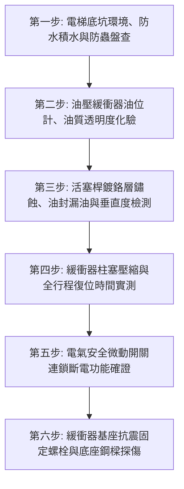

# 全案購屋實戰第七百三十六部_中古大樓社區電梯昇降路井道底坑油壓緩衝器液壓油乳化活塞桿鏽蝕微動極限開關接觸不良與安全防護體檢工序全書

---

## 壹、核心體檢綱領與歷史案例借鏡

在中古大樓（屋齡 20 至 30 年以上）的垂直交通昇降系統中，位於電梯井道最底層（深達地下 1.5 至 2.5 公尺）的「電梯底坑（Elevator Pit）」，沉睡著電梯安全防護體系中最後一道物理緩衝底牌——**油壓緩衝器（Hydraulic Buffer / Oil Buffer）**。

當電梯發生極端罕見的曳引鋼索打滑、調速機安全鉗制動失靈，或是配重側失衡導致車廂或對重以超速狀態「衝底（Bottoming Out）」時，油壓緩衝器必須以精密的液壓阻尼節流孔設計，在極短行程內吸收車廂滿載數公噸向下衝擊的巨大動能，並將其轉化為液壓油的熱能發散，將車廂減速度嚴格控制在人體骨骼與內臟能承受之極限生理加速度（通常平均減速度嚴格限制在 $1.0\,g$ 以內，峰值不得超過 $2.5\,g$ 且持續時間不得超過 0.04 秒），防止乘客遭受頸椎粉碎性骨折與致命衝擊。

然而，中古大樓常年處於缺乏專業機電預防性維護的盲區，電梯底坑普遍面臨「四大致命環境與機械病理死角」：
1. **底坑滲水淹水導致液壓油乳化變質**：底坑地處大樓地下最深點，若連續壁二次接縫或筏基底板防水破裂，雨季或地下水位上升時底坑極易積水成池。油壓緩衝器下半部浸泡於污水中，水分順著活塞桿油封縫隙滲入內部油缸，液壓油嚴重「乳化（Emulsification）」，運動黏度與流體不可壓縮性喪失，阻尼節流係數嚴重失真，衝底時無法產生足夠緩衝阻力，形同直挺挺撞擊金屬底座。
2. **鍍硬鉻活塞桿（Piston Rod）鏽蝕麻點與刮傷劃痕**：長年暴露於地下室潮濕與硫化環境中，活塞桿表面鍍硬鉻層產生微細孔洞點蝕（Pitting Corrosion），生成尖銳紅鐵鏽斑。當緩衝器偶爾受壓下行時，粗糙鏽斑瞬間將聚氨酯（PU）防塵密封油封撕裂割破，導致內部液壓油大量向外噴射外洩，油缸內部油位乾涸。
3. **柱塞復位彈簧（Return Spring）疲勞與卡死不復位**：緩衝器受壓後必須依靠內部或外部高強度回位彈簧迅速向上復位。彈簧長年浸泡酸性底坑積水鏽蝕斷裂，或導向襯套（Bushings）因水垢雜質卡死，緩衝器受壓後無法完全彈回頂部正常高度，使有效緩衝行程縮短 50% 以上，電梯處於無緩衝裸奔狀態。
4. **緩衝器安全微動開關（Safety Buffer Switch）接點氧化失效**：法規強制要求油壓緩衝器必須配置電氣安全開關。當緩衝器被壓縮或未完全復位時，開關必須切斷電梯安全回路阻止電梯運轉。但中古大樓底坑微動開關外殼防護等級（IP）不足，接點嚴重受潮氧化、彈簧疲勞黏連，甚至被無良電梯維護人員直接短接（Bypass），埋下電梯帶病運轉之重大災難禍根。

本工序全書旨在建立極致嚴謹的電梯底坑油壓緩衝器體檢標準，守護垂直昇降最後一道生命底線。

---

## 貳、油壓緩衝器水力學阻尼與材料破壞病理分析

### 一、油壓緩衝器能量吸收與節流阻尼力學方程式
車廂以初速度 $v_0$ 撞擊緩衝器柱塞時，液壓油通過變截面節流孔（Orifice）產生之阻尼反力 $F_{\text{hydraulic}}$：
$$F_{\text{hydraulic}} = \frac{1}{2} \cdot \rho_{\text{oil}} \cdot A_{\text{piston}} \cdot \left(\frac{A_{\text{piston}}}{C_d \cdot A_{\text{orifice}}(x)}\right)^2 \cdot \left(\frac{dx}{dt}\right)^2$$
- $\rho_{\text{oil}}$：液壓油密度。
- $A_{\text{piston}}$：緩衝器活塞柱塞截面積。
- $C_d$：節流孔流量係數。
- $A_{\text{orifice}}(x)$：隨行程 $x$ 變化的節流孔有效流通面積（設計為等減速度曲線）。
- $\frac{dx}{dt}$：衝擊下行瞬時速度。

**病理分析**：
- **油量不足或乾涸**：當油封洩漏導致油位低於節流孔位置時，阻尼力 $F_{\text{hydraulic}} \rightarrow 0$，衝擊動能完全由金屬活塞硬碰硬撞擊缸底，造成車廂骨架扭曲撕裂、乘客重傷。
- **液壓油乳化與氣蝕**：含水超過 5% 之乳化油在高剪切節流過程中產生大量微氣泡（泡沫化），阻尼係數跳躍式衰減，減速度曲線出現劇烈震盪衝擊。

### 二、活塞桿電化學腐蝕力學
活塞桿基材為 45# 中碳鋼，外鍍 $20 \sim 30\,\mu\text{m}$ 硬鉻。在含硫地下水浸泡下，鉻層微觀裂紋處與碳鋼基體形成強烈微電池腐蝕：
$$\text{Fe} \rightarrow \text{Fe}^{2+} + 2e^-$$
生成的氧化鐵晶體體積膨脹 2 至 3 倍，將外層鍍鉻層頂起剝落，形成銳利火山口狀鏽坑，徹底破壞密封面。

---

## 參、實地體檢六大極致檢驗工序

### 工序一：底坑乾燥度、排水設施與沉泥勘查
1. **底坑滲水與積水檢視**：使用強光手電筒全面照射底坑地面與牆角。底坑必須維持絕對乾燥，嚴禁有積水、油泥或青苔滋生。
2. **自動排水泵（Sump Pump）功能驗證**：若底坑設有集水坑，檢查其沉水排水泵與浮球開關能否正常排水，止回閥無污水倒灌現象。

### 工序二：液壓油油位、油質取樣與乳化度檢驗
1. **油位視窗（Oil Sight Glass）檢核**：檢視油壓緩衝器油位計。液面必須處於「NORMAL / FULL」標準刻度線區間內，嚴禁低於最低油位標線。
2. **油質化驗判定**：鬆開油箱底部取樣閥，取出 50ml 油樣置於透明試管中觀察。
   - **合格標準**：油質呈清澈金黃色或琥珀色透明液體，無懸浮雜質、無泡沫。
   - **乳化報廢標準**：油質呈現奶白色、渾濁黃褐色或分層出水，判定為嚴重乳化，必須全額排空清洗油缸並更換專用抗磨液壓油（如 ISO VG 32/46）。

### 工序三：活塞桿鍍鉻表面、油封洩漏與同心垂直度實測
1. **柱塞外觀與鏽蝕檢測**：手觸活塞桿表面（需在安全停機狀態下），圓周及全行程表面應光滑如鏡。若有指甲可感知的縱向劃痕、凹坑或紅鏽點斑，判定為不合格。
2. **垂直度與偏心測量**：使用磁性底座百分表（Dial Indicator）架設於缸體上，檢驗活塞柱塞與導向套之同軸度與垂直度，其垂直度偏差嚴禁超過 **$1.0\,\text{mm/m}$**。

### 工序四：緩衝器柱塞手動/機械壓縮與自動復位時間（Resetting Time）實測
1. 依據 CNS 10594 / EN 81 電梯安全法規，進行緩衝器壓縮復位測試。
2. **復位時間秒錶測量**：使用專用頂升千斤頂或慢速檢修車廂將緩衝器柱塞完全壓入缸底，隨後瞬間釋放壓力，使用數位碼錶精確記錄活塞桿從完全壓縮狀態自動彈回至完全伸展初始位置所需時間。
   - **法規合格標準：復位時間必須 $\le 90$ 秒**（優良性能通常在 $10 \sim 30$ 秒內平穩完全伸展）。
   - 若超過 90 秒仍未完全回位，或卡在半途中無法動作，代表內部回位彈簧斷裂或襯套咬死，必須立即停機大修。

### 工序五：安全微動開關（Safety Contact）電氣連鎖性能測試
1. 在緩衝器處於壓縮行程大於 **$5\,\text{mm}$** 時，檢視緩衝器安全開關接點狀態。
2. **電梯安全迴路連鎖確證**：
   - 安全開關接點必須精準斷開，切斷電梯主控制盤之安全回路（Safety Circuit）。
   - 此時在機房手動操作檢修運轉或正常叫梯，電梯驅動主機必須**絕對鎖定無法啟動**，面板顯示緩衝器故障代碼。
   - 柱塞完全復位後，電氣接點必須能自動可靠閉合，無虛接、黏滯現象。

### 工序六：基座地腳螺栓、槽鋼支架防腐與焊道探傷
1. 檢驗固定緩衝器之高張力地腳螺栓（Anchor Bolts），使用扭力扳手抽驗緊固扭力，不得有鬆動浮起。
2. **底座結構防腐**：底坑緩衝器工字鋼或槽鋼基座表面防鏽漆若剝落生鏽，鏽蝕深度嚴禁超過鋼材原始厚度之 10%，焊縫處無疲勞開裂痕跡。

---

## 肆、社區管委會維護與置產勘查避坑清單

| 檢查項目 | 良好合規狀態（安心置產） | 嚴重劣化徵兆（潛在巨額分攤） | 買方議價與防禦對策 |
| :--- | :--- | :--- | :--- |
| **底坑環境與緩衝器外觀** | 底坑地面乾燥乾淨無垃圾雜物，緩衝器金屬本體油漆完好、活塞光滑如鏡 | 底坑長年積水深達腳踝，油壓緩衝器浸泡水裡，活塞桿滿是黑褐色鐵鏽斑 | 電梯安全防護徹底破產，底坑防水抓漏與更換油壓緩衝器費用每部約 10~20 萬元 |
| **緩衝器油位與油質** | 油位視窗油量充足，油質透亮清澈，無任何漏油滴漏跡象 | 視窗完全看不到油（已漏光乾涸），油缸外圍積滿厚厚油泥黏渣 | 發生衝底事故時將無任何阻尼防護，等同硬著陸，列入一級致命安全隱患 |
| **每月專業保養紀錄** | 昇降設備合格廠商每月按時保養，紀錄卡上有緩衝器油位確認與復位測試簽證 | 保養紀錄長期勾選合格但現場緩衝器早已卡死斷電，流於形式作假簽證 | 社區電梯維護品質低劣，需更換優良保養廠商並全面實施大保養校驗 |
| **安全開關防護等級** | 開關具備 IP65 以上防水防塵外殼，接線牢固密封，動態測試連鎖靈敏 | 開關蓋子脫落遺失、金屬觸點裸露發綠，甚至電線被電工膠帶直接短接短路 | 蓄意破壞電梯安全回路，嚴重違反公共安全法規，要求立即整改更換原廠開關 |

---

## 伍、本手冊落地執行結論

電梯井道底坑油壓緩衝器，是整座垂直昇降大樓最後一道沈默的「救命降落傘」。它長年佇立在最黑暗、最潮濕的地下深處，數十年或許不曾動作一次，但只要電梯發生失控衝底的萬分之一極限危機，這根被液壓油浸潤的鋼鐵活塞，就是全家乘客生命與骨骼完整的唯一屏障。

購屋者在勘驗大樓公共公設時，走訪電梯機房與底坑視窗，親眼確認油壓緩衝器的油位充足、柱塞光滑未鏽，是洞察管委會是否真正敬畏生命、重視公共安全的最權威指標。
