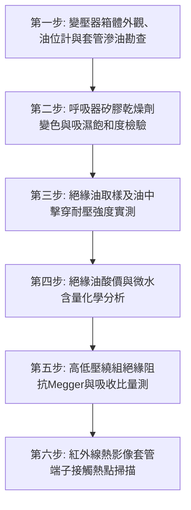

# 全案購屋實戰第七百三十四部_中古大樓社區地下室變電室油浸式變壓器絕緣油耐壓劣化油泥碳化PCB多氯聯苯殘留油封滲漏與高溫爆炸體檢工序全書

---

## 壹、核心體檢綱領與歷史案例借鏡

在中古大樓（屋齡 20 至 30 年以上）的高壓電氣機房（變電室）中，「油浸式配電變壓器（Oil-immersed Distribution Transformer）」是將台電 11.4kV 或 22.8kV 高壓電源轉換為 380V/220V 或 220V/110V 社區民生動力的最核心「心臟主動脈」。台電供電經由高壓真空斷路器（VCB）或負荷啟斷開關（LBS）引入變壓器一次側，再經由矽鋼片磁路耦合降壓輸出，供應全社區數百戶生活用電。

油浸式變壓器內部注滿數百公升甚至上千公升之礦物絕緣油（Transformer Mineral Oil）。絕緣油同時承擔著兩大神聖使命：**高壓電氣絕緣**與**高溫散熱循環冷卻**。然而，中古大樓常年處於缺乏專業甲級電氣承裝業深層維護的盲區中，普遍存在四大致命隱患：
1. **絕緣油擊穿耐壓（Dielectric Breakdown Voltage）急劇衰退與水分乳化**：變壓器呼吸器（Breather）內部之矽膠乾燥劑吸濕飽和失效，地下室潮濕空氣侵入油枕與油箱。微量水分（$> 30\,\text{ppm}$）與空氣中之氧氣使絕緣油嚴重受潮乳化，介質耐壓值由全新油的 $> 30\,\text{kV}$ 驟降至 $< 15\,\text{kV}$ 以下。一旦遭遇雷擊突波或電網過電壓，高壓繞組匝間絕緣直接被擊穿，引發劇烈相間短路。
2. **絕緣油氧化酸化、油泥沉積（Sludge Formation）與碳化通道**：長年處於 70°C 至 90°C 之滿載高溫下，油品產生酸性物質與膠質油泥。黏稠油泥沉積於繞組散熱油道與矽鋼片表面，阻斷對流散熱，形成「溫度越高 $\rightarrow$ 氧化越快 $\rightarrow$ 溫度再飆高」之惡性熱崩潰循環；局部微弱放電更在絕緣油中產生碳化導電微粒，形成隱形碳化通道。
3. **老舊變壓器 PCB（多氯聯苯）劇毒致癌殘留違規風險**：民國 70 年代至 80 年代初期製造之部分老舊變壓器，絕緣油中可能含有國際嚴格管制的持久性有機污染物——多氯聯苯（Polychlorinated Biphenyls, PCBs）。若未經環保署認證機構檢測確認，一旦發生滲漏或火災，釋放之戴奧辛劇毒氣體將污染整棟地下室，社區更面臨主管機關巨額裁罰與巨額有害廢棄物清除費用。
4. **油箱油封（Gasket）硬化滲漏與內部電弧引發高溫爆裂**：變壓器高低壓套管（Bushing）根部與油箱上蓋之丁腈橡膠（NBR）油封，在紫外線、熱油與機械應力作用下碳化脆裂，絕緣油沿著箱體接縫持續滴漏，造成油位降至繞組裸露警戒線以下。此時一旦繞組發生匝間短路電弧，數千度高溫電弧瞬間將周圍絕緣油裂解為大量氫氣、乙炔與甲烷等易燃性氣體，油箱內部壓力在幾毫秒內突破極限，直接引發油箱炸裂噴油，釀成地下室毀滅性大火。

本工序全書旨在建立極致嚴謹的地下室油浸式變壓器與絕緣油化驗體檢工序，捍衛社區生命財產與電力安全基石。

---

## 貳、絕緣油劣化化學反應與變壓器爆炸物理機制

### 一、絕緣油熱氧化反應與油泥生成方程式
礦物絕緣油主成分為環烷烴與石蠟烴碳氫化合物（$\text{C}_n\text{H}_{2n+2}$）。在高溫與金屬銅/鐵催化作用下：
$$\text{RH} + \text{O}_2 \xrightarrow{\text{Cu, Fe, Heat}} \text{ROOH} \xrightarrow{\text{氧化分解}} \text{RCOOH (有機酸)} + \text{Sludge (聚合油泥)}$$
酸性產物侵蝕絕緣紙（牛皮紙纖維素），聚合度（DP, Degree of Polymerization）由 1000 降至 200 以下，絕緣紙脆化如落葉，輕微電磁震動即碎裂脫落。

### 二、油中溶解氣體分析（DGA）故障特徵對應
依據國際電工委員會 IEC 60599 與 IEEE C57.104 規範，不同電氣熱故障在油中產生特定的特徵氣體：
- **低溫過熱（$< 300^\circ\text{C}$）**：主要釋放甲烷（$\text{CH}_4$）與乙烷（$\text{C}_2\text{H}_6$）。
- **高溫過熱（$> 700^\circ\text{C}$）**：主要釋放乙烯（$\text{C}_2\text{H}_4$）。
- **局部放電（Partial Discharge, PD）**：主要釋放大量氫氣（$\text{H}_2$）。
- **電弧放電（Arcing Fault）**：主要釋放**乙炔（$\text{C}_2\text{H}_2$）**。若油中檢出乙炔濃度 $> 5\,\text{ppm}$，即代表變壓器內部已發生高能量破壞性電弧，隨時面臨爆炸！

---

## 參、實地體檢六大極致檢驗工序

### 工序一：變壓器外殼、高低壓套管與油位計（Oil Level Gauge）勘查
1. **油位指示核對**：檢視油位計指針是否處於當前油溫對應之標準刻度（$20^\circ\text{C} \sim 40^\circ\text{C}$ 常溫線）。若指針低於「MIN」下限，代表油量嚴重洩漏，繞組頂部已暴露於空氣中。
2. **高壓瓷套管（Porcelain Bushing）與油封檢視**：持強光手電筒檢視瓷套管表面有無電暈放電痕跡、微裂紋；檢查套管底座法蘭密封膠圈有無滲油發黑、積聚黏稠油泥。

### 工序二：呼吸器（Dehydrating Breather）矽膠乾燥劑狀態檢核
1. 檢視安裝於變壓器側邊之呼吸器透明玻璃筒。
2. **矽膠顏色判定**：
   - **正常乾燥狀態**：矽膠顆粒呈現深藍色或亮橘色。
   - **吸濕失效狀態**：矽膠轉變為**粉紅色或淺白色**（代表吸濕已達飽和狀態，喪失除濕能力）。底部油封杯（Oil Cup）若乾涸無油，潮濕空氣已直通變壓器內部，必須立即更換活性乾燥劑並補滿密封油。

### 工序三：絕緣油下閥門嚴密取樣與耐壓擊穿試驗（Breakdown Voltage Test）
1. 透過變壓器底部專用採樣閥，先排放 1~2 公升沉積廢油以沖洗閥門，再使用乾燥無水之專用棕色玻璃採樣瓶取樣。
2. **油耐壓測試（依 ASTM D877 / IEC 60156）**：
   - 將油樣倒入專用電極油杯中（兩電極間距精確維持 $2.5\,\text{mm}$），以 $2\,\text{kV/s}$ 升壓速率施加交流高壓，連續測試 5 次取平均值。
   - **合格標準**：運轉中變壓器絕緣油耐壓必須 **$\ge 25\,\text{kV}$**（全新油 $\ge 30\,\text{kV}$）。
   - 危險警戒：若耐壓值 $< 20\,\text{kV}$，絕緣油必須立即進行真空濾油脫水脫氣，或全額抽換新油。

### 工序四：油品化學分析——酸價（Acid Number）與含水量
1. **中和酸值測定**：量測中和 1 克絕緣油中酸性物質所需之氫氧化鉀毫克數（$\text{mg KOH/g}$）。
   - 標準上限：酸價必須 **$\le 0.2\,\text{mg KOH/g}$**。若 $> 0.4\,\text{mg KOH/g}$，油泥沉積加劇，必須更換。
2. **微量水分檢測（Karl Fischer 水分儀）**：油中溶解水分含量必須 **$\le 25\,\text{ppm}$**。

### 工序五：高低壓繞組絕緣阻抗與極化指數（PI）量測
1. 將變壓器高低壓端子與外部母線解開，分別使用 2500V DC 高阻計量測：
   - 高壓繞組對低壓繞組及大地（一次側對二次側+外殼）。
   - 低壓繞組對高壓繞組及大地。
2. **絕緣電阻與吸收比（Absorption Ratio）**：
   - 常溫 $25^\circ\text{C}$ 下，高壓側絕緣電阻必須 **$\ge 1000\,\text{M}\Omega$**。
   - 吸收比 $K = R_{60\text{s}} / R_{15\text{s}} \ge 1.3$；極化指數 $\text{PI} = R_{10\text{min}} / R_{1\text{min}} \ge 1.5$。若比值偏低，代表繞組絕緣受潮嚴重。

### 工序六：全載紅外線熱影像熱點與套管端子接觸電阻掃描
1. 在夏季用電尖峰滿載時，以紅外線熱像儀掃描變壓器箱體散熱管路與高低壓套管接線端子。
2. **熱像判定標準**：
   - 散熱管上下應具備自然的自然對流溫差（上熱下涼，溫差約 $5^\circ\text{C} \sim 10^\circ\text{C}$）；若某根散熱管冰涼不熱，代表內部油管已被油泥堵死。
   - 接線端子各相溫差不得超過 **$5^\circ\text{C}$**，端子絕對溫度嚴禁超過 **$85^\circ\text{C}$**。

---

## 肆、社區管委會維護與置產勘查避坑清單

| 檢查項目 | 良好合規狀態（安心置產） | 嚴重劣化徵兆（潛在巨額分攤） | 買方議價與防禦對策 |
| :--- | :--- | :--- | :--- |
| **定期電氣檢驗報告** | 每年委由合格甲級電氣承裝業實施大檢，並留有台電申報備查紀錄與絕緣油化驗合格單 | 無任何檢驗報告，或報告列有「絕緣油耐壓不足」卻長達數年未撥款濾油處理 | 隨時面臨變壓器燒毀引發全棟停電，更換大型變壓器報價高達 50~100 萬元 |
| **變電室環境與變壓器外觀** | 變電室乾燥通風、備有溫控排風，變壓器表面清潔乾燥無一處漏油 | 變壓器底盤積滿黑色廢油，甚至放置油盆接漏油，機房瀰漫焦糊油氣味 | 嚴重火災隱患，且油位隨時低於繞組引發爆炸，列為公共設施第一級危險瑕疵 |
| **變壓器銘牌與 PCB 標籤** | 銘牌標記明確（知名大廠如士林電機/大同），附有「不含多氯聯苯（Non-PCB）」檢驗認證合格標章 | 民國 70 幾年老舊白牌變壓器，無 Non-PCB 證明，外殼油漆大面積生鏽剝落 | 存在環保劇毒管制風險，未來報廢處理成本極高，務必向賣方要求專項折讓 |
| **運轉噪音與震動** | 運轉發出均勻低沉之 60Hz 輕微嗡嗡聲，距離 2 公尺噪音值 $\le 55\,\text{dB}$ | 發出震耳欲聾之金屬刮擦破音或不規則放電辟啪聲，外殼摸起來強烈麻手震顫 | 矽鋼片鬆脫或內部存在局部放電，隨時面臨絕緣擊穿，需停機吊芯檢修 |

---

## 伍、本手冊落地執行結論

油浸式變壓器是整棟大樓電氣網絡的「重型心臟」。它在數萬伏特的高壓電弧與高溫重油的交織中，日夜無休地搏動著全社區的光明與生機。一瓶受潮變質的絕緣油、一只硬化漏油的橡膠墊片，就能在數秒之內引發數千度電弧火海，讓全社區陷入長達一個月以上的大停電與百萬修復災難。

購屋者在勘驗中古大樓標的時，務必透過管委會調閱近三年的電氣安全申報書與變壓器絕緣油耐壓檢測報告。親眼檢視變電室是否乾爽、變壓器是否滴油不沾，是守護全家居住安全、免於捲入公設機電天價維修攤提的崇高智慧。
