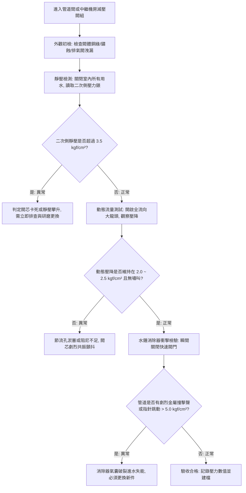

# 全案購屋實戰第七百九十九部：中古大樓社區各樓層生活給水垂直幹管減壓閥組閥芯水垢卡死超壓震盪水錘消除器氣囊破裂與低樓層水管爆裂體檢工序全書

## 壹、 導言與實務體檢核心概述

在台中市南區與南屯區 20 至 35 年屋齡的集合住宅大樓中，高層自來水給水系統多採用「頂樓蓄水池重力自流（Gravity Fed System）」或「中繼水箱分段加壓給水」配置。當重力幹管自頂樓直落至地下室或低樓層時，依照流體靜力學公式：

$$\Delta P = \rho \cdot g \cdot \Delta h$$

垂直高度每增加 10 公尺，管內靜水壓力即增加約 $1.0\ \text{kgf/cm}^2$（約 $0.1\ \text{MPa}$）。以 15 至 20 層樓（樓高 45 至 60 公尺）之超高大樓為例，底層幹管之靜水壓力高達 $4.5$ 至 $6.0\ \text{kgf/cm}^2$，若逢瞬間關閉水龍頭或馬桶進水閥引發之水錘波（Water Hammer），瞬間衝擊峰值壓力往往突破 $12.0\ \text{kgf/cm}^2$。

為保護低樓層（特別是 1 樓至 6 樓）住戶之室內管線與衛浴設備（如熱水器水箱、陶瓷閥芯水龍頭、洗衣機進水軟管），營造法規與水電設計規範要求必須在垂直幹管之中繼層或各戶進水表前設置**定比減壓閥（Direct-Acting PRV）**或**先導水力式減壓閥（Pilot-Operated PRV）**，並搭配**氣囊式水錘消除器（Water Hammer Arrester）**。

然而，歷經二十餘年之地下水質硬度沉積、碳酸鈣結晶結垢、橡膠膜片硬化破裂，減壓閥與水錘消除器若缺乏專項保養檢測，極易引發「減壓閥失靈直通超壓」、「閥芯卡死無水可用」或「水錘反震導致低樓層爆管淹水」等毀滅性災難。本手冊旨在為購屋者提供最具實戰力的機電公設體檢工序。

---

## 貳、 減壓閥組與水錘消除器之失效機理剖析

### 一、 先導水力式減壓閥（Pilot PRV）之水垢卡阻與動態漂移
1. **導閥（Pilot Valve）節流微孔堵塞：** 先導閥依靠一條銅質或不鏽鋼導引微管將二次側（出水端）壓力反饋至主閥隔膜腔室。若自來水中夾雜鐵鏽微粒或水垢，節流針閥孔徑（僅約 $1.5\ \text{mm}$）極易淤塞，造成主閥無法依據負載關閉，一次側高壓直接全開貫通至住戶室內。
2. **閥座結晶與密合面刮傷：** 碳酸鈣與鎂離子在高壓擾流區沉澱，硬質結晶附著於閥芯（Disc）與銅合金閥座（Seat）接觸面，導致零流量（夜間全樓無人用水）時之靜態密封失效，引發「靜壓攀升（Creep Pressure）」，使低樓層水管承受與幹管同等之爆裂高壓。
3. **主閥彈簧疲勞與不鏽鋼隔膜破裂：** 長期處於動態微振環境下，橡膠複合隔膜（EPDM with Nylon reinforcement）發生交聯老化與龜裂，高壓水滲入彈簧腔室，造成調節失靈。

### 二、 氣囊式水錘消除器（Water Hammer Arrester）失效機制
1. **充氣氣囊（NBR / Butyl Diaphragm）滲漏：** 水錘消除器內部以氮氣預充壓力（Pre-charge Pressure）作為液壓吸收阻尼。經過 15 年以上運行，氣門嘴橡膠塞劣化或橡膠囊破裂，預充氮氣完全外洩，腔室被不可壓縮的液態自來水填滿（Water-logged），水錘吸收效能歸零。
2. **金屬波紋管型（Bellows Type）金屬疲勞破裂：** 不鏽鋼波紋管在百萬次水錘高頻脈衝衝擊下，焊道產生微裂紋，阻尼剛性喪失，無法衰減反射衝擊波。

---

## 參、 現場實勘與機能檢測驗收標準工序（SOP）



### 一、 壓力檢測四步法（Pressure Diagnostics）
1. **無用水靜壓檢驗（Static Pressure Verification）：**
   - 確保被測樓層全戶所有水龍頭緊閉，靜置 5 分鐘。
   - 檢視減壓閥組後端二次側壓力錶，標準安全讀數應落在 **$2.0\ \text{kgf/cm}^2 \sim 3.0\ \text{kgf/cm}^2$** 之間。
   - 若指針持續緩慢向上攀升至 $4.5\ \text{kgf/cm}^2$ 以上，即為典型「內漏微滲」，管線隨時有夜間爆破風險。
2. **大流量動態穩壓檢驗（Dynamic Regulation Verification）：**
   - 同時開啟廚房水龍頭與浴室花灑（模擬最大用水峰值）。
   - 觀察出水端壓力錶，壓降不應低於 **$1.8\ \text{kgf/cm}^2$**，且減壓閥體不得發出「嘰——」或「嗡——」之高頻氣蝕嘯叫聲。
3. **水錘瞬態反彈峰值監測（Water Hammer Spike Test）：**
   - 迅速關閉全開之單把手陶瓷閥龍頭，利用高取樣率壓力紀錄儀（或耐震油質壓力錶）觀察瞬間回彈壓力。
   - 合格標準：衝擊峰值壓力不得超過靜水壓力之 $1.5$ 倍（即不應超過 $4.5\ \text{kgf/cm}^2$）。若瞬間彈跳突破 $8.0\ \text{kgf/cm}^2$ 並伴隨「噹！噹！」金屬撞擊巨響，證明水錘消除器已完全失效。
4. **消除器預充壓力檢測（Pre-charge Pressure Inspection）：**
   - 關閉消除器前端隔離閥，釋放管段餘壓。
   - 使用輪胎數位胎壓計檢測氣嘴（Schrader Valve），預充氣壓應為管網設計工作壓力之 $80\% \sim 90\%$（標準值約 **$2.0\ \text{bar}$**）。若測量結果為 $0\ \text{psi}$ 甚至自氣嘴噴出水珠，確認內部氣囊已破裂。

---

## 肆、 購屋合約防坑特約條款與修繕責任劃分

在斡旋與成屋買賣契約中，針對高樓層與低樓層減壓閥之權責與屋況保障，應明確載明以下特約條款：

```markdown
### 買賣契約防坑特別約定事項：供水減壓閥組與室內抗壓安全保障條款

1. 【給水壓力現況保證】：賣方保證本買賣標的物各處出水龍頭關閉時，進戶給水靜水壓力不得高於 3.5 kgf/cm²，且大流量出水時動態壓力不得低於 1.8 kgf/cm²。
2. 【減壓閥功能瑕疵擔保】：點交前由買賣雙方會同合格水電技術士進行減壓閥組壓力檢測。若發現減壓閥芯卡死、失靈貫通、靜壓攀升超過 4.0 kgf/cm² 或伴隨嚴重水錘撞擊者，賣方應於交屋前負責修繕完畢或全額負擔更新先導水力式減壓閥組與水錘消除器之全額費用。
3. 【修繕漏水賠償責任】：若交屋前因公共幹管減壓閥失靈導致本標的物室內自來水管路爆裂、衛浴設備損壞或木地板裝潢浸泡者，一切修復與損害賠償責任概由賣方（或由賣方督促社區管委會）全權負責，買方得順延交屋尾款之給付。
```

---

## 伍、 本專項工序體檢總結

自來水垂直幹管減壓閥與水錘消除器為中古高樓社區最易被忽視之「隱形心臟炸彈」。買方實勘時切勿僅憑「水壓看起來很大很過癮」而輕忽背後潛藏的爆管致命危險。嚴格落實本手冊之靜動態雙壓檢測工序，方能確保未來數十年安居無虞，徹底阻絕室內淹水浩劫。
