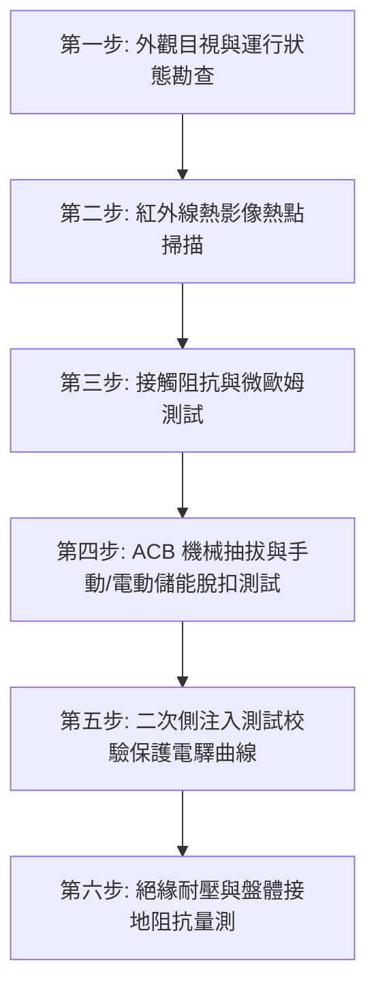

# 全案購屋實戰第七百二十一部_中古大樓社區低壓配電盤空氣斷路器過電流脫扣機構彈簧疲勞接地故障保護零序比流器失準與母線排過熱體檢工序全書

---

## 壹、核心體檢綱領與歷史案例借鏡

在中古大樓（屋齡 20 至 30 年以上）的公共機電系統中，位於地下室電氣總配電室（變電室）的「低壓主配電盤（Low Voltage Switchgear）」是整棟社區心臟般的神經中樞。高壓台電電力（11.4kV 或 22.8kV）經由油浸式或乾式變壓器降壓為 380V/220V 或 220V/110V 之後，第一道把關的總開關即為**空氣斷路器（Air Circuit Breaker, ACB）**。

空氣斷路器（ACB）承載整棟社區數百戶住戶之生活動力、各樓層電梯昇降、地下室排污揚水雙泵浦、緊急消防排煙與逃生梯增壓風機的極限電流。然而，中古大樓常年處於缺乏專業機電預防性維護（Preventive Maintenance）的危險盲區：
1. **儲能與脫扣彈簧金屬疲勞**：ACB 內部合閘儲能彈簧（Charging Spring）與跳脫釋放彈簧（Trip Spring）長達數十年處於拉伸受壓狀態，彈性模數衰減、機械連桿機構黃油硬化凝固，導致故障電流（如短路或過載）發生時，斷路器無法在安全週波數（Cycles，通常為 3 至 5 週波內）內順利解扣，引發配電盤全面弧光爆炸（Arc Flash）。
2. **接地故障保護（ZCT / GF Relay）失準**：零序比流器（Zero-Phase Current Transformer, ZCT）絕緣劣化、接地過載電驛參數漂移，在住戶端或公設管路發生單相接地漏電時毫無反應，造成地下室機電盤體浮接帶電，危及維修人員生命。
3. **主母線銅排（Busbar）接觸面氧化過熱**：配電盤主母排螺栓接點因長年熱脹冷縮鬆動，未定期施以扭力扳手校驗與紅外線熱影像檢測，螺栓接觸阻抗激增，在夏季用電高峰期溫度飆升至 100°C 以上，絕緣支撐絕緣子炭化破壞，引發相間金屬短路。

本工序全書旨在建立極致嚴謹的檢驗基準，杜絕社區因低壓主配電盤失效而導致全棟大停電、機電焚毀與巨額緊急搶修攤提。

---

## 貳、低壓配電盤與 ACB 關鍵劣化病理分析

### 一、空氣斷路器（ACB）機械與電氣機構劣化機制
- **儲能機構卡阻**：馬達電動儲能機構傳動齒輪磨損、手動儲能手柄連桿變形。
- **滅弧室（Arc Chute）石棉／陶瓷柵板金屬噴濺**：多次啟斷小額過載電弧後，銅蒸氣沉積於滅弧柵板之間，導致絕緣阻抗驟降，喪失快速冷卻與切斷強大電弧能力。
- **主觸頭（Main Contacts）與弧觸頭（Arcing Contacts）燒蝕**：銀合金主觸頭表面凹凸氧化，未達設計接觸面，額定滿載運轉時產生異常焦耳熱（$P = I^2 R$）。

### 二、接地保護與零序比流器（ZCT）常見致命盲點
- **穿心電纜中性線與接地線穿法錯誤**：三相四線制系統中，中性線（N相）未正確同時穿過 ZCT，或接地線（G）重複穿回，導致向量和相消錯誤，造成「漏電不跳、無漏誤跳」。
- **比流器二次側開路過電壓**：CT 二次側端子鬆動導致極高感應電壓，擊穿絕緣破壞保護電驛。

### 三、母線排（Copper Busbar）熱應力與電阻倍增
- 銅排表面鍍錫或鍍銀層在地下室高濕氣與硫化環境下氧化腐蝕，生成高電阻的氧化銅黑斑。
- 固定螺栓使用不當材質（如未採用高張力螺栓並搭配碟形華司 Belleville Washer），歷經 20 餘年負載升降之熱膨脹與冷收縮循環後，扭力衰退達 40% 以上。

---

## 參、實地體檢六大極致檢驗工序

### 工序一：盤體外觀、環境溫濕度與異音氣味全面盤查
1. **封閉防護等級檢視**：確認配電盤頂部、底部電纜引入口防鼠防蟲防火泥（Firestop Putty）是否乾裂脫落，防止鼠害鑽入造成母排相間短路。
2. **運行氣味與噪音**：配電室內嚴禁有臭氧刺鼻異味（代表電暈放電）或塑膠燒焦味；聽測 ACB 是否有異常 60Hz 交流蜂鳴震動聲。

### 工序二：全負載紅外線熱影像（Thermography）精密掃描
1. 檢測時機：必須於社區用電負載達 60% 以上之尖峰時段（如夏季晚間 19:00 - 21:30）執行。
2. 溫差判定標準（依據 NETA / IEEE 規範）：
   - **溫差 $\Delta T \le 3^\circ\text{C}$**：正常狀態，持續列管追蹤。
   - **溫差 $4^\circ\text{C} \le \Delta T \le 15^\circ\text{C}$**：中度發熱，存在接觸不良，應排定下次停電保養時重新鎖固並更換接點螺栓。
   - **溫差 $\Delta T > 15^\circ\text{C}$ 或絕對溫度超過 $90^\circ\text{C}$**：嚴重致命危險，必須立即採取降載分流或緊急停電檢修，防範母排熔斷爆炸。

### 工序三：主迴路微歐姆（Micro-ohm）接觸電阻測量
1. 使用數位式微歐姆計（DLRO, 測試電流不低於 100A DC）量測 ACB 各相閉合時之接觸阻抗。
2. 測量值標準：ACB 主極接觸阻抗一般應小於 $50\,\mu\Omega$；相間阻抗不平衡度（Unbalance Ratio）不得超過 10%。

### 工序四：ACB 抽拔（Draw-out Type）機械連桿與互鎖機制驗證
1. 檢查抽拔導軌是否平整順暢，一次側斷開插頭（Tulip Contacts）鍍銀層是否完好、彈簧壓力是否正常，有無塗抹適量高導電防氧化電氣絕緣潤滑膏。
2. 驗證「合閘狀態下嚴禁抽拔」之安全機械互鎖（Mechanical Interlock）是否 100% 有效。

### 工序五：二次側電流注入（Secondary Injection）測試過載脫扣特性
1. 利用原廠或通用型二次側測試儀（Test Kit），向 ACB 之電子式脫扣控制器（OCR / MicroLogic Trip Unit）注入模擬故障信號。
2. 檢驗項目包括：
   - **長延時保護（L - Long Time Delay）**：模擬過載狀態，驗證逆時間反時限跳脫特性。
   - **短延時保護（S - Short Time Delay）**：驗證定時限或反時限短路保護。
   - **瞬時保護（I - Instantaneous）**：驗證大電流直接切斷無延時跳脫。
   - **接地故障保護（G - Ground Fault）**：驗證單相接地故障脫扣反應速度。

### 工序六：絕緣阻抗與接地系統阻抗測試
1. **絕緣電阻量測**：使用 1000V DC 高阻計（Megger），量測相與相之間、相與大地（PE）之間之絕緣阻抗，其測試阻抗值必須 $\ge 100\,\text{M}\Omega$。
2. **接地電阻量測**：配電設備外殼及系統接地之接地電阻值，依照特種/第一種接地規定，必須維持在 $10\,\Omega$ 以下（中古大樓普遍至少應達到 $25\,\Omega$ 以下安全基準）。

---

## 肆、社區管委會維護與置產勘查避坑清單

| 檢查項目 | 良好合規狀態（安心置產） | 嚴重劣化徵兆（潛在巨額分攤） | 買方議價與防禦對策 |
| :--- | :--- | :--- | :--- |
| **ACB 廠牌與出廠年份** | 知名國際大廠（ABB/Schneider/Mitsubishi 等），出廠使用未逾 15 年，或已編列基金完成翻新 | 白牌或停產多年型號，無零件可修；面板電子控制器液晶淡化死機 | 要求調閱近三年機電年檢報告；預估更換新品報價約 25~45 萬元/台，列為議價折讓依據 |
| **母線銅排與絕緣子** | 銅排色標清晰、無發黑發紫、絕緣支撐環氧樹脂無碳化裂痕 | 螺栓接頭周邊變色、保護熱縮套管焦黃皺縮、金屬墊片受熱發藍 | 存在重大相間短路火災隱患，要求特約排除公共機電停電保養費用 |
| **紅外線熱檢報告** | 每年定期委託甲級電氣承裝業實施全負載熱影像檢驗，無一處熱點 $\Delta T > 5^\circ\text{C}$ | 管委會未曾進行熱顯影檢測，或報告列有嚴重高溫缺失卻長年不撥款修繕 | 管委會公基金體質虛弱之徵兆，公設安全防護意識低落 |
| **配電盤內溫濕度控制** | 盤內加裝自動溫濕度控制加熱除濕器（Space Heater），維持濕度 $\le 60\%$ | 盤內潮濕凝結水珠、底板嚴重生鏽穿孔，電纜絕緣出油黏稠 | 地下室返潮引發沿面放電跳電風險極高，必須增設防潮溫控排風設備 |

---

## 伍、本手冊落地執行結論

低壓配電盤與空氣斷路器（ACB）是中古大樓供電架構的「護城河」。一旦空氣斷路器在突發過載或短路故障時拒動，其短路電弧將在幾毫秒內釋放數千度高溫等離子體，徹底焚毀整個變電室低壓盤，屆時整棟社區不僅陷入長達數週之大停電，甚至波及上方結構安全，修復成本動輒數百萬至上千萬元。

購屋者在勘查屋齡 20 年以上之大樓標的時，必須會同機電專業人員實地探勘地下室低壓配電盤現況，審閱管委會公共機電保養紀錄與台電定期大檢申報資料，確保自身居家安全與置產資產之永恆價值。
