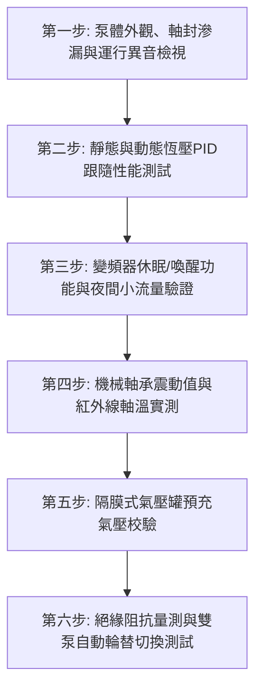

# 全案購屋實戰第七百二十三部_中古大樓社區地下室生活自來水二次加壓變頻泵浦PID控制恆壓傳送器漂移葉輪氣蝕剝落與機械軸封高溫乾磨體檢工序全書

---

## 壹、核心體檢綱領與歷史案例借鏡

在中古大樓（屋齡 20 至 30 年以上）的建築給水系統中，位於地下室蓄水池旁之「二次加壓變頻給水泵浦機組（Variable Frequency Drive Booster Pump System）」是維繫全體住戶出水水壓恆定、保障洗澡淋浴水流舒適的「動脈心臟」。自來水由地下室受水箱經由變頻加壓雙泵（或三泵並聯）抽送，直接送達各住戶龍頭或低中樓層生活管網。

然而，加壓泵浦常年處於 24 小時無休止運轉、尖峰與離峰用水流量劇烈起伏的高應力環境中：
1. **壓力傳送器（Pressure Transmitter）校準零點漂移與 PID 震盪**：水管壁上的 4-20mA 壓阻式或陶瓷壓電式壓力傳送器長期受水垢附著、脈衝水錘撞擊，信號漂移失準。變頻器（VFD）接收到失真壓力回饋，PID 調節參數陷入「超調與欠調」之死循環震盪，泵浦轉速忽高忽低，住戶端水壓劇烈忽大忽小、熱水器忽冷忽熱反覆熄火。
2. **葉輪空化氣蝕（Cavitation）與金屬蜂窩狀剝落**：當地下室受水箱水位偏低、吸水管路阻力過大（如底閥濾網被泥沙淤塞或吸入管徑設計偏小），泵浦進口處局部壓力低於水之飽和蒸汽壓時，水中產生大量微氣泡。氣泡隨水流進入高壓區瞬間暴破破裂，產生高達數千大氣壓之局部微射流（Micro-jet），使不鏽鋼或青銅葉輪表面產生蜂窩狀蝕坑（Pitting），嚴重剝落斷裂，出水量驟降並伴隨砂石摩擦般的巨大尖銳噪音。
3. **機械軸封（Mechanical Seal）高溫乾磨與碳化矽面開裂洩漏**：當夜間無人用水且管路逆止閥微洩漏時，變頻器未正確設定「休眠頻率（Sleep Frequency）」，泵浦在閉閥狀態下微轉「打死水」，水體在泵腔內因機械攪拌摩擦急劇升溫至 70°C - 90°C 以上。動靜環碳化矽（SiC）/碳化鎢端面因缺乏潤滑水膜產生乾磨（Dry Running），橡膠 O 型環高溫碳化硬化，造成軸封全面爆開噴水，淹沒泵浦電機與控制盤。

本工序全書旨在建立極致嚴謹的變頻二次加壓泵浦體檢標準，守護社區供水穩定與管路資產壽命。

---

## 貳、二次加壓變頻泵浦關鍵劣化病理分析

### 一、壓力傳送器與變頻控制閉迴路劣化機制
- **阻尼孔（Snubber Hole）水垢堵塞**：壓力傳送器進壓口微小阻尼孔被自來水沉澱碳酸鈣（水垢）與鐵鏽顆粒堵塞，造成壓力感測延遲，引起變頻器控制獵振（Hunting）。
- **變頻器直流母線電解電容老化**：變頻控制盤常年處於地下室 35°C 以上高溫環境，內部鋁電解電容電解液乾涸，濾波能力喪失，輸出 PWM 諧波失真，導致馬達產生強烈電磁噪音、軸承電蝕（Bearing Fluting）與過熱跳脫。

### 二、水力氣蝕（Cavitation）的破壞演變
- **有效淨吸入水頭不足（$\text{NPSHa} < \text{NPSHr}$）**：受水箱水位降至有效水位以下，吸入管程彎頭過多，導致泵浦進口處絕對壓力驟降。
- **流道水力效率衰退**：葉輪前蓋板與口環（Wear Ring）間隙因泥沙磨損由標準的 $0.2\,\text{mm}$ 擴大至 $1.0\,\text{mm}$ 以上，內部高低壓回流洩漏嚴重，泵浦耗電量激增 30% 但水壓依然不足。

### 三、機械軸封破壞模式
- **熱裂（Thermal Cracking）**：摩擦高溫使動環陶瓷或石墨面急冷急熱產生徑向微裂紋。
- **彈簧沉積抱死**：軸封補償彈簧縫隙卡滿水垢泥沙，失去軸向追隨彈性補償能力，端面微間隙無法閉合而持續漏水。

---

## 參、實地體檢六大極致檢驗工序

### 工序一：泵體外觀、機械軸封滲漏與運轉異音勘查
1. **軸封滴水目視**：機械軸封在正常運轉時應維持微潤滑無滴漏狀態（每分鐘滴漏滴數應 $\le 3$ 滴）。若軸承托架底部有連續水流或白色水垢結晶堆積，判定為軸封完全磨損失效。
2. **聽音棒聽測氣蝕與軸承異音**：使用金屬聽音棒接觸泵殼葉輪渦室。若聽見如同「碎石在金屬筒中翻滾旋轉」之劇烈辟啪聲，即為嚴重葉輪氣蝕；若軸承端呈現尖銳「金屬嘯叫聲」，代表軸承滾珠缺油或剝落。

### 工序二：壓力傳送器精度比對與 PID 恆壓追隨測試
1. **雙錶校驗**：在壓力傳送器旁之取壓閥上，安裝經校準之高精度甘油指針壓力錶，核對變頻器面板顯示壓力值與指針錶差值。
   - 誤差標準：兩者壓力讀數差值必須 $\le \pm 0.1\,\text{kg/cm}^2$（$\pm 0.01\,\text{MPa}$）。若誤差 $> 0.3\,\text{kg/cm}^2$，必須清洗傳送器孔道或重新標定更換。
2. **階躍擾動響應測試**：在泵浦運轉時，突然開啟大口徑放水閥模擬尖峰用水，觀察變頻器升頻追隨時間。
   - 正常狀態：水壓跌落不應超過設定值的 15%，且在 3 至 5 秒內平穩恢復至設定恆壓值，無持續劇烈上下擺動。

### 工序三：變頻器「低流量休眠（Sleep Mode）」與壓力喚醒測試
1. 關閉所有出水測試閥，模擬全社區深夜完全無人用水之工況。
2. 檢驗變頻器能否在達到設定目標壓力後，轉速自動降至休眠頻率（通常為 25~30Hz），並在設定延時（如 30 秒至 60 秒）內**完全停止運轉（進入休眠狀態）**。
3. 嚴防「休眠失效持續空轉」：若閉閥後馬達持續以 40Hz 以上高速運轉長達數十分鐘，將使泵腔水溫飆高燒毀軸封，必須立即重設 PID 休眠閾值。

### 工序四：軸承震動速度值（Vibration Velocity）與溫升量測
1. 使用振動計量測馬達及泵浦軸承垂直、水平與軸向振動值。
   - 標準規範（依 ISO 10816-3 類別 Class II）：振動速度均方根值（RMS）必須 $\le 2.8\,\text{mm/s}$。若 $> 4.5\,\text{mm/s}$ 判定為警示，$> 7.1\,\text{mm/s}$ 必須停機檢修聯軸器同心度。
2. 以紅外線測溫儀量測軸承座表面溫度，最高溫度嚴禁超過 $75^\circ\text{C}$，溫升嚴禁超過環境溫度 $40^\circ\text{C}$。

### 工序五：隔膜式氣壓罐（Pressure Diaphragm Tank）預充氣壓校驗
1. 變頻供水系統標配之隔膜氣壓罐用以吸收微小洩漏與維持休眠水壓。
2. **洩壓測氣**：將水泵停機並排空管道水壓，使用胎壓計量測氣閥氣嘴預充壓力。
   - 標準氣壓：氣壓罐預充壓力應為系統設定恆壓值的 **$70\% \sim 80\%$**。
   - 氣囊破裂檢查：若按壓氣嘴噴出水滴，代表內部丁基橡膠隔膜已破裂穿孔，完全喪失緩衝功能，必須更換氣壓罐。

### 工序六：絕緣阻抗與主副泵自動交替輪替切換
1. **馬達絕緣阻抗**：使用 500V 高阻計量測馬達繞組對地絕緣阻抗，常溫冷態阻抗必須 $\ge 5\,\text{M}\Omega$。
2. **自動交替機能**：測試主泵、副泵（1號泵與2號泵）每次啟停或每設定時數（如 12 小時）能否自動互換運轉，且任一泵過載跳脫時，備用泵能在 2 秒內無縫自投運轉。

---

## 肆、社區管委會維護與置產勘查避坑清單

| 檢查項目 | 良好合規狀態（安心置產） | 嚴重劣化徵兆（潛在巨額分攤） | 買方議價與防禦對策 |
| :--- | :--- | :--- | :--- |
| **泵浦運轉噪聲與震動** | 變頻運轉平順如微風，無敲擊雜音；進出水管安裝雙球型橡膠防震軟接管 | 站在地下室停車場即可聽見金屬撕裂轟鳴聲，管路震顫劇烈，底座螺栓震裂鬆動 | 泵浦內部葉輪已氣蝕剝落且軸承散珠，更換整組泵浦葉輪與馬達約需 8~15 萬元 |
| **控制盤與變頻器狀態** | 變頻器品牌知名（Danfoss/ABB/Yaskawa），散熱風扇運轉正常，盤內附溫控通風 | 變頻器已故障報廢，被管委會便宜行事改成「傳統定頻全開+洩壓閥放水」，電費暴增 | 喪失恆壓節能效益且水壓衝擊大，要求回扣公設機電整修基金 |
| **深夜休眠機能** | 深夜零星用水時泵浦能安靜停機，靠氣壓罐供水；水壓下降後瞬間平穩喚醒 | 泵浦 24 小時高速狂轉永不休眠，觸摸泵頭表面發燙（超過 60°C） | 機械軸封即將熱破裂噴水，且馬達壽命急劇縮短，列入機電重大隱患 |
| **管路止回閥（逆止閥）** | 採用無水錘靜音式逆止閥（Silent Check Valve），停機時無撞擊回震 | 採用老式擺錘逆止閥，停機瞬間發出「咚！」之巨大水錘撞擊聲 | 造成全棟立管水錘震盪，易引發接頭脫落漏水，需全面更換靜音逆止閥 |

---

## 伍、本手冊落地執行結論

二次加壓變頻泵浦機組是現代生活品質的無形基石。水壓的細微脈動與水流的穩定度，直接關係到每一位家庭成員洗沐烹飪的身心舒適感。一個管理優良、機電體質健康的中古大樓，其變頻加壓系統必然具備精準的 PID 恆壓調校、靈敏的微流量休眠機制以及完善的氣蝕防護。

購屋者在實地驗屋評估大樓公設時，走入地下室加壓泵浦室親耳聆聽其運轉聲、親手觸摸其溫升與震動，是看穿管委會管理實力與公共設施維護成色最直接而有力的照妖鏡。
