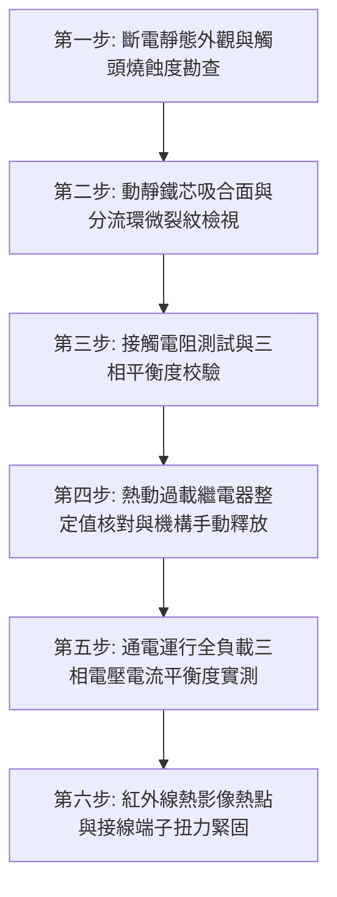

# 全案購屋實戰第七百二十二部_中古大樓社區低壓配電盤電磁接觸器主觸頭氧化電弧熔焊熱動過載繼電器失準與動力設備缺相燒毀體檢工序全書

---

## 壹、核心體檢綱領與歷史案例借鏡

在中古大樓（屋齡 20 至 30 年以上）的動力配電盤（Motor Control Center, MCC）中，**電磁接觸器（Magnetic Contactor, MC）**與**熱動過載繼電器（Thermal Overload Relay, TH-RY / OLR）**共同組成了控制全社區大型三相交流感應電動機（如生活給水揚水泵浦、二次加壓變頻泵浦、地下室污廢水沉水絞碎泵浦、排煙消防抽風機、機械停車橫移昇降馬達）的核心啟動保護組件（即電磁開關，Magnetic Starter, MS）。

然而，中古大樓常年處於地下室潮濕、機電震動與高頻度起停（Start-Stop Cycles）之嚴苛工況中：
1. **主觸頭氧化、電弧燒蝕與接點熔焊（Contact Welding）**：電磁接觸器每次啟動大馬力泵浦時，均承受 5 至 7 倍額定電流之強大湧浪電流（Inrush Current）。歷經數萬次開閉，主觸頭銀合金表面因劇烈電弧（Arcing）而凹凸氧化、有效導電面積驟降；一旦因接點彈簧疲勞導致吸合不完全產生強烈震顫（Contact Bouncing），主觸頭瞬間高溫熔接（熔焊），造成即使停機信號發出，馬達依然持續狂轉運轉、泵浦乾磨燒毀或管路爆裂。
2. **三相接觸阻抗不均引發缺相（Single-Phasing）運行**：三組主觸頭中只要有一相嚴重氧化斷開或接觸不良，三相馬達即陷入「單相運轉（缺相）」。此時運行相電流激增 $\sqrt{3}$ 倍（約 1.73 倍），馬達內部定子繞組在數分鐘內溫度飆破絕緣極限（Class B/F/H），漆包線絕緣熔化短路，引發整台泵浦燒毀。
3. **熱動過載繼電器（TH-RY）雙金屬片疲勞失準**：TH-RY 內部的雙金屬片（Bimetallic Strip）長期受熱老化、機械校準滑塊移位，或過去機電維修人員便宜行事將整定電流（Trip Current Setting）私自調高至額定電流的 150% 以上，導致馬達在過載或缺相初期毫無保護動作，直到變壓器保險絲跳斷或馬達冒濃煙才被察覺。

本工序全書旨在建立極致嚴謹的動力配電盤電磁接觸器與熱動過載保護體檢規範，杜絕社區公共動力設備因電氣缺相、接觸器熔焊而陷入癱瘓。

---

## 貳、電磁接觸器與熱動過載繼電器劣化機制深度剖析

### 一、電磁接觸器（MC）機械與電弧破壞物理機制
- **線圈（Operating Coil）匝間短路與吸力不足**：控制線圈長年承受交流電磁熱與電壓波動，凡立水絕緣漆老化脆化，線圈匝間微短路導致磁動勢（Ampere-Turns）不足。吸力下降使動靜鐵芯（E-Core）無法緊密閉合，磁路氣隙（Air Gap）存在，引發巨大 60Hz 交流蜂鳴噪聲並造成鐵芯分流環（Shading Ring）震斷脫落。
- **動靜觸頭銀合金（AgNi / AgSnO₂）轉移與濺射**：電弧高溫（高達 3000°C - 5000°C）使觸頭材料昇華與噴濺，形成海綿狀高電阻金屬氧化層，接點導通電阻由微歐姆級飆升至歐姆級。

### 二、熱動過載繼電器（TH-RY）失準與盲區
- **雙金屬片熱疲勞蠕變（Creep）**：雙金屬片由不同熱膨脹係數的合金壓合而成。長年處於 40°C - 60°C 的控制盤溫環境中，金屬內部晶格產生應力鬆弛，跳脫曲線嚴重右移（延遲跳脫）或左移（頻繁誤跳）。
- **缺乏欠相保護功能（Non-Phase-Failure Protection）**：早期中古大樓普遍採用最便宜的二元件（2-Element）或普通三元件熱動繼電器，無差動差動連桿機構（Differential Mechanism），無法在馬達單相斷線時進行快速快速（5 秒內）跳脫保護。

---

## 參、實地體檢六大極致檢驗工序

### 工序一：斷電靜態外觀與觸頭燒蝕度極致盤查
1. **滅弧罩拆卸檢視**：使用專用工具拆開電磁接觸器上蓋與滅弧罩，肉眼與放大鏡檢視主觸頭。若觸頭銀合金厚度磨損已達原始厚度 1/2 以上，或呈現焦黑碳化、深層坑洞、熔融珠狀突起，必須立即全組更換。
2. **復位彈簧彈力驗證**：手動手動按壓銜鐵（Armature）動作機構，手感應平順無阻卡，放手後動觸頭必須在復位彈簧作用下瞬間清脆彈回原位。

### 工序二：動靜鐵芯吸合面與分流環（Shading Coil）檢驗
1. 檢視鐵芯接觸面是否有油垢、灰塵、鐵鏽沉積；清除表面污垢，避免鐵芯閉合不實。
2. 仔細檢查嵌入鐵芯端面的純銅分流環是否有斷裂、鬆動。分流環斷裂將使交流吸力過零點時產生巨大劇烈振動與敲擊聲。

### 工序三：主觸頭接觸電阻（Contact Resistance）精確量測
1. 使用數位式微歐姆計（DLRO）量測三相主觸頭在閉合狀態下之直流接觸電阻。
2. 標準規範：
   - 全新或良好接觸器之觸頭電阻應 $< 10\,\text{m}\Omega$（通常在數百微歐姆級）。
   - 任一相接觸電阻超過 $50\,\text{m}\Omega$，或三相間電阻不平衡率超過 15%，即存在嚴重缺相或局部高溫熔接隱患，嚴禁繼續投入運行。

### 工序四：熱動過載繼電器（TH-RY）整定值與手動釋放測試
1. **整定電流值校對**：核對 TH-RY 旋鈕之整定電流（Trip Setting Current, $I_s$）是否符合馬達銘牌之額定全載電流（Full Load Amperes, FLA）。
   - 標準規範：$I_s \approx 1.0 \sim 1.05 \times \text{FLA}$。嚴禁因跳脫而私自調高至 $1.2 \times \text{FLA}$ 以上。
2. **手動測試桿（Test Trip Lever）驗證**：以測試桿推動跳脫機構，確認輔助接點（$95-96$ 常閉 NC 接點開路、$97-98$ 常開 NO 接點導通）能否精準動作並切斷控制迴路。

### 工序五：全負載動態運行三相電流平衡度檢驗
1. 在揚水泵浦或變頻泵浦全負載運轉時，使用鉗形電流表（Clamp Meter）量測 MC 二次側三相電流（$I_R, I_S, I_T$）。
2. 計算三相電流不平衡率（Current Unbalance Rate）：
   $$\text{不平衡率 (\%)} = \frac{\text{最大偏離平均值之相電流}}{\text{三相平均電流}} \times 100\%$$
3. 標準要求：不平衡率不得超過 5%。若超過 10%，馬達溫升將飆升 20°C 以上，縮短馬達壽命 50% 以上。

### 工序六：紅外線熱影像熱點掃描與接線端子扭力鎖固
1. 在滿載運轉 30 分鐘後，以高解析度紅外線熱像儀掃描 MC 一次側電源端、二次側負載端及 TH-RY 端子。
2. 判定基準：任何端子與相鄰母線溫差 $\Delta T \ge 5^\circ\text{C}$ 即判定為接觸不良；使用絕緣扭力螺絲起子依原廠規格（一般 M4 螺栓為 $1.2 \sim 1.5\,\text{N}\cdot\text{m}$，M5 為 $2.5 \sim 3.0\,\text{N}\cdot\text{m}$）全面重新鎖固。

---

## 肆、社區管委會維護與置產勘查避坑清單

| 檢查項目 | 良好合規狀態（安心置產） | 嚴重劣化徵兆（潛在巨額分攤） | 買方議價與防禦對策 |
| :--- | :--- | :--- | :--- |
| **電磁開關運轉噪音** | 吸合時清脆一聲「喀」，運轉期間安靜無聲，無交流蜂鳴震顫 | 控制盤內發出刺耳「嗡嗡」震動聲，盤門摸起來有明顯麻手震顫感 | 鐵芯接觸面不平或分流環斷裂，隨時可能吸合不實燒毀線圈或跳脫，要求更換新品 |
| **熱動過載繼電器型式** | 採用具備「差動欠相保護功能（Phase-Failure Protection, 3E/2E）」之現代化繼電器 | 採用 25 年前最陽春型號，旋鈕外殼已焦黑變形，甚至被用電線短接跳過（Bypass） | 嚴重違反電工法規，馬達隨時可能因缺相直接燒燬整組泵浦，列入購屋安全扣分項 |
| **備援切換控制機制** | 雙泵自動交替控制器（Alternating Relay）運作正常，手動/自動（Manual/Auto）選擇開關靈敏 | 只能切在手動檔強制運轉，自動交替功能失靈，導致單台泵浦超時過載運轉 | 控制線路老化混亂，需整盤重新配線及更換邏輯控制器，評估維修費用約 3~6 萬元 |
| **配電盤端子碳化狀態** | 配線整齊標示分明，接線端子壓接緊實並套上絕緣壓條，無變色 | 端子周邊 PVC 絕緣皮焦黑收縮、露出發綠銅線，盤內底板散落碳化粉末 | 發生過多次高溫過熱事故，存在重大火災風險，要求出賣人提供機電改善證明 |

---

## 伍、本手冊落地執行結論

電磁接觸器與熱動過載繼電器是社區地下室動力的第一線士兵。當一棟大樓的電磁開關老舊、主觸頭熔焊或過載保護失靈時，住戶不僅將面臨「水泵燒毀無法打水停水」、「污水倒灌地下室淹惡臭廢水」之嚴重民生災難，更可能因接點拉弧高溫引發控制盤起火爆炸。

購屋者在選定心儀標的時，切勿僅看室內裝潢表象，務必親自走訪地下室機電泵浦控制室，檢視電磁開關運轉聲響與維護標籤，為全家人的居住安全與長期公設品質奠定堅不可摧的保障。
