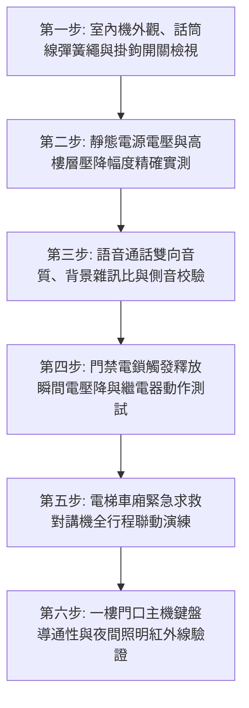

# 全案購屋實戰第七百二十八部_中古大樓社區各樓層電梯對講機室內分機音訊放大IC老化破音直流供電壓降雜訊干擾與主機面板通訊中斷體檢工序全書

---

## 壹、核心體檢綱領與歷史案例借鏡

在中古大樓（屋齡 20 至 30 年以上）的弱電通訊與公共安防體系中，連接一樓門廳管理室、各樓層電梯車廂、地下停車場與各住戶室內之「社區對講機系統（Intercom & Access Control System）」是維繫社區出入安全、訪客過濾、緊急求救與包裹通知的第一線神經網路。

然而，歷經 20 餘年的全天候 24 小時通電運作，中古大樓之傳統類比（Analog）或多線式（Multi-wire Bus）對講機系統，普遍陷入系統性老化與功能癱瘓危機：
1. **室內分機與管理主機音訊放大 IC 老化與電解電容乾涸**：話機內部之音訊功率放大晶片（如 LM386、TDA2822 等）長年受熱，周邊濾波電解電容電解液乾涸漏液，造成通話時伴隨巨大 60Hz 交流蜂鳴嗡嗡聲、嚴重雜訊破音、語音微弱模糊甚至完全無聲。
2. **弱電垂直幹管長距離直流供電（DC 12V/24V）壓降與接地迴路干擾**：對講機主幹線穿梭於弱電管道間，電源供應器（Power Supply Unit, PSU）輸出電壓衰退，加上各樓層接線端子螺栓氧化鬆脫。當電流傳輸至 10 樓以上高樓層時，工作電壓由額定的 DC 12V 跌落至 8V 以下，導致高樓層分機無法正常解碼、電鎖按鈕按壓無反應、開門繼電器無法吸合釋放一樓大門電鎖。
3. **電梯車廂內緊急對講機（Emergency Intercom）斷線盲區**：電梯隨行電纜（Traveling Cable）隨電梯每日數千次往返彎折，內部細芯遮蔽對講信號線產生疲勞微斷線。車廂內住戶遇到故障受困時，按下黃色緊急呼叫按鈕，管理室主機毫無響鈴警報，形成極度危險之孤島困梯隱患。
4. **一樓門口機鍵盤按鍵氧化與防雨氣密失效**：一樓迎風面門口機長年受風吹日曬雨淋，橡膠按鍵導電黑膠磨損、金屬薄膜接點氧化積碳，住戶或訪客按壓房號鍵接觸不良，甚至按鍵卡死導致整棟總線信號處於持續佔線（Busy Line）鎖死狀態。

本工序全書旨在建立極致嚴謹的社區對講機、電梯緊急通訊與弱電弱電壓降體檢標準，守護家庭居住安寧與生命緊急求援通道。

---

## 貳、社區弱電對講系統關鍵劣化病理分析

### 一、音訊放大迴路與電子零件物理劣化
- **電解電容等效串聯電阻（ESR）激增**：話機主板電源濾波電解電容在高溫環境下內部電解質乾涸，容量衰退達 70% 以上，無法濾除電源漣波（Ripple Voltage），使音訊功率放大器輸出端夾帶強大 120Hz/60Hz 交流聲。
- **炭精或駐極體電容麥克風（ECM）受潮老化**：話筒內之麥克風受人體呼氣濕氣侵蝕，內部振膜彈性疲勞、FET 阻抗變換管漏電，導致送話靈敏度驟降 20dB 以上。

### 二、弱電幹線傳輸線路衰減與信號反射
- **分歧器（Distributor / Tap-off）插頭接觸面銅綠氧化**：各樓層弱電箱內之影音分歧器與接線排端子，在管道間高濕環境下生成高阻抗氧化銅（CuO），產生高達數十歐姆之接觸電阻，引發信號嚴重衰減與阻抗不匹配之信號反射重影。
- **公共接地電位差（Ground Loop）雜訊**：弱電信號遮蔽層未落實單端接地（Single-point Grounding），多點浮接地形成地迴路循環電流，將動力盤馬達起閉之強大電磁脈衝直接耦合灌入對講語音線路。

---

## 參、實地體檢六大極致檢驗工序

### 工序一：室內機本體外觀、話筒伸縮繩與掛鉤開關（Hook Switch）檢驗
1. **外殼材質檢視**：檢查話機 ABS 外殼是否嚴重泛黃脆化、螺絲孔崩裂；檢視彈簧話筒線（Coiled Cord）是否有外皮龜裂、芯線外露或接觸不良。
2. **掛鉤彈簧開關觸動**：手動輕按掛鉤開關數次，手感應彈性清晰，放開後能立即斷開通話迴路；若按鈕卡滯，將導致該戶持續佔線，阻斷全棟通話。

### 工序二：各樓層直流供電電壓降（Voltage Drop）精密實測
1. 使用高精度數位三用電表 DC 電壓檔，先量測地下室或一樓弱電總電源供應器輸出端電壓（標準基準：$V_0 = \text{DC } 12.0\,\text{V} \sim 13.8\,\text{V}$）。
2. 至最頂樓住戶室內分機電源端子處實測負載工作電壓 $V_L$。
3. **壓降率判定**：
   $$\text{壓降率 (\%)} = \frac{V_0 - V_L}{V_0} \times 100\%$$
   - 合格標準：壓降率必須 **$\le 10\%$**（即頂樓電壓不得低於 DC 10.8V）。
   - 嚴重缺失：若電壓 $< 9.5\,\text{V}$，分機將出現解碼失常、音量衰退與開門失靈，必須更換線徑較粗之電源幹線或增設中繼穩壓電源。

### 工序三：通話音質雙向清晰度與信噪比（SNR）量測
1. 由檢驗人員於一樓門口機發起呼叫，室內人員接聽通話。
2. **客觀評估指標**：
   - **語音清晰度**：語音傳送無金屬破音、無顫音、無間歇中斷。
   - **背景雜訊等級**：安靜狀態下耳機聽筒內不得有可聞之「嗡嗡」交流聲或「嘶嘶」白雜訊；信噪比（SNR）應 $\ge 45\,\text{dB}$。
   - **側音（Sidetone）平衡**：自己說話時耳機回饋側音適中，無劇烈嘯叫哮鳴（Acoustic Feedback）。

### 工序四：遠端開門電鎖（Electric Strike / Maglock）觸發動作驗證
1. 於室內分機按下「開門（Unlock）」按鍵，同時以電表監測開門瞬間電源線端電壓波動。
2. **動作標準**：
   - 一樓大門陽極鎖或磁力鎖必須在 **$0.5$ 秒內**清脆跳開釋放，解鎖開門順暢無阻滯。
   - 開鎖瞬間電壓跌落值不得超過 **$1.5\,\text{V}$**；若開鎖瞬間整棟分機指示燈閃爍熄滅，代表直流電源供應器功率嚴重不足（容量過小）。

### 工序五：電梯車廂內緊急對講機全行程呼叫演練
1. 將電梯分別停於頂樓、中樓層及地下最底層，分別按下車廂內黃色緊急呼叫按鈕。
2. **考核指標**：
   - 管理室主機必須在 **$1$ 秒內**響起高分貝警報，螢幕顯示正確之電梯編號。
   - 通話必須具備全雙工（Full Duplex）免持擴音功能，車廂內受困人員在 2 公尺距離內正常說話，管理員端均能清晰辨識，且電梯在高速運行過程中無刮擦雜訊。

### 工序六：門口機鍵盤矩陣與夜間攝影補光查核
1. 逐一按壓門口機數字鍵盤 $0 \sim 9$、呼叫鍵與取消鍵，按鍵彈性回饋明確，按壓導通阻抗應 $< 50\,\Omega$。
2. **攝影鏡頭與夜間補光**：若具備影像功能，檢查攝影機保護透明罩有無泛黃刮傷模糊；夜間測試白光 LED 補光燈或紅外線是否能自動點亮，螢幕人臉辨識無死角黑影。

---

## 肆、社區管委會維護與置產勘查避坑清單

| 檢查項目 | 良好合規狀態（安心置產） | 嚴重劣化徵兆（潛在巨額分攤） | 買方議價與防禦對策 |
| :--- | :--- | :--- | :--- |
| **對講機室內機通話功能** | 鈴響清晰、通話音質清澈如市話，按下開門鍵一樓大門立即應聲彈開 | 拿起聽筒滿是刺耳電流雜音、音量極微弱，甚至根本不會響鈴，無法遠端開門 | 分機電路板已報廢或幹線斷線；若全棟老舊無零件，需整棟更換系統，評估每戶分攤 1.5~3 萬元 |
| **電梯緊急呼叫機制** | 按下對講鍵管理員立即回應，通話順暢，通話音量充足無雜音干擾 | 按下後車廂內毫無動靜、管理室主機不響，或只發出沙沙盲音無法通話 | 重大昇降公共安全違規！電梯隨行電纜斷線，發生困梯事故時求救無門，要求限期改善 |
| **社區對講機系統整合度** | 採用標準數位總線系統，門口機、管理室、室內機品牌統一，維護廠商正常出勤 | 系統早已停產多年，各戶各自改裝無線門鈴或便宜白牌機，管理室主機斷線拔除 | 社區弱電系統已全面瓦解，門禁形同虛設，代表管委會無力推動大型公設更新 |
| **一樓大門電鎖與閉門器** | 電鎖吸合結實，閉門器緩衝順暢無劇烈撞擊，門鎖開閉無虛位 | 電鎖歪斜鬆動，大門需用力猛甩才能鎖上，或鎖舌磨損被膠帶貼死不鎖 | 門禁安全防線蕩然無存，外人隨意進出，居住安寧與防竊能力極為脆弱 |

---

## 伍、本手冊落地執行結論

社區對講機與緊急通訊系統，絕非單純的話機通話工具，而是整棟大樓安防隔離與生命呼救的「隱形神經」。一部破音雜訊、電壓不足、電梯斷線的對講系統，折射出的是大樓弱電工程長達二十年的忽視與凋零。

購屋者在實地勘查物件時，務必親自拿起室內分機，要求仲介在一樓門口機進行一次真實的呼叫與開門測試；並在搭乘電梯時，親眼檢視緊急對講按鈕維護標籤。唯有神經敏銳、通訊無阻的社區，才能給予家人二十四小時不間斷的安心守護。
