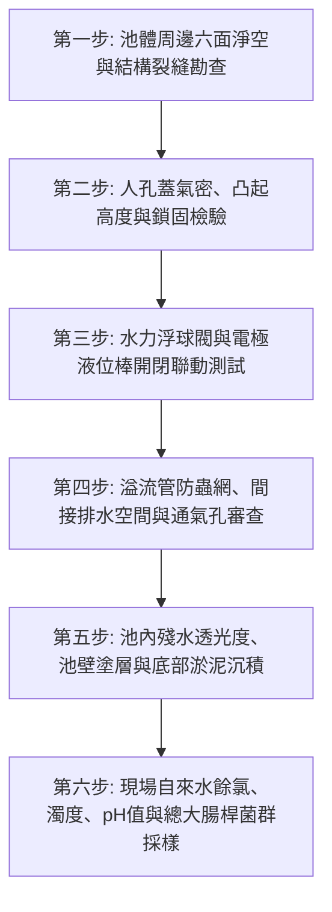

# 全案購屋實戰第七百二十四部_中古大樓社區地下室生活自來水受水箱蓄水池池體裂縫滲水進水浮球閥卡阻無效溢流管防蟲網破裂與水質二次污染體檢工序全書

---

## 壹、核心體檢綱領與歷史案例借鏡

在中古大樓（屋齡 20 至 30 年以上）的公共衛生給水工程中，位於地下室的最底層自來水受水箱（蓄水池，Water Receiving Sump Tank），是全體住戶家庭飲用、烹飪、洗滌之源頭第一道蓄水防線。台電與市府自來水幹管之自來水，必須先以重力流或微壓注入地下室受水箱，再由揚水泵浦抽送至頂樓水塔。

然而，中古大樓地下室受水箱常年隱身於陰暗潮濕之地下邊角，普遍面臨「五大隱蔽致命盲區」：
1. **箱體 RC 結構微裂縫與地下污水相互滲透**：早期大樓受水箱多採用與建築物地下連續壁或基礎底板共構之鋼筋混凝土（RC）池體，歷經 921 集集大地震、多次餘震及地基不均勻沉陷後，池壁產生貫穿性剪力裂紋。更致命的是，地下室化糞池或排污池若恰好緊鄰受水箱且未落實「六面淨空（Air Gap Separation）」規範，化糞池滲漏之高濃度大腸桿菌與惡臭毒水，將透過混凝土微孔隙「虹吸逆滲透」進入自來水箱，形成極端恐怖之飲用水糞水交叉污染。
2. **水力浮球閥（Float Control Valve）導閥淤塞卡阻與水流狂溢**：自來水進水端之主水力浮球閥內部導閥濾網水垢淤塞、橡膠隔膜老化穿孔或不鏽鋼浮球連桿變形卡死。一旦浮球閥「關不死」，自來水日夜無休狂瀉直注；若「打不開」，全社區瞬間陷入大缺水。
3. **溢流管（Overflow Pipe）與通氣管（Vent Pipe）防蟲防鼠銅網腐蝕破裂**：溢流管出口常年暴露於地下室集水坑上方，其末端之不鏽鋼或銅質防蟲紗網因地下室硫化氫（$H_2S$）氣體腐蝕鏽蝕穿孔。蟑螂、美洲蜚蠊、甚至老鼠順著溢流管與通氣管直接爬入受水箱內溺斃腐爛，整棟住戶不知不覺飲用「屍水與細菌培養液」長達數月。
4. **人孔蓋（Manhole Cover）密閉防水失效與地面雨污水倒灌**：地下室受水箱頂部人孔蓋未凸出池頂地面至少 $20\,\text{cm}$ 以上，且未採用雙層氣密防砂防水人孔蓋。地下室洗車、爆管或大雨淹水時，地面積水混雜汽機車機油、重金屬與泥沙，直接從人孔蓋縫隙傾瀉灌入蓄水池。

本工序全書旨在建立極致嚴謹的地下室生活自來水受水箱與水質安全檢驗全綱，徹底捍衛住戶生命健康與家庭飲用水安全。

---

## 貳、受水箱池體與水質二次污染病理機制分析

### 一、RC 池體防水層碳化與有害離子溶出
- **環氧樹脂（Epoxy）塗層水解老化**：早期大樓水箱內壁多塗刷環氧樹脂防水漆。歷經 15 至 20 年水浸，環氧樹脂水解脆化、起泡剝落，釋放雙酚 A（Bisphenol A, BPA）與未固化芳香胺類致癌物；剝落處露出裸露混凝土，水體直接接觸鹼性水泥，使自來水 pH 值飆高至 9.0 以上，並溶出大量鈣離子（硬度激增產生白垢）。
- **陰角角隅應力集中裂紋**：池體底板與立壁交接處（陰角）未施作倒角（Fillet/Chamfer），在地震剪力作用下優先開裂，成為外圍地下水與內部自來水雙向滲漏之高速通道。

### 二、水力浮球閥結構失效力學
- **隔膜微穿孔引發背壓失衡**：水力控制主閥仰賴上方控制室（Control Chamber）之水壓推動隔膜壓閉閥瓣。當隔膜產生肉眼難以察覺的針孔微裂時，控制室無法蓄積足夠背壓，主閥彈簧無法抗衡進水動壓，造成主閥完全無法關死。
- **導閥金屬濾網水垢結石**：銅製導閥內部的針閥開口僅 $0.5 \sim 1.0\,\text{mm}$，自來水沉澱之碳酸鈣結晶（水垢）迅速堵死針閥孔，使控制室完全斷水，主閥長久卡死於全開或全關位置。

---

## 參、實地體檢六大極致檢驗工序

### 工序一：池體六面淨空（Air Gap）與外壁滲漏勘查
1. **六面淨空合規性**：依照建築技術規則給水排水規範，生活蓄水池嚴禁與建築物外牆、地下室外壁、地基底板或污水化糞池共用壁體；池體周邊頂部、底部及四週立壁，必須保留至少 **$60\,\text{cm} \sim 80\,\text{cm}$ 以上**之人員檢修通道與空氣淨空（Air Gap）。
2. **外壁白華與水漬**：持強光手電筒檢驗池體外壁，若發現連續結晶白華（壁癌）、濕潤水痕或水滴滲出，代表池體內部結構防水層已全線崩潰。

### 工序二：防護型雙層氣密人孔蓋（Manhole）合規檢驗
1. **凸起高度標準**：受水箱頂部人孔頸部，必須高出水箱頂板或地下室地坪至少 **$20\,\text{cm}$ 以上**，防止地面清洗污水漫入。
2. **密封膠條與防盜鎖固**：檢查人孔蓋是否配置防老化三元乙丙橡膠（EPDM）密封襯墊；人孔蓋必須具備鎖扣機構（嚴防非授權人員或孩童隨意掀開投毒或墜落）。

### 工序三：水力浮球閥動態開關性能與電極浮球雙重保護測試
1. **手動強迫壓下浮球**：下壓浮球連桿，主閥應在 2 秒內平穩大開進水；放開浮球向上抬起至水平關閉位，主閥必須在 3 至 5 秒內緩慢平穩關閉（緩閉防微水錘），不得有漏水聲與劇烈震動。
2. **五位電極棒（Level Electrodes）控制連鎖驗證**：
   - 檢驗「超高水位警報（HH - 觸發蜂鳴器與警報燈）」、「進水停止（H）」、「進水啟動（L）」、「低水位停泵防乾磨（LL - 強制揚水泵跳脫保護）」之電極訊號動作精準度。
   - 電極棒表面嚴禁附著厚重水垢碳酸鈣，避免導電短路造成判斷失靈。

### 工序四：溢流管間接排水與通氣管雙層防蟲不鏽鋼網查核
1. **間接排水（Indirect Drainage）空氣間隙**：受水箱溢流管與排水管末端，嚴禁與地下室排水溝或排污管「直接硬管連接」；管口與受水容器最高水位之間，必須維持至少 **$15\,\text{cm} \sim 20\,\text{cm}$ 以上**之空氣間隙（Air Gap），阻絕污水逆流與下水道沼氣反灌。
2. **防蟲網檢視**：溢流管出口與通氣管 U 型彎頭（Gooseneck）出口，必須加裝孔徑 $\le 1\,\text{mm}$（16 目以上）之 SUS316 不鏽鋼雙層防蟲紗網，確保無鏽蝕破損。

### 工序五：池內塗層、底板沉積物與池體清洗頻率查核
1. **內部塗層型式**：檢視水箱內部是否採用現代化食品級 SUS304/SUS316 不鏽鋼組合水箱，或通過衛福部飲用水安全認證之無溶劑聚脲（Polyurea）/陶瓷防水塗層；嚴禁殘留剝落之厚重黃綠色舊型環氧樹脂。
2. **底部沉淤**：池底是否具備 1:50 之洩水斜坡與集泥坑（Sump Well）；底板泥沙、鐵鏽沉澱厚度不得超過 $2\,\text{mm}$。

### 工序六：現場水質理化即時快篩與合格標準
在受水箱出水端取樣，以精密水質快檢儀進行實測：
- **自由有效餘氯（Free Chlorine）**：必須維持在 **$0.2 \sim 1.0\,\text{mg/L}$**（過低代表管線有漏水稀釋或微生物滋生快速消耗餘氯；過高代表加藥失控）。
- **濁度（Turbidity）**：必須 $\le 2.0\,\text{NTU}$。
- **pH 值**：必須維持在弱鹼性至中性之安全範圍 **$6.5 \sim 8.5$**。
- **大腸桿菌群（Coliform Group）**：每 100 毫升水樣中必須為 **$< 1.0\,\text{CFU}$（未檢出）**。

---

## 肆、社區管委會維護與置產勘查避坑清單

| 檢查項目 | 良好合規狀態（安心置產） | 嚴重劣化徵兆（潛在巨額分攤） | 買方議價與防禦對策 |
| :--- | :--- | :--- | :--- |
| **水箱形式與結構獨立性** | 採獨立不鏽鋼模組化水箱，六面與建築壁面徹底分開淨空 | 採 30 年老舊水泥池共構，池壁緊鄰化糞池，外牆大面積滲透白華發霉 | 存在極大糞水交叉污染風險，池體整修改造費用動輒 80~150 萬元，務必力爭議價折讓 |
| **每半年水塔清洗檢驗報告** | 嚴格遵守自來水法規，每半年委託合格水質清洗廠商清洗並公告大腸桿菌合格檢驗報告 | 超過 1 年以上未曾清洗水塔，無法提供環保局認證檢驗報告，帳目混亂 | 管委會公設管理嚴重失職，飲水健康毫無保障 |
| **水力浮球閥與溢流管排水** | 浮球閥開閉迅速密封，溢流管懸空於水溝上方且不鏽鋼防蟲網完整 | 溢流管直接插入下水道水溝深處，且無防蟲網；浮球閥關閉不嚴持續溢流漏水 | 下水道蟑螂老鼠隨時直入水箱，且自來水費嚴重浪費分攤，需整盤更新閥門 |
| **水質外觀與氣味** | 取水清澈透亮無雜質，無任何異味，餘氯儀讀數穩定在 0.5 mg/L | 水質微黃帶有鐵鏽色，甚至帶有微弱土腥味或沼氣味，餘氯值為零 | 管路嚴重生鏽腐蝕且生物膜污染，需進行全社區給水管線高壓清洗與消毒 |

---

## 伍、本手冊落地執行結論

水是生命之源，中古大樓的地下室受水箱更是全家人日常飲用水的守護結界。一個外壁斑駁、浮球閥失效、溢流管毫無防蟲防護的水箱，即便室內裝潢得如何金碧輝煌，每天打開水龍頭流出的卻是浸泡過鏽蝕鐵砂與害蟲污染的微毒水質。

購屋者在實地驗屋評估大樓公設時，務必將「地下室受水箱六面淨空與人孔溢流結構」列為第一等級的核心必查項目。審閱清洗紀錄、實地查驗浮球閥與溢流管網，是確保家庭長治久安、身心健康不可妥協的崇高底線。
