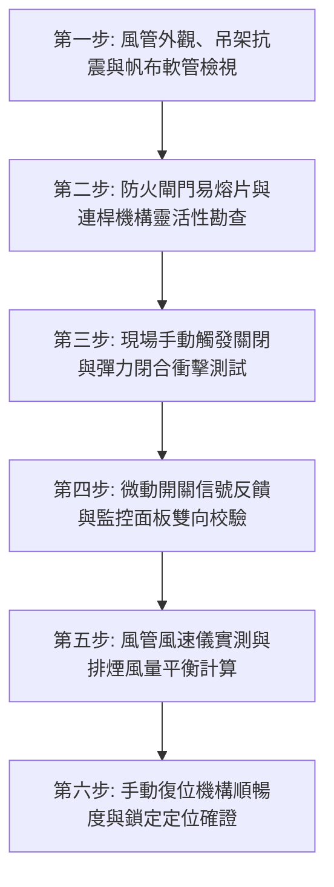

# 全案購屋實戰第七百五一部_中古大樓社區地下室機械通風防排煙風管防火閘門熔斷手動復位卡死微動開關定位失效與風量衰減體檢工序全書

---

## 壹、核心體檢綱領與歷史案例借鏡

在中古大樓（屋齡 20 至 30 年以上）的地下停車場、機房區與各樓層梯廳防護體系中，「機械防排煙與通風換氣系統（Mechanical Smoke Exhaust & Ventilation System）」是火災發生時保障全棟住戶垂直疏散逃生、阻絕劇毒高溫濃煙的「呼吸生命線」。當火警發生時，火警受訊總機連鎖啟動排煙風機，將走道與起火分區濃煙強力抽離，同時啟動逃生梯間進氣增壓風機（Positive Pressure Fan），形成正壓氣室阻擋濃煙侵入安全梯。

然而，在風管貫穿防火區劃牆體（Fire Compartment Wall）或樓地板之關鍵節點上，設置的**防火閘門（Fire Damper, FD）**與**防煙防火閘門（Smoke & Fire Damper, SFD）**常年處於地下室油氣、潮濕與灰塵積累的盲區中，普遍存在四大致命隱患：
1. **易熔金屬片（Fusible Link）熔斷機構卡死或低溫早衰**：傳統防火閘門依賴 $72^\circ\text{C}$（或 $280^\circ\text{C}$ 排煙風道）易熔金屬片。中古大樓常見易熔片受潮氧化鏽蝕、彈簧連桿機構黃油硬化，當高溫真火來襲時金屬熔化但葉片被油泥卡阻無法關閉，火舌順著風道直接燒穿防火分區；或反之，平日無火警時因金屬疲勞斷裂而誤關閉，導致日常地下室廢氣排不出、排風阻力暴增。
2. **手動復位機構（Manual Reset Mechanism）鏽蝕卡阻**：定期消防申報保養時，檢測人員一旦手動拉動測試觸發關閉，其手動復位把手（Reset Handle）、滑輪與棘輪機構因長年未上油嚴重卡死，維護廠商貪圖省事竟用鐵絲或木楔強行頂開閘門葉片，使防火閘門形同虛設。
3. **微動極限開關（Micro Limit Switch）定位接點氧化失效**：具備遠端監控之電動或氣動防煙防火閘門，其指示「全開（Open）」與「全關（Closed）」之微動開關接點受潮積碳。中央防災監控室螢幕顯示「全開正常」，實體風道內部葉片早已半閉下垂，風道截面積被遮蔽達 50% 以上。
4. **風管靜壓損失劇增與有效排煙風量嚴重衰減**：風管內部積垢、防火閘門葉片角度傾斜震顫、風管帆布防震軟管（Flexible Duct Connector）老化破裂漏風，導致末端排風口實測風量不到原設計風量的 40%，火災時無法形成有效負壓排煙，濃煙迅速瀰漫逃生通道致人窒息。

本工序全書旨在建立極致嚴謹的機械通風防排煙風管與防火閘門體檢標準，守護社區火警生命防線。

---

## 貳、防火閘門與通風風管關鍵劣化病理分析

### 一、防火閘門機械與材料破壞物理機制
- **葉片旋轉軸承（Bronze / Stainless Steel Bushings）電化學腐蝕**：鍍鋅鋼板葉片轉軸與銅套軸承在地下室高濕環境下形成微電池效應，氧化鐵與銅綠膨脹卡死軸頸間隙，關閉重力矩或彈簧扭力無法克服摩擦阻力。
- **耐火陶瓷棉／膨脹型氣密膠條（Intumescent Seal）水解剝落**：防煙閘門葉片邊緣之防火膨脹密封條老化脆化，一旦遇火無法發泡膨脹填補金屬間隙，高溫有毒氣體穿透微縫逆灌。

### 二、風管氣流動力學衰減與結構疲勞
- **靜壓失衡與局部阻力係數 $\zeta$ 飆升**：防火閘門未完全開透（呈 30°~45° 傾斜）時，在風道內形成強烈渦流區，阻力係數激增數倍，風機運轉時風管產生劇烈低頻震動與「呼嘯」風切聲。
- **帆布接頭撕裂漏風**：排煙風機進出口處之耐火帆布接頭受震動熱脹冷縮老化變硬開裂，形成巨大負壓漏風點，大量風量在機房內部短路循環，無法抽吸火災現場煙氣。

---

## 參、實地體檢六大極致檢驗工序

### 工序一：風管本體、耐震吊架與耐火被覆全面盤查
1. **風管懸吊支架**：依據耐震建築設備規範，排煙風管每隔 $3\,\text{m}$ 必須設置抗震斜撐，檢查吊桿螺栓是否生鏽鬆動、抗震橫向與縱向支撐是否齊全。
2. **耐火被覆層（Fireproofing Wrap）**：排煙風管外部包覆之岩棉或矽酸鈣板耐火層，是否有破損脫落、受潮下垂，確保其具備至少 1 至 2 小時以上之耐燃防火時效。

### 工序二：防火閘門（FD/SFD）外觀與易熔金屬片檢查
1. **易熔金屬片規格確認**：日常空調通風閘門應使用 $72^\circ\text{C}$ 易熔片；消防專用排煙風管防火閘門必須使用 $280^\circ\text{C}$ 耐高溫易熔片，嚴禁規格混淆倒置。
2. **葉片與閥體間隙**：持強光手電筒照射風管檢修口（Access Door），葉片表面不得有厚重油泥積累（油泥厚度嚴禁 $> 1\,\text{mm}$），轉軸無嚴重紅鏽。

### 工序三：現場手動觸發（Manual Release）瞬時閉合測試
1. 撥動測試手柄或解開易熔聯動銷，觀察閘門關閉動態。
2. **動作標準**：重力或彈簧驅動之閘門葉片，必須在 **$0.5 \sim 1.0$ 秒內迅猛清脆閉合**，緊密貼合框架底槽，無卡滯、半閉或反彈間隙；關閉密封間隙嚴禁 $> 2\,\text{mm}$。

### 工序四：微動開關（Limit Switch）與監控主機連鎖校核
1. 在閘門閉合瞬間，使用三用電表量測輔助微動開關常閉（NC）及常開（NO）接點導通狀態。
2. **雙向信號核對**：聯繫中央監控室或火警總機值班人員，確認防煙閘門關閉信號是否精準在螢幕上轉為紅燈報警，且對應之排煙風機聯動狀態符合設計矩陣。

### 工序五：排煙風量與管網風速（Anemometer）精確實測
1. **葉輪風速測量**：在各排煙口與風管測試孔處，使用熱線式或葉輪式高精度風速計實施網格法（Grid Method）多點量測。
2. **排煙風量核算**：
   $$Q = A \times \bar{v} \times 3600 \quad (\text{m}^3/\text{h})$$
   - $A$：風道或出風口有效截面積（$\text{m}^2$）。
   - $\bar{v}$：各測點平均風速（$\text{m/s}$）。
3. **合格基準**：實測排煙總風量不得低於法定消防設計風量之 **$90\%$**；逃生樓梯間正壓送風風速應維持在 $0.5 \sim 1.0\,\text{m/s}$，門扇開啟阻力不得超過 $110\,\text{N}$（確保老弱婦孺能輕易推開防煙門逃生）。

### 工序六：手動復位（Manual Reset）與上鎖確證
1. 測試完成後，轉動手動復位把手，將葉片重新拉回 90 度完全全開位置。
2. 確認棘輪卡扣與定位銷穩固咬合，上鎖牢固，輕推葉片不得有滑脫下墜現象；隨後旋緊檢修門螺栓，確保密封無縫漏風。

---

## 肆、社區管委會維護與置產勘查避坑清單

| 檢查項目 | 良好合規狀態（安心置產） | 嚴重劣化徵兆（潛在巨額分攤） | 買方議價與防禦對策 |
| :--- | :--- | :--- | :--- |
| **風管與檢修門現況** | 風管外觀平整乾淨，每只防火閘門旁均留有密封良好之檢修門，標示清晰 | 風管凹陷變形、無檢修門，或檢修門被木作天花板完全封死無法檢修 | 無法實施法規年檢，後續破壞天花板重開檢修口工程繁雜，需扣除修繕款 |
| **防火閘門開啟角度** | 閘門指示計清晰指在「OPEN」90 度垂直位置，風阻最小 | 閘門把手下垂呈 45 度，內部葉片被鐵絲捆綁固定或木條支撐 | 嚴重公共安全違規，火警時無法自動切斷防火區劃，面臨主管機關勒令開罰 |
| **排煙風機聯動運轉** | 手動測試排煙閥時，排煙風機於 15 秒內平穩啟動，排風口抽力強勁 | 風機啟動時三角皮帶打滑尖叫冒煙、風管帆布撕裂逆風噴塵，排風口毫無吸力 | 排煙系統已實質癱瘓，風機皮帶、軸承與電機翻修更換需耗費數十萬元 |
| **每年消防安全申報** | 連續五年消防申報全數合格，附有排煙風量實測記錄與閘門動作簽證 | 申報紀錄列有「排煙設備不合格」或「防火閘門動作不良」長期列管未修繕 | 社區公設維護意識低落，存在公共安全保險拒賠風險，列為重大議價折讓依據 |

---

## 伍、本手冊落地執行結論

建築防排煙風管與防火閘門，是沉睡在天花板頂部與管道間深處的「守護神盾」。平時無人注意其存在，但一旦火災發生，幾分鐘內的排煙阻絕效果即決定全體住戶生死。

購屋者在實地驗屋評估大樓公共安全時，切勿忽視地下室與梯廳天花板上方的風管管線與防火閘門指示器。抬頭審視其維護標籤、檢驗其手動復位機構完整度，是穿透裝潢假象、確保生命財產萬無一失的至尊智慧。
