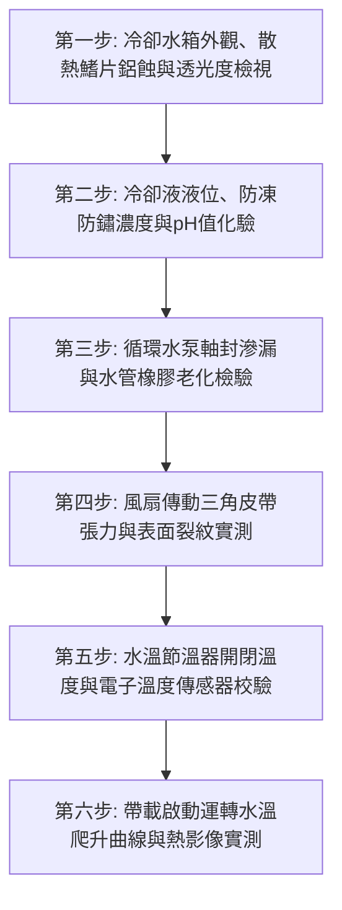

# 全案購屋實戰第七百五十九部_中古大樓社區地下室緊急柴油發電機冷卻水箱散熱鰭片鋁蝕淤塞冷卻風扇皮帶打滑水泵軸封滲漏與過熱高溫抱死體檢工序全書

---

## 壹、核心體檢綱領與歷史案例借鏡

在中古大樓（屋齡 20 至 30 年以上）的公共安全防災體系中，「緊急柴油發電機組（Emergency Diesel Generator Set, EDG）」是整棟社區在面臨颱風水災、台電電網崩潰或嚴重火警大斷電時，維繫全體住戶逃生與生命維持的「最後孤島方舟」。發電機必須在市電中斷後的 **10 秒內**自動啟動，並迅速承載緊急逃生電梯、地下室排污揚水泵浦、室內消防栓栓泵、全區自動灑水系統與火警排煙風機的滿載動力。

柴油引擎在全功率輸出時，其燃燒產生的熱能僅約 35% 轉換為機械功，其餘高達 65% 的熱量必須依賴冷卻水循環系統與水箱散熱風扇及時帶走。然而，中古大樓常年處於缺乏專業負載測試（Load Bank Testing）與深度防護的危險盲區中：
1. **散熱水箱（Radiator）散熱鰭片電化學鋁蝕與粉塵泥垢淤塞**：發電機水箱常年暴露於地下室潮濕、發電機排氣硫化物與汽車廢氣環境中。薄型鋁製散熱鰭片表面產生嚴重的「白粉狀」電化學氧化鋁腐蝕（Aluminum Corrosion），熱傳導效率暴跌；散熱芯管外表被油泥毛屑吸附堵死，導致散熱通風風道被阻隔達 50% 以上。
2. **冷卻水循環泵浦（Coolant Water Pump）機械軸封老化滲漏與冷卻液酸化**：發電機引擎冷卻液長達 5 至 10 年未曾更換，防鏽防蝕添加劑耗盡，乙二醇防凍液酸化（pH 值跌破 6.5），強烈侵蝕循環水泵鑄鐵葉輪與機械軸封碳化矽端面。冷卻水從水泵軸頸洩水孔（Weep Hole）持續滴漏，造成冷卻水箱水位悄悄降至最低警戒線以下。
3. **散熱風扇傳動三角皮帶（V-Belt）老化龜裂與張力鬆弛打滑**：傳動皮帶橡膠硬化龜裂、纖維層疲勞延伸。皮帶在普利盤（Pulley）上產生嚴重打滑（Slippage），風扇轉速不足，無法吸出足夠散熱風量。
4. **過熱高溫抱死（Thermal Seizure）與發電機開機即跳脫**：一旦市電中斷、發電機自動點火帶載，引擎缸體水溫在短短 3 至 5 分鐘內飆升突破 $105^\circ\text{C}$。若水溫保護開關（High Water Temp Switch）動作，發電機將直接「高溫跳脫停機」；若保護開關失靈，活塞在高溫下急劇熱膨脹，將汽缸套內壁劇烈拉缸撕裂，最終導致連桿抱死斷裂、引擎缸體炸裂報廢，全社區陷入伸手不見五指之漆黑絕境。

本工序全書旨在建立極致嚴謹的發電機冷卻系統體檢標準，守護社區災難時的最後生命電力。

---

## 貳、發電機冷卻系統熱力學與機械破壞病理分析

### 一、柴油引擎冷卻熱平衡方程式
柴油發電機額定全載運轉時，冷卻系統必須排除之熱負荷 $Q_{\text{cool}}$：
$$Q_{\text{cool}} = P_{\text{brake}} \times \frac{1 - \eta_{\text{thermal}}}{\eta_{\text{thermal}}} \times \phi_{\text{jacket}}$$
- $P_{\text{brake}}$：引擎輸出制動馬力（kW）。
- $\eta_{\text{thermal}}$：柴油機有效熱效率（通常為 $0.32 \sim 0.38$）。
- $\phi_{\text{jacket}}$：轉移至缸套水套之散熱比例（約佔總熱損失之 $40\% \sim 50\%$）。

**病理破壞演變**：
當散熱水箱內部積垢熱阻 $R_{\text{scale}}$ 激增，且外部鰭片堵塞導致散熱風量 $V_{\text{air}}$ 下降 30% 時，熱交換能力 $U \cdot A$ 驟降達 60% 以上。引擎缸套內部熱量無法傳導至冷卻水，局部金屬壁溫瞬間超過 $250^\circ\text{C}$，潤滑機油在高溫下迅速氧化結焦（Carbon Sludge），失去油膜潤滑保護，直接引發活塞拉缸與曲軸抱死。

### 二、三角皮帶傳動打滑力學
依據歐拉皮帶摩擦傳動公式（Euler's Belt Equation）：
$$\frac{T_1}{T_2} = e^{\mu \cdot \theta}$$
- $T_1, T_2$：緊邊與鬆邊張力。
- $\mu$：皮帶與鑄鐵普利盤之摩擦係數。
- $\theta$：包角（接觸角）。

**張力衰退分析**：
當皮帶使用超過 5 年產生塑性伸長，鬆弛導致初張力 $T_0$ 下降；加上地下室油氣使摩擦係數 $\mu$ 由正常的 $0.35$ 驟降至 $0.15$ 以下，傳動比嚴重失真。皮帶在高速帶載時產生極度摩擦高溫，甚至發出刺耳尖叫聲並冒出橡膠焦煙，風扇實測轉速下降 40% 以上。

---

## 參、實地體檢六大極致檢驗工序

### 工序一：散熱水箱鰭片微觀檢視與透光度（Transmittance）檢驗
1. **強光透光度測試**：手持強光 LED 手電筒置於散熱水箱後方，從前方觀察光線穿透水箱散熱鰭片之均勻度。
   - 合格標準：整體水箱有效散熱面積之光線穿透率必須 **$\ge 90\%$**。
   - 嚴重缺失：若超過 20% 區域因粉塵油泥堵塞或倒片（Fins Bent）而完全不透光，必須使用專用空壓機吹洗或以鰭片梳（Fin Comb）進行梳理整平。
2. **鋁蝕白粉檢視**：以放大鏡檢視鋁製散熱鰭片表面，若有大面積片狀白粉剝落、金屬厚度脆化變薄，代表水箱芯體壽命已達極限，面臨漏水爆管風險。

### 工序二：冷卻水水質化驗、乙二醇濃度與酸鹼度（pH）實測
1. **折射光度計測量冰點與濃度**：抽取冷卻水樣滴於光學折射儀，測定乙二醇（Ethylene Glycol）防凍防沸劑濃度。
   - 標準規範：濃度應維持在 **$30\% \sim 50\%$**，提供抗沸保護（沸點 $> 108^\circ\text{C}$）與絕佳防腐蝕保護。
2. **pH 值測試**：以精密數位酸鹼計實測冷卻液 pH 值。
   - 合格標準：**$7.5 \sim 9.5$（弱鹼性）**。
   - 酸化預警：若 $\text{pH} < 7.0$（呈酸性），冷卻水已轉變為腐蝕性液體，必須立即全額排空沖洗並重新加註長效型防腐冷卻液。

### 工序三：循環水泵（Water Pump）軸封與橡膠水管耐壓檢驗
1. **水泵洩水孔（Weep Hole）檢查**：檢查冷卻水泵軸承座下方之呼吸洩水孔。若孔周邊附著綠色或紅色乾涸冷卻液結晶，或怠速運轉時有水珠連續滴落，代表機械軸封碳化矽動靜環已磨損開裂，必須更換水泵總成。
2. **進出水橡膠軟管彈性**：手捏上下大水管，橡膠應具備良好韌性與彈性回饋。若手感硬如木棍（硬化碳化）或軟爛如泥（內層分層脫落膨脹），代表耐壓強度不足，隨時可能在高溫高壓下爆管。

### 工序四：傳動皮帶張力（Belt Tension）與幾何磨損精確實測
1. **拇指下壓撓度測試**：在兩相鄰皮帶輪中心跨距處，以大拇指施加約 $10\,\text{kgf}$（$98\,\text{N}$）垂直下壓力。
   - 標準撓度：皮帶下陷撓度值必須維持在 **$10\,\text{mm} \sim 15\,\text{mm}$** 規範範圍內。
   - 若撓度 $> 25\,\text{mm}$，皮帶嚴重鬆弛，必須調整發電機張緊臂螺栓或更換新皮帶。
2. **微裂紋檢視**：翻轉皮帶內側齒面，若每公分長度內出現 3 道以上貫穿性橫向裂紋，或皮帶側面帆布層磨光發亮，判定為立即淘汰更換。

### 工序五：節溫器（Thermostat）與高溫保護開關校驗
1. **節溫器動作驗證**：柴油引擎節溫器通常在水溫達到 **$75^\circ\text{C} \sim 82^\circ\text{C}$** 時開始開啟，在 **$90^\circ\text{C} \sim 95^\circ\text{C}$** 時完全全開進入大循環。
2. **雙金屬水溫開關動作測試**：以加熱油浴槽或原廠檢測儀校驗，高水溫保護警報開關必須在 **$98^\circ\text{C} \pm 2^\circ\text{C}$** 準確送出警報信號，並在 **$105^\circ\text{C}$** 精準切斷燃油電磁閥停機保護。

### 工序六：帶載啟動運轉水溫平衡與紅外線熱影像實測
1. **月度帶載試車**：配合管委會定期維護，啟動發電機並帶載至少 30% 負載運轉 30 分鐘。
2. **水溫熱平衡判定**：
   - 水溫表讀數應在 10 分鐘內由冷態平穩上升至 **$80^\circ\text{C} \sim 88^\circ\text{C}$**，並在此區間恆定平衡，不得呈現無止境直線飆升。
   - 使用紅外線熱像儀掃描散熱水箱進水管與出水管，兩端必須存在 **$8^\circ\text{C} \sim 12^\circ\text{C}$ 以上**之顯著溫差，證明水箱散熱能力極致高效。

---

## 肆、社區管委會維護與置產勘查避坑清單

| 檢查項目 | 良好合規狀態（安心置產） | 嚴重劣化徵兆（潛在巨額分攤） | 買方議價與防禦對策 |
| :--- | :--- | :--- | :--- |
| **發電機試車維護紀錄** | 每月固定無載試車 10 分鐘、每半年帶載測試，發電機水溫表、油壓表運作精準 | 發電機長達數年未曾啟動試車，電瓶早已沒電硫化，水箱內完全乾涸見底 | 社區公共安全防線全面崩潰，發電機引擎可能已內部鏽蝕抱死，修復需數十萬元 |
| **水箱冷卻液顏色與清澈度** | 冷卻液呈現清亮螢光綠色或紅色，無雜質沉澱，液位維持在膨脹水箱上限 | 水箱內部滿是黃褐色鐵鏽泥漿，甚至漂浮黑色機油油膜（汽缸墊片燒蝕穿孔） | 引擎內部存在重大結構拉缸或汽缸壁穿孔隱患，需大修重組，列入嚴重瑕疵扣分 |
| **傳動皮帶與風扇護罩** | 皮帶張力緊實無龜裂，風扇防護鐵網完整無鬆動，運轉無雜音打滑 | 皮帶鬆垂發黑、運轉時發出尖銳刺耳叫聲，風扇葉片有刮擦外框之凹痕 | 散熱系統嚴重缺乏調校，隨時可能斷帶高溫跳脫，要求管委會全面更換皮帶 |
| **發電機機房通風排氣** | 具備獨立大口徑排煙熱風道，百葉窗能隨發電機啟動自動連鎖推開 | 熱風百葉窗被鐵絲固定卡死，機房內部通風極差，試車 5 分鐘室溫高達 50°C | 機房形成熱空氣回流短路，散熱水箱吸入熱風導致發電機必跳脫，需整修改造通風 |

---

## 伍、本手冊落地執行結論

緊急柴油發電機冷卻水箱與循環水泵，是守護大樓黑暗時刻的「生命散熱盾」。它平時隱匿於地下最深處的重鎖機房內，卻在市電斷絕、濃煙烈火蔓延的極限時刻，決定了整棟大樓逃生電梯與排煙風機能否持續運轉救命。

購屋者在勘驗大樓公共公設時，切勿被光鮮的大廳裝潢所矇蔽。務必隨同機電專員走入發電機房，親眼查看冷卻水箱之透光度、親手觸摸水管皮帶之彈性與張力。唯有在極限災難面前依然冷靜運轉的發電機組，才是保障家庭世代安居、資產長治久安的真金白銀！
