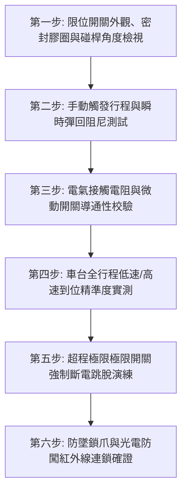

# 全案購屋實戰第七百五十二部_中古大樓社區地下室機械停車設備車位限位極限開關碰桿變形接點氧化短路與橫移車台衝撞邊柱體檢工序全書

---

## 壹、核心體檢綱領與歷史案例借鏡

在中古大樓（屋齡 20 至 30 年以上）的地下停車場中，二段式或多段式「機械停車設備（Mechanical Parking System）」是寸土寸金都市生活中的空間妥協產物。然而，這類由上層昇降車台、下層橫移車台、馬達傳動鏈條與電氣控制迴路構成的自動化機械，常年處於潮濕地下室與汽機車油氣廢氣環境中。

在機械停車設備的所有電氣安全防線中，最關鍵的守門員即為**極限位置開關（Limit Switch / Over-travel Limit Switch）**與**減速停止微動開關**。它們負責精確感測車台「到位停止」、「減速定位」與「超程緊急斷電」。然而，中古大樓常年處於缺乏深度維護的狀態，普遍存在三大致命安全死角：
1. **碰桿（Actuator Roller Lever）金屬變形與機械卡死**：橫移車台在每日數十次往返運動中，導軌沉積沙塵、車台橫向搖晃偏擺，金屬碰塊（Dog）長期撞擊限位開關之滾輪碰桿，造成碰桿彎曲變形或轉軸卡死。當車台行駛至極限邊界時，碰桿無法被有效下壓觸發，控制盤未能及時切斷動力，馬達持續驅動鏈條將數噸重的金屬車台強行推向建築邊柱或鋼構框架，引發鋼構扭曲撕裂、車輛墜落損毀之慘劇。
2. **開關內部微動接點（Silver Contacts）氧化積碳與短路誤動作**：地下室空氣濕度高達 80% 以上，廉價或防護等級（IP Rating）不足之極限開關外殼橡膠密封圈脆化龜裂，濕氣侵入導致常開/常閉接點表面氧化變黑、接觸阻抗激增，甚至在受潮後產生微短路或信號黏滯，造成控制主機接收到錯誤的「已到位」信號而在半途中突兀斷電卡死，或「未到位」信號而釀成過衝碰撞。
3. **安全防墜落防逆轉機械鎖爪（Anti-falling Safety Hook）連鎖電氣開關失準**：上層昇降車台定位後，本應由電磁鐵釋放防墜勾爪咬合橫樑，但連鎖開關因接點故障未感測到位，導致車台在鏈條疲勞斷裂時瞬間垂直墜落，直接壓扁下方停放車輛。

本工序全書旨在建立極致嚴謹的機械停車設備限位極限開關與抗衝撞安全體檢標準，守護住戶愛車安全與人身生命無虞。

---

## 貳、限位極限開關與車台衝撞力學病理分析

### 一、機械撞擊應力與結構破壞物理機制
- **動能衝擊轉換（Kinetic Energy Impact）**：滿載休旅車之車台總重可達 $2.5 \sim 3.0$ 公噸，以 $0.2 \sim 0.3\,\text{m/s}$ 速度橫移時，若限位開關失靈未減速直接衝撞邊柱，其衝擊力瞬間高達數十公噸力，足以剪斷地錨螺栓、撞裂地下室 RC 結構柱外層保護層。
- **連桿彈簧回位疲勞**：限位開關內部之雙向回位扭簧在數萬次觸動後彈性模數衰退，碰桿被碰塊推動後無法瞬間彈回原位，導致車台反向運行時系統陷入邏輯混亂。

### 二、電氣接觸與絕緣劣化機制
- **電弧燒蝕與接點黏連（Contact Welding）**：極限開關接點在感性負載（交流接觸器線圈）頻繁切斷時產生感應反電動勢電弧，接點材料發生金屬轉移與微熔接，形成「開路失靈」或「常閉不開」。
- **絕緣電阻驟降**：開關端子座在凝結水與粉塵積聚下，絕緣阻抗由標準 $> 100\,\text{M}\Omega$ 驟降至 $< 0.5\,\text{M}\Omega$，引發漏電與控制 PLC 雜訊誤判。

---

## 參、實地體檢六大極致檢驗工序

### 工序一：極限開關本體外觀與碰桿幾何角度檢驗
1. **外殼防護檢視**：確認開關本體採用 IP67 等級之壓鑄鋁合金或強化阻燃工程塑料外殼，電纜迫緊頭（Cable Gland）必須鎖緊密封，橡膠防塵套無龜裂破洞。
2. **碰桿角度與滾輪磨損**：檢視金屬滾輪是否轉動靈活無偏心卡阻；碰桿與車台撞塊之接觸角度必須維持在標準之 **$30^\circ \sim 45^\circ$** 切角，嚴禁呈現 $90^\circ$ 直角死硬碰撞。

### 工序二：機械行程手動觸動與彈力復位極限測試
1. 手動推動碰桿至動作位置，手感應有清晰的「雙穩態快動（Snap Action）」微動開關跳扣反饋感。
2. 放開碰桿後，滾輪必須在 **$0.1$ 秒內**迅速彈回初始機械原位，無任何遲滯、卡阻或晃動虛位。

### 工序三：電氣接觸電阻與接點絕緣耐壓測量
1. **閉合接觸電阻**：使用數位三用電表低阻檔測量常閉（NC）及常開（NO）接點閉合時之接觸電阻，標準值必須 **$< 0.1\,\Omega$**。
2. **開路絕緣阻抗**：使用 500V 高阻計量測開路接點間及接點與金屬外殼間之絕緣電阻，絕緣值必須 **$\ge 20\,\text{M}\Omega$**。

### 工序四：車台全行程動態運行停止精度實測
1. 實際操作控制按鈕，讓車台執行左/右橫移及上/下昇降全行程運動。
2. **停車定位精度判定**：
   - 橫移車台與相鄰車台或邊柱之安全邊界淨距，到位停止時必須維持在 **$30\,\text{mm} \sim 50\,\text{mm}$** 規範間隙內。
   - 誤差標準：反覆 3 次運行，停止位置偏差不得超過 **$\pm 5\,\text{mm}$**。若偏差 $> 15\,\text{mm}$，代表減速減速開關位置偏移或煞車制動襯片磨損。

### 工序五：終端超程極限保護（Over-travel Limit）斷電演練
1. 模擬日常到位停止開關失效，車台越過正常停止點繼續行駛。
2. **第二道終端極限開關**必須在車台越位 **$15\,\text{mm} \sim 25\,\text{mm}$ 內**強制切斷主電源回路（直接連鎖主電磁接觸器斷開），並發出蜂鳴聲與故障紅燈鎖定，馬達立即機械制動剎停，嚴禁衝撞機械剛性極限擋塊（Buffer Block）。

### 工序六：防墜安全勾爪與出入口光電感應雙重防護驗證
1. **防墜勾爪到位電氣檢知**：上層車台昇至最高定位點時，電氣檢知開關必須確認機械防墜鎖爪已 100% 深入卡槽咬合牢固，方能允許下層橫移車台動作。
2. **光電感應（Photoelectric Sensor）防闖遮斷測試**：在車台運行過程中，以手或障礙物遮斷出入口紅外線光幕，系統必須在 **$0.2$ 秒內**緊急停止所有機械動作，確保無夾人、擠壓車體危險。

---

## 肆、社區管委會維護與置產勘查避坑清單

| 檢查項目 | 良好合規狀態（安心置產） | 嚴重劣化徵兆（潛在巨額分攤） | 買方議價與防禦對策 |
| :--- | :--- | :--- | :--- |
| **機械車位保養許可證** | 具備經濟部認可昇降設備檢查機構核發之最新「機械停車設備安全使用許可證」，且每月份保養紀錄翔實 | 許可證過期數年未檢驗，或貼有「限期改善」黃色警告單，無專業保養廠商維護 | 社區重大公設違規，一旦發生意外保險全額拒賠，需由全體區權人連帶負擔 |
| **車台運轉聲響與震顫** | 鏈條運轉聲音均勻順暢，到位時平穩減速微震停止 | 運行時伴隨金屬劇烈刮削聲，到位時「轟！」一聲猛烈撞擊擋塊晃動 | 減速與極限定位全數失準，機械骨架已有隱形疲勞裂痕，需全面整修控制盤與齒輪 |
| **載重限制與車格尺寸** | 銘牌標示載重 $\ge 2,000\,\text{kg}$（可停休旅車），長寬高淨空尺寸充足 | 銘牌標示載重僅 $1,600\,\text{kg}$，且限高僅 $1.5\,\text{m}$，完全無法停放一般休旅車 | 車位具重大使用限制，市場轉手流通性極差，至少爭取 70~100 萬元總價折讓 |
| **控制盤箱體與微動開關** | 箱體密閉良好，開關線路整齊帶編號套管，開關外殼清潔無鏽斑 | 控制盤門隨意敞開，雨水滴入盤內，極限開關被鐵絲直接短接綁死 | 嚴重人為破壞安全防線，隨時可能發生衝撞邊柱災難，必須列為重大瑕疵 |

---

## 伍、本手冊落地執行結論

機械停車設備是精密機械與電氣連鎖緊密交織的立體系統。一組小小的限位極限開關與一根看似不起眼的碰桿，背後維繫的是數百萬名車的資產安全與住戶上下車時的生命防線。

購屋者在勘查附帶機械車位之中古大樓時，務必親自按下操作按鈕，完整觀看一次車台昇降與橫移之完整行程。仔細傾聽其到位剎停時的平順度、檢視極限開關之機械幾何外觀，是用最嚴苛的理性視角剔除潛在隱患、捍衛家庭資產安全的必備專業素養。
