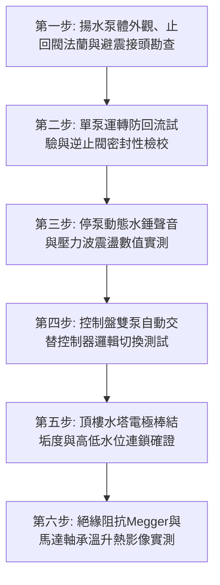

# 全案購屋實戰第七百五十六部_中古大樓社區地下室生活自來水雙泵揚水系統止回閥逆向洩漏低頻水錘震盪雙泵自動交替控制器故障與高樓層水塔溢流體檢工序全書

---

## 壹、核心體檢綱領與歷史案例借鏡

在中古大樓（屋齡 20 至 30 年以上）的公共給水管網體系中，位於地下室蓄水池旁之「生活自來水揚水系統（Domestic Water Transfer Pump System）」，是將地下室數百噸市政自來水，克服數十米垂直重力水頭，垂直揚升抽送至頂樓生活水塔（高位蓄水池）的「高壓動脈主動脈泵」。

為確保供水不中斷，大樓通常配置兩台大馬力揚水泵浦（1號泵與2號泵），並採用**自動交替運轉控制器（Alternating Relay / Controller）**，使兩台泵浦每次抽水時交替輪替運作，以均衡機械磨損。在每台泵浦的出水法蘭端，必須配置極致靈敏的**靜音式止回閥（Silent Check Valve / Non-slam Check Valve）**，用以在停泵瞬間阻擋垂直高聳水柱的強大逆流水頭。

然而，中古大樓常年處於缺乏專業機電動態檢驗的盲區中，揚水系統普遍面臨四大致命隱患：
1. **止回閥閥瓣（Valve Disc）橡膠密封圈磨損與逆向洩漏**：止回閥在長達 20 餘年的無休止開閉撞擊下，內部復位不鏽鋼彈簧斷裂、閥瓣導桿水垢卡阻，橡膠密封墊圈龜裂脫落。當 1 號泵抽水時，高壓水流順著故障的 2 號泵止回閥「逆向倒灌」回地下室水箱，形成「無效內部循環迴流」；更嚴重者，停泵後頂樓高位水塔數十噸自來水逆向倒灌回地下室，引發地下蓄水池滿水溢流淹水，整棟大樓水費暴增數倍。
2. **停泵極速水錘（Non-slam Water Hammer）與低頻震盪噪聲**：當採用老式旋啟式（Swing）或逆止閥彈簧失效時，泵浦切斷電源瞬間，高達數十公尺的直立水柱在重力作用下瞬間逆流倒衝，將閥瓣以音速猛烈砸向閥座，發出如同重砲轟擊般的「轟！咚！」劇烈水錘巨響。強烈低頻水錘震波沿著建築結構柱與給水立管貫穿整棟大樓，震碎管路吊架、震鬆接頭，使低樓層住戶夜間承受極度痛苦的神經衰弱低頻震動。
3. **雙泵自動交替控制器（Alternating Controller）故障與單泵超載過熱**：控制盤內之交替微電腦繼電器接點氧化黏死，或水位電極訊號混亂，導致系統喪失「雙泵輪替」機能，永遠只由單一一台泵浦孤軍奮戰超頻運轉。該泵浦在頻繁熱過載下馬達絕緣迅速老化燒毀，而備用泵浦長達數年未轉動造成軸承鏽死，一旦主泵燒毀全社區瞬間全面斷水。
4. **頂樓高位水塔電極棒水垢短路與自來水狂溢滅頂**：頂樓水塔內部之五位水準電極棒（E1~E5）附著厚重碳酸鈣水垢結晶，電極棒之間產生假導通或短路，或低水位浮球卡死。揚水泵浦接收到錯誤的「水塔缺水」信號，在水塔早已注滿後持續狂抽猛打，數十噸自來水漫過水塔溢流口，順著電梯機房天花板、安全梯間與外牆傾瀉而下，造成頂樓住戶全家泡水、電梯主機板燒毀之毀滅性洪災。

本工序全書旨在建立極致嚴謹的地下室雙泵揚水系統、止回閥水錘阻尼與水位連鎖體檢工序，捍衛大樓民生供水與資產安全。

---

## 貳、揚水系統水力學動態平衡與逆向水錘破壞力學

### 一、垂直水柱倒流與止回閥撞擊力學方程式
揚水泵浦停止瞬間，立管水流流速減速減速加速度 $dv/dt$：
$$\frac{dv/dt}{dt} = -g \cdot \sin\theta - \frac{f \cdot v^2}{2D}$$
- $g$：重力加速度（$9.8\,\text{m/s}^2$）。
- $D$：揚水幹管管徑。
- $f$：管壁摩擦係數。

**止回閥撞擊能量病理分析**：
若止回閥無法在水流流速降為零的瞬間（Zero Velocity Point）完成閉合，逆流水流將以反向加速度沖刷閥瓣。閥瓣撞擊閥座之動能 $E_{\text{impact}}$：
$$E_{\text{impact}} = \frac{1}{2} \cdot m_{\text{disc}} \cdot v_{\text{reverse\_water}}^2$$
逆向撞擊引發之水錘增壓峰值 $\Delta P = \rho \cdot a \cdot v_{\text{reverse}}$，可瞬間超過泵浦額定工作壓力的 **$4 \sim 6$ 倍**（高達 $25 \sim 35\,\text{kg/cm}^2$），輕易將閥體法蘭螺栓拉斷、撕裂橡膠避震軟管。

### 二、雙泵並聯回流短路水力計算
當 1 號泵運轉（出口壓力 $P_1$），而 2 號泵止回閥洩漏（閥門等效流通截面積 $A_{\text{leak}}$）時：
$$Q_{\text{actual\_to\_roof}} = Q_{\text{pump1}} - C_d \cdot A_{\text{leak}} \cdot \sqrt{\frac{2(P_1 - P_{\text{sump}})}{\rho}}$$
當洩漏面積增大時，高達 $50\%$ 以上的水量在地下室兩泵之間自我空轉回流，耗電量激增一倍，但打上頂樓的水量微弱，導致泵浦每日運轉時數由 2 小時暴增至 8 小時以上，馬達線圈迅速高溫燒毀。

---

## 參、實地體檢六大極致檢驗工序

### 工序一：泵體外觀、進出水止回閥與高壓軟管盤查
1. **靜音止回閥（Silent Check Valve）規格檢驗**：揚水泵出口必須採用彈簧輔助快速關閉之「不鏽鋼閥心靜音逆止閥」，嚴禁使用無彈簧之老式水平旋啟式閥門。
2. **防震可撓軟管（Flexible Rubber Joint）檢視**：泵浦進出水口之雙球型防震橡膠接頭，表面橡膠無龜裂、無簾線層外露鼓包，法蘭螺栓無嚴重紅鏽鬆動。

### 工序二：單泵運轉逆向回流與止回閥氣密性測試
1. 啟動 1 號揚水泵浦正常抽水，將手觸摸 2 號備用泵浦之泵頭外殼與吸水管。
2. **逆向迴流判定基準**：
   - **合格標準**：2 號泵浦泵體與吸水管必須處於完全冰涼、無水流震動狀態。
   - **逆漏故障確診**：若 2 號泵浦出水管至吸水管有強烈水流震動聲，且吸水管震顫向外反噴水，100% 證明 2 號泵止回閥已嚴重卡死或閥座穿孔，造成高壓水逆向洩漏短路。

### 工序三：停泵瞬態水錘脈衝（Water Hammer Spike）與震盪實測
1. 在揚水立管出水總管處裝設高頻指針壓力錶與數位壓力感測器。
2. 在泵浦全速揚水狀態下，手動按下「停止」按鈕切斷電源。
3. **水錘與聲音判定**：
   - 閥瓣必須在 **$0.1 \sim 0.2$ 秒內**無聲密閉。
   - 停機瞬間管路水壓指針向上彈跳幅度嚴禁超過工作壓力的 **$1.2$ 倍**；現場嚴禁發出任何金屬撞擊巨響或管路大幅跳動晃動。

### 工序四：控制盤雙泵自動交替（Alternation）邏輯功能驗證
1. 模擬頂樓水塔缺水訊號（連續觸發 3 次啟停抽水循環）。
2. **自動輪替動作考核**：
   - 第一次啟動必須為 1 號泵；停止後第二次啟動必須**精準切換為 2 號泵**；第三次再自動切回 1 號泵。
   - **故障自動自投（Auto-failover）**：手動手動扳開 1 號泵之熱動過載開關（模擬 1 號泵過載跳脫），控制盤必須在 **$2$ 秒內**發出故障警報，並**自動無縫切換啟動 2 號備用泵**抽水，確保供水不中斷。

### 工序五：頂樓水塔電極棒結垢度與超高溢流（HH）連鎖確證
1. **電極棒表面清理度檢測**：攀登至頂樓生活水塔人孔，取出 SUS304/SUS316 電極棒，表面碳酸鈣水垢結晶厚度嚴禁超過 **$0.5\,\text{mm}$**，各電極棒之間必須配置防短路塑料隔板。
2. **滿水停泵與超高溢流連鎖**：
   - 水位抵達高水位（H）電極棒時，地下室揚水泵必須在 **$1$ 秒內**強制斷電停泵。
   - 手動抬起超高水位（HH）浮球開關，必須瞬間觸發管理室中央控制台聲光蜂鳴警報，並連鎖切斷進水。

### 工序六：馬達冷態絕緣阻抗與軸承紅外線熱影像實測
1. **馬達絕緣耐壓**：使用 500V 高阻計量測兩台馬達繞組對地絕緣阻抗，數值必須 **$\ge 5\,\text{M}\Omega$**。
2. **軸承運轉溫升**：運轉 30 分鐘後以紅外線熱像儀掃描馬達前端與後端軸承座，絕對溫度嚴禁超過 **$75^\circ\text{C}$**，兩端軸承溫差不得超過 $10^\circ\text{C}$。

---

## 肆、社區管委會維護與置產勘查避坑清單

| 檢查項目 | 良好合規狀態（安心置產） | 嚴重劣化徵兆（潛在巨額分攤） | 買方議價與防禦對策 |
| :--- | :--- | :--- | :--- |
| **揚水泵浦運轉聲與水錘** | 啟動平順無雜音，停泵時安靜無聲，立管無任何水錘震顫感 | 停機瞬間「轟！」一聲地動山搖，低樓層牆壁震動，管身劇烈跳動 | 止回閥已完全失靈，立管疲勞爆裂風險極高，整換靜音止回閥組需 3~6 萬元 |
| **雙泵交替控制運作狀態** | 控制盤自動交替指示燈每次輪流點亮，兩台泵浦外觀保養維護良好 | 系統永遠切在手動檔強制運轉單台泵，另一台早已故障生鏽貼上封條 | 失去備用防護能力，管委會推拖不修，隨時面臨全棟斷水危機，列入公設扣分 |
| **水錶度數與公用水費** | 社區公共自來水費分攤穩定合理，無不明暴增現象 | 公共水費近半年無故暴增數倍，地下室水箱持續溢流或水塔暗流漏水 | 社區給水系統存在重大逆漏與溢流缺陷，管委會管理失能，水費分攤成為冤大頭 |
| **頂樓水塔周邊乾爽度** | 水塔四周地坪乾燥排水通暢，溢流管懸空且無溢流水痕 | 水塔頂部人孔蓋大開，四周地面積水滿是青苔，溢流口正持續向外狂瀉自來水 | 水位感應電極全數失靈且浮球卡死，存在水塔滅頂與電梯泡水風險，要求立即整修 |

---

## 伍、本手冊落地執行結論

地下室生活雙泵揚水系統與止回閥，是支撐高層住宅生命水源的「擎天神柱」。它在地下室最幽深的角落，以萬鈞之力將水流送往雲端水塔；而一只逆漏老化的止回閥、一塊失控交替的控制電路板，就能讓整座大樓在高壓水錘的摧殘下日夜哀鳴，甚至引發數百噸自來水倒灌滅頂之巨大災厄。

購屋者在勘驗大樓公共公設時，務必親自走訪地下室揚水泵房，現場觀察一次泵浦啟動與停止之動態全行程。傾聽止回閥是否有震耳欲聾的水錘巨響、核驗雙泵是否真正自動輪替運轉，是捍衛家庭供水安穩、看穿管委會管理底蘊的至尊實戰智慧。
