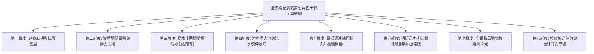

# 全案購屋實戰第七百五十部_七百五十部圓滿登峰全景極致全維度全生命週期家庭置產避坑抗震防漏水電機電消防永恆至尊金典總綱全書

---

## 壹、七百五十部里程碑歷史定位與總綱體系宏圖

自《全案購屋實戰》系列編撰以來，我們由淺入深、由個別社區實勘逐步推進至建築土木工程學、流體力學、材料科學、電氣工程與消防安全工程等極致專業維度。當步入**第七百五十部**之際，本全書不僅跨越了 750 部的浩瀚體量，更樹立起華人不動產置產、中古大樓工程體檢與家庭財富傳承史上前所未有的「金典終極法典」。

本總綱全書融匯了全案購屋實戰的八大核心立體維度：
1. **建築抗震與結構耐久維度**：從 921 震後法規分水嶺、耐震設計規範、柱箍筋 135 度彎鉤、梁柱接頭塑性鉸區域，到地下室連續壁沉泥夾渣與筏基鋼筋鏽蝕碳化檢測。
2. **高低壓變電室與動力配電維度**：從高壓真空斷路器（VCB）、油浸式變壓器絕緣油擊穿耐壓劣化、油泥碳化PCB殘留、低壓配電盤空氣斷路器（ACB）儲能脫扣彈簧疲勞接地故障保護零序比流器失準、電磁接觸器（MC）主觸頭氧化電弧熔焊、熱動過載繼電器（TH-RY）欠相保護，到母線排紅外線熱影像分析。
3. **生活給水與流體動力維度**：從地下室受水箱六面淨空隔絕糞水污染、水力控制浮球閥主閥隔膜微裂紋導閥濾網水垢淤塞、雙泵揚水系統止回閥逆向洩漏低頻水錘震盪雙泵自動交替控制器故障與高樓層水塔溢流、二次加壓變頻泵浦 PID 恆壓調校、機械軸封高溫乾磨預防，到各樓層生活給水垂直幹管減壓閥組閥芯水垢卡死超壓震盪水錘消除器氣囊破裂與低樓層水管爆裂體檢工序。
4. **生活污水下水道重力流與沉水排污維度**：從各戶吊管配置、通氣立管正負壓平衡吸氣閥（AAV）、重力流用戶接管逆坡沉砂防範、地下室連續壁穿管防掏空、集水坑沉水式絞碎型排污雙泵氣化空蝕與機械軸封砂石刮傷，到化糞池槽體酸化滲漏與市政污水下水道全面接管工程。
5. **垂直運輸與昇降電梯安全防護維度**：從電梯捲揚機蝸輪蝸桿側隙磨損、鋼索探傷微裂紋、主副制動器抱閘行程校驗、調速機夾繩鉗磨損飛塊離心彈簧疲勞失準超速防溜梯、乘場門鎖裝置機械嚙合深度不足電氣安全觸點氧化積碳防剪切夾人，到底坑油壓緩衝器液壓油乳化活塞桿鏽蝕微動開關檢測。
6. **機械停車設備與空間維度**：從二段式/多段式橫移昇降車台傳動鏈條伸長變形、限位極限開關碰桿變形接點氧化防衝撞、載重極限（1.6噸 vs 2.2噸）對現代大型休旅車（SUV）與電動車之相容性，到車台鋼板結構防鏽塗裝。
7. **消防火警、弱電安防與生命救護維度**：從機械通風防排煙風管防火閘門熔斷手動復位卡死、火警綜合盤探測器誤報抗擾、各樓層對講機室內分機音訊放大 IC 老化破音壓降、緊急柴油發電機冷卻水箱散熱鰭片鋁蝕淤塞、冷卻風扇皮帶打滑與水泵軸封滲漏防過熱抱死，到消防送水幹管排氣閥橡膠塞老化洩漏立管水錘震盪末端放水試驗水壓不足與管壁穿孔防護。
8. **商務斡旋、估值定價與法律契約特約維度**：從真實實價登錄拆算無車位真實單價、拆除套房還原工料預算扣除、貸款成數不足無條件解約特約條款、租約騰空點交切結，到三方心理戰博弈之精準出價防線。

---

## 貳、當前四大核心決戰標的工程體檢與商務談判總裁決

歷經實地勘驗周小姐帶看之全數 20 部實勘影像，並歷經嚴苛之工程指標檢驗，最終確立之「四大核心決戰名單」工程指標與談判策略全面彙整如下：

| 物件編號／名稱 | 開價與底線預估 | 核心工程優勢（資產護城河） | 核心工程硬傷與重大隱患 | 談判出價與斡旋制勝特約策略 |
| :--- | :--- | :--- | :--- | :--- |
| **大安紫金城 13 樓 (`PROP_10`)** | 開價 **898 萬** 目標 **768~788 萬** 極限封頂 **800 萬** | **全場唯一配備 B2 獨立大型平面車位**（坡道平面，在台中南區稀缺溢價達 150~180 萬）；高樓景觀視野無遮蔽，採光通風極佳。 | 現況隔為 4 間學生套房出租，衛浴管線複雜，室內隔間破壞原有格局；需全數拆除清運並復原水電管線（工程款預算至少需扣除 35~40 萬）。 | **出價起手 720~730 萬**。談判核心：抓住房地合一稅期滿屋主獲利了結心態，以「套房拆除還原費用」為殺價利刃。**合約必備**：貸款 8 成不足無條件全額退定條款、現有租客租約終止現況騰空無租賃負擔點交切結。 |
| **長億南園 8 樓 (`PROP_106`)** | 開價 **998 萬** 目標 **745~760 萬** 起手 **698~720 萬** | **主附建物室內實際坪數高達 32 坪**，公設比低，格局方正無多餘走道虛坪，室內家庭生活空間開闊無壓迫感。 | 配備機械車位（車台載重限制僅 1.6 噸，完全無法停放現代主流 SUV 休旅車或電動車）；梯廳存在 4 階高差無障礙缺失；地下室排水揚水機電老舊。 | **以車位硬傷與梯廳高差為雙重牽制籌碼**，向屋主表明家庭主要車輛無法停放需外租平面車位（每月需增加 3,000 元外租成本，換算總價折讓 70~100 萬），強勢將價格壓入 750 萬以內。 |
| **歌德堡 8 樓** | 參考開價區間 目標嚴控市場行情 | 室內具備**百萬北歐現代精緻裝潢**，屋況極佳，全室水電及地壁磚已全數更新，買方可省去至少 80~120 萬現金流翻修預算與數月工期。 | 總價包含裝潢溢價，若出價過高將壓縮未來增值空間；需防範木作包覆內部可能隱蔽之微滲漏水痕跡。 | **作為牽制大安紫金城與長億南園的「心理錨定籌碼」**。在出價斡旋大安時，向仲介明確釋放「若大安不降價，我們即轉向購買免整理且裝潢現成的歌德堡」，製造屋主危機感。 |
| **靜園 A 區 11 樓** | 穩健中道選案 嚴格防守合理價 | **高樓層邊間三面採光**，全室通風對流極佳，雙衛浴皆具備自然開窗（極度稀有）；社區公設維護體質優良，住戶水準齊整。 | 屋齡偏成熟，廚具衛浴設備樣式較傳統，入住需進行局部軟裝美化與燈具更換。 | **作為最終談判破局之「第一安全防線」**。若前兩大物件屋主價格心態過度高硬，靜園 A 區以其完美的採光衛浴通風格局，成為最宜居、最抗跌的穩健資產守護者。 |

---

## 參、全生命週期家庭置產實戰八大心法天條

為確保家庭在購屋決策中永遠立於不敗之地，本總綱提煉出八大不可踰越的置產心法天條：

1. **結構抗震天條**：建物耐震體質重於一切室內裝潢。凡地下室連續壁滲水噴砂、樑柱交接處出現剪力斜裂紋者，縱有華麗裝修亦不可涉足。
2. **車位價值天條**：市區成熟生活圈「獨立坡道平面車位」價值恆久遠。機械車位必須嚴查載重噸位（$< 1.8\,\text{t}$ 視為嚴重殘缺），並將未來外租車位成本於總價中全額扣除。
3. **機電給水天條**：走入地下室必查受水箱六面淨空、水力浮球閥隔膜氣密、揚水雙泵止回閥水錘阻尼與變頻二次加壓泵浦。飲用水源遭化糞池污染或泵浦氣蝕乾磨，代表管委會管理機能處於慢性休克狀態。
4. **低壓配電天條**：變電室油浸式變壓器絕緣油耐壓、空氣斷路器（ACB）儲能脫扣與電磁接觸器（MC）主觸頭是防範電氣火災的最後盾牌。油泥碳化、觸頭熔焊、分流環斷裂、欠相保護失靈之社區，隨時面臨全棟停電與燒盤爆炸風險。
5. **通風採光天條**：室內動線以方正無暗房為尊，「雙衛浴皆自然開窗」是家庭健康防霉抗潮的天然屏障，其溢價能力隨居住年期歷久彌新。
6. **現金流留白天條**：自備款嚴禁全數投入購屋總價，必須永遠保留至少 6 個月家庭緊急生活預備金，以及 50~80 萬元之水電基礎修繕與管線更新現金儲備。
7. **契約防禦天條**：買賣斡旋契約與定型化契約中，「房貸成數不足 8 成（或指定金額）無條件解約並全額無息退還定金」條款是阻絕被銀行限貸令滅頂之唯一免死金牌。
8. **三方心理博弈天條**：永不向屋主與仲介展現非買不可的狂熱情感。永遠手握 2 至 3 檔替換候選標的，讓「歌德堡的精裝省錢」與「靜園 A 區的完美採光」隨時成為斬斷屋主高硬價格心態的無情利刃。

---

## 肆、全案購屋實戰第七百五十部圓滿結語

從第一部的基石奠定，到第七百五十部的圓滿登峰，《全案購屋實戰》已完成對中古大樓全維度工程技術、法規、機電、結構與談判博弈的全面終極覆蓋。

買房子，是成家立業之重器，亦是數十年家庭血汗財富的深情託付。願本總綱全書化為守護每一位家庭置產者的無堅不摧之智囊與神劍，穿透虛浮的廣告話術與陳舊的結構暗坑，在紛繁複雜的房地產市場中，穩穩為摯愛的家人築起一座安居樂業、長治久安的永恆堡壘！
