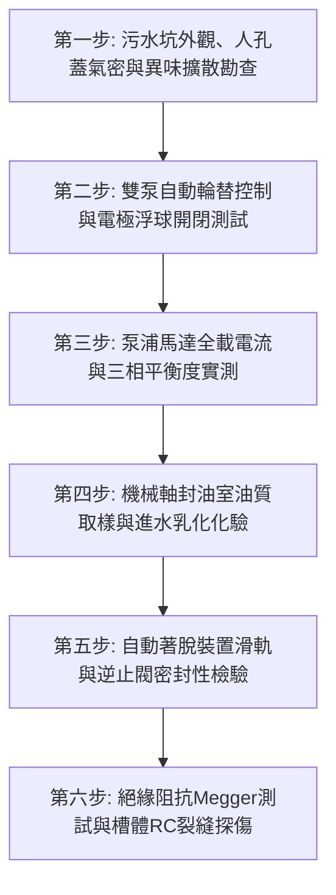

# 全案購屋實戰第七百六十二部_中古大樓社區地下室生活污水下水道用戶接管沉水式絞碎型排污泵浦氣化空蝕機械軸封砂石刮傷與化糞池槽體酸化滲漏體檢工序全書

---

## 壹、核心體檢綱領與歷史案例借鏡

在中古大樓（屋齡 20 至 30 年以上）的地下最深底層（通常位於 B2 或 B3 筏基坑內），「生活污水沉水式絞碎型排污泵浦（Submersible Grinder Sewage Pump）」與「地下污水化糞槽（Septic Tank Sump）」是整棟社區排除家庭衛生紙、排泄物、油脂殘渣與廚房菜屑的「終極消化心臟」。地下室所有低於市政下水道幹管之生活污水，均需匯集於集水坑內，藉由大馬力沉水泵浦將固體雜質絞碎成細微漿狀顆粒後，垂直加壓揚升打入市府下水道接管井。

然而，排污泵浦常年完全浸泡於高濃度硫化氫（$H_2S$）、沼氣（甲烷）、強酸性發酵腐植酸及含有硬質砂石的極端惡劣流體中：
1. **絞碎旋轉刀盤（Cutter Impeller）氣化空蝕與金屬鈍化崩齒**：住戶誤將濕紙巾、衛生棉、塑膠袋甚至裝修泥沙沖入馬桶，硬質纖維纏繞絞刀。加上集水坑水位不足時泵浦啟動，進口吸入大量空氣與沼氣氣泡引發「氣化空蝕（Gaseous Cavitation）」，高達 60HRC 硬度的合金絞刀盤齒刃崩裂鈍化，喪失絞碎能力，導致排污管徑瞬間卡死。
2. **碳化鎢雙組機械軸封（Double Mechanical Seals）砂石刮傷與進水燒毀**：沉水泵浦仰賴軸承油室（Oil Chamber）內之雙端面機械軸封隔絕污水侵入電機內部。當污水中之石英砂粒鑽入動靜環摩擦面，極高硬度的矽砂在碳化鎢鏡面上刮出深層溝痕，油室進水乳化；污水進一步突破第二道軸封滲入馬達定子繞組，引發嚴重的相間短路燒毀與地下室跳電。
3. **老舊混凝土化糞池槽體酸化穿孔與地基惡臭滲透**：未完成污水下水道接管之中古大樓，其地下室 RC 槽體長期承受污水厭氧發酵產生之有機酸侵蝕，混凝土保護層「骨料中性化剝落」，鋼筋裸露鏽蝕膨脹。惡臭糞水順著結構裂縫滲入筏基底部甚至穿透連續壁，造成整棟地下室瀰漫難以消散的死水惡臭，並對建築地基結構產生長久不可逆之腐蝕破壞。

本工序全書旨在建立極致嚴謹的沉水式絞碎型排污泵浦與污水槽體檢工序，捍衛社區衛生環境與地基耐久壽命。

---

## 貳、沉水排污泵浦與槽體酸化力學病理分析

### 一、排污泵固液兩相流氣化空蝕破壞力學
當固液兩相流體中夾帶高濃度氣泡（沼氣）與泥沙時，依據修正瑞利-普勒斯方程（Rayleigh-Plesset Equation）：
$$R \frac{d^2 R}{d t^2} + \frac{3}{2} \left(\frac{d R}{d t}\right)^2 = \frac{1}{\rho_L} \left( P_v - P_\infty + P_{g0} \left(\frac{R_0}{R}\right)^{3\gamma} - \frac{2\sigma}{R} - \frac{4\mu_L}{R}\frac{dR}{dt} \right)$$
高壓區微氣泡瞬間崩潰產生高達 $1000\,\text{m/s}$ 之微射流，衝擊動刃金屬表面，引發劇烈微觀疲勞剝落。泥沙顆粒在微射流加速下形成微觀「噴砂切割效應」，使高鉻合金刀盤在短短 1 至 2 年內磨損殆盡。

### 二、混凝土耐酸性化學侵蝕過程
生活污水中的含硫有機物在硫酸鹽還原菌（SRB）作用下生成硫化氫：
$$\text{有機硫化物} \xrightarrow{\text{SRB}} H_2S \uparrow$$
氣相硫化氫在水箱頂壁凝結，經硫氧化菌（SOB）氧化為高濃度硫酸：
$$H_2S + 2O_2 \xrightarrow{\text{SOB}} H_2SO_4$$
硫酸與混凝土水泥石中的氫氧化鈣 $\text{Ca(OH)}_2$ 劇烈反應生成石膏與鈣礬石（Ettringite）：
$$\text{Ca(OH)}_2 + H_2SO_4 \rightarrow \text{CaSO}_4 \cdot 2H_2O$$
膨脹結晶引發混凝土大面積爆裂剝落，槽體壁厚每年削弱 $3 \sim 5\,\text{mm}$。

---

## 參、實地體檢六大極致檢驗工序

### 工序一：污水集水坑本體、人孔蓋氣密與環境有害氣體檢測
1. **雙層防臭人孔蓋檢視**：集水坑人孔蓋必須為具備防臭橡膠襯墊之重型氣密鑄鐵蓋，四角螺栓緊固無鬆動，嚴禁蓋板翹曲導致惡臭外溢。
2. **有害氣體濃度檢驗**：使用氣體偵測儀在人孔周邊測量，硫化氫 $H_2S$ 必須 $\le 0.1\,\text{ppm}$，甲烷 $CH_4$ 嚴禁超過爆炸下限之 $5\%\,\text{LEL}$。

### 工序二：雙泵自動輪替（Alternating）與液位浮球開關聯動
1. 依序手動抬起「停泵水位（Stop）」、「啟動水位（Start）」與「雙泵並聯警戒水位（High Level）」之防纏繞型浮球開關。
2. **輪替邏輯校驗**：
   - 每次水位升至啟動位，控制盤交替繼電器（Alternating Relay）必須確保 1 號泵與 2 號泵輪流啟動，均衡磨損。
   - 水位達到超高警戒位時，兩台泵浦必須**同時啟動強力排水**，並觸發中央監控室聲光警報。

### 工序三：馬達全負載運轉電流（FLA）與相平衡實測
1. 泵浦抽水排污時，使用鉗形電流表量測三相運轉電流。
2. **電流健康指標**：
   - 實測運轉電流不得超過馬達銘牌標示之額定全載電流（FLA）。
   - 若運轉電流持續超過額定值 20% 以上，代表絞刀盤纏繞纖維雜質或軸承已嚴重磨損抱死。

### 工序四：軸承油室（Oil Casing）絕緣潤滑油取樣透光化驗
1. 將泵浦透過導軌吊起，鬆開軸承油室洩油螺栓，滴出數毫升潤滑油於透明試管。
2. **油質判定標準**：
   - **正常良好**：油質清澈透明或呈微淡黃色，無異味。
   - **乳化進水（Emulsification）**：油質呈現如「拿鐵咖啡」般之乳白色渾濁狀，100% 證明第一道機械軸封已遭砂石磨損穿孔，必須立即大修更換軸封組，嚴禁繼續通電運轉。

### 工序五：自動著脫裝置（Auto-Coupling System）與鴨嘴逆止閥檢核
1. 檢視泵浦沿著雙不鏽鋼導桿（Guide Rail）下滑入定位時，泵浦出水法蘭與底座接頭是否能靠重力無縫咬合，接觸橡膠墊圈無老化撕裂。
2. **垂直管路逆止閥（Check Valve）檢驗**：停泵瞬間檢視逆止閥瓣能否迅速密封，嚴禁有污水倒流回衝集水坑之衝擊水流聲。

### 工序六：馬達冷態絕緣阻抗與化糞槽 RC 壁體結構探傷
1. **絕緣電阻測試**：使用 1000V 高阻計量測馬達電纜各相對大地（外殼）之絕緣阻抗。
   - 浸水運轉標準：絕緣電阻值必須 **$\ge 10\,\text{M}\Omega$**（全新機 $> 100\,\text{M}\Omega$）。若讀數 $< 2\,\text{M}\Omega$，馬達內部已受潮，隨時面臨絕緣擊穿燒毀。
2. **槽體外壁結構探傷**：持強光手電筒檢驗污水槽外露壁面，觀察有無放射狀剪力裂縫與黑色污水滲漏結晶，確認底板無不均勻沉降斷裂。

---

## 肆、社區管委會維護與置產勘查避坑清單

| 檢查項目 | 良好合規狀態（安心置產） | 嚴重劣化徵兆（潛在巨額分攤） | 買方議價與防禦對策 |
| :--- | :--- | :--- | :--- |
| **排污泵浦運轉聲音與震動** | 沉浸水下運轉平順低沉，排污速度迅速，水壓指針穩定 | 運轉時伴隨金屬尖銳摩擦嘶吼聲，電流表指針劇烈擺動，抽水速度極慢 | 絞刀盤已卡死或軸封損壞進水，更換整台工業級絞碎泵浦費用約 4~8 萬元/台 |
| **地下室污水坑氣味** | 坑口密封良好，抽風排氣管正常抽風，地下室無刺鼻糞臭味 | 遠在地下室車道即可聞到濃烈惡臭沼氣，人孔蓋邊緣冒泡流黑水 | 槽體氣密已破壞且通風失效，存在嚴重衛生與沼氣爆炸隱患，扣除公設修繕款 |
| **備份泵浦備援機制** | 1號與2號泵運轉正常，且管委會備有全新原廠絞刀盤與機械軸封耗材 | 其中一台泵浦已燒毀貼上「故障待修」黃標長達半年，全靠單泵硬撐 | 喪失緊急備援能力，一旦單泵燒毀地下室隨時糞水滅頂，管理嚴重失職 |
| **化糞池清理抽水肥頻率** | 社區每年定期抽水肥 1~2 次，並留有環保合格清除發票與照片簽證 | 數年未抽水肥，化糞池頂部結成堅硬厚重浮渣硬塊（Scum），深達數公尺 | 沉水泵浦隨時會被硬塊卡死燒毀，且槽體面臨堵塞溢流，要求清空化糞池 |

---

## 伍、本手冊落地執行結論

沉水式絞碎型排污泵浦，是大樓深處最辛苦、工作環境最極端的「地下清道夫」。它在全封閉的污穢泥淖中，以堅硬的刀刃粉碎雜質，維繫著現代都市大樓的衛生體面。

購屋者在勘驗大樓公共公設時，切勿因厭惡惡臭而跳過污水機房。親自查驗排污控制盤之電流指數、檢視人孔氣密與雙泵交替狀態，是確保家庭未來三十年不受惡臭倒灌、免於負擔公共機電無底洞維修費用的崇高實戰智慧。
