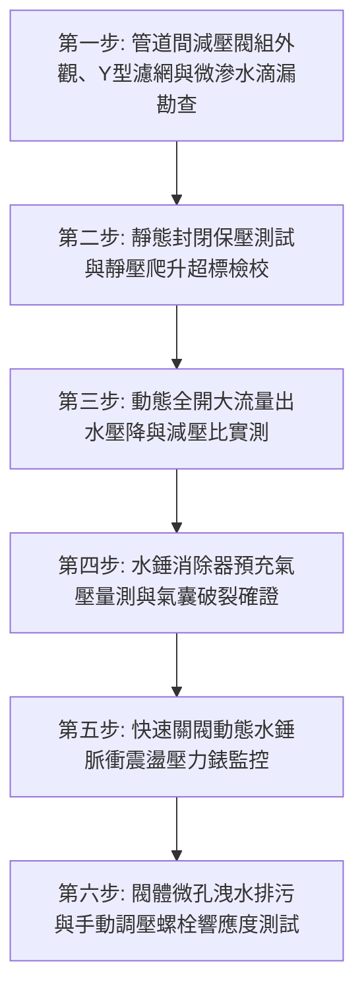

# 全案購屋實戰第七百四十一部_中古大樓社區各樓層生活給水垂直幹管減壓閥組閥芯水垢卡死超壓震盪水錘消除器氣囊破裂與低樓層水管爆裂體檢工序全書

---

## 壹、核心體檢綱領與歷史案例借鏡

在中古高層大樓（屋齡 20 至 30 年以上、樓高 12 至 25 層）的生活自來水給水系統中，由頂樓高位水塔或地下室變頻二次加壓泵浦向下供水時，流體依照重力水頭物理定律，每下降 10 公尺高度即自然產生 $1.0\,\text{kg/cm}^2$（約 $0.1\,\text{MPa}$）之靜水壓。當生活給水垂直立管抵達中低樓層（例如 1 至 6 樓）時，靜水壓力可輕易飆升至 $6.0 \sim 9.0\,\text{kg/cm}^2$ 以上。

如此巨大之高壓水流若直接注入住戶室內，將輕易衝破家庭洗臉盆龍頭軟管、熱水器內膽與逆滲透 RO 淨水器濾殼。因此，大樓在給水管道間各分區管段（通常每隔 4 至 5 層樓）或各戶水錶箱後方，必須配置「直接作用式或導閥引導式減壓閥組（Pressure Reducing Valve, PRV）」與「水錘消除器（Water Hammer Arrestor）」，強制將入戶水壓穩定減壓並鉗制在極致舒適安全之 **$2.0 \sim 3.0\,\text{kg/cm}^2$**。

然而，中古大樓常年處於缺乏專業拆解檢驗與阻尼校驗的盲區中，給水減壓管網普遍面臨四大致命破壞：
1. **減壓閥內部閥芯（Valve Spool / Piston）碳酸鈣水垢結晶結石卡死**：自來水中溶解的鈣鎂離子在減壓節流口的高剪切區沉澱析出，硬質碳酸鈣（$\text{CaCO}_3$）水垢將不鏽鋼閥芯與青銅導向套死死咬合卡住。閥芯喪失軸向滑動調節能力，要麼卡死於「微開狀態」導致全戶水壓微弱如涓滴，要麼卡死於「全開狀態」使高達 $8\,\text{kg/cm}^2$ 的致命靜水壓全額灌入室內。
2. **調壓不鏽鋼彈簧應力腐蝕疲勞與膜片穿孔**：減壓閥內部的調壓大彈簧在長達 20 餘年的恆定高壓壓縮下產生金屬潛變（Creep），剛度係數衰減；強化三元乙丙橡膠（EPDM）隔膜受自來水餘氯侵蝕變薄穿孔，使平衡背壓喪失，輸出水壓產生劇烈飄移與超壓震盪。
3. **管壁水錘消除器（Water Hammer Arrestor）橡膠氣囊破裂充水失效**：各戶龍頭或洗衣機電磁閥快速關閉時產生之極速水錘壓力波（波速 $> 1000\,\text{m/s}$），本應由減壓閥旁之水錘消除器氣囊吸收。然而中古大樓的水錘器內部丁基橡膠氣囊早已老化破裂，內部預充之高壓氮氣漏光並注滿死水，徹底喪失空氣彈簧緩衝機能。
4. **超壓震盪引發低樓層水管爆裂與室內「水淹金山寺」**：當水錘消除器失效且減壓閥卡死全開時，深夜尖峰用水結束後管路水壓驟升，疊加水錘脈衝壓力波，瞬間峰值突破 $15\,\text{kg/cm}^2$。低樓層住戶廚房流理台下之老舊編織軟管接頭瞬間脫落爆開，高壓水流日夜狂噴數百噸，毀壞全室百萬裝潢與木地板，水流更順著樓板接縫滲透灌入下方鄰居家及電梯昇降路，釀成無法挽回之巨額鄰損賠償。

本工序全書旨在建立極致嚴謹的各樓層生活給水減壓閥組與水錘消除器體檢工序，捍衛住戶家居水電資產之絕對安全。

---

## 貳、減壓閥水力平衡與水錘衝擊破壞病理機制

### 一、直接作用式減壓閥力矩平衡方程式
減壓閥閥芯之開度平衡取決於調壓彈簧力、出口水壓反力與膜片受力平衡：
$$F_{\text{net}} = F_{\text{spring}} - P_{\text{out}} \cdot A_{\text{diaphragm}} - F_{\text{friction}}$$
- $F_{\text{spring}}$：頂部調壓螺栓設定之彈簧預緊力。
- $P_{\text{out}}$：減壓閥出口端水壓。
- $A_{\text{diaphragm}}$：橡膠隔膜有效受壓面積。
- $F_{\text{friction}}$：閥芯密封環（O-Ring）與金屬導套間之摩擦阻力。

**病理破壞演變**：
當碳酸鈣水垢附著於閥軸表面時，靜摩擦力 $F_{\text{friction}}$ 暴增數十倍，遠超彈簧微調力。閥芯陷入「遲滯非線性區（Hysteresis Zone）」；當住戶關閉水龍頭瞬間，靜態水壓滲透洩漏，出口壓力 $P_{\text{out}}$ 失去控制，在靜止狀態下直通一次側高壓（稱為「靜壓失控爬升」），達到與進口壓力相同之破壞性高壓。

### 二、水錘脈衝壓力峰值破壞力學
依據流體彈性理論（Joukowsky Equation），水龍頭電磁閥在微秒級（$\Delta t < 2L/a$）快速關閉時：
$$P_{\text{peak}} = P_{\text{static}} + \Delta P_{\text{hammer}} = P_{\text{static}} + \rho \cdot a \cdot v_0$$
- $\rho \approx 1000\,\text{kg/m}^3$。
- $a \approx 1200\,\text{m/s}$（水在鋼管中之壓力波速）。
- $v_0$：管內原始流速（約 $1.5 \sim 2.5\,\text{m/s}$）。
瞬間壓力增量 $\Delta P_{\text{hammer}}$ 可達 **$18 \sim 30\,\text{bar}$（$18 \sim 30\,\text{kg/cm}^2$）**。如此強大的液壓衝擊波在薄弱的 PVC 膠合接頭或編織軟管壓接套管處產生環向拉應力 $\sigma_\theta = P \cdot D / (2e)$，瞬間超過材料降伏強度，引發脆性爆管斷裂。

---

## 參、實地體檢六大極致檢驗工序

### 工序一：管道間減壓閥組外觀、旁通管路與前置過濾器盤查
1. **閥組三閥配置檢驗**：標準優良給水減壓管網必須配置「主減壓閥、旁通管路（Bypass Line）與前後隔離球閥」，確保減壓閥故障維修時不停水。
2. **前置 Y 型過濾器（Y-Strainer）檢查**：減壓閥進口前端必須安裝 60 目不鏽鋼過濾器，檢查排污螺塞有無生鏽漏水痕跡；若未安裝過濾器，自來水鐵渣將直接鑽入減壓閥拉傷閥芯。

### 工序二：靜態保壓（Static Lock-up Pressure）與靜壓爬升檢驗
1. 在各戶水錶箱後方裝設經校驗之高精度甘油指針壓力錶（精度 0.5 級）。
2. **靜態密封保壓實測**：
   - 關閉戶內所有水龍頭與用水設備，靜置 30 分鐘，密切觀察指針壓力錶讀數。
   - **合格標準**：靜態壓力必須穩定恆定在 **$2.0 \sim 3.0\,\text{kg/cm}^2$** 之間，無任何向上攀升跡象。
   - **靜壓爬升（Creeping）故障判定**：若指針在關閥後緩慢且持續向上漂移，最終超過 **$4.5\,\text{kg/cm}^2$** 並逼近管道總立管壓力，100% 確診為減壓閥橡膠閥墊磨損或閥芯水垢卡死，失去靜態密封截止能力。

### 工序三：動態全開大流量壓降（Dynamic Flowing Pressure）測試
1. 同時全開室內衛浴浴缸龍頭與面盆龍頭（模擬家庭尖峰用水流量，流量約 $30 \sim 50\,\text{L/min}$）。
2. **動態減壓穩定度考核**：
   - 水壓跌落值（動態壓降 $\Delta P$）不得超過靜態設定值的 **$20\%$**（即出水動壓應維持在 $1.8 \sim 2.4\,\text{kg/cm}^2$）。
   - 若出水瞬間指針直接暴跌至 $< 0.8\,\text{kg/cm}^2$ 且出水極微弱，代表閥芯內部結石嚴重堵塞，有效流通面積被削弱。

### 工序四：活塞/氣囊式水錘消除器（Arrestor）預充氣壓量測
1. 檢視安裝於減壓閥出口端或各戶立管頂端之不鏽鋼水錘吸收器。
2. **胎壓計實測氣嘴氣壓**：在關閉主水源並排空管內水壓後，使用數位胎壓計量測水錘器充氣閥門氣壓。
   - **標準預充氣壓**：預充氮氣或空氣壓力必須維持在系統工作水壓的 **$80\% \sim 90\%$（通常為 $2.0 \sim 2.5\,\text{kg/cm}^2$）**。
   - **氣囊破裂確診**：若按壓氣嘴頂針時有「水珠或水柱噴射而出」，代表內部隔膜氣囊已破裂穿孔，水錘消除器已徹底癱瘓化為死金屬罐，必須立即更換新品。

### 工序五：急遽關閉閥門水錘衝擊波（Hammer Shock）實測
1. 在室內面盆安裝快開快關陶瓷閥芯水龍頭，在全流量出水狀態下以 **$0.2$ 秒極速瞬間拍下關閉**。
2. **衝擊壓力動態判定**：
   - 觀察減壓閥後方壓力錶指針擺動幅度。
   - 合格標準：指針瞬間衝高幅度不得超過工作壓力的 **$1.3$ 倍（$\le 3.5\,\text{kg/cm}^2$）**，管路無劇烈金屬撞擊巨響，管身無明顯跳動。
   - 嚴重危險：若指針瞬間狂甩爆錶（$> 8.0\,\text{kg/cm}^2$）並伴隨管道間傳出「咚！」之巨大水錘撞擊震顫，代表水錘消除器完全失效，管件正承受極限破壞應力。

### 工序六：閥芯手動調壓螺栓響應度與微孔排污試驗
1. 鬆開減壓閥頂部鎖緊螺帽，以六角扳手順時針（升壓）及逆時針（降壓）旋轉調壓螺栓各 1 至 2 圈。
2. **調壓靈敏度考核**：出水水壓指針必須即時、平穩隨之線性升降；若旋轉螺栓後水壓毫無變化，或突然暴衝失控，代表彈簧已斷裂或調節滑塊螺牙滑絲。

---

## 肆、社區管委會維護與置產勘查避坑清單

| 檢查項目 | 良好合規狀態（安心置產） | 嚴重劣化徵兆（潛在巨額分攤） | 買方議價與防禦對策 |
| :--- | :--- | :--- | :--- |
| **管道間減壓閥組外觀** | 閥體採用純青銅或 SUS316 不鏽鋼，表面清潔無銅綠，標示調定水壓清晰 | 鑄鐵閥體大面積生鏽剝落、接頭嚴重滲水滴漏，管道間地坪長滿青苔積水 | 閥體內部已嚴重鏽蝕結石，隨時面臨破裂噴水，整組更換進口減壓閥需 2~4 萬元 |
| **室內用水水壓體驗** | 開啟水龍頭水流飽滿柔和，關閉時無震動聲；熱水器點火迅速無忽冷忽熱 | 水流狂噴如高壓清洗機，洗手濺得滿身濕；關水瞬間牆壁內部發出巨大撞擊震動 | 減壓閥已完全失控全開，全室水管隨時爆裂，必須立即重新配置減壓閥 |
| **熱水器安全閥（洩壓閥）狀態** | 儲熱式或瓦斯熱水器下方之安全洩壓閥乾燥無滴漏，管路冷熱平衡 | 安全閥日夜持續向外噴射漏水，熱水器外殼微微膨脹變形，水溫調控失常 | 入戶水壓已突破熱水器耐壓極限（$> 5\,\text{kg/cm}^2$），存在內膽爆裂燙傷危險 |
| **低樓層住戶爆管歷史** | 社區歷年無管道間或室內水管爆管淹水紀錄，管委會定期推動減壓閥保養 | 社區 1~4 樓曾發生多次住戶不在家時水管爆開淹水慘案，引發管委會互告賠償 | 社區垂直幹管減壓系統處於全面崩潰狀態，低樓層標的必須列入重大風險防範 |

---

## 伍、本手冊落地執行結論

生活給水減壓閥組與水錘消除器，是守護現代高層住宅水管生命的「心血管減壓神經」。它在陰暗狹窄的管道間內，以精密的彈簧與水力膜片平衡，默默阻擋著數十米高聳水柱的萬鈞重力；而一顆老化的閥芯、一只破裂的水錘氣囊，隨時能在深夜睡夢中引發數十噸洪水的狂暴破壞，將數百萬精美裝潢毀於一旦。

購屋者在勘驗大樓物件（特別是 1 至 6 樓中低樓層標的）時，務必攜帶便攜式指針壓力錶實測入戶靜水壓力，並在廚房衛浴快速開關水龍頭傾聽牆內是否有水錘震顫。唯有水壓恆定、脈動溫和的管網體質，才是守護家庭財富與安寧歲月的堅實護城河。
