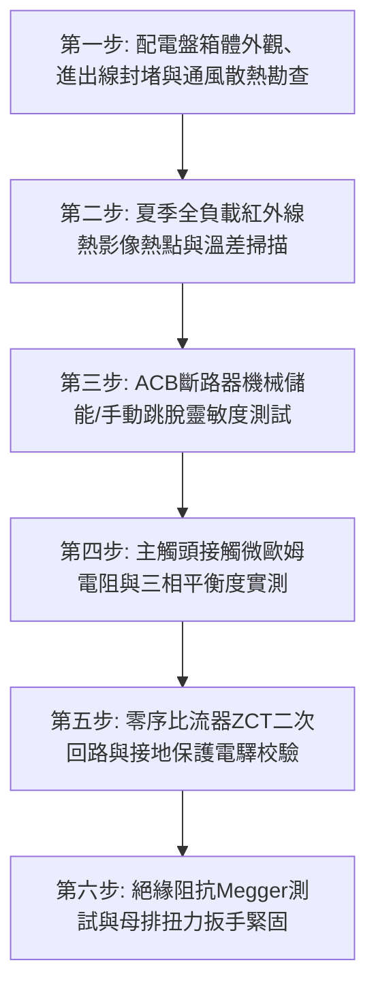

# 全案購屋實戰第七百四十三部_中古大樓社區低壓配電盤空氣斷路器過電流脫扣機構彈簧疲勞接地故障保護零序比流器失準與母線排過熱體檢工序全書

---

## 壹、核心體檢綱領與歷史案例借鏡

在中古大樓（屋齡 20 至 30 年以上）的公共電氣供電體系中，位於地下室總配電變電室之「低壓主配電盤（Main Low Voltage Switchboard, MSB）」，是承接變壓器降壓後數千安培大電流、再分派輸送至全社區各棟各戶與公設機電的「總電源閘門」。而在這座龐大配電盤的核心咽喉處，守護整座大樓不受短路火災吞噬的第一道重裝甲開關，即為**空氣斷路器（Air Circuit Breaker, ACB）**。

空氣斷路器（ACB）具備極高之極限短路啟斷容量（Icu，通常高達 50kA 至 85kA 以上），其內部結構包含精密複雜的機械儲能機構（Charging Mechanism）、跳脫脫扣連桿（Trip Latch）、滅弧柵室（Arc Chutes）與智慧型電子式脫扣控制器（Electronic Trip Unit / OCR）。

然而，中古大樓常年處於缺乏專業甲級電氣承裝業停電大保養（Preventive Overhaul）的盲區中，低壓主盤普遍面臨四大致命破壞：
1. **合閘與跳脫儲能彈簧（Charging & Trip Springs）金屬晶格疲勞衰退**：ACB 內部的重型合金彈簧在長達數十年的恆定受壓與拉伸下，金屬彈性模數逐漸疲勞衰減；加之軸銷轉軸之潤滑硬脂酸鋰黃油在高溫乾燥環境下硬化凝固成乾硬蠟塊。當大樓發生重大短路故障時，跳脫連桿受阻無法在規定的 **3 至 5 個週波（Cycles，約 50~80ms）**內快速彈開，引發毀滅性金屬電弧噴濺與相間爆裂。
2. **接地故障保護（Ground Fault Protection）零序比流器（ZCT）信號失準**：大樓公設給水泵浦或住戶端發生單相接地漏電時，若零序比流器（ZCT）二次側感應線圈匝間受潮短路，或穿心電纜中性線（N）未同步穿過造成向量相消錯誤，接地電驛（GF Relay）完全失明無法送出跳脫信號，使地下室管路與金屬配電箱體常態帶有數十伏特至上百伏特之致命浮接對地電壓。
3. **主母線銅排（Copper Busbars）螺栓接點熱膨脹鬆弛與極限過熱**：配電盤主母線長年承載夏季數百戶冷氣同時開機之尖峰用電，銅排接點承受數千次熱脹冷縮循環。早期未採用標準碟形彈簧華司（Belleville Washers）緊固的螺栓接點接觸阻抗激增（由微歐姆級飆升至毫歐姆級），在 $P = I^2 R$ 焦耳熱效應下，接頭溫度狂飆至 $120^\circ\text{C}$ 以上，支撐絕緣子炭化破壞，引發相間金屬直接短路大爆炸。
4. **滅弧室金屬柵片（De-ion Arc Chute Plates）銅蒸氣沉積短路**：ACB 歷經多次正常負載啟斷與小額過載電弧後，高溫電弧噴發之金屬微粒沉積於石棉與陶瓷柵板表面，滅弧柵絕緣阻抗大幅崩潰。當遭遇真正短路電流時，滅弧室無法及時將電弧拉長、冷卻與熄滅，電弧外溢引發配電盤弧光爆炸（Arc Flash），整個變電室瞬間化為火海廢墟。

本工序全書旨在建立極致嚴謹的低壓配電盤 ACB、ZCT 接地保護與母線排熱影像體檢工序，捍衛大樓供電心臟之絕對安全。

---

## 貳、空氣斷路器開斷電弧與母線排焦耳熱破壞力學分析

### 一、短路電弧熄滅水力學與電磁力分析
短路發生時，ACB 動靜觸頭分開瞬間產生的電弧電壓 $V_{\text{arc}}$：
$$V_{\text{arc}} = V_c + V_a + \int_0^L E(x) \, dx$$
- $V_c, V_a$：陰極與陽極壓降。
- $E(x)$：弧柱電場強度。
- $L$：電弧長度。

**病理破壞分析**：
滅弧室利用鐵磁金屬柵片的電磁吸力（Lorentz Force）將電弧迅速拉入柵片間隙分割為數十個短弧，使總電弧電壓大於電網峰值電壓強迫電弧過零熄滅。若柵板被金屬氧化物導電短路，電弧在柵外燃燒無法熄滅，產生溫度高達 **$10000^\circ\text{C} \sim 20000^\circ\text{C}$** 的等離子氣體，箱內空氣瞬間劇烈熱膨脹，配電盤鋼板門扇被氣壓直接炸飛撕裂。

### 二、母線排接點接觸阻抗與溫升發熱計算
母線排螺栓搭接面之接觸電阻 $R_{\text{contact}}$：
$$R_{\text{contact}} = \frac{\rho_c}{\sum A_{\text{true}}} = \frac{\rho_c}{\xi \cdot (F_{\text{bolt}} / H_{\text{copper}})}$$
- $\rho_c$：表面氧化膜電阻率。
- $F_{\text{bolt}}$：螺栓軸向夾緊力。
- $H_{\text{copper}}$：銅材布氏硬度。

**鬆弛發熱連鎖反應**：
當螺栓預緊力 $F_{\text{bolt}}$ 因長期熱震動衰減 40% 時，真實金屬接觸微斑點面積 $\sum A_{\text{true}}$ 急劇縮小，接觸電阻激增 3 倍以上。在 $2000\,\text{A}$ 滿載電流下，單一搭接點發熱功率 $P = I^2 R$ 瞬間產生數百瓦純熱量，金屬表面迅速氧化生成高電阻的黑色氧化銅（CuO），引發無法自行遏止之「熱失控（Thermal Runaway）」。

---

## 參、實地體檢六大極致檢驗工序

### 工序一：配電盤箱體密封、防火泥與凝結水防護盤查
1. **電纜孔防火泥（Firestop Putty）密封**：檢查配電盤底部所有進出電纜穿孔，必須以厚度 $\ge 150\,\text{mm}$ 之耐火防蟲泥嚴密填實，防止地下室潮氣或老鼠鑽入造成母排短路。
2. **凝結水與濕度檢驗**：持強光手電筒檢驗盤體內頂板，嚴禁有露珠凝結或鏽蝕水痕；盤內必須配備恆溫恆濕自動控制之加熱器（Space Heater），維持濕度 $\le 60\%$。

### 工序二：尖峰負載紅外線熱影像（Thermography）精密掃描
1. 於夏季用電尖峰時段（全社區負載率 $\ge 60\%$），使用高解析度紅外線熱像儀掃描 ACB 一次側進線排、二次側出線排與各分路連接點。
2. **溫差判定標準（依 NETA MTS 規範）**：
   - **$\Delta T \le 3^\circ\text{C}$**：正常優良，維持定期追蹤。
   - **$4^\circ\text{C} \le \Delta T \le 15^\circ\text{C}$**：中度發熱，存在螺栓鬆動或氧化，排入下次計畫停電重新鎖固。
   - **$\Delta T > 15^\circ\text{C}$ 或絕對溫度 $> 90^\circ\text{C}$**：嚴重致命危險！必須立即通報並緊急採取降載措施，安排緊急停電檢修，防範爆炸。

### 工序三：空氣斷路器（ACB）手動/電動儲能與瞬時跳脫測試
1. **抽拔式（Draw-out Type）滑軌檢查**：將 ACB 搖出至「測試（Test）」位置，檢驗導向軌道與主插頭鍍銀層磨損狀況。
2. **儲能與脫扣手感動作測試**：
   - 轉動手動儲能手柄數次，儲能指示標誌必須清脆跳為黃色「CHARGED（已儲能）」。
   - 按下綠色合閘按鈕，機構必須在 **$0.05$ 秒內**發出清脆響亮之「喀嚓！」一聲緊密閉合。
   - 按下紅色跳脫按鈕，斷路器必須瞬間解扣彈開，無任何卡滯、沉悶或半跳現象。

### 工序四：主觸頭微歐姆（Micro-ohm）直流接觸電阻精確量測
1. 在停電狀態下，使用專用數位式數位微歐姆計（DLRO，注入不低於 100A DC 測試電流），測量三相主觸頭在完全閉合時之接觸阻抗。
2. **數值標準**：
   - 額定 1600A~3200A 之 ACB 主極接觸電阻通常必須 **$< 35\,\mu\Omega$**。
   - 三相間接觸阻抗不平衡率嚴禁超過 **$10\%$**。

### 工序五：零序比流器（ZCT）穿心線路與接地電驛（GFR）連鎖校驗
1. **ZCT 穿線合規性查驗**：三相四線制系統中，A、B、C 三相主導線與中性線（N）必須**全部、同方向同時穿過 ZCT**；設備接地線（PE）嚴禁穿過 ZCT。
2. **二次側信號注入測試**：使用專用繼電器測試儀向接地故障電驛注入模擬單相接地漏電電流（如設定值 30A/0.2s）。
   - 考核標準：電驛必須精準在 **$0.2$ 秒內**發出脫扣信號，帶動 ACB 之分勵脫扣器（Shunt Trip Device）切斷主開關。

### 工序六：絕緣耐壓阻抗量測與母線高張力螺栓扭力校驗
1. **高壓絕緣電阻測試**：使用 1000V DC 高阻計量測相與相之間、相與大地（外殼盤體）之間之絕緣電阻，測試值必須 **$\ge 100\,\text{M}\Omega$**（法規最低極限 $\ge 1\,\text{M}\Omega$）。
2. **扭力扳手校緊（Torque Verification）**：使用校準合格之絕緣扭力扳手，對母線排搭接螺栓進行抽檢緊固：
   - M10 螺栓扭力標準：**$45 \sim 50\,\text{N}\cdot\text{m}$**。
   - M12 螺栓扭力標準：**$75 \sim 85\,\text{N}\cdot\text{m}$**。所有螺栓均需重新標註防鬆防篡改紅色扭力標記線（Torque Seal Line）。

---

## 肆、社區管委會維護與置產勘查避坑清單

| 檢查項目 | 良好合規狀態（安心置產） | 嚴重劣化徵兆（潛在巨額分攤） | 買方議價與防禦對策 |
| :--- | :--- | :--- | :--- |
| **ACB 品牌、出廠年限與備品** | 採用國際頂級一線品牌（施耐德/ABB/三菱等），出廠未滿 15 年，附原廠檢驗合格單 | 採用早已倒閉停產之雜牌斷路器，面板液晶死機破裂，機電廠商明言「已無零件可修」 | 面臨無法維修之大停電風險，整台更換進口智慧型 ACB 費用高達 25~45 萬元 |
| **紅外線熱影像定期簽證** | 每年定期實施全盤紅外線熱顯影檢測，附有完整各回路熱圖，無任何 $\Delta T > 5^\circ\text{C}$ 熱點 | 管委會從未實施熱影像檢驗，甚至配電盤內有撲鼻之塑膠燒焦味，銅排嚴重發紫變色 | 存在一級電氣火災爆炸隱患，列入重大公共安全折讓，要求出賣人提供修繕保證 |
| **接地故障保護系統機能** | 接地保護電驛設定參數清晰，ZCT 二次回路接線牢固，接地電阻實測 $< 10\,\Omega$ | 接地電驛面板長年亮「FAULT」紅燈卻無人理會，甚至控制回路保險絲被直接拔除 | 漏電保護機制已徹底崩潰，全社區機電設備金屬外殼帶電，存在人命觸電危險 |
| **配電室環境衛生與門禁** | 配電室重鎖管制、地面乾淨如無塵室，無鼠跡蟲糞，排風機溫控運轉良好 | 配電室堆滿管委會廢棄物與打掃工具，盤底有老鼠骨骸死屍，濕氣瀰漫牆面發霉 | 機電管理嚴重失能，老鼠咬破電纜引發全棟爆炸事故機率極高，列入嚴重瑕疵 |

---

## 伍、本手冊落地執行結論

低壓主配電盤與空氣斷路器（ACB），是維繫現代社區文明運轉的「供電咽喉動脈」。它在安靜的變電室深處，以堅固的鋼鐵結構與精密的電磁力學，吞吐著數千安培的澎湃電流，守護著千家萬戶燈火通明的安寧生活；而一組疲勞卡死的儲能彈簧、一顆高溫鬆動的母線螺栓，就能在毫秒之間將整座地下變電中樞化為火海焦土。

購屋者在實地驗屋評估大樓公共公設時，走入地下變電室親眼審視紅外線熱檢報告、檢驗 ACB 儲能標誌與母排銅面成色，是穿透大樓表面虛華包裝、確保家庭置產財富免於無底洞機電搶修分攤的至高實戰智慧。
